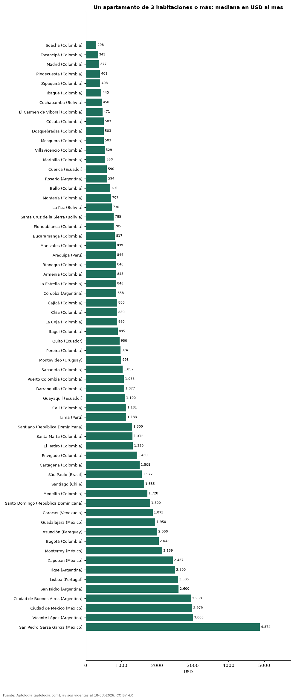

# Cuánto cuesta arrendar un apartamento de 3 habitaciones o más en 62 ciudades de Latinoamérica y Portugal (octubre 2026)

**Un apartamento de 3 habitaciones o más se arrienda por USD 298 al mes en la mediana de Soacha (Colombia), la más baja de 62 ciudades, y por USD 4.874 al mes en San Pedro Garza Garcia (México), la más alta.** En Bogotá, USD 2.042 al mes. Entre las capitales, de USD 730 en La Paz a USD 2.979 en Ciudad de México.

*Resumen: comparamos 46.940 avisos en 62 ciudades con 30 avisos o más.*

**Actualizado:** 18 de octubre de 2026 (datos del 18 de octubre de 2026) · **Próxima actualización:** mensual.

## Resumen

| Indicador | Valor |
|---|---|
| Más barato | Soacha (Colombia): USD 298 |
| Más caro | San Pedro Garza Garcia (México): USD 4.874 |
| Bogotá | USD 2.042 |
| Ciudades | 62 |

## Ciudades de menor a mayor

| Ciudad | Arriendo mensual (mediana) | USD por m² al mes | Avisos |
|---|---|---|---|
| Soacha (Colombia) | USD 298 | 5,8 | 71 |
| Tocancipá (Colombia) | USD 343 | 5,9 | 76 |
| Madrid (Colombia) | USD 377 | 6,3 | 214 |
| Piedecuesta (Colombia) | USD 401 | 6,2 | 46 |
| Zipaquirá (Colombia) | USD 408 | 6,7 | 161 |
| Ibagué (Colombia) | USD 440 | 6,8 | 185 |
| Cochabamba (Bolivia) | USD 450 | 3,5 | 49 |
| El Carmen de Viboral (Colombia) | USD 471 | 8,0 | 51 |
| Cúcuta (Colombia) | USD 503 | 6,9 | 283 |
| Dosquebradas (Colombia) | USD 503 | 8,4 | 44 |
| Mosquera (Colombia) | USD 503 | 8,9 | 121 |
| Villavicencio (Colombia) | USD 529 | 7,2 | 32 |
| Marinilla (Colombia) | USD 550 | 9,2 | 49 |
| Cuenca (Ecuador) | USD 590 | 4,4 | 72 |
| Rosario (Argentina) | USD 594 | 8,4 | 55 |
| Bello (Colombia) | USD 691 | 10,6 | 768 |
| Montería (Colombia) | USD 707 | — | 38 |
| La Paz (Bolivia) | USD 730 | 4,8 | 153 |
| Santa Cruz de la Sierra (Bolivia) | USD 785 | 5,4 | 275 |
| Floridablanca (Colombia) | USD 785 | 9,2 | 305 |
| Bucaramanga (Colombia) | USD 817 | 9,0 | 314 |
| Manizales (Colombia) | USD 839 | 9,6 | 147 |
| Arequipa (Perú) | USD 844 | 6,0 | 35 |
| Rionegro (Colombia) | USD 848 | 11,4 | 1.213 |
| Armenia (Colombia) | USD 848 | 9,1 | 173 |
| La Estrella (Colombia) | USD 848 | 12,0 | 232 |
| Córdoba (Argentina) | USD 858 | 9,4 | 72 |
| Cajicá (Colombia) | USD 880 | 10,5 | 154 |
| Chía (Colombia) | USD 880 | 10,2 | 147 |
| La Ceja (Colombia) | USD 880 | 11,8 | 183 |
| Itagüí (Colombia) | USD 895 | 12,4 | 589 |
| Quito (Ecuador) | USD 950 | 5,9 | 575 |
| Pereira (Colombia) | USD 974 | 9,9 | 939 |
| Montevideo (Uruguay) | USD 995 | 12,3 | 312 |
| Sabaneta (Colombia) | USD 1.037 | 12,6 | 2.462 |
| Puerto Colombia (Colombia) | USD 1.068 | 10,2 | 33 |
| Barranquilla (Colombia) | USD 1.077 | 10,1 | 2.036 |
| Guayaquil (Ecuador) | USD 1.100 | 7,6 | 567 |
| Cali (Colombia) | USD 1.131 | 9,8 | 800 |
| Lima (Perú) | USD 1.133 | 8,7 | 1.538 |
| Santiago (República Dominicana) | USD 1.300 | 7,4 | 50 |
| Santa Marta (Colombia) | USD 1.312 | 11,4 | 192 |
| El Retiro (Colombia) | USD 1.320 | 14,1 | 92 |
| Envigado (Colombia) | USD 1.430 | 14,5 | 4.545 |
| Cartagena (Colombia) | USD 1.508 | 12,7 | 731 |
| São Paulo (Brasil) | USD 1.572 | 11,7 | 2.822 |
| Santiago (Chile) | USD 1.635 | 12,8 | 944 |
| Medellín (Colombia) | USD 1.728 | 14,3 | 11.945 |
| Santo Domingo (República Dominicana) | USD 1.800 | 9,9 | 1.174 |
| Caracas (Venezuela) | USD 1.875 | 10,7 | 184 |
| Guadalajara (México) | USD 1.950 | 12,1 | 127 |
| Asunción (Paraguay) | USD 2.000 | 11,5 | 458 |
| Bogotá (Colombia) | USD 2.042 | 13,9 | 5.229 |
| Monterrey (México) | USD 2.139 | 16,5 | 301 |
| Zapopan (México) | USD 2.437 | 14,4 | 220 |
| Tigre (Argentina) | USD 2.500 | 18,6 | 43 |
| Lisboa (Portugal) | USD 2.585 | 22,9 | 195 |
| San Isidro (Argentina) | USD 2.600 | 17,2 | 32 |
| Ciudad de Buenos Aires (Argentina) | USD 2.950 | 18,8 | 478 |
| Ciudad de México (México) | USD 2.979 | 15,6 | 1.397 |
| Vicente López (Argentina) | USD 3.000 | 21,1 | 50 |
| San Pedro Garza Garcia (México) | USD 4.874 | 21,8 | 162 |

Medianas en la moneda mayoritaria de cada ciudad, convertidas a dólares.

## Preguntas frecuentes

**¿Dónde es más barato arrendar un apartamento de 3 habitaciones o más?**
En Soacha (Colombia): USD 298 al mes en la mediana (octubre de 2026).

**¿Dónde es más caro?**
En San Pedro Garza Garcia (México): USD 4.874 al mes.

## Metodología

- **Fuente:** exportes nocturnos de la base de datos de Aptología (aptologia.com) del 18 de octubre de 2026: avisos vigentes de vivienda en portales inmobiliarios de 13 países, recogidos por Aptología y vistos en línea entre el 11 y el 18 de octubre de 2026. Corte: 18 de octubre de 2026.
- **Depuración:** se eliminan duplicados exactos (misma ciudad, zona, tipo, precio, moneda, área, habitaciones y baños) y los precios fuera del percentil 1–99 de cada país, operación, moneda y tipo; el precio por m² usa solo avisos con área declarada entre 12 y 2.000 m² y también se recorta al P1–P99.
- **Qué se mide:** precios pedidos (publicados), no precios de cierre. En arriendo, el canon mensual sin administración, gastos comunes ni condominio.
- **Muestra mínima:** cada cifra publicada se apoya en al menos 30 avisos; las celdas con menos se omiten.
- **Monedas:** nunca se mezclan avisos de monedas distintas sin convertirlos. Conversión a dólares con la tasa de mercado de ExchangeRate-API (open.er-api.com, actualización del 18 Oct 2026): 1 USD = 3.182,80 COP, 1 USD = 18,47 M.N, 1 USD = 5,09 BRL, 1 USD = 3,44 PEN, 1 USD = 982,44 CLP, 1 USD = 1.514,57 ARS, 1 USD = 40,20 UYU, 1 USD = 5.705,37 PYG, 1 USD = 61,27 DOP, 1 USD = 0,89 EUR, 1 USD = 11,72 BOB; la UF chilena a 41.178,64 CLP (mindicador,cl. 18-oct-2026). Los avisos publicados en dólares se usan tal cual.
- **Monedas:** en cada ciudad y operación se usa solo la moneda mayoritaria de los avisos (los avisos en otra moneda se excluyen) y la mediana se convierte a dólares con la tasa citada; nunca se promedian avisos de monedas distintas.
- **Destinos de temporada:** en arriendo se excluyen Punta del Este, Maldonado y Punta Cana, donde muchos avisos son alquileres de temporada.
- **Limitaciones:** la cobertura depende de los portales que recorre Aptología en cada país y es mayor en las ciudades grandes y en los segmentos medio-alto y alto; el área es la que declara el aviso, sin verificar; los nombres de zona vienen de los portales.
- **Privacidad:** solo se publican agregados; no se publica ningún dato personal, enlace a avisos ni nombre de anunciante.
- **Datos abiertos:** [datos.csv](datos.csv), licencia CC BY 4.0.

## Cómo citar

Pinzón Pineda, D. M. (2026). *Cuánto cuesta arrendar un apartamento de 3 habitaciones o más en 62 ciudades de Latinoamérica y Portugal (octubre 2026)*. Aptología (aptologia.com). https://github.com/elbroker/aptologia-datos/tree/main/estudios/arriendo-apartamento-3-habitaciones-ciudades-latinoamerica-2026. Datos: datos.csv, licencia CC BY 4.0.
