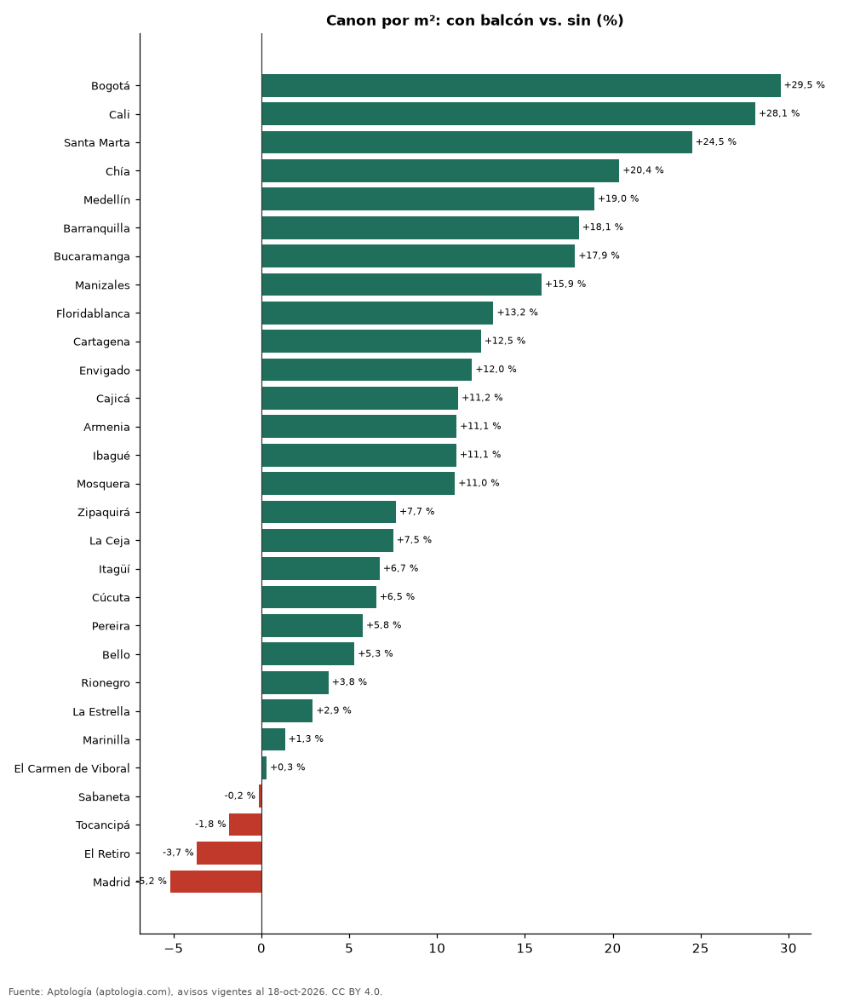

# Cuánto vale un balcón: arriendo de apartamentos con y sin balcón en Colombia (octubre 2026)

**Un apartamento en arriendo con balcón se pide en Colombia un 16,1 % más por metro cuadrado que uno comparable sin esa característica (misma ciudad y número de habitaciones).** El 70,5 % de los apartamentos en arriendo lo declara. En Bogotá la diferencia es 29,5 % (49,1 % de la oferta).

*Resumen: comparamos 64.543 apartamentos en arriendo con área declarada, emparejando por ciudad y habitaciones (55 celdas con 30 avisos o más en cada grupo).*

**Actualizado:** 18 de octubre de 2026 (datos del 18 de octubre de 2026) · **Próxima actualización:** mensual.

## Resumen

| Indicador | Valor |
|---|---|
| Diferencia por m² (emparejada) | +16,1 % |
| Parte de la oferta | 70,5 % |
| Ciudades con muestra suficiente | 29 |
| Avisos analizados | 64.543 |

## Diferencia por ciudad

| Ciudad | Diferencia por m² | Con balcón (pesos/m²) | Sin balcón (pesos/m²) | Parte de la oferta | Avisos (con / sin) |
|---|---|---|---|---|---|
| Bogotá | +29,5 % | 54.545 | 42.105 | 49,1 % | 6.363 / 6.591 |
| Cali | +28,1 % | 32.710 | 25.532 | 66,7 % | 1.000 / 499 |
| Santa Marta | +24,5 % | 45.867 | 36.839 | 87,2 % | 588 / 86 |
| Chía | +20,4 % | 36.111 | 30.000 | 50,1 % | 245 / 244 |
| Medellín | +19,0 % | 50.980 | 42.857 | 75,7 % | 15.194 / 4.874 |
| Barranquilla | +18,1 % | 35.374 | 29.961 | 63,5 % | 2.346 / 1.348 |
| Bucaramanga | +17,9 % | 32.143 | 27.273 | 52,6 % | 219 / 197 |
| Manizales | +15,9 % | 34.783 | 30.000 | 43,3 % | 122 / 160 |
| Floridablanca | +13,2 % | 30.702 | 27.120 | 64,7 % | 231 / 126 |
| Cartagena | +12,5 % | 45.000 | 40.000 | 78,1 % | 1.569 / 439 |
| Envigado | +12,0 % | 49.329 | 44.048 | 89,6 % | 6.544 / 759 |
| Cajicá | +11,2 % | 34.752 | 31.250 | 68,1 % | 262 / 123 |
| Armenia | +11,1 % | 33.333 | 30.000 | 69,4 % | 234 / 103 |
| Ibagué | +11,1 % | 23.429 | 21.088 | 73,5 % | 183 / 66 |
| Mosquera | +11,0 % | 29.630 | 26.689 | 52,1 % | 87 / 80 |
| Zipaquirá | +7,7 % | 22.515 | 20.913 | 54,8 % | 92 / 76 |
| La Ceja | +7,5 % | 37.500 | 34.884 | 68,6 % | 243 / 111 |
| Itagüí | +6,7 % | 40.323 | 37.779 | 80,2 % | 728 / 180 |
| Cúcuta | +6,5 % | 22.727 | 21.333 | 60,1 % | 179 / 119 |
| Pereira | +5,8 % | 33.846 | 32.000 | 66,1 % | 1.011 / 519 |
| Bello | +5,3 % | 33.929 | 32.222 | 81,1 % | 877 / 205 |
| Rionegro | +3,8 % | 37.879 | 36.486 | 75,8 % | 2.410 / 769 |
| La Estrella | +2,9 % | 38.427 | 37.333 | 81,0 % | 396 / 93 |
| Marinilla | +1,3 % | 29.199 | 28.814 | 71,0 % | 76 / 31 |
| El Carmen de Viboral | +0,3 % | 25.455 | 25.379 | 49,0 % | 50 / 52 |
| Sabaneta | -0,2 % | 41.026 | 41.091 | 84,9 % | 3.282 / 586 |
| Tocancipá | -1,8 % | 18.867 | 19.219 | 61,7 % | 58 / 36 |
| El Retiro | -3,7 % | 48.611 | 50.467 | 73,2 % | 396 / 145 |
| Madrid | -5,2 % | 20.312 | 21.429 | 58,7 % | 152 / 107 |

Mediana del canon por m² con y sin la característica en cada ciudad (30 avisos o más en cada grupo). La cifra nacional promedia las diferencias dentro de cada combinación de ciudad y número de habitaciones, ponderadas por el número de avisos con la característica.

## Preguntas frecuentes

**¿Cuánto más cuesta arrendar un apartamento con balcón en Colombia?**
En la oferta de octubre de 2026, un 16,1 % más por metro cuadrado que uno comparable.

**¿Qué porcentaje de los arriendos en Colombia es con balcón?**
El 70,5 % de los apartamentos en arriendo con el dato informado.

## Metodología

- **Fuente:** exportes nocturnos de la base de datos de Aptología (aptologia.com) del 18 de octubre de 2026: avisos vigentes de vivienda en portales inmobiliarios de 13 países, recogidos por Aptología y vistos en línea entre el 11 y el 18 de octubre de 2026. Corte: 18 de octubre de 2026.
- **Depuración:** se eliminan duplicados exactos (misma ciudad, zona, tipo, precio, moneda, área, habitaciones y baños) y los precios fuera del percentil 1–99 de cada país, operación, moneda y tipo; el precio por m² usa solo avisos con área declarada entre 12 y 2.000 m² y también se recorta al P1–P99.
- **Qué se mide:** precios pedidos (publicados), no precios de cierre. En arriendo, el canon mensual sin administración, gastos comunes ni condominio.
- **Muestra mínima:** cada cifra publicada se apoya en al menos 30 avisos; las celdas con menos se omiten.
- **Colombia:** Precios en pesos colombianos, sin conversión de moneda. Los indicadores de amoblado, mascotas, conjunto cerrado, balcón y aviso directo del dueño solo existen en arriendo y vienen de los portales.
- **Limitaciones:** la cobertura depende de los portales que recorre Aptología en cada país y es mayor en las ciudades grandes y en los segmentos medio-alto y alto; el área es la que declara el aviso, sin verificar; los nombres de zona vienen de los portales.
- **Privacidad:** solo se publican agregados; no se publica ningún dato personal, enlace a avisos ni nombre de anunciante.
- **Datos abiertos:** [datos.csv](datos.csv), licencia CC BY 4.0.

## Cómo citar

Pinzón Pineda, D. M. (2026). *Cuánto vale un balcón: arriendo de apartamentos con y sin balcón en Colombia (octubre 2026)*. Aptología (aptologia.com). https://github.com/elbroker/aptologia-datos/tree/main/estudios/arriendo-apartamento-con-balcon-colombia-2026. Datos: datos.csv, licencia CC BY 4.0.
