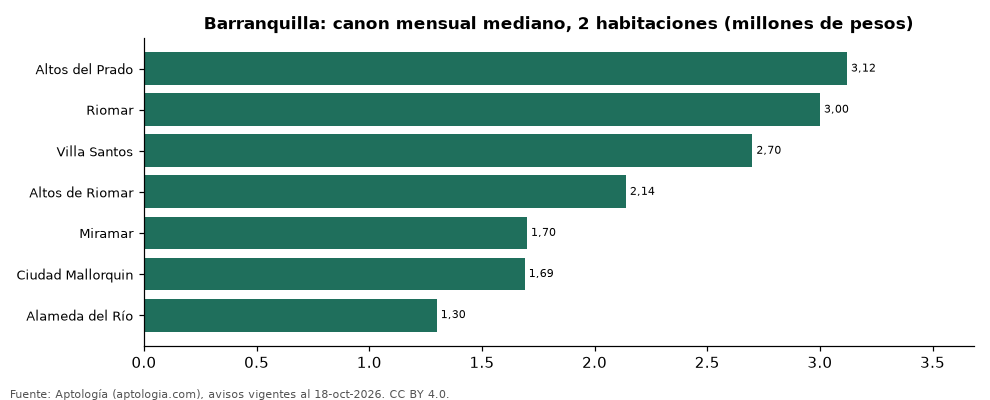

# Dónde es más caro y más barato arrendar un apartamento de 2 habitaciones en Barranquilla: ranking de barrios (octubre 2026)

**En Barranquilla, un apartamento de 2 habitaciones se arrienda por 3.120.000 pesos al mes en la mediana en Altos del Prado, el barrio más caro, y 1.299.500 pesos al mes en Alameda del Río, el más barato: 2,4 veces menos.** Comparamos 7 barrios con al menos 30 avisos de 2 habitaciones.

*Resumen: analizamos 454 apartamentos en arriendo de 2 habitaciones en 7 barrios de Barranquilla (sin amoblar).*

**Actualizado:** 18 de octubre de 2026 (datos del 18 de octubre de 2026) · **Próxima actualización:** mensual.

## Resumen

| Indicador | Valor |
|---|---|
| Más caro | Altos del Prado: 3.120.000 pesos |
| Más barato | Alameda del Río: 1.299.500 pesos |
| Diferencia | 2,4 veces |
| Barrios | 7 |

## Canon mensual de un apartamento de 2 habitaciones por barrio

| Barrio | Canon mensual (mediana) | Rango típico (P25–P75) | Área mediana (m²) | Avisos |
|---|---|---|---|---|
| Altos del Prado | 3.120.000 pesos | 2.475.000 pesos – 3.900.000 pesos | 83 | 31 |
| Riomar | 3.000.000 pesos | 2.237.500 pesos – 4.000.000 pesos | 82 | 46 |
| Villa Santos | 2.700.000 pesos | 2.200.000 pesos – 3.150.000 pesos | 78 | 70 |
| Altos de Riomar | 2.139.000 pesos | 1.755.000 pesos – 3.475.000 pesos | 88 | 30 |
| Miramar | 1.700.000 pesos | 1.500.000 pesos – 2.075.000 pesos | 55 | 46 |
| Ciudad Mallorquin | 1.690.000 pesos | 1.499.000 pesos – 1.900.000 pesos | 57 | 101 |
| Alameda del Río | 1.299.500 pesos | 1.100.950 pesos – 1.437.500 pesos | 55 | 130 |

Medianas del canon pedido, sin administración ni gastos comunes; solo barrios con 30 avisos o más.

## Preguntas frecuentes

**¿Cuánto cuesta arrendar un apartamento de 2 habitaciones en Altos del Prado?**
3.120.000 pesos al mes en la mediana (octubre de 2026); la mitad central entre 2.475.000 pesos y 3.900.000 pesos.

**¿Dónde es más barato arrendar un apartamento de 2 habitaciones en Barranquilla?**
En Alameda del Río: 1.299.500 pesos al mes en la mediana.

## Metodología

- **Fuente:** exportes nocturnos de la base de datos de Aptología (aptologia.com) del 18 de octubre de 2026: avisos vigentes de vivienda en portales inmobiliarios de 13 países, recogidos por Aptología y vistos en línea entre el 11 y el 18 de octubre de 2026. Corte: 18 de octubre de 2026.
- **Depuración:** se eliminan duplicados exactos (misma ciudad, zona, tipo, precio, moneda, área, habitaciones y baños) y los precios fuera del percentil 1–99 de cada país, operación, moneda y tipo; el precio por m² usa solo avisos con área declarada entre 12 y 2.000 m² y también se recorta al P1–P99.
- **Qué se mide:** precios pedidos (publicados), no precios de cierre. En arriendo, el canon mensual sin administración, gastos comunes ni condominio.
- **Muestra mínima:** cada cifra publicada se apoya en al menos 30 avisos; las celdas con menos se omiten.
- **Colombia:** Precios en pesos colombianos, sin conversión de moneda.
- **Sin amoblar:** se excluyen los avisos marcados como amoblados.
- **Limitaciones:** la cobertura depende de los portales que recorre Aptología en cada país y es mayor en las ciudades grandes y en los segmentos medio-alto y alto; el área es la que declara el aviso, sin verificar; los nombres de zona vienen de los portales.
- **Privacidad:** solo se publican agregados; no se publica ningún dato personal, enlace a avisos ni nombre de anunciante.
- **Datos abiertos:** [datos.csv](datos.csv), licencia CC BY 4.0.

## Cómo citar

Pinzón Pineda, D. M. (2026). *Dónde es más caro y más barato arrendar un apartamento de 2 habitaciones en Barranquilla: ranking de barrios (octubre 2026)*. Aptología (aptologia.com). https://github.com/elbroker/aptologia-datos/tree/main/estudios/arriendo-apartamentos-de-2-habitaciones-por-barrio-barranquilla-2026. Datos: datos.csv, licencia CC BY 4.0.
