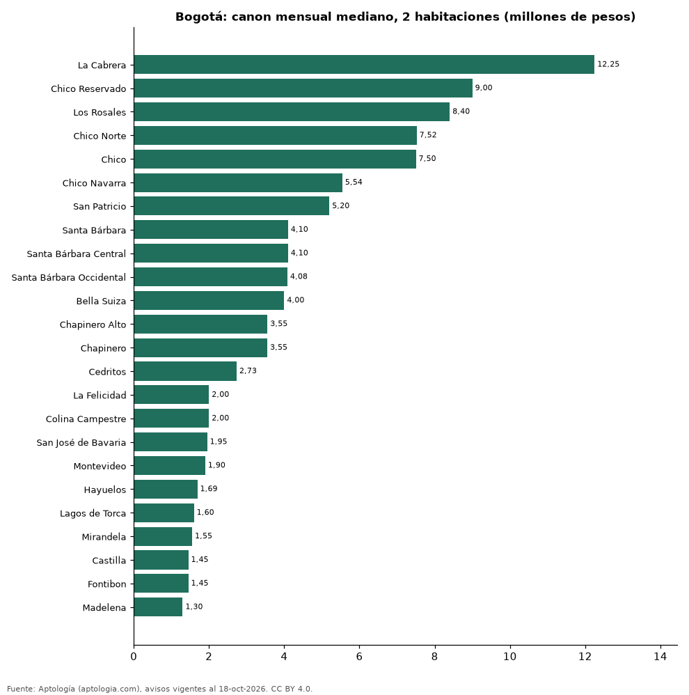

# Dónde es más caro y más barato arrendar un apartamento de 2 habitaciones en Bogotá: ranking de barrios (octubre 2026)

**En Bogotá, un apartamento de 2 habitaciones se arrienda por 12.250.000 pesos al mes en la mediana en La Cabrera, el barrio más caro, y 1.300.000 pesos al mes en Madelena, el más barato: 9,4 veces menos.** Comparamos 24 barrios con al menos 30 avisos de 2 habitaciones.

*Resumen: analizamos 1.160 apartamentos en arriendo de 2 habitaciones en 24 barrios de Bogotá (sin amoblar).*

**Actualizado:** 18 de octubre de 2026 (datos del 18 de octubre de 2026) · **Próxima actualización:** mensual.

## Resumen

| Indicador | Valor |
|---|---|
| Más caro | La Cabrera: 12.250.000 pesos |
| Más barato | Madelena: 1.300.000 pesos |
| Diferencia | 9,4 veces |
| Barrios | 24 |

## Canon mensual de un apartamento de 2 habitaciones por barrio

| Barrio | Canon mensual (mediana) | Rango típico (P25–P75) | Área mediana (m²) | Avisos |
|---|---|---|---|---|
| La Cabrera | 12.250.000 pesos | 8.400.000 pesos – 15.625.000 pesos | 146 | 44 |
| Chico Reservado | 9.000.000 pesos | 7.600.000 pesos – 11.750.000 pesos | 120 | 39 |
| Los Rosales | 8.400.000 pesos | 6.500.000 pesos – 9.798.866 pesos | 138 | 59 |
| Chico Norte | 7.520.000 pesos | 4.981.500 pesos – 9.000.000 pesos | 98 | 88 |
| Chico | 7.500.000 pesos | 5.046.000 pesos – 9.500.000 pesos | 106 | 66 |
| Chico Navarra | 5.544.000 pesos | 4.450.000 pesos – 6.360.000 pesos | 92 | 31 |
| San Patricio | 5.200.000 pesos | 4.316.000 pesos – 5.700.000 pesos | 87 | 35 |
| Santa Bárbara | 4.100.000 pesos | 3.425.000 pesos – 5.000.000 pesos | 83 | 83 |
| Santa Bárbara Central | 4.100.000 pesos | 3.500.000 pesos – 4.525.000 pesos | 80 | 36 |
| Santa Bárbara Occidental | 4.084.238 pesos | 3.825.000 pesos – 4.623.750 pesos | 76 | 30 |
| Bella Suiza | 4.000.000 pesos | 3.500.000 pesos – 6.400.000 pesos | 87 | 36 |
| Chapinero Alto | 3.554.000 pesos | 2.578.575 pesos – 4.500.000 pesos | 68 | 36 |
| Chapinero | 3.550.000 pesos | 2.725.000 pesos – 5.200.000 pesos | 69 | 48 |
| Cedritos | 2.733.650 pesos | 2.300.000 pesos – 3.300.000 pesos | 69 | 98 |
| La Felicidad | 2.000.000 pesos | 1.688.150 pesos – 2.836.050 pesos | 45 | 35 |
| Colina Campestre | 2.000.000 pesos | 1.700.626 pesos – 2.705.250 pesos | 47 | 42 |
| San José de Bavaria | 1.950.000 pesos | 1.800.000 pesos – 2.500.000 pesos | 42 | 40 |
| Montevideo | 1.900.000 pesos | 1.750.000 pesos – 2.162.500 pesos | 42 | 32 |
| Hayuelos | 1.690.000 pesos | 1.550.000 pesos – 1.845.000 pesos | 42 | 30 |
| Lagos de Torca | 1.600.000 pesos | 1.500.000 pesos – 1.900.000 pesos | 45 | 83 |
| Mirandela | 1.552.000 pesos | 1.230.000 pesos – 1.950.000 pesos | 45 | 33 |
| Castilla | 1.450.000 pesos | 1.400.000 pesos – 1.600.000 pesos | 42 | 33 |
| Fontibon | 1.450.000 pesos | 1.210.800 pesos – 1.600.000 pesos | 45 | 73 |
| Madelena | 1.300.000 pesos | 1.162.500 pesos – 1.368.800 pesos | 42 | 30 |

Medianas del canon pedido, sin administración ni gastos comunes; solo barrios con 30 avisos o más.

## Preguntas frecuentes

**¿Cuánto cuesta arrendar un apartamento de 2 habitaciones en La Cabrera?**
12.250.000 pesos al mes en la mediana (octubre de 2026); la mitad central entre 8.400.000 pesos y 15.625.000 pesos.

**¿Dónde es más barato arrendar un apartamento de 2 habitaciones en Bogotá?**
En Madelena: 1.300.000 pesos al mes en la mediana.

## Metodología

- **Fuente:** exportes nocturnos de la base de datos de Aptología (aptologia.com) del 18 de octubre de 2026: avisos vigentes de vivienda en portales inmobiliarios de 13 países, recogidos por Aptología y vistos en línea entre el 11 y el 18 de octubre de 2026. Corte: 18 de octubre de 2026.
- **Depuración:** se eliminan duplicados exactos (misma ciudad, zona, tipo, precio, moneda, área, habitaciones y baños) y los precios fuera del percentil 1–99 de cada país, operación, moneda y tipo; el precio por m² usa solo avisos con área declarada entre 12 y 2.000 m² y también se recorta al P1–P99.
- **Qué se mide:** precios pedidos (publicados), no precios de cierre. En arriendo, el canon mensual sin administración, gastos comunes ni condominio.
- **Muestra mínima:** cada cifra publicada se apoya en al menos 30 avisos; las celdas con menos se omiten.
- **Colombia:** Precios en pesos colombianos, sin conversión de moneda.
- **Sin amoblar:** se excluyen los avisos marcados como amoblados.
- **Limitaciones:** la cobertura depende de los portales que recorre Aptología en cada país y es mayor en las ciudades grandes y en los segmentos medio-alto y alto; el área es la que declara el aviso, sin verificar; los nombres de zona vienen de los portales.
- **Privacidad:** solo se publican agregados; no se publica ningún dato personal, enlace a avisos ni nombre de anunciante.
- **Datos abiertos:** [datos.csv](datos.csv), licencia CC BY 4.0.

## Cómo citar

Pinzón Pineda, D. M. (2026). *Dónde es más caro y más barato arrendar un apartamento de 2 habitaciones en Bogotá: ranking de barrios (octubre 2026)*. Aptología (aptologia.com). https://github.com/elbroker/aptologia-datos/tree/main/estudios/arriendo-apartamentos-de-2-habitaciones-por-barrio-bogota-2026. Datos: datos.csv, licencia CC BY 4.0.
