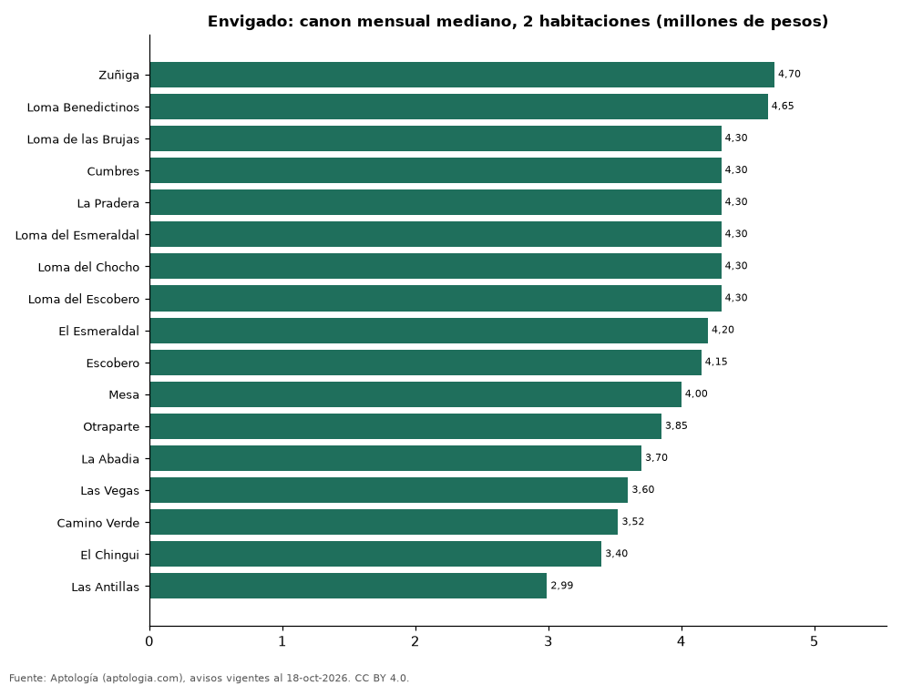

# Dónde es más caro y más barato arrendar un apartamento de 2 habitaciones en Envigado: ranking de barrios (octubre 2026)

**En Envigado, un apartamento de 2 habitaciones se arrienda por 4.700.000 pesos al mes en la mediana en Zuñiga, el barrio más caro, y 2.990.000 pesos al mes en Las Antillas, el más barato: 1,6 veces menos.** Comparamos 17 barrios con al menos 30 avisos de 2 habitaciones.

*Resumen: analizamos 1.318 apartamentos en arriendo de 2 habitaciones en 17 barrios de Envigado (sin amoblar).*

**Actualizado:** 18 de octubre de 2026 (datos del 18 de octubre de 2026) · **Próxima actualización:** mensual.

## Resumen

| Indicador | Valor |
|---|---|
| Más caro | Zuñiga: 4.700.000 pesos |
| Más barato | Las Antillas: 2.990.000 pesos |
| Diferencia | 1,6 veces |
| Barrios | 17 |

## Canon mensual de un apartamento de 2 habitaciones por barrio

| Barrio | Canon mensual (mediana) | Rango típico (P25–P75) | Área mediana (m²) | Avisos |
|---|---|---|---|---|
| Zuñiga | 4.700.000 pesos | 4.200.000 pesos – 5.500.000 pesos | 100 | 61 |
| Loma Benedictinos | 4.650.000 pesos | 3.650.000 pesos – 5.037.500 pesos | 86 | 64 |
| Loma de las Brujas | 4.300.000 pesos | 4.000.000 pesos – 4.700.000 pesos | 80 | 106 |
| Cumbres | 4.300.000 pesos | 3.500.000 pesos – 4.662.500 pesos | 83 | 164 |
| La Pradera | 4.300.000 pesos | 3.900.000 pesos – 4.650.000 pesos | 82 | 35 |
| Loma del Esmeraldal | 4.300.000 pesos | 3.887.500 pesos – 4.650.000 pesos | 80 | 184 |
| Loma del Chocho | 4.300.000 pesos | 3.837.500 pesos – 4.650.000 pesos | 80 | 108 |
| Loma del Escobero | 4.300.000 pesos | 3.825.000 pesos – 4.500.000 pesos | 80 | 134 |
| El Esmeraldal | 4.200.000 pesos | 3.800.000 pesos – 4.500.000 pesos | 80 | 82 |
| Escobero | 4.150.000 pesos | 3.650.000 pesos – 4.600.000 pesos | 74 | 63 |
| Mesa | 4.000.000 pesos | 3.225.000 pesos – 4.787.500 pesos | 78 | 42 |
| Otraparte | 3.850.000 pesos | 3.625.000 pesos – 4.362.500 pesos | 73 | 40 |
| La Abadia | 3.700.000 pesos | 3.500.000 pesos – 3.950.000 pesos | 76 | 31 |
| Las Vegas | 3.600.000 pesos | 3.300.000 pesos – 4.000.000 pesos | 72 | 61 |
| Camino Verde | 3.525.000 pesos | 3.050.000 pesos – 4.000.000 pesos | 73 | 82 |
| El Chingui | 3.400.000 pesos | 3.000.000 pesos – 3.637.500 pesos | 70 | 30 |
| Las Antillas | 2.990.000 pesos | 2.800.000 pesos – 3.250.000 pesos | 70 | 31 |

Medianas del canon pedido, sin administración ni gastos comunes; solo barrios con 30 avisos o más.

## Preguntas frecuentes

**¿Cuánto cuesta arrendar un apartamento de 2 habitaciones en Zuñiga?**
4.700.000 pesos al mes en la mediana (octubre de 2026); la mitad central entre 4.200.000 pesos y 5.500.000 pesos.

**¿Dónde es más barato arrendar un apartamento de 2 habitaciones en Envigado?**
En Las Antillas: 2.990.000 pesos al mes en la mediana.

## Metodología

- **Fuente:** exportes nocturnos de la base de datos de Aptología (aptologia.com) del 18 de octubre de 2026: avisos vigentes de vivienda en portales inmobiliarios de 13 países, recogidos por Aptología y vistos en línea entre el 11 y el 18 de octubre de 2026. Corte: 18 de octubre de 2026.
- **Depuración:** se eliminan duplicados exactos (misma ciudad, zona, tipo, precio, moneda, área, habitaciones y baños) y los precios fuera del percentil 1–99 de cada país, operación, moneda y tipo; el precio por m² usa solo avisos con área declarada entre 12 y 2.000 m² y también se recorta al P1–P99.
- **Qué se mide:** precios pedidos (publicados), no precios de cierre. En arriendo, el canon mensual sin administración, gastos comunes ni condominio.
- **Muestra mínima:** cada cifra publicada se apoya en al menos 30 avisos; las celdas con menos se omiten.
- **Colombia:** Precios en pesos colombianos, sin conversión de moneda.
- **Sin amoblar:** se excluyen los avisos marcados como amoblados.
- **Limitaciones:** la cobertura depende de los portales que recorre Aptología en cada país y es mayor en las ciudades grandes y en los segmentos medio-alto y alto; el área es la que declara el aviso, sin verificar; los nombres de zona vienen de los portales.
- **Privacidad:** solo se publican agregados; no se publica ningún dato personal, enlace a avisos ni nombre de anunciante.
- **Datos abiertos:** [datos.csv](datos.csv), licencia CC BY 4.0.

## Cómo citar

Pinzón Pineda, D. M. (2026). *Dónde es más caro y más barato arrendar un apartamento de 2 habitaciones en Envigado: ranking de barrios (octubre 2026)*. Aptología (aptologia.com). https://github.com/elbroker/aptologia-datos/tree/main/estudios/arriendo-apartamentos-de-2-habitaciones-por-barrio-envigado-2026. Datos: datos.csv, licencia CC BY 4.0.
