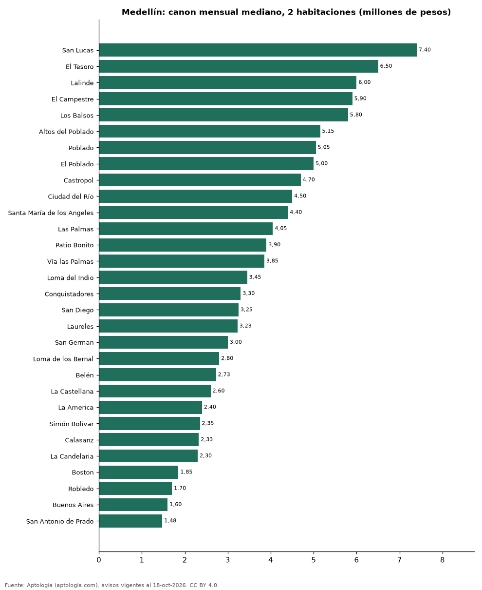

# Dónde es más caro y más barato arrendar un apartamento de 2 habitaciones en Medellín: ranking de barrios (octubre 2026)

**En Medellín, un apartamento de 2 habitaciones se arrienda por 7.400.000 pesos al mes en la mediana en San Lucas, el barrio más caro, y 1.475.000 pesos al mes en San Antonio de Prado, el más barato: 5,0 veces menos.** Comparamos 30 barrios con al menos 30 avisos de 2 habitaciones.

*Resumen: analizamos 3.928 apartamentos en arriendo de 2 habitaciones en 30 barrios de Medellín (sin amoblar).*

**Actualizado:** 18 de octubre de 2026 (datos del 18 de octubre de 2026) · **Próxima actualización:** mensual.

## Resumen

| Indicador | Valor |
|---|---|
| Más caro | San Lucas: 7.400.000 pesos |
| Más barato | San Antonio de Prado: 1.475.000 pesos |
| Diferencia | 5,0 veces |
| Barrios | 30 |

## Canon mensual de un apartamento de 2 habitaciones por barrio

| Barrio | Canon mensual (mediana) | Rango típico (P25–P75) | Área mediana (m²) | Avisos |
|---|---|---|---|---|
| San Lucas | 7.400.000 pesos | 5.800.000 pesos – 8.525.000 pesos | 114 | 84 |
| El Tesoro | 6.500.000 pesos | 5.200.000 pesos – 7.600.000 pesos | 101 | 63 |
| Lalinde | 6.000.000 pesos | 5.300.000 pesos – 7.000.000 pesos | 94 | 69 |
| El Campestre | 5.900.000 pesos | 5.100.000 pesos – 7.750.000 pesos | 105 | 31 |
| Los Balsos | 5.800.000 pesos | 4.875.000 pesos – 7.000.000 pesos | 93 | 127 |
| Altos del Poblado | 5.150.000 pesos | 4.300.000 pesos – 7.000.000 pesos | 85 | 92 |
| Poblado | 5.050.000 pesos | 4.000.000 pesos – 7.275.000 pesos | 91 | 160 |
| El Poblado | 5.000.000 pesos | 3.996.250 pesos – 6.500.000 pesos | 90 | 1.412 |
| Castropol | 4.700.000 pesos | 4.000.000 pesos – 6.600.000 pesos | 89 | 159 |
| Ciudad del Río | 4.500.000 pesos | 3.900.000 pesos – 4.900.000 pesos | 79 | 129 |
| Santa María de los Angeles | 4.400.000 pesos | 3.600.000 pesos – 5.500.000 pesos | 82 | 93 |
| Las Palmas | 4.050.000 pesos | 3.600.000 pesos – 6.000.000 pesos | 71 | 124 |
| Patio Bonito | 3.900.000 pesos | 3.500.000 pesos – 4.600.000 pesos | 78 | 58 |
| Vía las Palmas | 3.850.000 pesos | 3.575.000 pesos – 4.825.000 pesos | 70 | 52 |
| Loma del Indio | 3.450.000 pesos | 2.700.000 pesos – 4.000.000 pesos | 68 | 80 |
| Conquistadores | 3.300.000 pesos | 2.725.000 pesos – 3.875.000 pesos | 78 | 38 |
| San Diego | 3.250.000 pesos | 2.637.500 pesos – 4.000.000 pesos | 62 | 52 |
| Laureles | 3.225.000 pesos | 2.700.000 pesos – 3.912.500 pesos | 75 | 356 |
| San German | 3.000.000 pesos | 2.625.000 pesos – 3.300.000 pesos | 56 | 39 |
| Loma de los Bernal | 2.800.000 pesos | 2.600.000 pesos – 3.150.000 pesos | 65 | 39 |
| Belén | 2.725.000 pesos | 2.300.000 pesos – 3.275.000 pesos | 70 | 162 |
| La Castellana | 2.600.000 pesos | 2.100.000 pesos – 3.275.000 pesos | 65 | 50 |
| La America | 2.400.000 pesos | 2.000.000 pesos – 2.672.500 pesos | 60 | 50 |
| Simón Bolívar | 2.350.000 pesos | 2.200.000 pesos – 2.687.500 pesos | 60 | 38 |
| Calasanz | 2.325.000 pesos | 2.000.000 pesos – 2.637.500 pesos | 58 | 114 |
| La Candelaria | 2.300.000 pesos | 1.850.000 pesos – 3.400.000 pesos | 60 | 33 |
| Boston | 1.850.000 pesos | 1.700.000 pesos – 1.900.000 pesos | 53 | 47 |
| Robledo | 1.700.000 pesos | 1.500.000 pesos – 2.387.500 pesos | 50 | 90 |
| Buenos Aires | 1.600.000 pesos | 1.500.000 pesos – 1.800.000 pesos | 55 | 35 |
| San Antonio de Prado | 1.475.000 pesos | 1.337.500 pesos – 1.562.500 pesos | 50 | 52 |

Medianas del canon pedido, sin administración ni gastos comunes; solo barrios con 30 avisos o más.

## Preguntas frecuentes

**¿Cuánto cuesta arrendar un apartamento de 2 habitaciones en San Lucas?**
7.400.000 pesos al mes en la mediana (octubre de 2026); la mitad central entre 5.800.000 pesos y 8.525.000 pesos.

**¿Dónde es más barato arrendar un apartamento de 2 habitaciones en Medellín?**
En San Antonio de Prado: 1.475.000 pesos al mes en la mediana.

## Metodología

- **Fuente:** exportes nocturnos de la base de datos de Aptología (aptologia.com) del 18 de octubre de 2026: avisos vigentes de vivienda en portales inmobiliarios de 13 países, recogidos por Aptología y vistos en línea entre el 11 y el 18 de octubre de 2026. Corte: 18 de octubre de 2026.
- **Depuración:** se eliminan duplicados exactos (misma ciudad, zona, tipo, precio, moneda, área, habitaciones y baños) y los precios fuera del percentil 1–99 de cada país, operación, moneda y tipo; el precio por m² usa solo avisos con área declarada entre 12 y 2.000 m² y también se recorta al P1–P99.
- **Qué se mide:** precios pedidos (publicados), no precios de cierre. En arriendo, el canon mensual sin administración, gastos comunes ni condominio.
- **Muestra mínima:** cada cifra publicada se apoya en al menos 30 avisos; las celdas con menos se omiten.
- **Colombia:** Precios en pesos colombianos, sin conversión de moneda.
- **Sin amoblar:** se excluyen los avisos marcados como amoblados.
- **Limitaciones:** la cobertura depende de los portales que recorre Aptología en cada país y es mayor en las ciudades grandes y en los segmentos medio-alto y alto; el área es la que declara el aviso, sin verificar; los nombres de zona vienen de los portales.
- **Privacidad:** solo se publican agregados; no se publica ningún dato personal, enlace a avisos ni nombre de anunciante.
- **Datos abiertos:** [datos.csv](datos.csv), licencia CC BY 4.0.

## Cómo citar

Pinzón Pineda, D. M. (2026). *Dónde es más caro y más barato arrendar un apartamento de 2 habitaciones en Medellín: ranking de barrios (octubre 2026)*. Aptología (aptologia.com). https://github.com/elbroker/aptologia-datos/tree/main/estudios/arriendo-apartamentos-de-2-habitaciones-por-barrio-medellin-2026. Datos: datos.csv, licencia CC BY 4.0.
