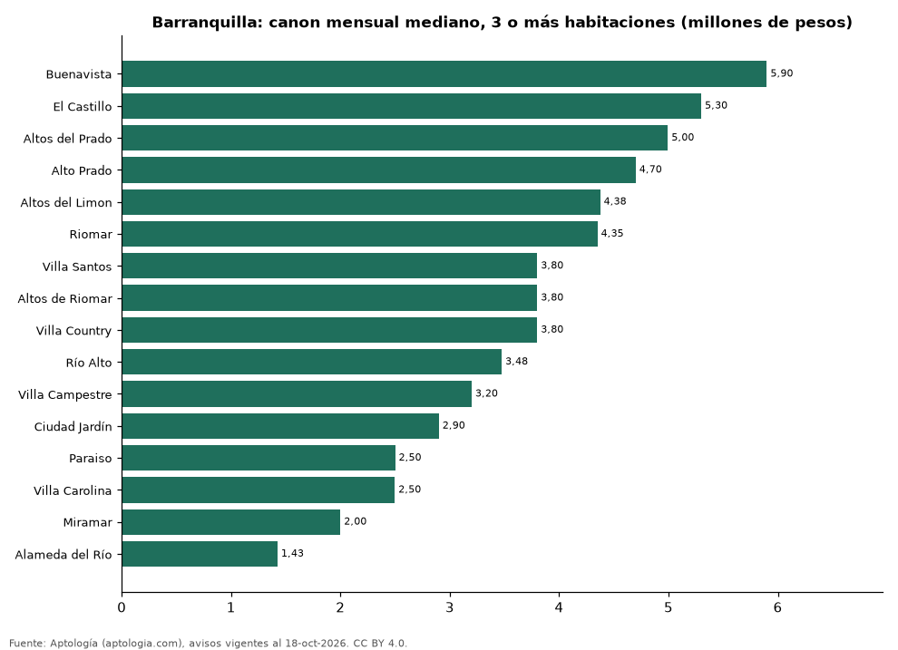

# Dónde es más caro y más barato arrendar un apartamento de 3 o más habitaciones en Barranquilla: ranking de barrios (octubre 2026)

**En Barranquilla, un apartamento de 3 o más habitaciones se arrienda por 5.900.000 pesos al mes en la mediana en Buenavista, el barrio más caro, y 1.425.000 pesos al mes en Alameda del Río, el más barato: 4,1 veces menos.** Comparamos 16 barrios con al menos 30 avisos de 3 o más habitaciones.

*Resumen: analizamos 1.154 apartamentos en arriendo de 3 o más habitaciones en 16 barrios de Barranquilla (sin amoblar).*

**Actualizado:** 18 de octubre de 2026 (datos del 18 de octubre de 2026) · **Próxima actualización:** mensual.

## Resumen

| Indicador | Valor |
|---|---|
| Más caro | Buenavista: 5.900.000 pesos |
| Más barato | Alameda del Río: 1.425.000 pesos |
| Diferencia | 4,1 veces |
| Barrios | 16 |

## Canon mensual de un apartamento de 3 o más habitaciones por barrio

| Barrio | Canon mensual (mediana) | Rango típico (P25–P75) | Área mediana (m²) | Avisos |
|---|---|---|---|---|
| Buenavista | 5.900.000 pesos | 4.553.200 pesos – 8.500.000 pesos | 140 | 52 |
| El Castillo | 5.300.000 pesos | 4.200.000 pesos – 7.000.000 pesos | 127 | 49 |
| Altos del Prado | 4.995.000 pesos | 3.241.500 pesos – 7.537.500 pesos | 162 | 108 |
| Alto Prado | 4.700.000 pesos | 3.293.250 pesos – 6.000.000 pesos | 174 | 91 |
| Altos del Limon | 4.375.000 pesos | 2.975.990 pesos – 6.525.311 pesos | 126 | 34 |
| Riomar | 4.350.000 pesos | 3.675.000 pesos – 6.225.000 pesos | 123 | 116 |
| Villa Santos | 3.800.000 pesos | 2.500.000 pesos – 5.000.000 pesos | 116 | 65 |
| Altos de Riomar | 3.800.000 pesos | 2.612.500 pesos – 5.000.000 pesos | 126 | 116 |
| Villa Country | 3.800.000 pesos | 2.550.000 pesos – 5.100.000 pesos | 127 | 55 |
| Río Alto | 3.475.000 pesos | 3.016.500 pesos – 4.000.000 pesos | 86 | 54 |
| Villa Campestre | 3.200.000 pesos | 2.700.000 pesos – 3.900.000 pesos | 98 | 77 |
| Ciudad Jardín | 2.900.000 pesos | 2.000.000 pesos – 3.450.000 pesos | 110 | 53 |
| Paraiso | 2.500.000 pesos | 1.825.000 pesos – 3.875.000 pesos | 92 | 46 |
| Villa Carolina | 2.497.500 pesos | 2.100.000 pesos – 3.025.000 pesos | 78 | 52 |
| Miramar | 2.000.000 pesos | 1.800.000 pesos – 2.875.000 pesos | 75 | 98 |
| Alameda del Río | 1.425.000 pesos | 1.253.600 pesos – 1.800.000 pesos | 60 | 88 |

Medianas del canon pedido, sin administración ni gastos comunes; solo barrios con 30 avisos o más.

## Preguntas frecuentes

**¿Cuánto cuesta arrendar un apartamento de 3 o más habitaciones en Buenavista?**
5.900.000 pesos al mes en la mediana (octubre de 2026); la mitad central entre 4.553.200 pesos y 8.500.000 pesos.

**¿Dónde es más barato arrendar un apartamento de 3 o más habitaciones en Barranquilla?**
En Alameda del Río: 1.425.000 pesos al mes en la mediana.

## Metodología

- **Fuente:** exportes nocturnos de la base de datos de Aptología (aptologia.com) del 18 de octubre de 2026: avisos vigentes de vivienda en portales inmobiliarios de 13 países, recogidos por Aptología y vistos en línea entre el 11 y el 18 de octubre de 2026. Corte: 18 de octubre de 2026.
- **Depuración:** se eliminan duplicados exactos (misma ciudad, zona, tipo, precio, moneda, área, habitaciones y baños) y los precios fuera del percentil 1–99 de cada país, operación, moneda y tipo; el precio por m² usa solo avisos con área declarada entre 12 y 2.000 m² y también se recorta al P1–P99.
- **Qué se mide:** precios pedidos (publicados), no precios de cierre. En arriendo, el canon mensual sin administración, gastos comunes ni condominio.
- **Muestra mínima:** cada cifra publicada se apoya en al menos 30 avisos; las celdas con menos se omiten.
- **Colombia:** Precios en pesos colombianos, sin conversión de moneda.
- **Sin amoblar:** se excluyen los avisos marcados como amoblados.
- **Limitaciones:** la cobertura depende de los portales que recorre Aptología en cada país y es mayor en las ciudades grandes y en los segmentos medio-alto y alto; el área es la que declara el aviso, sin verificar; los nombres de zona vienen de los portales.
- **Privacidad:** solo se publican agregados; no se publica ningún dato personal, enlace a avisos ni nombre de anunciante.
- **Datos abiertos:** [datos.csv](datos.csv), licencia CC BY 4.0.

## Cómo citar

Pinzón Pineda, D. M. (2026). *Dónde es más caro y más barato arrendar un apartamento de 3 o más habitaciones en Barranquilla: ranking de barrios (octubre 2026)*. Aptología (aptologia.com). https://github.com/elbroker/aptologia-datos/tree/main/estudios/arriendo-apartamentos-de-3-o-mas-habitaciones-por-barrio-barranquilla-2026. Datos: datos.csv, licencia CC BY 4.0.
