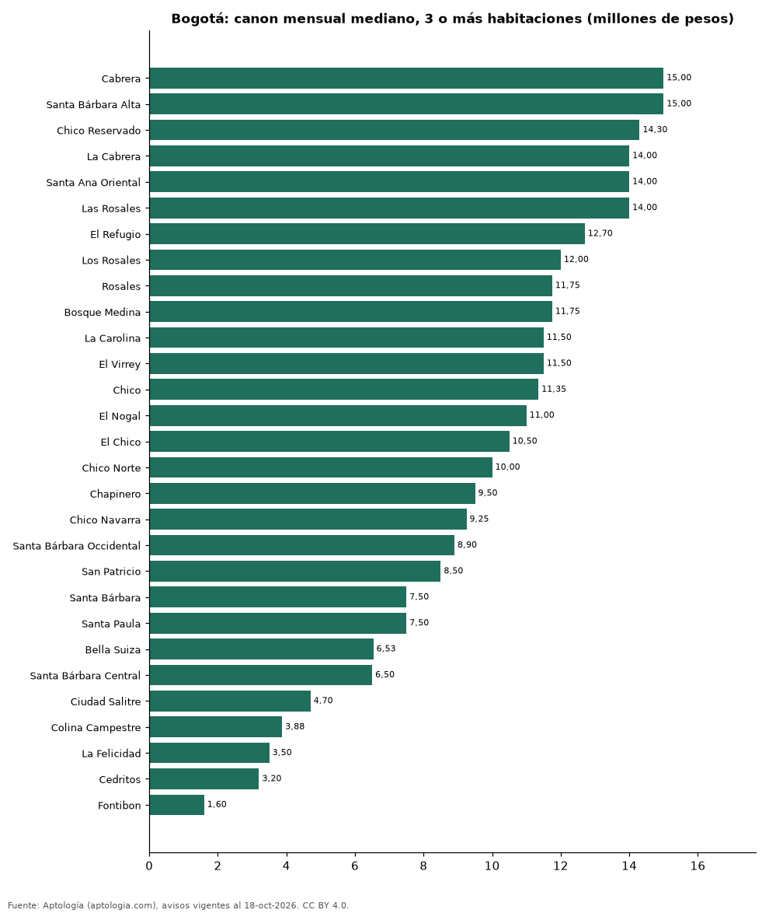

# Dónde es más caro y más barato arrendar un apartamento de 3 o más habitaciones en Bogotá: ranking de barrios (octubre 2026)

**En Bogotá, un apartamento de 3 o más habitaciones se arrienda por 15.000.000 pesos al mes en la mediana en Cabrera, el barrio más caro, y 1.600.000 pesos al mes en Fontibon, el más barato: 9,4 veces menos.** Comparamos 29 barrios con al menos 30 avisos de 3 o más habitaciones.

*Resumen: analizamos 1.922 apartamentos en arriendo de 3 o más habitaciones en 29 barrios de Bogotá (sin amoblar).*

**Actualizado:** 18 de octubre de 2026 (datos del 18 de octubre de 2026) · **Próxima actualización:** mensual.

## Resumen

| Indicador | Valor |
|---|---|
| Más caro | Cabrera: 15.000.000 pesos |
| Más barato | Fontibon: 1.600.000 pesos |
| Diferencia | 9,4 veces |
| Barrios | 29 |

## Canon mensual de un apartamento de 3 o más habitaciones por barrio

| Barrio | Canon mensual (mediana) | Rango típico (P25–P75) | Área mediana (m²) | Avisos |
|---|---|---|---|---|
| Cabrera | 15.000.000 pesos | 12.000.000 pesos – 18.000.000 pesos | 226 | 60 |
| Santa Bárbara Alta | 15.000.000 pesos | 12.500.000 pesos – 18.000.000 pesos | 286 | 46 |
| Chico Reservado | 14.300.000 pesos | 12.000.000 pesos – 16.300.000 pesos | 226 | 93 |
| La Cabrera | 14.000.000 pesos | 10.500.000 pesos – 16.000.000 pesos | 212 | 129 |
| Santa Ana Oriental | 14.000.000 pesos | 12.375.000 pesos – 17.087.500 pesos | 260 | 44 |
| Las Rosales | 14.000.000 pesos | 11.619.250 pesos – 18.000.000 pesos | 264 | 30 |
| El Refugio | 12.700.000 pesos | 10.000.000 pesos – 16.000.000 pesos | 245 | 52 |
| Los Rosales | 12.000.000 pesos | 9.500.000 pesos – 16.000.000 pesos | 241 | 177 |
| Rosales | 11.750.000 pesos | 10.000.000 pesos – 15.250.000 pesos | 238 | 60 |
| Bosque Medina | 11.750.000 pesos | 9.475.000 pesos – 14.625.000 pesos | 252 | 32 |
| La Carolina | 11.500.000 pesos | 8.375.000 pesos – 14.000.000 pesos | 187 | 67 |
| El Virrey | 11.500.000 pesos | 8.561.000 pesos – 14.332.500 pesos | 170 | 34 |
| Chico | 11.350.000 pesos | 7.500.000 pesos – 15.000.000 pesos | 190 | 96 |
| El Nogal | 11.000.000 pesos | 8.500.000 pesos – 14.625.000 pesos | 216 | 52 |
| El Chico | 10.500.000 pesos | 6.500.000 pesos – 14.049.000 pesos | 200 | 33 |
| Chico Norte | 10.000.000 pesos | 7.500.000 pesos – 14.500.000 pesos | 174 | 148 |
| Chapinero | 9.500.000 pesos | 3.825.000 pesos – 13.500.000 pesos | 156 | 54 |
| Chico Navarra | 9.250.000 pesos | 7.375.000 pesos – 12.500.000 pesos | 148 | 36 |
| Santa Bárbara Occidental | 8.900.000 pesos | 6.100.000 pesos – 12.600.000 pesos | 260 | 41 |
| San Patricio | 8.500.000 pesos | 5.512.094 pesos – 13.800.000 pesos | 190 | 50 |
| Santa Bárbara | 7.500.000 pesos | 5.500.000 pesos – 11.936.250 pesos | 168 | 138 |
| Santa Paula | 7.500.000 pesos | 5.902.500 pesos – 12.258.750 pesos | 174 | 46 |
| Bella Suiza | 6.533.000 pesos | 5.000.000 pesos – 8.150.000 pesos | 132 | 42 |
| Santa Bárbara Central | 6.500.000 pesos | 5.300.000 pesos – 9.000.000 pesos | 168 | 52 |
| Ciudad Salitre | 4.700.000 pesos | 3.695.000 pesos – 6.850.000 pesos | 97 | 44 |
| Colina Campestre | 3.875.000 pesos | 3.200.000 pesos – 4.825.000 pesos | 101 | 84 |
| La Felicidad | 3.500.000 pesos | 3.047.200 pesos – 4.300.000 pesos | 78 | 33 |
| Cedritos | 3.200.000 pesos | 2.600.000 pesos – 4.000.000 pesos | 90 | 108 |
| Fontibon | 1.600.000 pesos | 1.300.000 pesos – 2.790.000 pesos | 57 | 41 |

Medianas del canon pedido, sin administración ni gastos comunes; solo barrios con 30 avisos o más.

## Preguntas frecuentes

**¿Cuánto cuesta arrendar un apartamento de 3 o más habitaciones en Cabrera?**
15.000.000 pesos al mes en la mediana (octubre de 2026); la mitad central entre 12.000.000 pesos y 18.000.000 pesos.

**¿Dónde es más barato arrendar un apartamento de 3 o más habitaciones en Bogotá?**
En Fontibon: 1.600.000 pesos al mes en la mediana.

## Metodología

- **Fuente:** exportes nocturnos de la base de datos de Aptología (aptologia.com) del 18 de octubre de 2026: avisos vigentes de vivienda en portales inmobiliarios de 13 países, recogidos por Aptología y vistos en línea entre el 11 y el 18 de octubre de 2026. Corte: 18 de octubre de 2026.
- **Depuración:** se eliminan duplicados exactos (misma ciudad, zona, tipo, precio, moneda, área, habitaciones y baños) y los precios fuera del percentil 1–99 de cada país, operación, moneda y tipo; el precio por m² usa solo avisos con área declarada entre 12 y 2.000 m² y también se recorta al P1–P99.
- **Qué se mide:** precios pedidos (publicados), no precios de cierre. En arriendo, el canon mensual sin administración, gastos comunes ni condominio.
- **Muestra mínima:** cada cifra publicada se apoya en al menos 30 avisos; las celdas con menos se omiten.
- **Colombia:** Precios en pesos colombianos, sin conversión de moneda.
- **Sin amoblar:** se excluyen los avisos marcados como amoblados.
- **Limitaciones:** la cobertura depende de los portales que recorre Aptología en cada país y es mayor en las ciudades grandes y en los segmentos medio-alto y alto; el área es la que declara el aviso, sin verificar; los nombres de zona vienen de los portales.
- **Privacidad:** solo se publican agregados; no se publica ningún dato personal, enlace a avisos ni nombre de anunciante.
- **Datos abiertos:** [datos.csv](datos.csv), licencia CC BY 4.0.

## Cómo citar

Pinzón Pineda, D. M. (2026). *Dónde es más caro y más barato arrendar un apartamento de 3 o más habitaciones en Bogotá: ranking de barrios (octubre 2026)*. Aptología (aptologia.com). https://github.com/elbroker/aptologia-datos/tree/main/estudios/arriendo-apartamentos-de-3-o-mas-habitaciones-por-barrio-bogota-2026. Datos: datos.csv, licencia CC BY 4.0.
