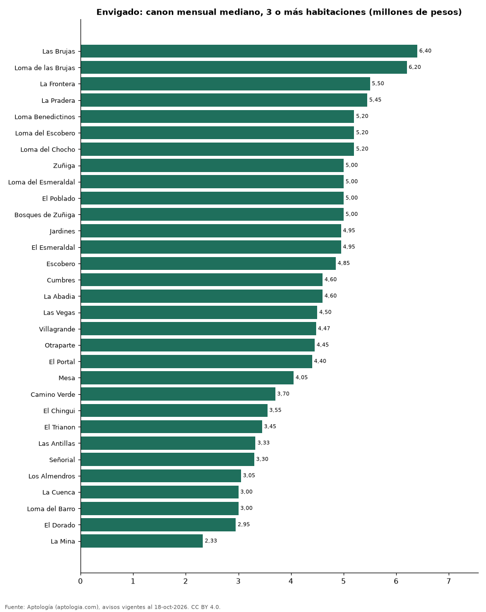

# Dónde es más caro y más barato arrendar un apartamento de 3 o más habitaciones en Envigado: ranking de barrios (octubre 2026)

**En Envigado, un apartamento de 3 o más habitaciones se arrienda por 6.400.000 pesos al mes en la mediana en Las Brujas, el barrio más caro, y 2.325.000 pesos al mes en La Mina, el más barato: 2,8 veces menos.** Comparamos 31 barrios con al menos 30 avisos de 3 o más habitaciones.

*Resumen: analizamos 2.911 apartamentos en arriendo de 3 o más habitaciones en 31 barrios de Envigado (sin amoblar).*

**Actualizado:** 18 de octubre de 2026 (datos del 18 de octubre de 2026) · **Próxima actualización:** mensual.

## Resumen

| Indicador | Valor |
|---|---|
| Más caro | Las Brujas: 6.400.000 pesos |
| Más barato | La Mina: 2.325.000 pesos |
| Diferencia | 2,8 veces |
| Barrios | 31 |

## Canon mensual de un apartamento de 3 o más habitaciones por barrio

| Barrio | Canon mensual (mediana) | Rango típico (P25–P75) | Área mediana (m²) | Avisos |
|---|---|---|---|---|
| Las Brujas | 6.400.000 pesos | 5.000.000 pesos – 8.050.000 pesos | 130 | 72 |
| Loma de las Brujas | 6.200.000 pesos | 5.212.500 pesos – 8.150.000 pesos | 130 | 202 |
| La Frontera | 5.500.000 pesos | 4.500.000 pesos – 5.600.000 pesos | 114 | 32 |
| La Pradera | 5.450.000 pesos | 4.075.000 pesos – 7.150.000 pesos | 110 | 43 |
| Loma Benedictinos | 5.200.000 pesos | 4.250.000 pesos – 7.000.000 pesos | 125 | 141 |
| Loma del Escobero | 5.200.000 pesos | 4.500.000 pesos – 6.200.000 pesos | 108 | 182 |
| Loma del Chocho | 5.200.000 pesos | 4.675.000 pesos – 6.000.000 pesos | 100 | 83 |
| Zuñiga | 5.000.000 pesos | 4.287.500 pesos – 5.525.000 pesos | 120 | 144 |
| Loma del Esmeraldal | 5.000.000 pesos | 4.300.000 pesos – 6.500.000 pesos | 100 | 193 |
| El Poblado | 5.000.000 pesos | 4.137.500 pesos – 6.000.000 pesos | 115 | 52 |
| Bosques de Zuñiga | 5.000.000 pesos | 4.575.000 pesos – 5.500.000 pesos | 118 | 32 |
| Jardines | 4.950.000 pesos | 4.325.000 pesos – 5.600.000 pesos | 108 | 58 |
| El Esmeraldal | 4.950.000 pesos | 4.475.000 pesos – 6.000.000 pesos | 100 | 64 |
| Escobero | 4.850.000 pesos | 3.950.000 pesos – 6.125.000 pesos | 98 | 107 |
| Cumbres | 4.600.000 pesos | 3.925.000 pesos – 5.525.000 pesos | 98 | 275 |
| La Abadia | 4.600.000 pesos | 4.075.000 pesos – 5.500.000 pesos | 102 | 92 |
| Las Vegas | 4.500.000 pesos | 4.000.000 pesos – 5.000.000 pesos | 88 | 101 |
| Villagrande | 4.475.000 pesos | 4.000.000 pesos – 5.000.000 pesos | 98 | 44 |
| Otraparte | 4.450.000 pesos | 3.950.000 pesos – 5.000.000 pesos | 96 | 162 |
| El Portal | 4.400.000 pesos | 3.800.000 pesos – 5.425.000 pesos | 112 | 74 |
| Mesa | 4.050.000 pesos | 3.200.000 pesos – 5.000.000 pesos | 108 | 101 |
| Camino Verde | 3.700.000 pesos | 3.200.000 pesos – 4.387.500 pesos | 84 | 238 |
| El Chingui | 3.550.000 pesos | 3.400.000 pesos – 3.800.000 pesos | 78 | 50 |
| El Trianon | 3.450.000 pesos | 3.000.000 pesos – 4.000.000 pesos | 80 | 51 |
| Las Antillas | 3.325.000 pesos | 2.937.500 pesos – 3.725.000 pesos | 75 | 56 |
| Señorial | 3.300.000 pesos | 2.800.000 pesos – 3.900.000 pesos | 72 | 69 |
| Los Almendros | 3.050.000 pesos | 2.725.000 pesos – 3.425.000 pesos | 70 | 31 |
| La Cuenca | 3.000.000 pesos | 2.800.000 pesos – 4.000.000 pesos | 70 | 61 |
| Loma del Barro | 3.000.000 pesos | 2.700.000 pesos – 3.800.000 pesos | 71 | 39 |
| El Dorado | 2.950.000 pesos | 2.700.000 pesos – 3.350.000 pesos | 80 | 30 |
| La Mina | 2.325.000 pesos | 2.100.000 pesos – 2.925.000 pesos | 68 | 32 |

Medianas del canon pedido, sin administración ni gastos comunes; solo barrios con 30 avisos o más.

## Preguntas frecuentes

**¿Cuánto cuesta arrendar un apartamento de 3 o más habitaciones en Las Brujas?**
6.400.000 pesos al mes en la mediana (octubre de 2026); la mitad central entre 5.000.000 pesos y 8.050.000 pesos.

**¿Dónde es más barato arrendar un apartamento de 3 o más habitaciones en Envigado?**
En La Mina: 2.325.000 pesos al mes en la mediana.

## Metodología

- **Fuente:** exportes nocturnos de la base de datos de Aptología (aptologia.com) del 18 de octubre de 2026: avisos vigentes de vivienda en portales inmobiliarios de 13 países, recogidos por Aptología y vistos en línea entre el 11 y el 18 de octubre de 2026. Corte: 18 de octubre de 2026.
- **Depuración:** se eliminan duplicados exactos (misma ciudad, zona, tipo, precio, moneda, área, habitaciones y baños) y los precios fuera del percentil 1–99 de cada país, operación, moneda y tipo; el precio por m² usa solo avisos con área declarada entre 12 y 2.000 m² y también se recorta al P1–P99.
- **Qué se mide:** precios pedidos (publicados), no precios de cierre. En arriendo, el canon mensual sin administración, gastos comunes ni condominio.
- **Muestra mínima:** cada cifra publicada se apoya en al menos 30 avisos; las celdas con menos se omiten.
- **Colombia:** Precios en pesos colombianos, sin conversión de moneda.
- **Sin amoblar:** se excluyen los avisos marcados como amoblados.
- **Limitaciones:** la cobertura depende de los portales que recorre Aptología en cada país y es mayor en las ciudades grandes y en los segmentos medio-alto y alto; el área es la que declara el aviso, sin verificar; los nombres de zona vienen de los portales.
- **Privacidad:** solo se publican agregados; no se publica ningún dato personal, enlace a avisos ni nombre de anunciante.
- **Datos abiertos:** [datos.csv](datos.csv), licencia CC BY 4.0.

## Cómo citar

Pinzón Pineda, D. M. (2026). *Dónde es más caro y más barato arrendar un apartamento de 3 o más habitaciones en Envigado: ranking de barrios (octubre 2026)*. Aptología (aptologia.com). https://github.com/elbroker/aptologia-datos/tree/main/estudios/arriendo-apartamentos-de-3-o-mas-habitaciones-por-barrio-envigado-2026. Datos: datos.csv, licencia CC BY 4.0.
