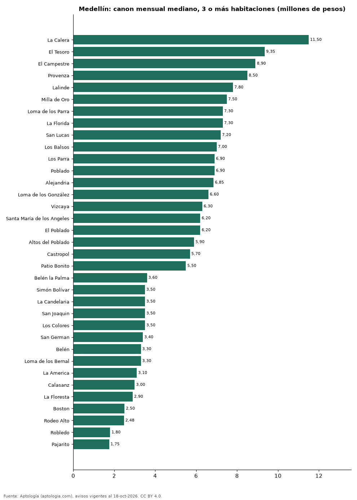

# Dónde es más caro y más barato arrendar un apartamento de 3 o más habitaciones en Medellín: ranking de barrios (octubre 2026)

**En Medellín, un apartamento de 3 o más habitaciones se arrienda por 11.500.000 pesos al mes en la mediana en La Calera, el barrio más caro, y 1.750.000 pesos al mes en Pajarito, el más barato: 6,6 veces menos.** Comparamos 46 barrios con al menos 30 avisos de 3 o más habitaciones.

*Resumen: analizamos 8.608 apartamentos en arriendo de 3 o más habitaciones en 46 barrios de Medellín (sin amoblar).*

**Actualizado:** 18 de octubre de 2026 (datos del 18 de octubre de 2026) · **Próxima actualización:** mensual.

## Resumen

| Indicador | Valor |
|---|---|
| Más caro | La Calera: 11.500.000 pesos |
| Más barato | Pajarito: 1.750.000 pesos |
| Diferencia | 6,6 veces |
| Barrios | 46 |

## Canon mensual de un apartamento de 3 o más habitaciones por barrio

| Barrio | Canon mensual (mediana) | Rango típico (P25–P75) | Área mediana (m²) | Avisos |
|---|---|---|---|---|
| La Calera | 11.500.000 pesos | 7.900.000 pesos – 14.500.000 pesos | 200 | 85 |
| El Tesoro | 9.350.000 pesos | 7.000.000 pesos – 12.900.000 pesos | 180 | 254 |
| El Campestre | 8.900.000 pesos | 6.000.000 pesos – 12.000.000 pesos | 190 | 67 |
| Provenza | 8.500.000 pesos | 6.225.000 pesos – 10.375.000 pesos | 152 | 34 |
| Lalinde | 7.800.000 pesos | 6.850.000 pesos – 10.650.000 pesos | 130 | 35 |
| Milla de Oro | 7.500.000 pesos | 6.364.494 pesos – 10.000.000 pesos | 170 | 43 |
| Loma de los Parra | 7.300.000 pesos | 6.500.000 pesos – 8.500.000 pesos | 147 | 51 |
| La Florida | 7.300.000 pesos | 5.800.000 pesos – 8.650.000 pesos | 153 | 59 |
| San Lucas | 7.200.000 pesos | 5.350.000 pesos – 9.000.000 pesos | 165 | 103 |
| Los Balsos | 7.000.000 pesos | 5.900.000 pesos – 10.500.000 pesos | 152 | 297 |
| Los Parra | 6.900.000 pesos | 6.200.000 pesos – 8.500.000 pesos | 150 | 54 |
| Poblado | 6.900.000 pesos | 5.300.000 pesos – 10.000.000 pesos | 140 | 429 |
| Alejandria | 6.850.000 pesos | 6.000.000 pesos – 8.550.000 pesos | 152 | 56 |
| Loma de los González | 6.600.000 pesos | 5.600.000 pesos – 9.000.000 pesos | 116 | 61 |
| Vizcaya | 6.300.000 pesos | 4.500.000 pesos – 9.000.000 pesos | 150 | 37 |
| Santa María de los Angeles | 6.200.000 pesos | 5.500.000 pesos – 7.225.000 pesos | 132 | 184 |
| El Poblado | 6.200.000 pesos | 4.800.000 pesos – 8.500.000 pesos | 136 | 3.096 |
| Altos del Poblado | 5.900.000 pesos | 4.850.000 pesos – 8.350.000 pesos | 120 | 95 |
| Castropol | 5.700.000 pesos | 4.825.000 pesos – 6.975.000 pesos | 120 | 302 |
| Patio Bonito | 5.500.000 pesos | 4.500.000 pesos – 6.275.000 pesos | 134 | 76 |
| La Frontera | 5.500.000 pesos | 4.500.000 pesos – 6.000.000 pesos | 114 | 38 |
| Ciudad del Río | 4.650.000 pesos | 4.200.000 pesos – 5.500.000 pesos | 84 | 179 |
| Vía las Palmas | 4.600.000 pesos | 4.000.000 pesos – 5.925.000 pesos | 90 | 79 |
| Las Palmas | 4.500.000 pesos | 4.000.000 pesos – 6.200.000 pesos | 88 | 133 |
| Laureles | 4.500.000 pesos | 3.600.000 pesos – 5.500.000 pesos | 120 | 1.038 |
| Conquistadores | 4.325.000 pesos | 3.800.000 pesos – 4.925.000 pesos | 120 | 100 |
| Estadio | 4.000.000 pesos | 3.400.000 pesos – 4.600.000 pesos | 114 | 43 |
| La Castellana | 3.950.000 pesos | 3.380.000 pesos – 4.500.000 pesos | 110 | 103 |
| Loma del Indio | 3.900.000 pesos | 3.300.000 pesos – 4.500.000 pesos | 82 | 90 |
| San Diego | 3.800.000 pesos | 3.500.000 pesos – 4.200.000 pesos | 80 | 57 |
| Guayabal | 3.625.000 pesos | 3.200.000 pesos – 3.800.000 pesos | 75 | 42 |
| Belén la Palma | 3.600.000 pesos | 3.125.000 pesos – 4.200.000 pesos | 96 | 30 |
| Simón Bolívar | 3.500.000 pesos | 3.025.000 pesos – 4.300.000 pesos | 110 | 58 |
| La Candelaria | 3.500.000 pesos | 2.350.000 pesos – 4.500.000 pesos | 100 | 41 |
| San Joaquin | 3.500.000 pesos | 2.625.000 pesos – 4.200.000 pesos | 95 | 30 |
| Los Colores | 3.500.000 pesos | 3.150.000 pesos – 4.200.000 pesos | 89 | 69 |
| San German | 3.400.000 pesos | 3.200.000 pesos – 3.800.000 pesos | 78 | 57 |
| Belén | 3.300.000 pesos | 2.800.000 pesos – 3.950.000 pesos | 85 | 389 |
| Loma de los Bernal | 3.300.000 pesos | 3.000.000 pesos – 3.800.000 pesos | 77 | 101 |
| La America | 3.100.000 pesos | 2.675.000 pesos – 3.500.000 pesos | 84 | 83 |
| Calasanz | 3.000.000 pesos | 2.587.500 pesos – 3.500.000 pesos | 75 | 168 |
| La Floresta | 2.900.000 pesos | 2.800.000 pesos – 3.050.000 pesos | 92 | 31 |
| Boston | 2.500.000 pesos | 2.125.000 pesos – 3.450.000 pesos | 78 | 34 |
| Rodeo Alto | 2.475.000 pesos | 2.237.500 pesos – 2.800.000 pesos | 68 | 40 |
| Robledo | 1.800.000 pesos | 1.600.000 pesos – 2.550.000 pesos | 60 | 123 |
| Pajarito | 1.750.000 pesos | 1.700.000 pesos – 1.800.000 pesos | 54 | 34 |

Medianas del canon pedido, sin administración ni gastos comunes; solo barrios con 30 avisos o más.

## Preguntas frecuentes

**¿Cuánto cuesta arrendar un apartamento de 3 o más habitaciones en La Calera?**
11.500.000 pesos al mes en la mediana (octubre de 2026); la mitad central entre 7.900.000 pesos y 14.500.000 pesos.

**¿Dónde es más barato arrendar un apartamento de 3 o más habitaciones en Medellín?**
En Pajarito: 1.750.000 pesos al mes en la mediana.

## Metodología

- **Fuente:** exportes nocturnos de la base de datos de Aptología (aptologia.com) del 18 de octubre de 2026: avisos vigentes de vivienda en portales inmobiliarios de 13 países, recogidos por Aptología y vistos en línea entre el 11 y el 18 de octubre de 2026. Corte: 18 de octubre de 2026.
- **Depuración:** se eliminan duplicados exactos (misma ciudad, zona, tipo, precio, moneda, área, habitaciones y baños) y los precios fuera del percentil 1–99 de cada país, operación, moneda y tipo; el precio por m² usa solo avisos con área declarada entre 12 y 2.000 m² y también se recorta al P1–P99.
- **Qué se mide:** precios pedidos (publicados), no precios de cierre. En arriendo, el canon mensual sin administración, gastos comunes ni condominio.
- **Muestra mínima:** cada cifra publicada se apoya en al menos 30 avisos; las celdas con menos se omiten.
- **Colombia:** Precios en pesos colombianos, sin conversión de moneda.
- **Sin amoblar:** se excluyen los avisos marcados como amoblados.
- **Limitaciones:** la cobertura depende de los portales que recorre Aptología en cada país y es mayor en las ciudades grandes y en los segmentos medio-alto y alto; el área es la que declara el aviso, sin verificar; los nombres de zona vienen de los portales.
- **Privacidad:** solo se publican agregados; no se publica ningún dato personal, enlace a avisos ni nombre de anunciante.
- **Datos abiertos:** [datos.csv](datos.csv), licencia CC BY 4.0.

## Cómo citar

Pinzón Pineda, D. M. (2026). *Dónde es más caro y más barato arrendar un apartamento de 3 o más habitaciones en Medellín: ranking de barrios (octubre 2026)*. Aptología (aptologia.com). https://github.com/elbroker/aptologia-datos/tree/main/estudios/arriendo-apartamentos-de-3-o-mas-habitaciones-por-barrio-medellin-2026. Datos: datos.csv, licencia CC BY 4.0.
