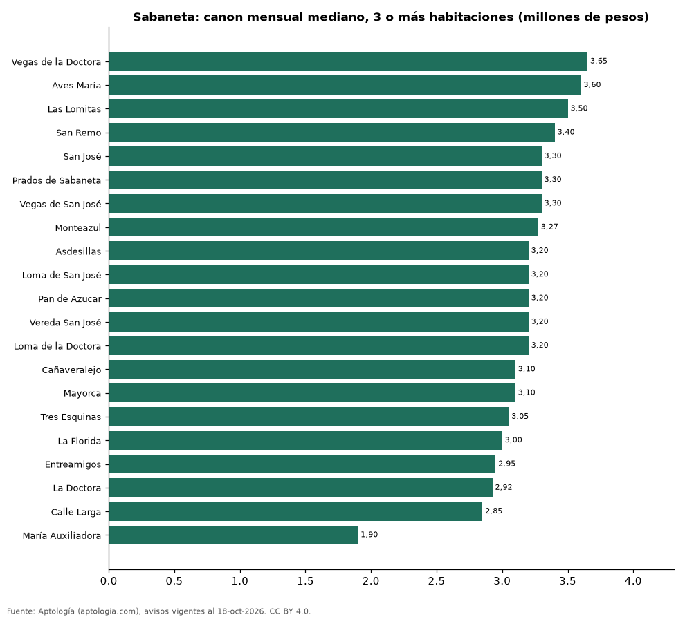

# Dónde es más caro y más barato arrendar un apartamento de 3 o más habitaciones en Sabaneta: ranking de barrios (octubre 2026)

**En Sabaneta, un apartamento de 3 o más habitaciones se arrienda por 3.650.000 pesos al mes en la mediana en Vegas de la Doctora, el barrio más caro, y 1.900.000 pesos al mes en María Auxiliadora, el más barato: 1,9 veces menos.** Comparamos 21 barrios con al menos 30 avisos de 3 o más habitaciones.

*Resumen: analizamos 1.582 apartamentos en arriendo de 3 o más habitaciones en 21 barrios de Sabaneta (sin amoblar).*

**Actualizado:** 18 de octubre de 2026 (datos del 18 de octubre de 2026) · **Próxima actualización:** mensual.

## Resumen

| Indicador | Valor |
|---|---|
| Más caro | Vegas de la Doctora: 3.650.000 pesos |
| Más barato | María Auxiliadora: 1.900.000 pesos |
| Diferencia | 1,9 veces |
| Barrios | 21 |

## Canon mensual de un apartamento de 3 o más habitaciones por barrio

| Barrio | Canon mensual (mediana) | Rango típico (P25–P75) | Área mediana (m²) | Avisos |
|---|---|---|---|---|
| Vegas de la Doctora | 3.650.000 pesos | 3.350.000 pesos – 4.150.000 pesos | 100 | 69 |
| Aves María | 3.600.000 pesos | 3.100.000 pesos – 4.100.000 pesos | 92 | 153 |
| Las Lomitas | 3.500.000 pesos | 2.925.000 pesos – 4.000.000 pesos | 86 | 227 |
| San Remo | 3.400.000 pesos | 3.150.000 pesos – 3.600.000 pesos | 78 | 30 |
| San José | 3.300.000 pesos | 3.000.000 pesos – 3.800.000 pesos | 84 | 161 |
| Prados de Sabaneta | 3.300.000 pesos | 3.000.000 pesos – 3.500.000 pesos | 77 | 68 |
| Vegas de San José | 3.300.000 pesos | 3.100.000 pesos – 3.700.000 pesos | 82 | 33 |
| Monteazul | 3.275.000 pesos | 3.000.000 pesos – 3.525.000 pesos | 78 | 84 |
| Asdesillas | 3.200.000 pesos | 2.900.000 pesos – 3.500.000 pesos | 78 | 37 |
| Loma de San José | 3.200.000 pesos | 3.000.000 pesos – 3.775.000 pesos | 80 | 47 |
| Pan de Azucar | 3.200.000 pesos | 2.925.000 pesos – 3.450.000 pesos | 75 | 43 |
| Vereda San José | 3.200.000 pesos | 2.900.000 pesos – 3.800.000 pesos | 80 | 33 |
| Loma de la Doctora | 3.200.000 pesos | 2.900.000 pesos – 3.800.000 pesos | 82 | 75 |
| Cañaveralejo | 3.100.000 pesos | 2.700.000 pesos – 3.500.000 pesos | 75 | 60 |
| Mayorca | 3.100.000 pesos | 2.700.000 pesos – 3.500.000 pesos | 75 | 76 |
| Tres Esquinas | 3.050.000 pesos | 2.900.000 pesos – 3.500.000 pesos | 74 | 32 |
| La Florida | 3.000.000 pesos | 2.800.000 pesos – 3.300.000 pesos | 75 | 48 |
| Entreamigos | 2.950.000 pesos | 2.700.000 pesos – 3.500.000 pesos | 76 | 93 |
| La Doctora | 2.925.000 pesos | 2.600.000 pesos – 3.400.000 pesos | 74 | 104 |
| Calle Larga | 2.850.000 pesos | 2.600.000 pesos – 3.200.000 pesos | 74 | 50 |
| María Auxiliadora | 1.900.000 pesos | 1.800.000 pesos – 2.550.000 pesos | 57 | 59 |

Medianas del canon pedido, sin administración ni gastos comunes; solo barrios con 30 avisos o más.

## Preguntas frecuentes

**¿Cuánto cuesta arrendar un apartamento de 3 o más habitaciones en Vegas de la Doctora?**
3.650.000 pesos al mes en la mediana (octubre de 2026); la mitad central entre 3.350.000 pesos y 4.150.000 pesos.

**¿Dónde es más barato arrendar un apartamento de 3 o más habitaciones en Sabaneta?**
En María Auxiliadora: 1.900.000 pesos al mes en la mediana.

## Metodología

- **Fuente:** exportes nocturnos de la base de datos de Aptología (aptologia.com) del 18 de octubre de 2026: avisos vigentes de vivienda en portales inmobiliarios de 13 países, recogidos por Aptología y vistos en línea entre el 11 y el 18 de octubre de 2026. Corte: 18 de octubre de 2026.
- **Depuración:** se eliminan duplicados exactos (misma ciudad, zona, tipo, precio, moneda, área, habitaciones y baños) y los precios fuera del percentil 1–99 de cada país, operación, moneda y tipo; el precio por m² usa solo avisos con área declarada entre 12 y 2.000 m² y también se recorta al P1–P99.
- **Qué se mide:** precios pedidos (publicados), no precios de cierre. En arriendo, el canon mensual sin administración, gastos comunes ni condominio.
- **Muestra mínima:** cada cifra publicada se apoya en al menos 30 avisos; las celdas con menos se omiten.
- **Colombia:** Precios en pesos colombianos, sin conversión de moneda.
- **Sin amoblar:** se excluyen los avisos marcados como amoblados.
- **Limitaciones:** la cobertura depende de los portales que recorre Aptología en cada país y es mayor en las ciudades grandes y en los segmentos medio-alto y alto; el área es la que declara el aviso, sin verificar; los nombres de zona vienen de los portales.
- **Privacidad:** solo se publican agregados; no se publica ningún dato personal, enlace a avisos ni nombre de anunciante.
- **Datos abiertos:** [datos.csv](datos.csv), licencia CC BY 4.0.

## Cómo citar

Pinzón Pineda, D. M. (2026). *Dónde es más caro y más barato arrendar un apartamento de 3 o más habitaciones en Sabaneta: ranking de barrios (octubre 2026)*. Aptología (aptologia.com). https://github.com/elbroker/aptologia-datos/tree/main/estudios/arriendo-apartamentos-de-3-o-mas-habitaciones-por-barrio-sabaneta-2026. Datos: datos.csv, licencia CC BY 4.0.
