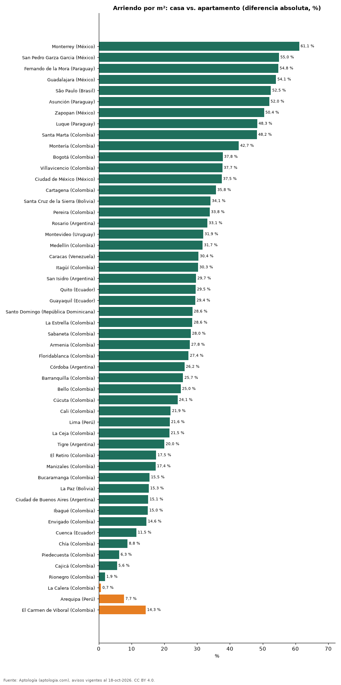

# ¿Sale más barato arrendar una casa o un apartamento por metro cuadrado? Comparación en 52 ciudades de Latinoamérica (octubre 2026)

**En 49 de 52 ciudades el metro cuadrado de una casa se arrienda más barato que el de un apartamento; la mayor diferencia está en Monterrey (México) (-61,1 %).** En El Carmen de Viboral (Colombia), en cambio, la casa se arrienda +14,3 % por m² frente al apartamento.

*Resumen: comparamos el canon por m² de 132.113 casas y apartamentos en arriendo en 52 ciudades con 30 avisos o más de cada tipo.*

**Actualizado:** 18 de octubre de 2026 (datos del 18 de octubre de 2026) · **Próxima actualización:** mensual.

## Resumen

| Indicador | Valor |
|---|---|
| Casa más barata por m² | 49 de 52 ciudades |
| Mayor descuento de la casa | Monterrey (México): -61,1 % |
| Mayor recargo de la casa | El Carmen de Viboral (Colombia): +14,3 % |

## Arriendo por m²: casa vs. apartamento

| Ciudad | Casa (USD/m² al mes) | Apartamento (USD/m² al mes) | Casa vs. apartamento |
|---|---|---|---|
| Monterrey (México) | 7,32 | 18,84 | -61,1 % |
| San Pedro Garza Garcia (México) | 11,30 | 25,10 | -55,0 % |
| Fernando de la Mora (Paraguay) | 4,94 | 10,92 | -54,8 % |
| Guadalajara (México) | 7,45 | 16,21 | -54,1 % |
| São Paulo (Brasil) | 5,90 | 12,41 | -52,5 % |
| Asunción (Paraguay) | 6,01 | 12,52 | -52,0 % |
| Zapopan (México) | 7,93 | 15,99 | -50,4 % |
| Luque (Paraguay) | 5,68 | 10,99 | -48,3 % |
| Santa Marta (Colombia) | 7,32 | 14,14 | -48,2 % |
| Montería (Colombia) | 4,60 | 8,03 | -42,7 % |
| Bogotá (Colombia) | 9,43 | 15,16 | -37,8 % |
| Villavicencio (Colombia) | 5,33 | 8,55 | -37,7 % |
| Ciudad de México (México) | 11,28 | 18,05 | -37,5 % |
| Cartagena (Colombia) | 8,90 | 13,86 | -35,8 % |
| Santa Cruz de la Sierra (Bolivia) | 4,79 | 7,26 | -34,1 % |
| Pereira (Colombia) | 6,93 | 10,47 | -33,8 % |
| Rosario (Argentina) | 5,87 | 8,78 | -33,1 % |
| Montevideo (Uruguay) | 9,95 | 14,60 | -31,9 % |
| Medellín (Colombia) | 10,56 | 15,46 | -31,7 % |
| Caracas (Venezuela) | 8,42 | 12,10 | -30,4 % |
| Itagüí (Colombia) | 8,76 | 12,57 | -30,3 % |
| San Isidro (Argentina) | 13,10 | 18,62 | -29,7 % |
| Quito (Ecuador) | 5,09 | 7,22 | -29,5 % |
| Guayaquil (Ecuador) | 6,00 | 8,50 | -29,4 % |
| Santo Domingo (República Dominicana) | 8,93 | 12,50 | -28,6 % |
| La Estrella (Colombia) | 8,61 | 12,04 | -28,6 % |
| Sabaneta (Colombia) | 9,28 | 12,89 | -28,0 % |
| Armenia (Colombia) | 7,31 | 10,12 | -27,8 % |
| Floridablanca (Colombia) | 6,71 | 9,24 | -27,4 % |
| Córdoba (Argentina) | 6,79 | 9,19 | -26,2 % |
| Barranquilla (Colombia) | 7,85 | 10,57 | -25,7 % |
| Bello (Colombia) | 7,85 | 10,47 | -25,0 % |
| Cúcuta (Colombia) | 5,25 | 6,91 | -24,1 % |
| Cali (Colombia) | 7,36 | 9,43 | -21,9 % |
| Lima (Perú) | 7,51 | 9,58 | -21,6 % |
| La Ceja (Colombia) | 9,20 | 11,73 | -21,5 % |
| Tigre (Argentina) | 14,00 | 17,50 | -20,0 % |
| El Retiro (Colombia) | 12,76 | 15,47 | -17,5 % |
| Manizales (Colombia) | 8,10 | 9,80 | -17,4 % |
| Bucaramanga (Colombia) | 7,85 | 9,30 | -15,5 % |
| La Paz (Bolivia) | 4,77 | 5,62 | -15,3 % |
| Ciudad de Buenos Aires (Argentina) | 10,59 | 12,47 | -15,1 % |
| Ibagué (Colombia) | 6,03 | 7,09 | -15,0 % |
| Envigado (Colombia) | 13,12 | 15,35 | -14,6 % |
| Cuenca (Ecuador) | 4,69 | 5,30 | -11,5 % |
| Chía (Colombia) | 9,55 | 10,47 | -8,8 % |
| Piedecuesta (Colombia) | 6,55 | 6,98 | -6,3 % |
| Cajicá (Colombia) | 10,06 | 10,66 | -5,6 % |
| Rionegro (Colombia) | 11,56 | 11,78 | -1,9 % |
| La Calera (Colombia) | 9,82 | 9,75 | +0,7 % |
| Arequipa (Perú) | 6,27 | 5,82 | +7,7 % |
| El Carmen de Viboral (Colombia) | 9,12 | 7,98 | +14,3 % |

Medianas del canon por m² en la moneda mayoritaria de cada ciudad, convertidas a dólares; sin emparejar por barrio ni tamaño (las casas suelen ser más grandes).

## Preguntas frecuentes

**¿Es más barato arrendar una casa que un apartamento?**
Por metro cuadrado, sí en 49 de 52 ciudades.

**¿Dónde es mayor la diferencia?**
En Monterrey (México): la casa se arrienda -61,1 % por m².

## Metodología

- **Fuente:** exportes nocturnos de la base de datos de Aptología (aptologia.com) del 18 de octubre de 2026: avisos vigentes de vivienda en portales inmobiliarios de 13 países, recogidos por Aptología y vistos en línea entre el 11 y el 18 de octubre de 2026. Corte: 18 de octubre de 2026.
- **Depuración:** se eliminan duplicados exactos (misma ciudad, zona, tipo, precio, moneda, área, habitaciones y baños) y los precios fuera del percentil 1–99 de cada país, operación, moneda y tipo; el precio por m² usa solo avisos con área declarada entre 12 y 2.000 m² y también se recorta al P1–P99.
- **Qué se mide:** precios pedidos (publicados), no precios de cierre. En arriendo, el canon mensual sin administración, gastos comunes ni condominio.
- **Muestra mínima:** cada cifra publicada se apoya en al menos 30 avisos; las celdas con menos se omiten.
- **Monedas:** nunca se mezclan avisos de monedas distintas sin convertirlos. Conversión a dólares con la tasa de mercado de ExchangeRate-API (open.er-api.com, actualización del 18 Oct 2026): 1 USD = 3.182,80 COP, 1 USD = 18,47 M.N, 1 USD = 5,09 BRL, 1 USD = 3,44 PEN, 1 USD = 982,44 CLP, 1 USD = 1.514,57 ARS, 1 USD = 40,20 UYU, 1 USD = 5.705,37 PYG, 1 USD = 61,27 DOP, 1 USD = 0,89 EUR, 1 USD = 11,72 BOB; la UF chilena a 41.178,64 CLP (mindicador,cl. 18-oct-2026). Los avisos publicados en dólares se usan tal cual.
- **Monedas:** en cada ciudad y operación se usa solo la moneda mayoritaria de los avisos (los avisos en otra moneda se excluyen) y la mediana se convierte a dólares con la tasa citada; nunca se promedian avisos de monedas distintas.
- **Destinos de temporada:** Punta del Este, Maldonado y Punta Cana se excluyen de las comparaciones de años de arriendo porque muchos avisos de alquiler son de temporada (precio mensual de verano), lo que infla el canon y daría una relación artificialmente baja.
- **Limitaciones:** la cobertura depende de los portales que recorre Aptología en cada país y es mayor en las ciudades grandes y en los segmentos medio-alto y alto; el área es la que declara el aviso, sin verificar; los nombres de zona vienen de los portales.
- **Privacidad:** solo se publican agregados; no se publica ningún dato personal, enlace a avisos ni nombre de anunciante.
- **Datos abiertos:** [datos.csv](datos.csv), licencia CC BY 4.0.

## Cómo citar

Pinzón Pineda, D. M. (2026). *¿Sale más barato arrendar una casa o un apartamento por metro cuadrado? Comparación en 52 ciudades de Latinoamérica (octubre 2026)*. Aptología (aptologia.com). https://github.com/elbroker/aptologia-datos/tree/main/estudios/arriendo-casa-vs-apartamento-por-m2-ciudades-latinoamerica-2026. Datos: datos.csv, licencia CC BY 4.0.
