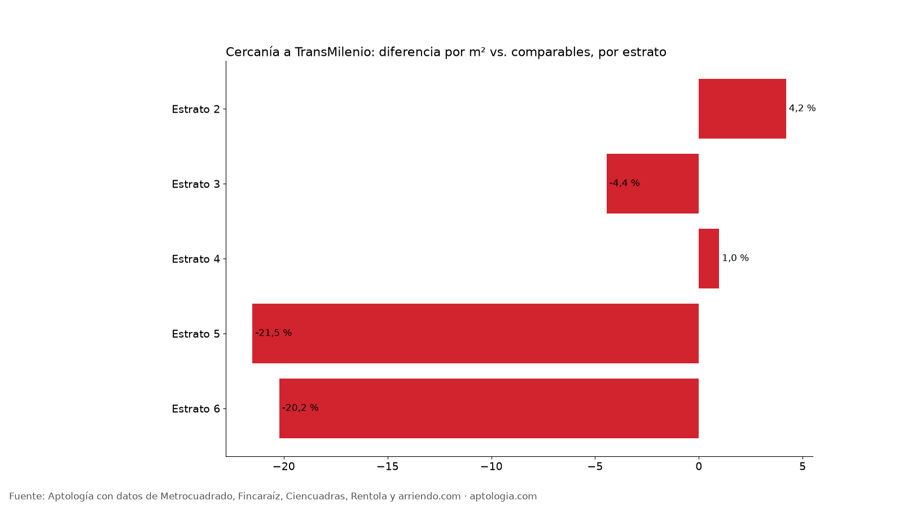
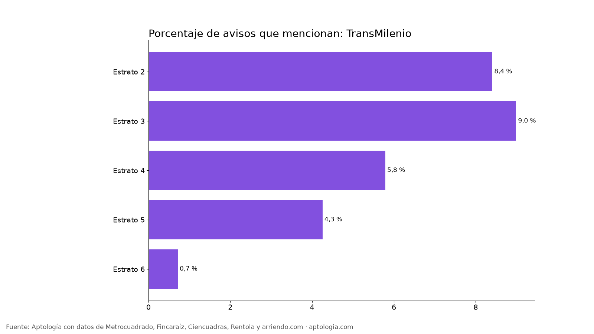

# Arriendo cerca de TransMilenio en Bogotá: ¿cuesta más vivir junto a una estación? (2026)

**En Bogotá, un apartamento en arriendo que menciona TransMilenio (cerca de una estación o troncal) cuesta 4,4 % menos por metro cuadrado que uno comparable del mismo estrato y número de habitaciones.** Así se anuncian 633 de 18.920 avisos (3,3 %); el canon mediano es $1.900.000 con el atributo y $2.500.000 sin él.

*Resumen: comparamos 18.920 apartamentos en arriendo únicos en Bogotá con descripción, con y sin mención de TransMilenio.*

**Actualizado:** 13 de octubre de 2026 · **Próxima actualización:** mensual.

## Cercanía a TransMilenio por estrato

| Estrato | Avisos | Lo mencionan | % de avisos | Canon mediano con | Canon mediano sin | Diferencia por m² (comparable) |
|---|---|---|---|---|---|---|
| Estrato 2 | 452 | 38 | 8,4 % | $1.200.000 | $1.182.500 | 4,2 % |
| Estrato 3 | 3.048 | 274 | 9,0 % | $1.600.000 | $1.600.000 | -4,4 % |
| Estrato 4 | 3.402 | 197 | 5,8 % | $2.000.000 | $2.500.000 | 1,0 % |
| Estrato 5 | 1.927 | 82 | 4,3 % | $2.925.000 | $4.400.000 | -21,5 % |
| Estrato 6 | 5.724 | 41 | 0,7 % | $4.500.000 | $9.000.000 | -20,2 % |

**Cómo usarlo para decidir:** en Bogotá, vivir cerca de TransMilenio no se paga con prima por m²: dentro del mismo estrato suele salir igual o más barato. Si trabajas o estudias sobre una troncal, buscar junto a una estación te ahorra tiempo sin subir el arriendo; a cambio, revisa el ruido y la seguridad de la cuadra.

## Preguntas frecuentes

**¿Cuánto cambia el arriendo de un apartamento que menciona TransMilenio (cerca de una estación o troncal) en Bogotá?**
-4,4 % por m² frente a apartamentos comparables del mismo estrato y habitaciones, corte al 13 de octubre de 2026.

**¿Cuántos apartamentos en arriendo mencionan TransMilenio?**
633 de 18.920 avisos con descripción (3,3 %).

## Metodología

- **Fuente:** base de ingesta diaria de Aptología, con avisos públicos de Metrocuadrado, Fincaraíz, Ciencuadras, Rentola y arriendo.com. Corte al 13 de octubre de 2026.
- **Filtros:** avisos vivos que pasan el control de calidad, en Bogotá, canon entre $400.000 y $30.000.000. Se excluyen TikTok y Facebook Marketplace.
- **Duplicados:** se deja un aviso por grupo de duplicados (el mismo inmueble en varios portales).
- **Prima emparejada:** se compara el precio por m² de avisos con y sin el atributo dentro de la misma celda de estrato × habitaciones (mínimo 8 avisos por lado) y se reporta la mediana ponderada de las diferencias. Así la prima no se confunde con estrato o tamaño. El atributo se detecta en el texto del aviso, por lo que solo cuentan avisos con descripción. La cercanía se detecta cuando el aviso menciona TransMilenio, una troncal o una estación de TM.
- **Limitaciones:** son precios pedidos, no cerrados. Los barrios y localidades vienen tal como los escribe cada portal.
- **Datos abiertos:** [datos.csv](data/arriendo_cerca_de_transmilenio_bogota_datos.csv), licencia CC BY 4.0.

## Cómo citar

Pinzón Pineda, D. M. (2026). *Arriendo cerca de TransMilenio en Bogotá: ¿cuesta más vivir junto a una estación? (2026)*. Aptología. https://www.aptologia.com/estudios/arriendo-cerca-de-transmilenio-bogota. Datos: datos.csv, licencia CC BY 4.0.
