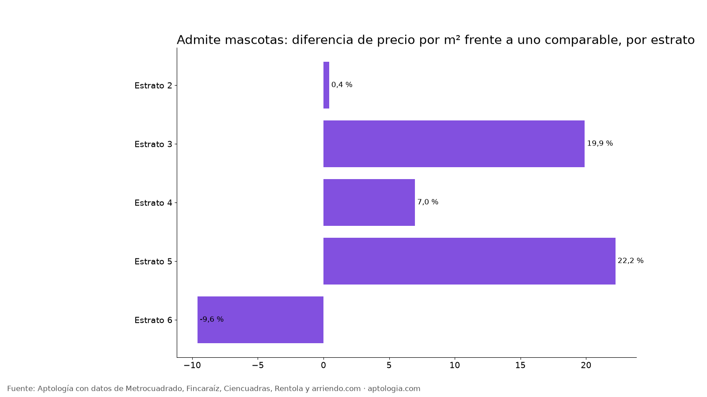

# Apartamentos que aceptan mascotas en Bogotá: cuántos hay y cuánto más cuestan (2026)

**En Bogotá, un apartamento en arriendo que acepta mascotas cuesta en promedio 7,0 % más por metro cuadrado que uno comparable del mismo estrato y número de habitaciones.** Lo menciona el 3,6 % de los avisos con descripción; el canon mediano de los que sí es $2.100.000 frente a $2.500.000 de los que no.

*Resumen: analizamos 19.156 apartamentos en arriendo únicos en Bogotá con descripción, de los cuales 694 mencionan que acepta mascotas.*

**Actualizado:** 13 de octubre de 2026 · **Próxima actualización:** mensual.

## Por estrato

| Estrato | Avisos | Lo mencionan | Canon mediano con | Canon mediano sin | Diferencia por m² (comparable) |
|---|---|---|---|---|---|
| 2 | 454 | 4,6 % | $1.200.000 | $1.200.000 | 0,4 % |
| 3 | 3.057 | 8,9 % | $1.500.000 | $1.600.000 | 19,9 % |
| 4 | 3.409 | 5,9 % | $2.300.000 | $2.500.000 | 7,0 % |
| 5 | 1.938 | 5,0 % | $3.500.000 | $4.300.000 | 22,2 % |
| 6 | 5.719 | 1,8 % | $5.100.000 | $9.000.000 | -9,6 % |

**Cómo usarlo para decidir:** la diferencia de canon bruta mezcla estrato y tamaño; la columna comparable aísla lo que pagas por el atributo. Úsala para negociar: si te cobran mucho más que esa prima, hay margen.

## Preguntas frecuentes

**¿Cuánto más cuesta un apartamento que acepta mascotas en Bogotá?**
Unos 7,0 % más por m² frente a un apartamento comparable (mismo estrato y habitaciones), según 673 avisos con el atributo, corte al 13 de octubre de 2026.

**¿Qué porcentaje de apartamentos en arriendo en Bogotá acepta mascotas?**
El 3,6 % de los avisos con descripción lo menciona.

## Metodología

- **Fuente:** base de ingesta diaria de Aptología, con avisos públicos de Metrocuadrado, Fincaraíz, Ciencuadras, Rentola y arriendo.com. Corte al 13 de octubre de 2026.
- **Filtros:** avisos vivos que pasan el control de calidad, en Bogotá, canon entre $400.000 y $30.000.000. Se excluyen TikTok y Facebook Marketplace.
- **Duplicados:** se deja un aviso por grupo de duplicados (el mismo inmueble en varios portales).
- **Prima emparejada:** se compara el precio por m² de avisos con y sin el atributo dentro de la misma celda de estrato × habitaciones (mínimo 8 avisos por lado) y se reporta la mediana ponderada de las diferencias. Así la prima no se confunde con estrato o tamaño. El atributo se detecta en el texto del aviso, por lo que solo cuentan avisos con descripción.
- **Limitaciones:** son precios pedidos, no cerrados. Los barrios y localidades vienen tal como los escribe cada portal.
- **Datos abiertos:** [datos.csv](datos.csv), licencia CC BY 4.0.

## Cómo citar

Pinzón Pineda, D. M. (2026). *Apartamentos que aceptan mascotas en Bogotá: cuántos hay y cuánto más cuestan (2026)*. Aptología. https://www.aptologia.com/estudios/arriendo-con-mascotas-bogota. Datos: datos.csv, licencia CC BY 4.0.
