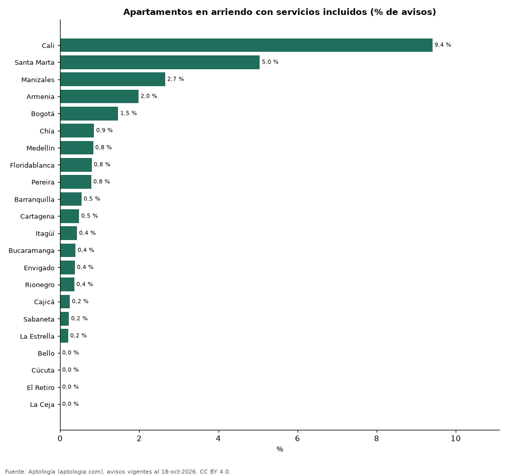

# Arriendo con servicios incluidos en Colombia: cuánto más cuesta y en qué ciudades se ofrece (octubre 2026)

**Solo el 1,1 % de los apartamentos en arriendo en Colombia se anuncia con servicios públicos incluidos; donde más se ofrece es en Cali (9,4 % de los avisos).** En apartamento 1 habitación el canon con servicios incluidos es 15,8 % más bajo que el que no los incluye (2.400.000 pesos contra 2.850.000 pesos), porque estos avisos suelen ser unidades más pequeñas o en otras zonas.

*Resumen: analizamos 73.367 apartamentos y apartaestudios en arriendo, 813 con servicios incluidos.*

**Actualizado:** 18 de octubre de 2026 (datos del 18 de octubre de 2026) · **Próxima actualización:** mensual.

## Resumen

| Indicador | Valor |
|---|---|
| Avisos con servicios incluidos | 1,1 % |
| Ciudad donde más se ofrecen | Cali: 9,4 % |
| Apartamento 1 habitación | -15,8 % |
| Apartamento 2 habitaciones | -35,5 % |
| Apartamento 3 o más habitaciones | -16,7 % |
| Apartaestudio | -27,5 % |

## Canon con y sin servicios incluidos por tipo

| Tipo | Con servicios incluidos | Sin servicios | Diferencia | Avisos (con / sin) |
|---|---|---|---|---|
| Apartamento 1 habitación | 2.400.000 pesos | 2.850.000 pesos | -15,8 % | 140 / 7.347 |
| Apartamento 2 habitaciones | 2.000.000 pesos | 3.100.000 pesos | -35,5 % | 162 / 23.456 |
| Apartamento 3 o más habitaciones | 3.500.000 pesos | 4.200.000 pesos | -16,7 % | 83 / 34.588 |
| Apartaestudio | 1.450.000 pesos | 2.000.000 pesos | -27,5 % | 426 / 6.967 |

Medianas del canon pedido; servicios incluidos según el portal (campo serv). Sin emparejar por barrio: los avisos con servicios se concentran en unidades pequeñas y amobladas.

## Parte de la oferta con servicios incluidos por ciudad (300 avisos o más)

| Ciudad | Avisos con servicios incluidos | Avisos |
|---|---|---|
| Cali | 9,4 % | 2.093 |
| Santa Marta | 5,0 % | 733 |
| Manizales | 2,7 % | 414 |
| Armenia | 2,0 % | 454 |
| Bogotá | 1,5 % | 16.212 |
| Chía | 0,9 % | 582 |
| Medellín | 0,8 % | 22.535 |
| Floridablanca | 0,8 % | 375 |
| Pereira | 0,8 % | 1.782 |
| Barranquilla | 0,5 % | 4.250 |
| Cartagena | 0,5 % | 2.078 |
| Itagüí | 0,4 % | 938 |
| Bucaramanga | 0,4 % | 515 |
| Envigado | 0,4 % | 7.530 |
| Rionegro | 0,4 % | 3.350 |
| Cajicá | 0,2 % | 406 |
| Sabaneta | 0,2 % | 4.012 |
| La Estrella | 0,2 % | 496 |
| Bello | 0,0 % | 1.148 |
| Cúcuta | 0,0 % | 438 |
| El Retiro | 0,0 % | 593 |
| La Ceja | 0,0 % | 391 |

## Preguntas frecuentes

**¿Cuesta más un arriendo con servicios incluidos?**
No siempre: apartamento 1 habitación, -15,8 %; apartamento 2 habitaciones, -35,5 %; apartamento 3 o más habitaciones, -16,7 %; apartaestudio, -27,5 % frente a los que no los incluyen (medianas sin emparejar por zona).

**¿Es común arrendar con servicios incluidos en Colombia?**
No: solo el 1,1 % de los avisos de apartamentos los incluye.

## Metodología

- **Fuente:** exportes nocturnos de la base de datos de Aptología (aptologia.com) del 18 de octubre de 2026: avisos vigentes de vivienda en portales inmobiliarios de 13 países, recogidos por Aptología y vistos en línea entre el 11 y el 18 de octubre de 2026. Corte: 18 de octubre de 2026.
- **Depuración:** se eliminan duplicados exactos (misma ciudad, zona, tipo, precio, moneda, área, habitaciones y baños) y los precios fuera del percentil 1–99 de cada país, operación, moneda y tipo; el precio por m² usa solo avisos con área declarada entre 12 y 2.000 m² y también se recorta al P1–P99.
- **Qué se mide:** precios pedidos (publicados), no precios de cierre. En arriendo, el canon mensual sin administración, gastos comunes ni condominio.
- **Muestra mínima:** cada cifra publicada se apoya en al menos 30 avisos; las celdas con menos se omiten.
- **Colombia:** Precios en pesos colombianos, sin conversión de moneda.
- **Limitaciones:** la cobertura depende de los portales que recorre Aptología en cada país y es mayor en las ciudades grandes y en los segmentos medio-alto y alto; el área es la que declara el aviso, sin verificar; los nombres de zona vienen de los portales.
- **Privacidad:** solo se publican agregados; no se publica ningún dato personal, enlace a avisos ni nombre de anunciante.
- **Datos abiertos:** [datos.csv](datos.csv), licencia CC BY 4.0.

## Cómo citar

Pinzón Pineda, D. M. (2026). *Arriendo con servicios incluidos en Colombia: cuánto más cuesta y en qué ciudades se ofrece (octubre 2026)*. Aptología (aptologia.com). https://github.com/elbroker/aptologia-datos/tree/main/estudios/arriendo-con-servicios-incluidos-colombia-2026. Datos: datos.csv, licencia CC BY 4.0.
