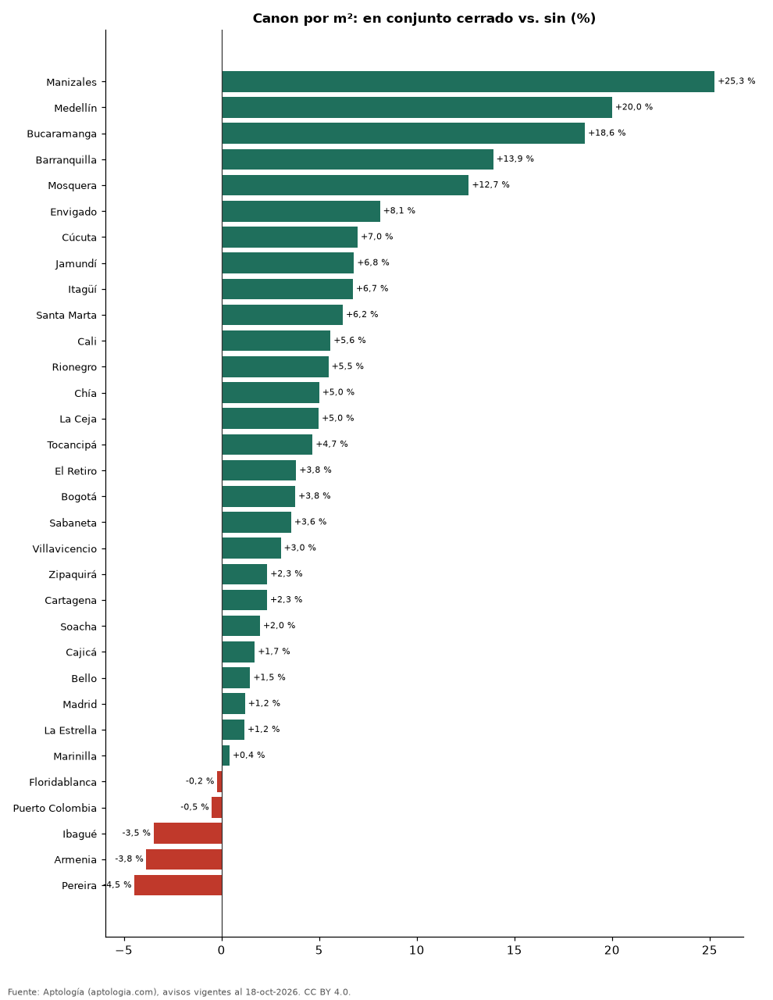

# Arriendo en conjunto cerrado frente a edificio o casa sin conjunto en Colombia (octubre 2026)

**Un apartamento en arriendo en conjunto cerrado se pide en Colombia un 11,0 % más por metro cuadrado que uno comparable sin esa característica (misma ciudad y número de habitaciones).** El 57,8 % de los apartamentos en arriendo lo declara. En Bogotá la diferencia es 3,8 % (38,0 % de la oferta).

*Resumen: comparamos 64.543 apartamentos en arriendo con área declarada, emparejando por ciudad y habitaciones (55 celdas con 30 avisos o más en cada grupo).*

**Actualizado:** 18 de octubre de 2026 (datos del 18 de octubre de 2026) · **Próxima actualización:** mensual.

## Resumen

| Indicador | Valor |
|---|---|
| Diferencia por m² (emparejada) | +11,0 % |
| Parte de la oferta | 57,8 % |
| Ciudades con muestra suficiente | 32 |
| Avisos analizados | 64.543 |

## Diferencia por ciudad

| Ciudad | Diferencia por m² | Con conjunto (pesos/m²) | Sin conjunto (pesos/m²) | Parte de la oferta | Avisos (con / sin) |
|---|---|---|---|---|---|
| Manizales | +25,3 % | 36.158 | 28.868 | 36,9 % | 104 / 178 |
| Medellín | +20,0 % | 52.000 | 43.333 | 64,3 % | 12.913 / 7.155 |
| Bucaramanga | +18,6 % | 32.349 | 27.273 | 38,0 % | 158 / 258 |
| Barranquilla | +13,9 % | 35.556 | 31.213 | 50,4 % | 1.860 / 1.834 |
| Mosquera | +12,7 % | 29.630 | 26.298 | 65,3 % | 109 / 58 |
| Envigado | +8,1 % | 49.565 | 45.843 | 75,6 % | 5.519 / 1.784 |
| Cúcuta | +7,0 % | 23.256 | 21.739 | 31,9 % | 95 / 203 |
| Jamundí | +6,8 % | 21.357 | 20.000 | 67,3 % | 72 / 35 |
| Itagüí | +6,7 % | 41.270 | 38.667 | 53,2 % | 483 / 425 |
| Santa Marta | +6,2 % | 45.758 | 43.080 | 61,1 % | 412 / 262 |
| Cali | +5,6 % | 30.716 | 29.091 | 43,6 % | 654 / 845 |
| Rionegro | +5,5 % | 38.462 | 36.464 | 62,6 % | 1.989 / 1.190 |
| Chía | +5,0 % | 34.348 | 32.711 | 48,9 % | 239 / 250 |
| La Ceja | +5,0 % | 38.304 | 36.486 | 34,5 % | 122 / 232 |
| Tocancipá | +4,7 % | 19.185 | 18.329 | 66,0 % | 62 / 32 |
| El Retiro | +3,8 % | 50.000 | 48.156 | 70,1 % | 379 / 162 |
| Bogotá | +3,8 % | 49.296 | 47.500 | 38,0 % | 4.919 / 8.035 |
| Sabaneta | +3,6 % | 41.429 | 40.000 | 73,0 % | 2.825 / 1.043 |
| Villavicencio | +3,0 % | 27.692 | 26.876 | 48,6 % | 36 / 38 |
| Zipaquirá | +2,3 % | 22.248 | 21.738 | 50,0 % | 84 / 84 |
| Cartagena | +2,3 % | 44.545 | 43.529 | 42,6 % | 855 / 1.153 |
| Soacha | +2,0 % | 19.375 | 19.000 | 53,9 % | 69 / 59 |
| Cajicá | +1,7 % | 34.228 | 33.654 | 57,1 % | 220 / 165 |
| Bello | +1,5 % | 33.824 | 33.333 | 55,7 % | 603 / 479 |
| Madrid | +1,2 % | 20.938 | 20.690 | 68,7 % | 178 / 81 |
| La Estrella | +1,2 % | 38.542 | 38.093 | 52,6 % | 257 / 232 |
| Marinilla | +0,4 % | 29.167 | 29.045 | 36,4 % | 39 / 68 |
| Floridablanca | -0,2 % | 29.361 | 29.428 | 47,6 % | 170 / 187 |
| Puerto Colombia | -0,5 % | 31.865 | 32.023 | 60,0 % | 54 / 36 |
| Ibagué | -3,5 % | 22.368 | 23.175 | 57,8 % | 144 / 105 |
| Armenia | -3,8 % | 32.051 | 33.333 | 64,7 % | 218 / 119 |
| Pereira | -4,5 % | 33.146 | 34.692 | 85,0 % | 1.300 / 230 |

Mediana del canon por m² con y sin la característica en cada ciudad (30 avisos o más en cada grupo). La cifra nacional promedia las diferencias dentro de cada combinación de ciudad y número de habitaciones, ponderadas por el número de avisos con la característica.

## Preguntas frecuentes

**¿Cuánto más cuesta arrendar un apartamento en conjunto cerrado en Colombia?**
En la oferta de octubre de 2026, un 11,0 % más por metro cuadrado que uno comparable.

**¿Qué porcentaje de los arriendos en Colombia es en conjunto cerrado?**
El 57,8 % de los apartamentos en arriendo con el dato informado.

## Metodología

- **Fuente:** exportes nocturnos de la base de datos de Aptología (aptologia.com) del 18 de octubre de 2026: avisos vigentes de vivienda en portales inmobiliarios de 13 países, recogidos por Aptología y vistos en línea entre el 11 y el 18 de octubre de 2026. Corte: 18 de octubre de 2026.
- **Depuración:** se eliminan duplicados exactos (misma ciudad, zona, tipo, precio, moneda, área, habitaciones y baños) y los precios fuera del percentil 1–99 de cada país, operación, moneda y tipo; el precio por m² usa solo avisos con área declarada entre 12 y 2.000 m² y también se recorta al P1–P99.
- **Qué se mide:** precios pedidos (publicados), no precios de cierre. En arriendo, el canon mensual sin administración, gastos comunes ni condominio.
- **Muestra mínima:** cada cifra publicada se apoya en al menos 30 avisos; las celdas con menos se omiten.
- **Colombia:** Precios en pesos colombianos, sin conversión de moneda. Los indicadores de amoblado, mascotas, conjunto cerrado, balcón y aviso directo del dueño solo existen en arriendo y vienen de los portales.
- **Limitaciones:** la cobertura depende de los portales que recorre Aptología en cada país y es mayor en las ciudades grandes y en los segmentos medio-alto y alto; el área es la que declara el aviso, sin verificar; los nombres de zona vienen de los portales.
- **Privacidad:** solo se publican agregados; no se publica ningún dato personal, enlace a avisos ni nombre de anunciante.
- **Datos abiertos:** [datos.csv](datos.csv), licencia CC BY 4.0.

## Cómo citar

Pinzón Pineda, D. M. (2026). *Arriendo en conjunto cerrado frente a edificio o casa sin conjunto en Colombia (octubre 2026)*. Aptología (aptologia.com). https://github.com/elbroker/aptologia-datos/tree/main/estudios/arriendo-conjunto-cerrado-vs-calle-colombia-2026. Datos: datos.csv, licencia CC BY 4.0.
