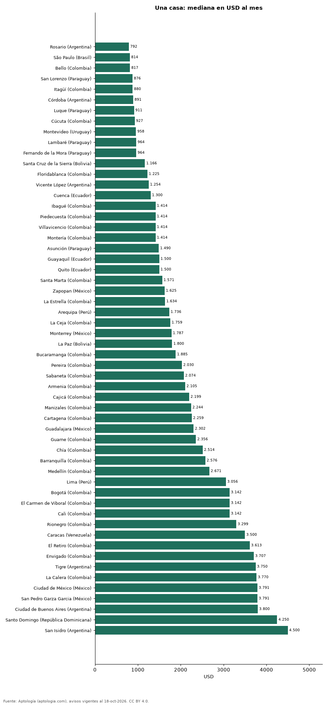

# Cuánto cuesta arrendar una casa en 56 ciudades de Latinoamérica (octubre 2026)

**Una casa se arrienda por USD 792 al mes en la mediana de Rosario (Argentina), la más baja de 56 ciudades, y por USD 4.500 al mes en San Isidro (Argentina), la más alta.** En Bogotá, USD 3.142 al mes. Entre las capitales, de USD 814 en São Paulo a USD 4.250 en Santo Domingo.

*Resumen: comparamos 27.002 avisos en 56 ciudades con 30 avisos o más.*

**Actualizado:** 18 de octubre de 2026 (datos del 18 de octubre de 2026) · **Próxima actualización:** mensual.

## Resumen

| Indicador | Valor |
|---|---|
| Más barato | Rosario (Argentina): USD 792 |
| Más caro | San Isidro (Argentina): USD 4.500 |
| Bogotá | USD 3.142 |
| Ciudades | 56 |

## Ciudades de menor a mayor

| Ciudad | Arriendo mensual (mediana) | USD por m² al mes | Avisos |
|---|---|---|---|
| Rosario (Argentina) | USD 792 | 5,9 | 84 |
| São Paulo (Brasil) | USD 814 | 5,9 | 2.671 |
| Bello (Colombia) | USD 817 | 7,9 | 54 |
| San Lorenzo (Paraguay) | USD 876 | — | 50 |
| Itagüí (Colombia) | USD 880 | 8,8 | 82 |
| Córdoba (Argentina) | USD 891 | 6,8 | 136 |
| Luque (Paraguay) | USD 911 | 5,7 | 222 |
| Cúcuta (Colombia) | USD 927 | 5,3 | 174 |
| Montevideo (Uruguay) | USD 958 | 9,9 | 493 |
| Lambaré (Paraguay) | USD 964 | — | 70 |
| Fernando de la Mora (Paraguay) | USD 964 | 4,9 | 82 |
| Santa Cruz de la Sierra (Bolivia) | USD 1.166 | 4,8 | 755 |
| Floridablanca (Colombia) | USD 1.225 | 6,7 | 84 |
| Vicente López (Argentina) | USD 1.254 | 11,8 | 47 |
| Cuenca (Ecuador) | USD 1.300 | 4,7 | 55 |
| Ibagué (Colombia) | USD 1.414 | 6,0 | 30 |
| Piedecuesta (Colombia) | USD 1.414 | 6,5 | 39 |
| Villavicencio (Colombia) | USD 1.414 | 5,3 | 47 |
| Montería (Colombia) | USD 1.414 | 4,6 | 95 |
| Asunción (Paraguay) | USD 1.490 | 6,0 | 1.958 |
| Guayaquil (Ecuador) | USD 1.500 | 6,0 | 561 |
| Quito (Ecuador) | USD 1.500 | 5,1 | 491 |
| Santa Marta (Colombia) | USD 1.571 | 7,3 | 112 |
| Zapopan (México) | USD 1.625 | 7,9 | 449 |
| La Estrella (Colombia) | USD 1.634 | 8,6 | 45 |
| Arequipa (Perú) | USD 1.736 | 6,3 | 32 |
| La Ceja (Colombia) | USD 1.759 | 9,2 | 236 |
| Monterrey (México) | USD 1.787 | 7,3 | 731 |
| La Paz (Bolivia) | USD 1.800 | 4,8 | 79 |
| Bucaramanga (Colombia) | USD 1.885 | 7,9 | 182 |
| Pereira (Colombia) | USD 2.030 | 6,9 | 965 |
| Sabaneta (Colombia) | USD 2.074 | 9,3 | 160 |
| Armenia (Colombia) | USD 2.105 | 7,3 | 92 |
| Cajicá (Colombia) | USD 2.199 | 10,1 | 534 |
| Manizales (Colombia) | USD 2.244 | 8,1 | 130 |
| Cartagena (Colombia) | USD 2.259 | 8,9 | 256 |
| Guadalajara (México) | USD 2.302 | 7,4 | 114 |
| Guarne (Colombia) | USD 2.356 | 10,7 | 75 |
| Chía (Colombia) | USD 2.514 | 9,6 | 669 |
| Barranquilla (Colombia) | USD 2.576 | 7,9 | 821 |
| Medellín (Colombia) | USD 2.671 | 10,6 | 3.728 |
| Lima (Perú) | USD 3.056 | 7,5 | 343 |
| Bogotá (Colombia) | USD 3.142 | 9,4 | 2.512 |
| El Carmen de Viboral (Colombia) | USD 3.142 | 9,1 | 95 |
| Cali (Colombia) | USD 3.142 | 7,4 | 581 |
| Rionegro (Colombia) | USD 3.299 | 11,6 | 1.437 |
| Caracas (Venezuela) | USD 3.500 | 8,4 | 54 |
| El Retiro (Colombia) | USD 3.613 | 12,8 | 512 |
| Envigado (Colombia) | USD 3.707 | 13,1 | 2.132 |
| Tigre (Argentina) | USD 3.750 | 14,0 | 128 |
| La Calera (Colombia) | USD 3.770 | 9,8 | 298 |
| Ciudad de México (México) | USD 3.791 | 11,3 | 763 |
| San Pedro Garza Garcia (México) | USD 3.791 | 11,3 | 191 |
| Ciudad de Buenos Aires (Argentina) | USD 3.800 | 14,3 | 138 |
| Santo Domingo (República Dominicana) | USD 4.250 | 8,9 | 48 |
| San Isidro (Argentina) | USD 4.500 | 13,1 | 80 |

Medianas en la moneda mayoritaria de cada ciudad, convertidas a dólares.

## Preguntas frecuentes

**¿Dónde es más barato arrendar una casa?**
En Rosario (Argentina): USD 792 al mes en la mediana (octubre de 2026).

**¿Dónde es más caro?**
En San Isidro (Argentina): USD 4.500 al mes.

## Metodología

- **Fuente:** exportes nocturnos de la base de datos de Aptología (aptologia.com) del 18 de octubre de 2026: avisos vigentes de vivienda en portales inmobiliarios de 13 países, recogidos por Aptología y vistos en línea entre el 11 y el 18 de octubre de 2026. Corte: 18 de octubre de 2026.
- **Depuración:** se eliminan duplicados exactos (misma ciudad, zona, tipo, precio, moneda, área, habitaciones y baños) y los precios fuera del percentil 1–99 de cada país, operación, moneda y tipo; el precio por m² usa solo avisos con área declarada entre 12 y 2.000 m² y también se recorta al P1–P99.
- **Qué se mide:** precios pedidos (publicados), no precios de cierre. En arriendo, el canon mensual sin administración, gastos comunes ni condominio.
- **Muestra mínima:** cada cifra publicada se apoya en al menos 30 avisos; las celdas con menos se omiten.
- **Monedas:** nunca se mezclan avisos de monedas distintas sin convertirlos. Conversión a dólares con la tasa de mercado de ExchangeRate-API (open.er-api.com, actualización del 18 Oct 2026): 1 USD = 3.182,80 COP, 1 USD = 18,47 M.N, 1 USD = 5,09 BRL, 1 USD = 3,44 PEN, 1 USD = 982,44 CLP, 1 USD = 1.514,57 ARS, 1 USD = 40,20 UYU, 1 USD = 5.705,37 PYG, 1 USD = 61,27 DOP, 1 USD = 0,89 EUR, 1 USD = 11,72 BOB; la UF chilena a 41.178,64 CLP (mindicador,cl. 18-oct-2026). Los avisos publicados en dólares se usan tal cual.
- **Monedas:** en cada ciudad y operación se usa solo la moneda mayoritaria de los avisos (los avisos en otra moneda se excluyen) y la mediana se convierte a dólares con la tasa citada; nunca se promedian avisos de monedas distintas.
- **Destinos de temporada:** en arriendo se excluyen Punta del Este, Maldonado y Punta Cana, donde muchos avisos son alquileres de temporada.
- **Limitaciones:** la cobertura depende de los portales que recorre Aptología en cada país y es mayor en las ciudades grandes y en los segmentos medio-alto y alto; el área es la que declara el aviso, sin verificar; los nombres de zona vienen de los portales.
- **Privacidad:** solo se publican agregados; no se publica ningún dato personal, enlace a avisos ni nombre de anunciante.
- **Datos abiertos:** [datos.csv](datos.csv), licencia CC BY 4.0.

## Cómo citar

Pinzón Pineda, D. M. (2026). *Cuánto cuesta arrendar una casa en 56 ciudades de Latinoamérica (octubre 2026)*. Aptología (aptologia.com). https://github.com/elbroker/aptologia-datos/tree/main/estudios/arriendo-de-casas-ciudades-latinoamerica-2026. Datos: datos.csv, licencia CC BY 4.0.
