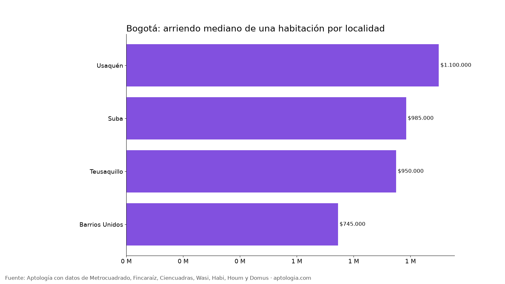

# Arriendo de habitaciones en Bogotá: cuánto cuesta una habitación por localidad (octubre 2026)

**Arrendar una habitación en Bogotá cuesta en la mediana $900.000 al mes (la mitad de los avisos está entre $700.000 y $1.200.000), frente a $1.900.000 de un apartaestudio.** El 43,5 % de las habitaciones pide medio salario mínimo ($875.452) o menos.

*Resumen: analizamos 115 habitaciones en arriendo únicas en Bogotá.*

**Actualizado:** 18 de octubre de 2026 (datos del 18 de octubre de 2026) · **Próxima actualización:** mensual.

## Resumen

| Indicador | Valor |
|---|---|
| Arriendo mediano de una habitación | $900.000 |
| Rango típico (P25 – P75) | $700.000 – $1.200.000 |
| Arriendo mediano de un apartaestudio | $1.900.000 |
| Habitaciones a medio salario mínimo o menos | 43,5 % |
| Habitaciones analizadas | 115 |

## Por localidad (10 avisos o más)

| Localidad | Arriendo mediano | Avisos |
|---|---|---|
| Usaquén | $1.100.000 | 22 |
| Suba | $985.000 | 24 |
| Teusaquillo | $950.000 | 23 |
| Barrios Unidos | $745.000 | 12 |

**Cómo usarlo para decidir:** una habitación cuesta mucho menos que un apartaestudio, pero confirma qué incluye (servicios, internet, uso de cocina y lavadora) y las reglas de la casa. Pide contrato escrito aunque sea corto.

## Preguntas frecuentes

**¿Cuánto cuesta arrendar una habitación en Bogotá?**
La mediana es $900.000 al mes; la mitad de los avisos está entre $700.000 y $1.200.000 (datos del 18 de octubre de 2026).

**¿Es más barato arrendar una habitación que un apartaestudio en Bogotá?**
Sí: $900.000 frente a $1.900.000 de mediana para un apartaestudio.

**¿Dónde es más barato arrendar una habitación en Bogotá?**
Entre las localidades con 10 avisos o más, en Barrios Unidos ($745.000).

## Metodología

- **Fuente:** avisos vivos de vivienda recogidos por la ingesta de Aptología en Metrocuadrado, Fincaraíz, Ciencuadras, Wasi, Habi, Houm y Domus, del 11 al 18 de octubre de 2026. Corte: 18 de octubre de 2026.
- **Depuración:** un mismo inmueble publicado varias veces se cuenta una sola vez (agrupación por portal y, entre portales, por precio, área, habitaciones y coordenadas). Se descartan precios y áreas fuera de rango y, en arriendo, se resta la administración cuando el portal la incluye en el canon.
- **Qué se mide:** precios pedidos (publicados), no precios de cierre.
- **Habitación:** aviso clasificado como habitación por el portal (casi todas en un solo portal). Por localidad, solo con 10 avisos o más; el estudio completo supera los 80 avisos. Muestra pequeña: úsala como referencia.
- **Limitaciones:** son precios pedidos en portales, que pueden diferir del valor final de arriendo o venta. La cobertura es mayor en el norte de Bogotá y en estratos 4 a 6, porque ahí se concentra la oferta publicada. Los barrios y la localidad vienen de lo que escribe cada portal; cuando falta la localidad se asigna por los avisos vecinos más cercanos.
- **Datos abiertos:** [datos.csv](datos.csv), licencia CC BY 4.0.

## Cómo citar

Pinzón Pineda, D. M. (2026). *Arriendo de habitaciones en Bogotá: cuánto cuesta una habitación por localidad (octubre 2026)*. Aptología. https://www.aptologia.com/estudios/arriendo-de-habitaciones-bogota-2026. Datos: datos.csv, licencia CC BY 4.0.
