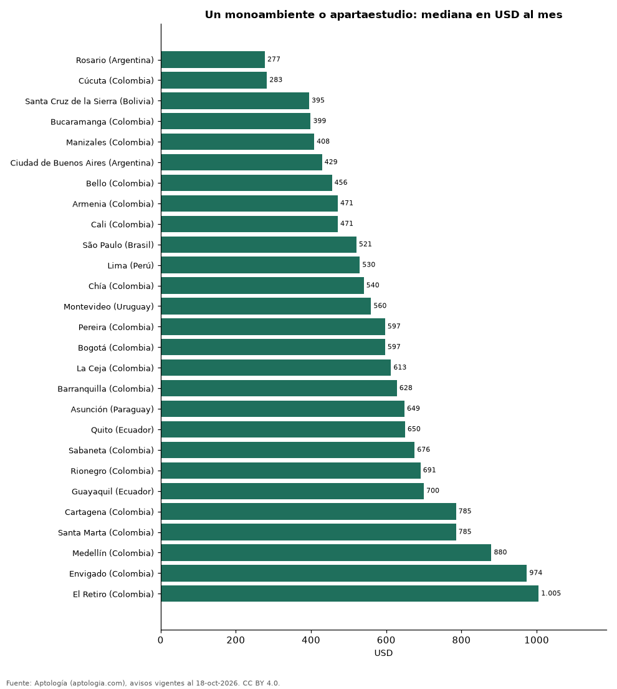

# Cuánto cuesta arrendar un monoambiente, estudio o apartaestudio en 27 ciudades de Latinoamérica (octubre 2026)

**Un monoambiente o apartaestudio se arrienda por USD 277 al mes en la mediana de Rosario (Argentina), la más baja de 27 ciudades, y por USD 1.005 al mes en El Retiro (Colombia), la más alta.** En Bogotá, USD 597 al mes. Entre las capitales, de USD 429 en Ciudad de Buenos Aires a USD 650 en Quito.

*Resumen: comparamos 11.828 avisos en 27 ciudades con 30 avisos o más.*

**Actualizado:** 18 de octubre de 2026 (datos del 18 de octubre de 2026) · **Próxima actualización:** mensual.

## Resumen

| Indicador | Valor |
|---|---|
| Más barato | Rosario (Argentina): USD 277 |
| Más caro | El Retiro (Colombia): USD 1.005 |
| Bogotá | USD 597 |
| Ciudades | 27 |

## Ciudades de menor a mayor

| Ciudad | Arriendo mensual (mediana) | USD por m² al mes | Avisos |
|---|---|---|---|
| Rosario (Argentina) | USD 277 | 9,5 | 34 |
| Cúcuta (Colombia) | USD 283 | 8,2 | 42 |
| Santa Cruz de la Sierra (Bolivia) | USD 395 | 10,0 | 258 |
| Bucaramanga (Colombia) | USD 399 | 11,3 | 77 |
| Manizales (Colombia) | USD 408 | 12,4 | 125 |
| Ciudad de Buenos Aires (Argentina) | USD 429 | 13,7 | 961 |
| Bello (Colombia) | USD 456 | 11,5 | 58 |
| Armenia (Colombia) | USD 471 | 12,8 | 115 |
| Cali (Colombia) | USD 471 | 12,6 | 479 |
| São Paulo (Brasil) | USD 521 | 18,8 | 1.988 |
| Lima (Perú) | USD 530 | 12,3 | 124 |
| Chía (Colombia) | USD 540 | 14,4 | 88 |
| Montevideo (Uruguay) | USD 560 | 17,1 | 663 |
| Pereira (Colombia) | USD 597 | 13,2 | 221 |
| Bogotá (Colombia) | USD 597 | 19,5 | 2.919 |
| La Ceja (Colombia) | USD 613 | 12,7 | 36 |
| Barranquilla (Colombia) | USD 628 | 14,3 | 424 |
| Asunción (Paraguay) | USD 649 | 15,5 | 356 |
| Quito (Ecuador) | USD 650 | 10,9 | 126 |
| Sabaneta (Colombia) | USD 676 | 14,2 | 122 |
| Rionegro (Colombia) | USD 691 | 14,2 | 153 |
| Guayaquil (Ecuador) | USD 700 | 10,0 | 87 |
| Cartagena (Colombia) | USD 785 | 17,4 | 43 |
| Santa Marta (Colombia) | USD 785 | 21,8 | 47 |
| Medellín (Colombia) | USD 880 | 18,9 | 2.055 |
| Envigado (Colombia) | USD 974 | 20,2 | 176 |
| El Retiro (Colombia) | USD 1.005 | 17,8 | 51 |

Medianas en la moneda mayoritaria de cada ciudad, convertidas a dólares.

## Preguntas frecuentes

**¿Dónde es más barato arrendar un monoambiente o apartaestudio?**
En Rosario (Argentina): USD 277 al mes en la mediana (octubre de 2026).

**¿Dónde es más caro?**
En El Retiro (Colombia): USD 1.005 al mes.

## Metodología

- **Fuente:** exportes nocturnos de la base de datos de Aptología (aptologia.com) del 18 de octubre de 2026: avisos vigentes de vivienda en portales inmobiliarios de 13 países, recogidos por Aptología y vistos en línea entre el 11 y el 18 de octubre de 2026. Corte: 18 de octubre de 2026.
- **Depuración:** se eliminan duplicados exactos (misma ciudad, zona, tipo, precio, moneda, área, habitaciones y baños) y los precios fuera del percentil 1–99 de cada país, operación, moneda y tipo; el precio por m² usa solo avisos con área declarada entre 12 y 2.000 m² y también se recorta al P1–P99.
- **Qué se mide:** precios pedidos (publicados), no precios de cierre. En arriendo, el canon mensual sin administración, gastos comunes ni condominio.
- **Muestra mínima:** cada cifra publicada se apoya en al menos 30 avisos; las celdas con menos se omiten.
- **Monedas:** nunca se mezclan avisos de monedas distintas sin convertirlos. Conversión a dólares con la tasa de mercado de ExchangeRate-API (open.er-api.com, actualización del 18 Oct 2026): 1 USD = 3.182,80 COP, 1 USD = 18,47 M.N, 1 USD = 5,09 BRL, 1 USD = 3,44 PEN, 1 USD = 982,44 CLP, 1 USD = 1.514,57 ARS, 1 USD = 40,20 UYU, 1 USD = 5.705,37 PYG, 1 USD = 61,27 DOP, 1 USD = 0,89 EUR, 1 USD = 11,72 BOB; la UF chilena a 41.178,64 CLP (mindicador,cl. 18-oct-2026). Los avisos publicados en dólares se usan tal cual.
- **Monedas:** en cada ciudad y operación se usa solo la moneda mayoritaria de los avisos (los avisos en otra moneda se excluyen) y la mediana se convierte a dólares con la tasa citada; nunca se promedian avisos de monedas distintas.
- **Destinos de temporada:** en arriendo se excluyen Punta del Este, Maldonado y Punta Cana, donde muchos avisos son alquileres de temporada.
- **Limitaciones:** la cobertura depende de los portales que recorre Aptología en cada país y es mayor en las ciudades grandes y en los segmentos medio-alto y alto; el área es la que declara el aviso, sin verificar; los nombres de zona vienen de los portales.
- **Privacidad:** solo se publican agregados; no se publica ningún dato personal, enlace a avisos ni nombre de anunciante.
- **Datos abiertos:** [datos.csv](datos.csv), licencia CC BY 4.0.

## Cómo citar

Pinzón Pineda, D. M. (2026). *Cuánto cuesta arrendar un monoambiente, estudio o apartaestudio en 27 ciudades de Latinoamérica (octubre 2026)*. Aptología (aptologia.com). https://github.com/elbroker/aptologia-datos/tree/main/estudios/arriendo-de-monoambientes-y-apartaestudios-latinoamerica-2026. Datos: datos.csv, licencia CC BY 4.0.
