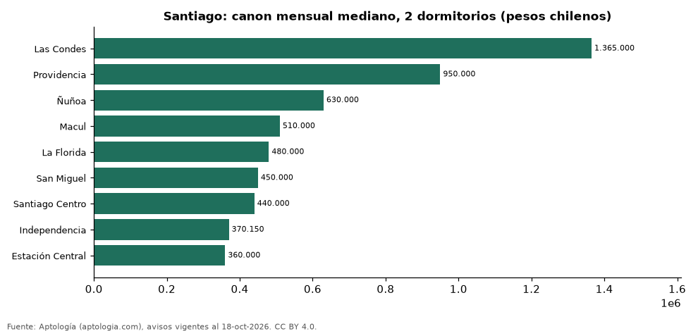

# Dónde es más caro y más barato arrendar un departamento de 2 dormitorios en Santiago: ranking de comunas (octubre 2026)

**En Santiago, un departamento de 2 dormitorios se arrienda por 1.365.000 pesos chilenos (USD 1.389) al mes en la mediana en Las Condes, la comuna más cara, y 360.000 pesos chilenos (USD 366) al mes en Estación Central, la más barata: 3,8 veces menos.** Comparamos 9 comunas con al menos 30 avisos de 2 dormitorios.

*Resumen: analizamos 2.106 departamentos en arriendo de 2 dormitorios en 9 comunas de Santiago.*

**Actualizado:** 18 de octubre de 2026 (datos del 18 de octubre de 2026) · **Próxima actualización:** mensual.

## Resumen

| Indicador | Valor |
|---|---|
| Más caro | Las Condes: 1.365.000 pesos chilenos (USD 1.389) |
| Más barato | Estación Central: 360.000 pesos chilenos (USD 366) |
| Diferencia | 3,8 veces |
| Comunas | 9 |

## Canon mensual de un departamento de 2 dormitorios por comuna

| Comuna | Canon mensual (mediana) | Rango típico (P25–P75) | Área mediana (m²) | Avisos |
|---|---|---|---|---|
| Las Condes | 1.365.000 pesos chilenos (USD 1.389) | 1.100.000 pesos chilenos (USD 1.120) – 1.712.500 pesos chilenos (USD 1.743) | 75 | 108 |
| Providencia | 950.000 pesos chilenos (USD 967) | 800.000 pesos chilenos (USD 814) – 1.162.500 pesos chilenos (USD 1.183) | 68 | 136 |
| Ñuñoa | 630.000 pesos chilenos (USD 641) | 540.000 pesos chilenos (USD 550) – 750.000 pesos chilenos (USD 763) | 57 | 228 |
| Macul | 510.000 pesos chilenos (USD 519) | 460.000 pesos chilenos (USD 468) – 570.000 pesos chilenos (USD 580) | 55 | 168 |
| La Florida | 480.000 pesos chilenos (USD 489) | 420.000 pesos chilenos (USD 428) – 530.000 pesos chilenos (USD 539) | 52 | 256 |
| San Miguel | 450.000 pesos chilenos (USD 458) | 400.000 pesos chilenos (USD 407) – 504.775 pesos chilenos (USD 514) | 52 | 216 |
| Santiago Centro | 440.000 pesos chilenos (USD 448) | 380.000 pesos chilenos (USD 387) – 513.000 pesos chilenos (USD 522) | 50 | 641 |
| Independencia | 370.150 pesos chilenos (USD 377) | 340.000 pesos chilenos (USD 346) – 414.666 pesos chilenos (USD 422) | 46 | 160 |
| Estación Central | 360.000 pesos chilenos (USD 366) | 310.000 pesos chilenos (USD 316) – 400.000 pesos chilenos (USD 407) | 47 | 193 |

Medianas del canon pedido, sin administración ni gastos comunes; solo comunas con 30 avisos o más.

## Preguntas frecuentes

**¿Cuánto cuesta arrendar un departamento de 2 dormitorios en Las Condes?**
1.365.000 pesos chilenos (USD 1.389) al mes en la mediana (octubre de 2026); la mitad central entre 1.100.000 pesos chilenos (USD 1.120) y 1.712.500 pesos chilenos (USD 1.743).

**¿Dónde es más barato arrendar un departamento de 2 dormitorios en Santiago?**
En Estación Central: 360.000 pesos chilenos (USD 366) al mes en la mediana.

## Metodología

- **Fuente:** exportes nocturnos de la base de datos de Aptología (aptologia.com) del 18 de octubre de 2026: avisos vigentes de vivienda en portales inmobiliarios de 13 países, recogidos por Aptología y vistos en línea entre el 11 y el 18 de octubre de 2026. Corte: 18 de octubre de 2026.
- **Depuración:** se eliminan duplicados exactos (misma ciudad, zona, tipo, precio, moneda, área, habitaciones y baños) y los precios fuera del percentil 1–99 de cada país, operación, moneda y tipo; el precio por m² usa solo avisos con área declarada entre 12 y 2.000 m² y también se recorta al P1–P99.
- **Qué se mide:** precios pedidos (publicados), no precios de cierre. En arriendo, el canon mensual sin administración, gastos comunes ni condominio.
- **Muestra mínima:** cada cifra publicada se apoya en al menos 30 avisos; las celdas con menos se omiten.
- **Monedas:** nunca se mezclan avisos de monedas distintas sin convertirlos. Conversión a dólares con la tasa de mercado de ExchangeRate-API (open.er-api.com, actualización del 18 Oct 2026): 1 USD = 3.182,80 COP, 1 USD = 18,47 M.N, 1 USD = 5,09 BRL, 1 USD = 3,44 PEN, 1 USD = 982,44 CLP, 1 USD = 1.514,57 ARS, 1 USD = 40,20 UYU, 1 USD = 5.705,37 PYG, 1 USD = 61,27 DOP, 1 USD = 0,89 EUR, 1 USD = 11,72 BOB; la UF chilena a 41.178,64 CLP (mindicador,cl. 18-oct-2026). Los avisos publicados en dólares se usan tal cual.
- **Monedas:** en cada ciudad y operación se usa solo la moneda mayoritaria de los avisos (los avisos en otra moneda se excluyen) y la mediana se convierte a dólares con la tasa citada; nunca se promedian avisos de monedas distintas.
- **Limitaciones:** la cobertura depende de los portales que recorre Aptología en cada país y es mayor en las ciudades grandes y en los segmentos medio-alto y alto; el área es la que declara el aviso, sin verificar; los nombres de zona vienen de los portales.
- **Privacidad:** solo se publican agregados; no se publica ningún dato personal, enlace a avisos ni nombre de anunciante.
- **Datos abiertos:** [datos.csv](datos.csv), licencia CC BY 4.0.

## Cómo citar

Pinzón Pineda, D. M. (2026). *Dónde es más caro y más barato arrendar un departamento de 2 dormitorios en Santiago: ranking de comunas (octubre 2026)*. Aptología (aptologia.com). https://github.com/elbroker/aptologia-datos/tree/main/estudios/arriendo-departamentos-de-2-dormitorios-por-comuna-santiago-chile-2026. Datos: datos.csv, licencia CC BY 4.0.
