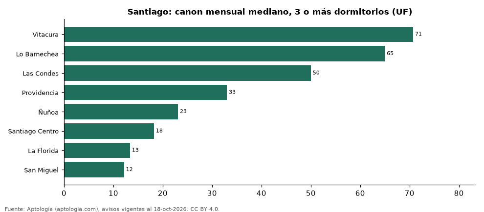

# Dónde es más caro y más barato arrendar un departamento de 3 o más dormitorios en Santiago: ranking de comunas (octubre 2026)

**En Santiago, un departamento de 3 o más dormitorios se arrienda por 71 UF (USD 2.964) al mes en la mediana en Vitacura, la comuna más cara, y 12 UF (USD 509) al mes en San Miguel, la más barata: 5,8 veces menos.** Comparamos 8 comunas con al menos 30 avisos de 3 o más dormitorios.

*Resumen: analizamos 913 departamentos en arriendo de 3 o más dormitorios en 8 comunas de Santiago.*

**Actualizado:** 18 de octubre de 2026 (datos del 18 de octubre de 2026) · **Próxima actualización:** mensual.

## Resumen

| Indicador | Valor |
|---|---|
| Más caro | Vitacura: 71 UF (USD 2.964) |
| Más barato | San Miguel: 12 UF (USD 509) |
| Diferencia | 5,8 veces |
| Comunas | 8 |

## Canon mensual de un departamento de 3 o más dormitorios por comuna

| Comuna | Canon mensual (mediana) | Rango típico (P25–P75) | Área mediana (m²) | Avisos |
|---|---|---|---|---|
| Vitacura | 71 UF (USD 2.964) | 49 UF (USD 2.054) – 86 UF (USD 3.626) | 170 | 130 |
| Lo Barnechea | 65 UF (USD 2.724) | 50 UF (USD 2.096) – 90 UF (USD 3.772) | 182 | 74 |
| Las Condes | 50 UF (USD 2.096) | 41 UF (USD 1.708) – 68 UF (USD 2.850) | 140 | 260 |
| Providencia | 33 UF (USD 1.383) | 28 UF (USD 1.171) – 45 UF (USD 1.886) | 107 | 107 |
| Ñuñoa | 23 UF (USD 967) | 20 UF (USD 830) – 29 UF (USD 1.222) | 86 | 72 |
| Santiago Centro | 18 UF (USD 764) | 12 UF (USD 517) – 49 UF (USD 2.045) | 76 | 119 |
| La Florida | 13 UF (USD 560) | 12 UF (USD 509) – 16 UF (USD 677) | 66 | 59 |
| San Miguel | 12 UF (USD 509) | 8 UF (USD 356) – 15 UF (USD 611) | 62 | 92 |

Medianas del canon pedido, sin administración ni gastos comunes; solo comunas con 30 avisos o más.

## Preguntas frecuentes

**¿Cuánto cuesta arrendar un departamento de 3 o más dormitorios en Vitacura?**
71 UF (USD 2.964) al mes en la mediana (octubre de 2026); la mitad central entre 49 UF (USD 2.054) y 86 UF (USD 3.626).

**¿Dónde es más barato arrendar un departamento de 3 o más dormitorios en Santiago?**
En San Miguel: 12 UF (USD 509) al mes en la mediana.

## Metodología

- **Fuente:** exportes nocturnos de la base de datos de Aptología (aptologia.com) del 18 de octubre de 2026: avisos vigentes de vivienda en portales inmobiliarios de 13 países, recogidos por Aptología y vistos en línea entre el 11 y el 18 de octubre de 2026. Corte: 18 de octubre de 2026.
- **Depuración:** se eliminan duplicados exactos (misma ciudad, zona, tipo, precio, moneda, área, habitaciones y baños) y los precios fuera del percentil 1–99 de cada país, operación, moneda y tipo; el precio por m² usa solo avisos con área declarada entre 12 y 2.000 m² y también se recorta al P1–P99.
- **Qué se mide:** precios pedidos (publicados), no precios de cierre. En arriendo, el canon mensual sin administración, gastos comunes ni condominio.
- **Muestra mínima:** cada cifra publicada se apoya en al menos 30 avisos; las celdas con menos se omiten.
- **Monedas:** nunca se mezclan avisos de monedas distintas sin convertirlos. Conversión a dólares con la tasa de mercado de ExchangeRate-API (open.er-api.com, actualización del 18 Oct 2026): 1 USD = 3.182,80 COP, 1 USD = 18,47 M.N, 1 USD = 5,09 BRL, 1 USD = 3,44 PEN, 1 USD = 982,44 CLP, 1 USD = 1.514,57 ARS, 1 USD = 40,20 UYU, 1 USD = 5.705,37 PYG, 1 USD = 61,27 DOP, 1 USD = 0,89 EUR, 1 USD = 11,72 BOB; la UF chilena a 41.178,64 CLP (mindicador,cl. 18-oct-2026). Los avisos publicados en dólares se usan tal cual.
- **Monedas:** en cada ciudad y operación se usa solo la moneda mayoritaria de los avisos (los avisos en otra moneda se excluyen) y la mediana se convierte a dólares con la tasa citada; nunca se promedian avisos de monedas distintas.
- **Limitaciones:** la cobertura depende de los portales que recorre Aptología en cada país y es mayor en las ciudades grandes y en los segmentos medio-alto y alto; el área es la que declara el aviso, sin verificar; los nombres de zona vienen de los portales.
- **Privacidad:** solo se publican agregados; no se publica ningún dato personal, enlace a avisos ni nombre de anunciante.
- **Datos abiertos:** [datos.csv](datos.csv), licencia CC BY 4.0.

## Cómo citar

Pinzón Pineda, D. M. (2026). *Dónde es más caro y más barato arrendar un departamento de 3 o más dormitorios en Santiago: ranking de comunas (octubre 2026)*. Aptología (aptologia.com). https://github.com/elbroker/aptologia-datos/tree/main/estudios/arriendo-departamentos-de-3-o-mas-dormitorios-por-comuna-santiago-chile-2026. Datos: datos.csv, licencia CC BY 4.0.
