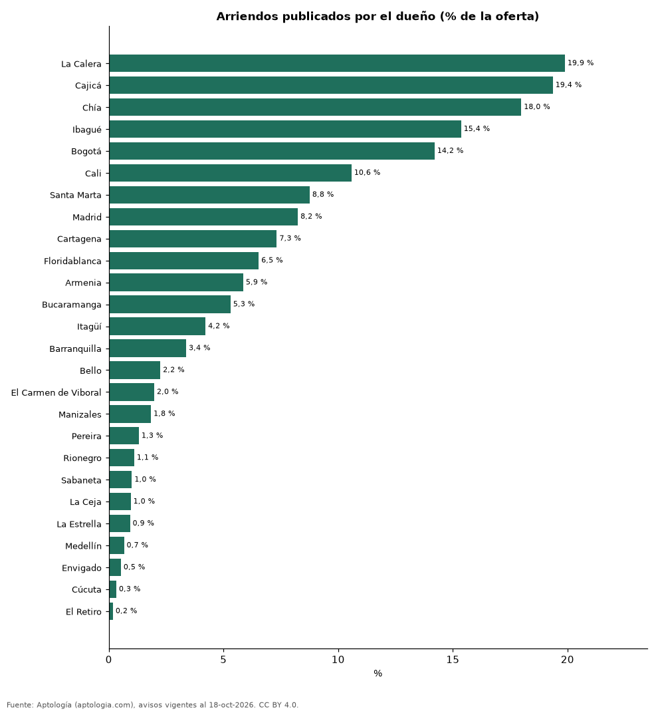

# Arriendo directo con el dueño o con inmobiliaria: qué parte de la oferta en Colombia publica el propietario (octubre 2026)

**Solo el 5,2 % de los avisos de arriendo de vivienda en Colombia los publica directamente el dueño; el resto pasa por inmobiliarias o agentes.** La proporción va de 19,9 % en La Calera a 0,2 % en El Retiro; en Bogotá es 14,2 %. Emparejando por ciudad y habitaciones, el aviso del dueño pide un 4,6 % menos por m².

*Resumen: analizamos 89.696 avisos de arriendo con el dato de anunciante en Colombia.*

**Actualizado:** 18 de octubre de 2026 (datos del 18 de octubre de 2026) · **Próxima actualización:** mensual.

## Resumen

| Indicador | Valor |
|---|---|
| Avisos del dueño (Colombia) | 5,2 % |
| Mayor proporción | La Calera: 19,9 % |
| Menor | El Retiro: 0,2 % |
| Diferencia de canon por m² (dueño vs. inmobiliaria) | -4,6 % |

## Proporción por ciudad (200 avisos o más)

| Ciudad | Avisos del dueño | Avisos analizados |
|---|---|---|
| La Calera | 19,9 % | 357 |
| Cajicá | 19,4 % | 940 |
| Chía | 18,0 % | 1.251 |
| Ibagué | 15,4 % | 319 |
| Bogotá | 14,2 % | 18.724 |
| Cali | 10,6 % | 2.674 |
| Santa Marta | 8,8 % | 845 |
| Madrid | 8,2 % | 279 |
| Cartagena | 7,3 % | 2.334 |
| Floridablanca | 6,5 % | 459 |
| Armenia | 5,9 % | 546 |
| Bucaramanga | 5,3 % | 697 |
| Itagüí | 4,2 % | 1.020 |
| Barranquilla | 3,4 % | 5.071 |
| Bello | 2,2 % | 1.202 |
| El Carmen de Viboral | 2,0 % | 202 |
| Manizales | 1,8 % | 544 |
| Pereira | 1,3 % | 2.747 |
| Rionegro | 1,1 % | 4.787 |
| Sabaneta | 1,0 % | 4.172 |
| La Ceja | 1,0 % | 627 |
| La Estrella | 0,9 % | 541 |
| Medellín | 0,7 % | 26.263 |
| Envigado | 0,5 % | 9.662 |
| Cúcuta | 0,3 % | 612 |
| El Retiro | 0,2 % | 1.105 |

## Preguntas frecuentes

**¿Cuántos arriendos en Colombia publica directamente el dueño?**
El 5,2 % de los avisos de arriendo de vivienda (octubre de 2026).

**¿Es más barato arrendar directo con el dueño?**
En la oferta, los avisos del dueño piden un 4,6 % menos por m² que los de inmobiliaria comparables (misma ciudad y habitaciones; 16 celdas).

## Metodología

- **Fuente:** exportes nocturnos de la base de datos de Aptología (aptologia.com) del 18 de octubre de 2026: avisos vigentes de vivienda en portales inmobiliarios de 13 países, recogidos por Aptología y vistos en línea entre el 11 y el 18 de octubre de 2026. Corte: 18 de octubre de 2026.
- **Depuración:** se eliminan duplicados exactos (misma ciudad, zona, tipo, precio, moneda, área, habitaciones y baños) y los precios fuera del percentil 1–99 de cada país, operación, moneda y tipo; el precio por m² usa solo avisos con área declarada entre 12 y 2.000 m² y también se recorta al P1–P99.
- **Qué se mide:** precios pedidos (publicados), no precios de cierre. En arriendo, el canon mensual sin administración, gastos comunes ni condominio.
- **Muestra mínima:** cada cifra publicada se apoya en al menos 30 avisos; las celdas con menos se omiten.
- **Colombia:** Precios en pesos colombianos, sin conversión de moneda. Los indicadores de amoblado, mascotas, conjunto cerrado, balcón y aviso directo del dueño solo existen en arriendo y vienen de los portales.
- **Dueño directo:** marca `directo` del portal (el aviso lo publica el propietario). Para la proporción por ciudad se exigen 200 avisos.
- **Limitaciones:** la cobertura depende de los portales que recorre Aptología en cada país y es mayor en las ciudades grandes y en los segmentos medio-alto y alto; el área es la que declara el aviso, sin verificar; los nombres de zona vienen de los portales.
- **Privacidad:** solo se publican agregados; no se publica ningún dato personal, enlace a avisos ni nombre de anunciante.
- **Datos abiertos:** [datos.csv](datos.csv), licencia CC BY 4.0.

## Cómo citar

Pinzón Pineda, D. M. (2026). *Arriendo directo con el dueño o con inmobiliaria: qué parte de la oferta en Colombia publica el propietario (octubre 2026)*. Aptología (aptologia.com). https://github.com/elbroker/aptologia-datos/tree/main/estudios/arriendo-directo-del-dueno-vs-inmobiliaria-colombia-2026. Datos: datos.csv, licencia CC BY 4.0.
