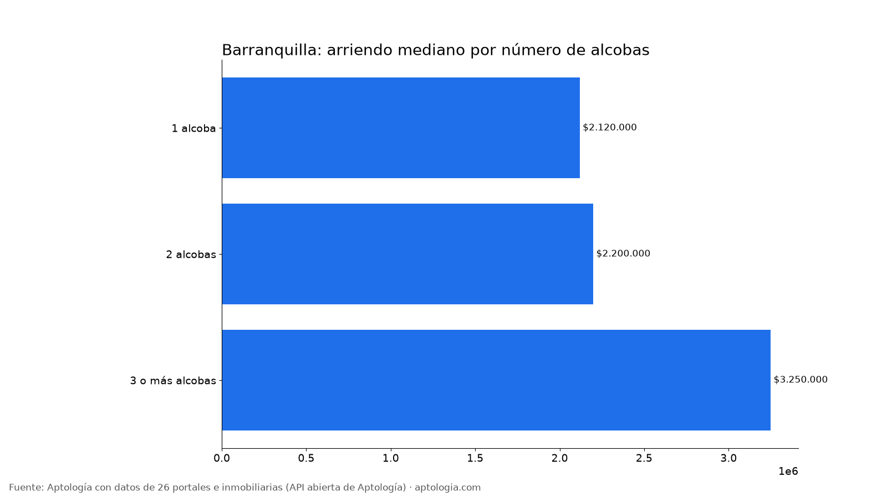
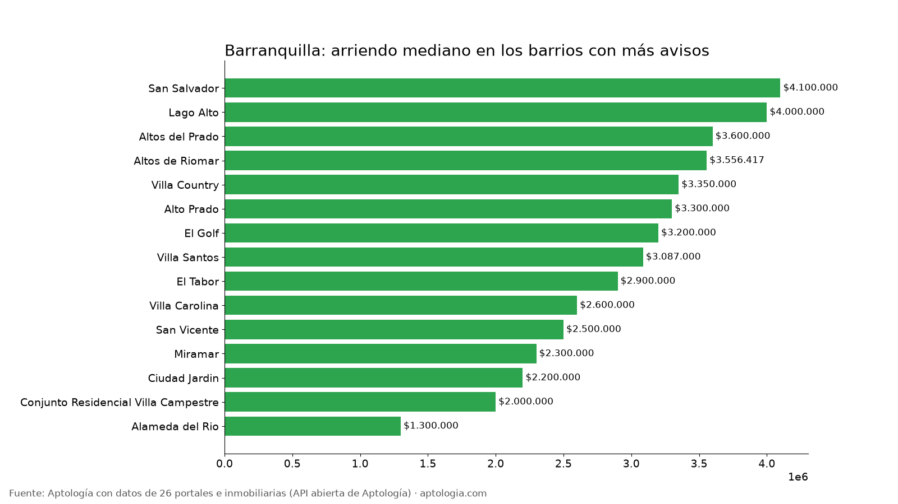

# Arriendo en Barranquilla por barrio: precios por alcobas, barrios más baratos y más caros (octubre 2026)

**El arriendo mediano de un apartamento en Barranquilla es de $2.600.000 al mes; un apartamento de 2 alcobas pide en la mediana $2.200.000.** Entre los barrios con 30 avisos o más, el más barato es Alameda del Rio ($1.300.000) y el más caro Buenavista ($5.000.000): 3,8 veces más.

*Resumen: analizamos 6.311 avisos de apartamentos en arriendo en 59 barrios depurados de Barranquilla.*

**Actualizado:** 18 de octubre de 2026 (datos del 5 de octubre de 2026) · **Próxima actualización:** mensual.

## Resumen

| Indicador | Valor |
|---|---|
| Arriendo mediano (toda la ciudad) | $2.600.000 |
| Mediana 1 alcoba | $2.120.000 |
| Mediana 2 alcobas | $2.200.000 |
| Mediana 3 o más alcobas | $3.250.000 |
| Avisos con parqueadero (barrios depurados) | 68,8 % |
| Barrios con 15 avisos o más | 59 |
| Avisos en barrios depurados | 6.311 |
| Rentabilidad bruta mediana por barrio (arriendo anual / precio de venta) | 6,9 % |

## Por número de alcobas

| Alcobas | Arriendo mediano | Avisos |
|---|---|---|
| 1 alcoba | $2.120.000 | 1.227 |
| 2 alcobas | $2.200.000 | 2.715 |
| 3 o más alcobas | $3.250.000 | 3.866 |

De 1 a 2 alcobas, la mediana sube $80.000 (3,8 %); de 2 a 3 o más alcobas, sube $1.050.000 (47,7 %).

## Barrios más baratos y más caros

**Más baratos (30 avisos o más):**

| Barrio | Arriendo mediano | P25 – P75 | 2 alcobas | Avisos |
|---|---|---|---|---|
| Alameda del Rio | $1.300.000 | $1.150.000 – $1.589.892 | $1.300.000 | 301 |
| Las Delicias | $1.421.000 | $1.165.000 – $1.750.000 | $1.450.000 | 43 |
| El Recreo | $1.500.000 | $1.300.000 – $1.750.000 | $1.459.453 | 57 |
| San Felipe | $1.500.000 | $1.061.750 – $1.700.000 | $1.550.000 | 34 |
| El Silencio | $1.536.000 | $1.211.250 – $2.850.000 | $1.400.000 | 38 |
| Ciudad Mallorquin | $1.700.000 | $1.580.000 – $2.000.000 | $1.700.000 | 89 |
| La Concepcion | $1.700.000 | $1.499.250 – $1.850.000 | $1.700.000 | 54 |
| Boston | $1.750.000 | $1.391.500 – $2.316.273 | $1.750.000 | 64 |
| Batallon Infanteria | $1.800.000 | $1.700.000 – $2.389.500 | $1.800.000 | 30 |
| El Porvenir | $1.800.000 | $1.500.000 – $2.400.000 | $1.800.000 | 129 |

**Más caros:**

| Barrio | Arriendo mediano | P25 – P75 | 2 alcobas | Avisos |
|---|---|---|---|---|
| Buenavista | $5.000.000 | $3.500.000 – $6.350.000 | $4.500.000 | 53 |
| La Castellana | $4.600.000 | $3.200.000 – $5.970.000 | $5.000.000 | 61 |
| El Castillo | $4.600.000 | $3.800.000 – $6.750.000 | $4.000.000 | 71 |
| San Salvador | $4.100.000 | $3.100.000 – $5.850.000 | $3.550.000 | 191 |
| Ub Altos de Parque | $4.100.000 | $3.000.000 – $5.875.000 | $4.500.000 | 34 |
| Altos del Limon | $4.000.000 | $2.925.990 – $5.500.000 | $3.200.000 | 86 |
| Lago Alto | $4.000.000 | $2.500.000 – $6.000.000 | $3.800.000 | 166 |
| Altos del Prado | $3.600.000 | $2.700.000 – $5.500.000 | $3.600.000 | 187 |
| Altos de Riomar | $3.556.417 | $2.400.000 – $5.000.000 | $3.000.000 | 422 |
| Rio Alto | $3.500.000 | $3.000.000 – $4.300.000 | $3.000.000 | 140 |

## Todos los barrios con 15 avisos o más

| Barrio | Avisos | Arriendo mediano | 1 alcoba | 2 alcobas | 3+ alcobas | Con parqueadero |
|---|---|---|---|---|---|---|
| Alto Prado | 442 | $3.300.000 | $2.500.000 | $3.200.000 | $4.250.000 | 67,6 % |
| Villa Santos | 440 | $3.087.000 | $2.600.000 | $3.000.000 | $3.975.000 | 71,8 % |
| Altos de Riomar | 422 | $3.556.417 | $2.750.000 | $3.000.000 | $4.200.000 | 65,4 % |
| Alameda del Rio | 301 | $1.300.000 | — | $1.300.000 | $1.400.000 | 46,8 % |
| Ciudad Jardin | 278 | $2.200.000 | $1.560.000 | $1.925.000 | $2.925.000 | 69,8 % |
| Conjunto Residencial Villa Campestre | 248 | $2.000.000 | — | $1.800.000 | $3.000.000 | 53,2 % |
| San Vicente | 234 | $2.500.000 | $2.210.000 | $2.100.000 | $3.800.000 | 80,3 % |
| Miramar | 232 | $2.300.000 | $1.700.000 | $2.300.000 | $2.400.000 | 75,9 % |
| El Golf | 202 | $3.200.000 | — | $1.575.000 | $4.550.000 | 64,9 % |
| Villa Carolina | 192 | $2.600.000 | — | $2.450.000 | $2.755.000 | 64,1 % |
| San Salvador | 191 | $4.100.000 | $2.600.000 | $3.550.000 | $4.400.000 | 93,2 % |
| Altos del Prado | 187 | $3.600.000 | $2.600.000 | $3.600.000 | $4.900.000 | 95,7 % |
| Lago Alto | 166 | $4.000.000 | $2.500.000 | $3.800.000 | $5.000.000 | 95,2 % |
| Villa Country | 165 | $3.350.000 | $2.625.000 | $3.325.000 | $3.600.000 | 80,0 % |
| El Tabor | 163 | $2.900.000 | $2.000.000 | $2.800.000 | $3.000.000 | 77,9 % |
| Paraiso | 157 | $2.200.000 | — | $1.754.688 | $2.500.000 | 53,5 % |
| Rio Alto | 140 | $3.500.000 | — | $3.000.000 | $3.800.000 | 89,3 % |
| El Porvenir | 129 | $1.800.000 | $1.500.000 | $1.800.000 | $2.500.000 | 68,2 % |
| Andalucia | 128 | $2.700.000 | $2.600.000 | $2.600.000 | $3.150.000 | 83,6 % |
| Altamira | 123 | $2.600.000 | $2.592.500 | $2.988.873 | $4.200.000 | 88,6 % |
| Granadillo | 108 | $2.344.500 | $2.000.000 | $2.309.500 | $3.000.000 | 63,9 % |
| El Prado | 92 | $2.300.000 | $1.800.000 | $1.750.000 | $2.860.000 | 64,1 % |
| Ciudad Mallorquin | 89 | $1.700.000 | — | $1.700.000 | $1.750.000 | 43,8 % |
| Altos del Limon | 86 | $4.000.000 | $2.736.000 | $3.200.000 | $4.750.000 | 88,4 % |
| Nuevo Horizonte | 84 | $2.125.000 | $1.890.000 | $2.150.000 | $2.573.000 | 72,6 % |
| El Poblado | 76 | $2.606.754 | $2.443.750 | $2.850.000 | $3.500.000 | 77,6 % |
| Los Alpes | 73 | $2.300.000 | $1.775.000 | $2.500.000 | $2.875.000 | 52,1 % |
| El Castillo | 71 | $4.600.000 | — | $4.000.000 | $5.300.000 | 97,2 % |
| La Campina | 68 | $2.600.000 | $2.500.000 | $2.640.000 | $2.615.000 | 86,8 % |
| El Country | 67 | $3.300.000 | — | $3.191.500 | $3.530.000 | 94,0 % |
| Boston | 64 | $1.750.000 | $1.157.000 | $1.750.000 | $1.800.000 | 40,6 % |
| La Castellana | 61 | $4.600.000 | — | $5.000.000 | $5.000.000 | 86,9 % |
| El Recreo | 57 | $1.500.000 | — | $1.459.453 | $1.700.000 | 38,6 % |
| La Concepcion | 54 | $1.700.000 | $1.340.000 | $1.700.000 | $1.825.000 | 27,8 % |
| Buenavista | 53 | $5.000.000 | $3.400.000 | $4.500.000 | $6.300.000 | 71,7 % |
| Santa Monica | 52 | $2.650.000 | — | $2.500.000 | $3.350.000 | 94,2 % |
| La Cumbre | 49 | $1.950.000 | $1.700.000 | $2.000.000 | $2.500.000 | 53,1 % |
| Las Delicias | 43 | $1.421.000 | — | $1.450.000 | $1.650.000 | 53,5 % |
| Bellavista | 42 | $2.000.000 | — | $2.050.000 | $2.500.000 | 54,8 % |
| El Silencio | 38 | $1.536.000 | — | $1.400.000 | $2.131.072 | 13,2 % |
| Ub Altos de Parque | 34 | $4.100.000 | — | $4.500.000 | $4.500.000 | 100,0 % |
| San Felipe | 34 | $1.500.000 | — | $1.550.000 | — | 8,8 % |
| Betania | 33 | $2.132.958 | — | — | $2.400.000 | 51,5 % |
| Barranquillita | 30 | $1.964.000 | — | $1.725.000 | $2.200.000 | 46,7 % |
| Batallon Infanteria | 30 | $1.800.000 | — | $1.800.000 | — | 60,0 % |
| Villa del Este | 30 | $2.903.850 | — | $2.850.000 | $4.000.000 | 63,3 % |
| Abajo | 29 | $1.114.000 | $900.000 | $1.459.653 | — | 20,7 % |
| Los Angeles | 25 | $1.450.000 | — | $1.475.000 | $1.400.000 | 8,0 % |
| El Limoncito | 23 | $2.790.000 | — | $2.790.000 | $3.500.000 | 47,8 % |
| San Isidro | 22 | $1.290.000 | — | — | $1.250.000 | 22,7 % |
| Cevillar | 21 | $1.400.000 | — | $1.000.000 | — | 19,0 % |
| Conjunto Residencial el Encanto | 19 | $3.750.000 | — | — | $4.500.000 | 89,5 % |
| Altos del Parque | 18 | $3.650.000 | — | $3.350.000 | — | 50,0 % |
| Portal de Genoves | 17 | $4.100.000 | — | $4.100.000 | — | 100,0 % |
| Chiquinquira | 16 | $1.200.000 | — | $1.200.000 | — | 25,0 % |
| Los Andes | 16 | $1.300.000 | — | — | $1.350.000 | 50,0 % |
| El Oasis | 16 | $3.900.000 | — | $3.800.000 | — | 93,8 % |
| El Pueblo | 16 | $1.450.000 | — | $1.400.000 | — | 12,5 % |
| Centro Historico | 15 | $1.340.000 | — | — | — | 26,7 % |

**Cómo usarlo para decidir:** compara tu presupuesto con la mediana de tu número de alcobas y mira la franja P25 – P75 del barrio: un aviso por debajo del P25 es barato para ese barrio, uno por encima del P75 es caro. Suma la administración, que no está incluida. Precios al día por barrio en [aptologia.com/precios-de-arriendo/barranquilla](https://www.aptologia.com/precios-de-arriendo/barranquilla).

## Preguntas frecuentes

**¿Cuánto cuesta arrendar un apartamento en Barranquilla?**
La mediana del arriendo pedido es $2.600.000 al mes, sin administración, con datos del 5 de octubre de 2026.

**¿Cuánto vale un apartamento de 2 alcobas en arriendo en Barranquilla?**
La mediana es $2.200.000 al mes (2.715 avisos).

**¿Cuál es el barrio más barato para arrendar en Barranquilla?**
Entre los barrios con 30 avisos o más, Alameda del Rio, con una mediana de $1.300.000. El más caro es Buenavista, con $5.000.000.

**¿Cuántos apartamentos en arriendo en Barranquilla tienen parqueadero?**
El 68,8 % de los avisos de los barrios depurados incluye parqueadero.

**¿Cuánto renta comprar un apartamento para arrendar en Barranquilla?**
La rentabilidad bruta mediana entre 34 barrios comparables es 6,9 % anual (12 meses de arriendo pedido sobre el precio de venta pedido), antes de administración, predial, vacancia e impuestos.

## Metodología

- **Fuente:** API abierta de Aptología ([aptologia.com/datos-abiertos](https://www.aptologia.com/datos-abiertos)), que cada noche revisa los avisos vivos de 26 portales e inmobiliarias. Foto de los datos: 5 de octubre de 2026.
- **Qué se mide:** precio pedido de apartamentos (no casas ni habitaciones), sin administración. Son precios publicados, no cerrados.
- **Barrios:** etiquetas depuradas. Se excluyen nombres de localidad o comuna, textos de aviso, zonas genéricas, barrios de otro municipio y variantes del mismo nombre, para no contar dos veces el mismo barrio.
- **Ranking de barrios:** barrios con 30 avisos o más; la tabla completa incluye los de 15 o más. Medianas por alcobas de un barrio solo con 5 avisos o más. **Rentabilidad bruta:** 12 × mediana del arriendo ÷ mediana del precio de venta pedido, en barrios con 30 avisos o más de cada uno.
- **Limitaciones:** un mismo apartamento puede estar publicado en más de un portal, por lo que los conteos de avisos pueden incluir repetidos. Los barrios vienen tal como los escribe cada portal, después de la depuración.
- **Datos abiertos:** [datos.csv](datos.csv), licencia CC BY 4.0.

## Cómo citar

Pinzón Pineda, D. M. (2026). *Arriendo en Barranquilla por barrio: precios por alcobas, barrios más baratos y más caros (octubre 2026)*. Aptología. https://www.aptologia.com/estudios/arriendo-en-barranquilla-por-barrio-2026. Datos: datos.csv, licencia CC BY 4.0.
