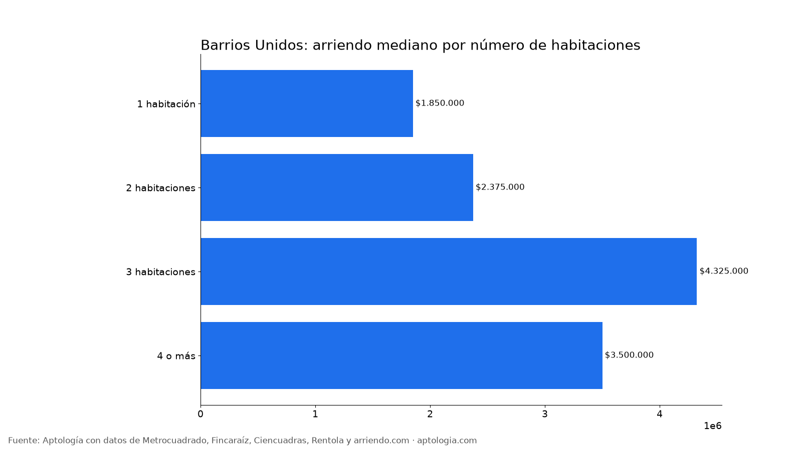
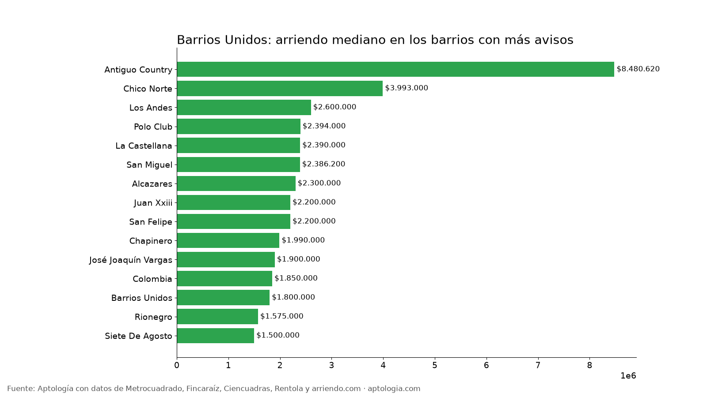

# Arriendo en Barrios Unidos, Bogotá: precios por habitaciones, estrato y barrio (octubre 2026)

**El arriendo mediano de un apartamento o apartaestudio en Barrios Unidos (Bogotá) es de $2.000.000 al mes, unos $60.000 por m².** Un 2 habitaciones cuesta en la mediana $2.375.000. El barrio más barato con 5 avisos o más es [Siete De Agosto](/arriendo/bogota/siete-de-agosto) ($1.500.000) y el más caro [El Virrey](/arriendo/bogota/el-virrey) ($15.000.000).

*Resumen: analizamos 360 apartamentos y apartaestudios en arriendo únicos en la localidad de Barrios Unidos.*

**Actualizado:** 13 de octubre de 2026 · **Próxima actualización:** mensual.

## Resumen

| Indicador | Valor |
|---|---|
| Canon mediano | $2.000.000 |
| Por m² (mediana) | $60.000/m² |
| Área mediana | 35 m² |
| Con parqueadero | 27,2 % |
| Administración mediana | $321.500 (14,4 % del canon) |
| Avisos únicos | 360 |

## Por número de habitaciones

| Habitaciones | Canon mediano | Por m² | Área mediana | Avisos |
|---|---|---|---|---|
| 1 habitación | $1.850.000 | $60.007/m² | 30 m² | 190 |
| 2 habitaciones | $2.375.000 | $39.987/m² | 55 m² | 60 |
| 3 habitaciones | $4.325.000 | $41.433/m² | 108 m² | 44 |
| 4 o más | $3.500.000 | $23.000/m² | 180 m² | 7 |

## Por estrato

| Estrato | Canon mediano | Por m² | Avisos |
|---|---|---|---|
| 3 | $1.600.000 | $51.679/m² | 152 |
| 4 | $2.200.000 | $63.763/m² | 148 |
| 5 | $3.050.000 | $68.750/m² | 28 |
| 6 | $4.550.000 | $73.529/m² | 31 |

## Barrios más baratos y más caros

**Más baratos:**

| Barrio | Canon mediano | Por m² | Avisos |
|---|---|---|---|
| [Siete De Agosto](/arriendo/bogota/siete-de-agosto) | $1.500.000 | $52.000 | 33 |
| [Rionegro](/arriendo/bogota/rionegro) | $1.575.000 | $37.793 | 6 |
| [Benjamin Herrera](/arriendo/bogota/benjamin-herrera) | $1.790.000 | $30.556 | 6 |
| [Barrios Unidos](/arriendo/bogota/barrios-unidos) | $1.800.000 | $60.000 | 63 |
| [Colombia](/arriendo/bogota/colombia) | $1.850.000 | $72.917 | 11 |

**Más caros:**

| Barrio | Canon mediano | Por m² | Avisos |
|---|---|---|---|
| [El Virrey](/arriendo/bogota/el-virrey) | $15.000.000 | $73.529 | 6 |
| [Antiguo Country](/arriendo/bogota/antiguo-country) | $8.480.620 | $64.265 | 7 |
| [El Chico](/arriendo/bogota/el-chico) | $5.200.000 | $63.218 | 5 |
| [Chico Norte](/arriendo/bogota/chico-norte) | $3.993.000 | $64.265 | 11 |
| [Los Andes](/arriendo/bogota/los-andes) | $2.600.000 | $54.878 | 10 |

## Apartaestudio o apartamento de 1 habitación

En Barrios Unidos, un apartaestudio cuesta en la mediana $2.000.000 (57 avisos) y un apartamento de 1 habitación $1.850.000 (190 avisos): $150.000 de diferencia.

**Cómo usarlo para decidir:** compara tu presupuesto con la mediana de tu número de habitaciones y mira los barrios más baratos de la tabla; suma la administración (mediana $321.500) para saber el costo real mensual.

## Preguntas frecuentes

**¿Cuánto cuesta arrendar un apartamento en Barrios Unidos?**
La mediana es $2.000.000 al mes, con 360 avisos únicos al 13 de octubre de 2026.

**¿Cuánto vale un apartamento de 2 habitaciones en arriendo en Barrios Unidos?**
La mediana es $2.375.000 al mes (60 avisos).

**¿Cuál es el barrio más barato para arrendar en Barrios Unidos?**
Entre los barrios con 5 avisos o más, Siete De Agosto, con un canon mediano de $1.500.000. El más caro es El Virrey, con $15.000.000.

**¿Cuánto se paga de administración en Barrios Unidos?**
La mediana es $321.500 al mes, alrededor del 14,4 % del canon.

**¿Qué porcentaje de apartamentos en arriendo en Barrios Unidos tiene parqueadero?**
El 27,2 % de los avisos que informan el dato incluye al menos un parqueadero.

## Metodología

- **Fuente:** base de ingesta diaria de Aptología, con avisos públicos de Metrocuadrado, Fincaraíz, Ciencuadras, Rentola y arriendo.com. Corte al 13 de octubre de 2026.
- **Filtros:** apartamentos y apartaestudios en avisos vivos que pasan el control de calidad, en la localidad de Barrios Unidos, canon entre $400.000 y $30.000.000. Se excluyen TikTok y Facebook Marketplace.
- **Duplicados:** se deja un aviso por grupo de duplicados (el mismo inmueble en varios portales).
- **Barrios:** solo barrios con 5 avisos o más. Parqueadero y administración, sobre los avisos que informan el dato.
- **Limitaciones:** son precios pedidos, no cerrados. Los barrios y localidades vienen tal como los escribe cada portal.
- **Datos abiertos:** [datos.csv](datos.csv), licencia CC BY 4.0.

## Cómo citar

Pinzón Pineda, D. M. (2026). *Arriendo en Barrios Unidos, Bogotá: precios por habitaciones, estrato y barrio (octubre 2026)*. Aptología. https://www.aptologia.com/estudios/arriendo-en-barrios-unidos-bogota-2026. Datos: datos.csv, licencia CC BY 4.0.
