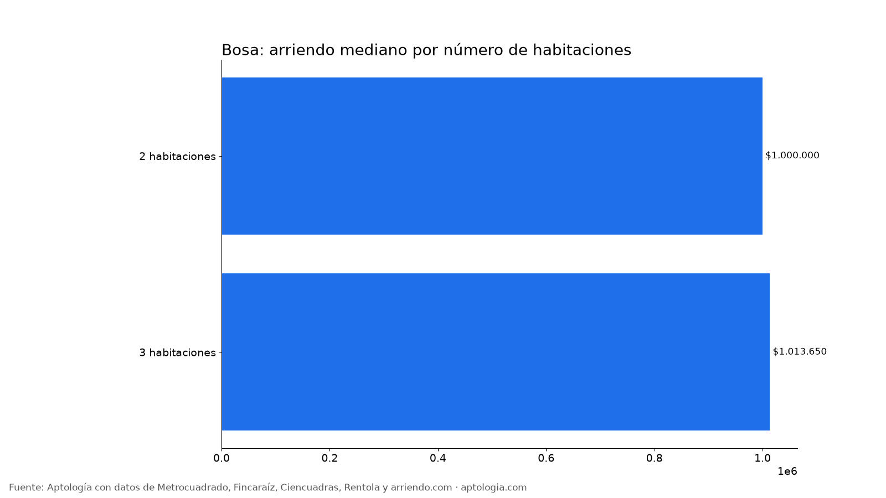
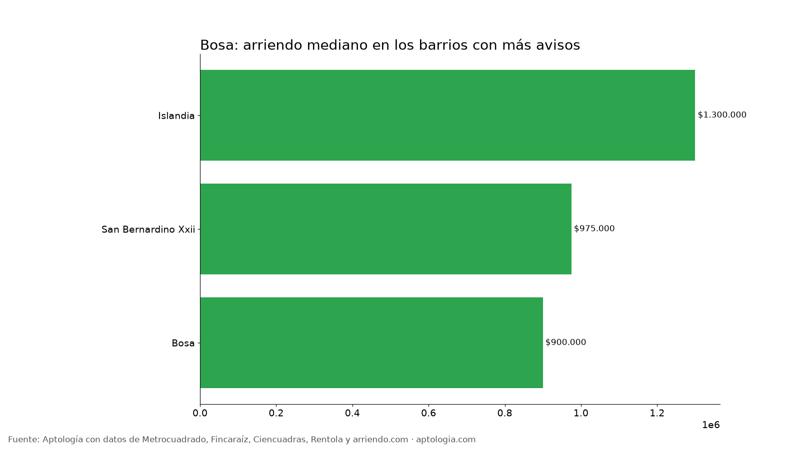

# Arriendo en Bosa, Bogotá: precios por habitaciones, estrato y barrio (octubre 2026)

**El arriendo mediano de un apartamento o apartaestudio en Bosa (Bogotá) es de $1.000.000 al mes, unos $22.895 por m².** Un 2 habitaciones cuesta en la mediana $1.000.000. El barrio más barato con 5 avisos o más es [Bosa](/arriendo/bogota/bosa) ($900.000) y el más caro [Islandia](/arriendo/bogota/islandia) ($1.300.000).

*Resumen: analizamos 87 apartamentos y apartaestudios en arriendo únicos en la localidad de Bosa.*

**Actualizado:** 13 de octubre de 2026 · **Próxima actualización:** mensual.

## Resumen

| Indicador | Valor |
|---|---|
| Canon mediano | $1.000.000 |
| Por m² (mediana) | $22.895/m² |
| Área mediana | 46 m² |
| Con parqueadero | 3,4 % |
| Administración mediana | $113.000 (10,1 % del canon) |
| Avisos únicos | 87 |

## Por número de habitaciones

| Habitaciones | Canon mediano | Por m² | Área mediana | Avisos |
|---|---|---|---|---|
| 2 habitaciones | $1.000.000 | $22.847/m² | 44 m² | 48 |
| 3 habitaciones | $1.013.650 | $20.845/m² | 47 m² | 32 |

## Por estrato

| Estrato | Canon mediano | Por m² | Avisos |
|---|---|---|---|
| 2 | $1.000.000 | $21.875/m² | 61 |
| 3 | $1.100.000 | $25.000/m² | 23 |

## Barrios más baratos y más caros

**Más baratos:**

| Barrio | Canon mediano | Por m² | Avisos |
|---|---|---|---|
| [Bosa](/arriendo/bogota/bosa) | $900.000 | $20.631 | 13 |
| [San Bernardino Xxii](/arriendo/bogota/san-bernardino-xxii) | $975.000 | $20.106 | 10 |
| [Islandia](/arriendo/bogota/islandia) | $1.300.000 | $26.531 | 5 |

**Más caros:**

| Barrio | Canon mediano | Por m² | Avisos |
|---|---|---|---|
| [Islandia](/arriendo/bogota/islandia) | $1.300.000 | $26.531 | 5 |
| [San Bernardino Xxii](/arriendo/bogota/san-bernardino-xxii) | $975.000 | $20.106 | 10 |
| [Bosa](/arriendo/bogota/bosa) | $900.000 | $20.631 | 13 |

**Cómo usarlo para decidir:** compara tu presupuesto con la mediana de tu número de habitaciones y mira los barrios más baratos de la tabla; suma la administración (mediana $113.000) para saber el costo real mensual.

## Preguntas frecuentes

**¿Cuánto cuesta arrendar un apartamento en Bosa?**
La mediana es $1.000.000 al mes, con 87 avisos únicos al 13 de octubre de 2026.

**¿Cuánto vale un apartamento de 2 habitaciones en arriendo en Bosa?**
La mediana es $1.000.000 al mes (48 avisos).

**¿Cuál es el barrio más barato para arrendar en Bosa?**
Entre los barrios con 5 avisos o más, Bosa, con un canon mediano de $900.000. El más caro es Islandia, con $1.300.000.

**¿Cuánto se paga de administración en Bosa?**
La mediana es $113.000 al mes, alrededor del 10,1 % del canon.

**¿Qué porcentaje de apartamentos en arriendo en Bosa tiene parqueadero?**
El 3,4 % de los avisos que informan el dato incluye al menos un parqueadero.

## Metodología

- **Fuente:** base de ingesta diaria de Aptología, con avisos públicos de Metrocuadrado, Fincaraíz, Ciencuadras, Rentola y arriendo.com. Corte al 13 de octubre de 2026.
- **Filtros:** apartamentos y apartaestudios en avisos vivos que pasan el control de calidad, en la localidad de Bosa, canon entre $400.000 y $30.000.000. Se excluyen TikTok y Facebook Marketplace.
- **Duplicados:** se deja un aviso por grupo de duplicados (el mismo inmueble en varios portales).
- **Barrios:** solo barrios con 5 avisos o más. Parqueadero y administración, sobre los avisos que informan el dato.
- **Limitaciones:** son precios pedidos, no cerrados. Los barrios y localidades vienen tal como los escribe cada portal.
- **Datos abiertos:** [datos.csv](datos.csv), licencia CC BY 4.0.

## Cómo citar

Pinzón Pineda, D. M. (2026). *Arriendo en Bosa, Bogotá: precios por habitaciones, estrato y barrio (octubre 2026)*. Aptología. https://www.aptologia.com/estudios/arriendo-en-bosa-bogota-2026. Datos: datos.csv, licencia CC BY 4.0.
