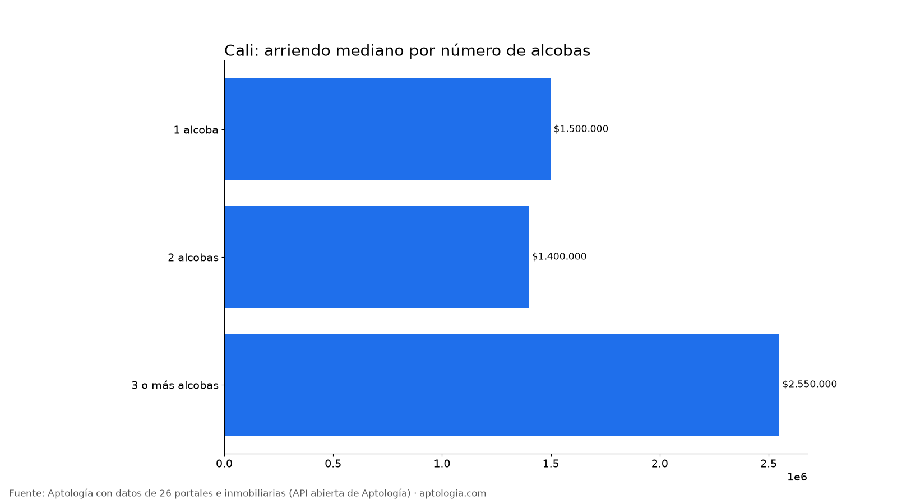
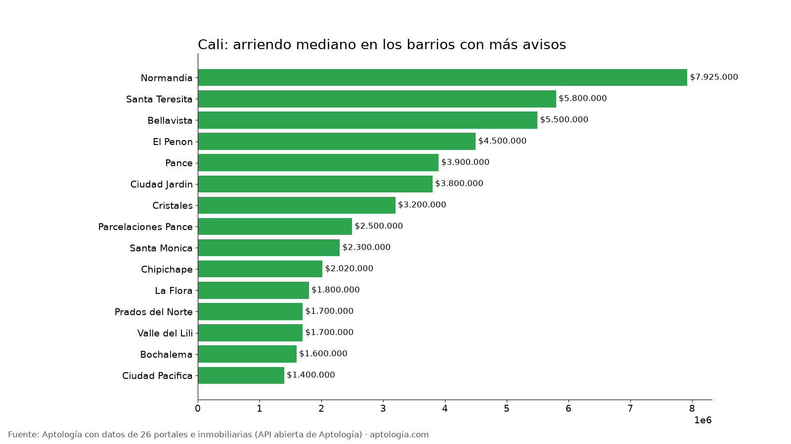

# Arriendo en Cali por barrio: precios por alcobas, barrios más baratos y más caros (octubre 2026)

**El arriendo mediano de un apartamento en Cali es de $1.600.000 al mes; un apartamento de 2 alcobas pide en la mediana $1.400.000.** Entre los barrios con 30 avisos o más, el más barato es Las Américas ($760.000) y el más caro Arboledas ($8.000.000): 10,5 veces más.

*Resumen: analizamos 11.756 avisos de apartamentos en arriendo en 177 barrios depurados de Cali.*

**Actualizado:** 18 de octubre de 2026 (datos del 5 de octubre de 2026) · **Próxima actualización:** mensual.

## Resumen

| Indicador | Valor |
|---|---|
| Arriendo mediano (toda la ciudad) | $1.600.000 |
| Mediana 1 alcoba | $1.500.000 |
| Mediana 2 alcobas | $1.400.000 |
| Mediana 3 o más alcobas | $2.550.000 |
| Avisos con parqueadero (barrios depurados) | 55,4 % |
| Barrios con 15 avisos o más | 177 |
| Avisos en barrios depurados | 11.756 |
| Rentabilidad bruta mediana por barrio (arriendo anual / precio de venta) | 6,2 % |

## Por número de alcobas

| Alcobas | Arriendo mediano | Avisos |
|---|---|---|
| 1 alcoba | $1.500.000 | 3.361 |
| 2 alcobas | $1.400.000 | 5.942 |
| 3 o más alcobas | $2.550.000 | 5.716 |

De 1 a 2 alcobas, la mediana baja $100.000 (6,7 %); de 2 a 3 o más alcobas, sube $1.150.000 (82,1 %). Que un apartamento de 1 alcoba pida más que uno de 2 puede deberse a que la oferta de 1 alcoba se concentra en barrios más caros o incluye más amoblados.

## Barrios más baratos y más caros

**Más baratos (30 avisos o más):**

| Barrio | Arriendo mediano | P25 – P75 | 2 alcobas | Avisos |
|---|---|---|---|---|
| Las Américas | $760.000 | $750.000 – $790.000 | — | 37 |
| Obrero | $780.000 | $700.000 – $975.000 | $780.000 | 38 |
| Ciudad Modelo | $800.000 | $685.000 – $1.000.000 | — | 35 |
| Atanasio Girardot | $800.000 | $735.000 – $1.135.000 | $800.000 | 39 |
| Las Delicias | $840.000 | $750.000 – $1.430.000 | $820.000 | 44 |
| Ciudad Cordoba | $850.000 | $777.500 – $950.000 | $850.000 | 60 |
| Salomia | $850.000 | $800.000 – $1.000.000 | $900.000 | 41 |
| Los Alcazares | $850.000 | $800.000 – $1.000.000 | — | 35 |
| Nueva Floresta | $860.000 | $800.000 – $1.150.000 | $905.000 | 40 |
| Guayaquil | $890.000 | $795.000 – $1.000.000 | $800.000 | 51 |

**Más caros:**

| Barrio | Arriendo mediano | P25 – P75 | 2 alcobas | Avisos |
|---|---|---|---|---|
| Arboledas | $8.000.000 | $4.000.000 – $14.675.000 | $4.100.000 | 66 |
| Normandia | $7.925.000 | $5.500.000 – $9.925.000 | $5.500.000 | 200 |
| Aguacatal | $7.213.000 | $1.500.000 – $8.600.000 | $1.425.000 | 142 |
| La Arboleda | $6.500.000 | $4.500.000 – $13.950.000 | $3.800.000 | 51 |
| Santa Teresita | $5.800.000 | $4.000.000 – $9.500.000 | $4.850.000 | 305 |
| Bellavista | $5.500.000 | $3.887.500 – $10.000.000 | $3.850.000 | 276 |
| Santa Monica Residencial | $5.000.000 | $2.525.000 – $6.600.000 | — | 60 |
| Juanambu | $5.000.000 | $3.600.000 – $7.000.000 | $3.600.000 | 137 |
| Santa Teresita Oeste | $5.000.000 | $3.900.000 – $8.750.000 | — | 36 |
| Santa Rita | $4.500.000 | $2.800.000 – $7.600.000 | $3.300.000 | 143 |

## Todos los barrios con 15 avisos o más

| Barrio | Avisos | Arriendo mediano | 1 alcoba | 2 alcobas | 3+ alcobas | Con parqueadero |
|---|---|---|---|---|---|---|
| Valle del Lili | 1.054 | $1.700.000 | $1.650.000 | $1.600.000 | $1.900.000 | 60,2 % |
| Pance | 597 | $3.900.000 | $2.600.000 | $4.500.000 | $5.800.000 | 67,7 % |
| Ciudad Jardin | 389 | $3.800.000 | $2.500.000 | $5.000.000 | $5.250.000 | 65,6 % |
| Bochalema | 378 | $1.600.000 | — | $1.500.000 | $1.800.000 | 65,1 % |
| Parcelaciones Pance | 317 | $2.500.000 | $2.500.000 | $1.475.000 | $4.900.000 | 57,4 % |
| Santa Teresita | 305 | $5.800.000 | $3.500.000 | $4.850.000 | $7.000.000 | 83,6 % |
| Bellavista | 276 | $5.500.000 | $3.900.000 | $3.850.000 | $9.000.000 | 82,6 % |
| La Flora | 255 | $1.800.000 | $1.750.000 | $2.200.000 | $2.900.000 | 60,8 % |
| Normandia | 200 | $7.925.000 | — | $5.500.000 | $8.000.000 | 74,5 % |
| Prados del Norte | 188 | $1.700.000 | $1.300.000 | $1.850.000 | $2.300.000 | 58,5 % |
| Ciudad Pacifica | 186 | $1.400.000 | — | $1.350.000 | $1.600.000 | 40,3 % |
| El Penon | 178 | $4.500.000 | $2.150.000 | $5.500.000 | $5.000.000 | 68,0 % |
| Chipichape | 167 | $2.020.000 | $1.800.000 | $3.450.000 | $5.500.000 | 61,7 % |
| Cristales | 166 | $3.200.000 | $2.200.000 | $3.200.000 | $5.000.000 | 75,3 % |
| Santa Monica | 163 | $2.300.000 | $1.800.000 | $2.000.000 | $5.900.000 | 62,0 % |
| El Ingenio | 160 | $1.800.000 | $1.300.000 | $1.800.000 | $2.800.000 | 56,9 % |
| Caney | 152 | $1.400.000 | $900.000 | $1.300.000 | $1.800.000 | 61,2 % |
| Santa Rita | 143 | $4.500.000 | $2.300.000 | $3.300.000 | $6.250.000 | 60,8 % |
| Aguacatal | 142 | $7.213.000 | — | $1.425.000 | $8.500.000 | 74,6 % |
| Juanambu | 137 | $5.000.000 | $3.200.000 | $3.600.000 | $6.500.000 | 69,3 % |
| San Vicente | 137 | $1.700.000 | $1.450.000 | $1.800.000 | $3.500.000 | 32,8 % |
| Granada | 133 | $2.000.000 | $1.700.000 | $2.000.000 | $4.500.000 | 34,6 % |
| El Refugio | 133 | $1.800.000 | $1.800.000 | $1.600.000 | $2.000.000 | 52,6 % |
| El Jardin | 131 | $900.000 | $850.000 | $930.000 | $950.000 | 57,3 % |
| Ciudad Melendez | 129 | $1.550.000 | — | $1.500.000 | $1.675.000 | 52,7 % |
| Ciudad 2000 | 122 | $1.360.000 | $1.200.000 | $1.500.000 | $1.400.000 | 30,3 % |
| Parque Natura | 120 | $1.250.000 | — | $1.200.000 | $1.450.000 | 88,3 % |
| Versalles | 115 | $2.700.000 | $1.500.000 | $2.500.000 | $3.900.000 | 45,2 % |
| San Fernando | 115 | $1.600.000 | $1.500.000 | $2.000.000 | $2.500.000 | 37,4 % |
| Lili | 111 | $2.000.000 | — | $1.725.000 | $2.500.000 | 73,0 % |
| Miraflores | 107 | $1.600.000 | $1.550.000 | $1.500.000 | $2.450.000 | 34,6 % |
| Melendez | 101 | $1.200.000 | $1.150.000 | $1.360.000 | $1.500.000 | 60,4 % |
| Brisas de los Alamos | 94 | $1.290.000 | $1.450.000 | $1.350.000 | $1.075.000 | 42,6 % |
| Vipasa | 90 | $1.200.000 | $1.200.000 | $1.000.000 | — | 54,4 % |
| Kachipay | 85 | $1.500.000 | — | $1.450.000 | $1.500.000 | 49,4 % |
| El Bosque | 82 | $1.100.000 | $990.000 | $2.300.000 | $2.800.000 | 53,7 % |
| San Fernando Viejo | 76 | $1.975.000 | $1.400.000 | $1.600.000 | $3.500.000 | 30,3 % |
| Bretana | 71 | $1.200.000 | $1.100.000 | $900.000 | $1.600.000 | 46,5 % |
| Cachipay | 68 | $1.445.000 | — | $1.440.000 | — | 48,5 % |
| Arboledas | 66 | $8.000.000 | $2.600.000 | $4.100.000 | $11.000.000 | 86,4 % |
| El Cedro | 65 | $1.050.000 | $1.000.000 | $960.000 | — | 10,8 % |
| La Selva | 63 | $1.800.000 | — | $1.950.000 | $1.800.000 | 44,4 % |
| Centenario | 60 | $2.400.000 | $1.750.000 | $3.900.000 | $3.975.000 | 48,3 % |
| Santa Monica Residencial | 60 | $5.000.000 | $2.450.000 | — | $6.250.000 | 75,0 % |
| Ciudad Cordoba | 60 | $850.000 | $650.000 | $850.000 | $1.000.000 | 13,3 % |
| Menga | 60 | $3.500.000 | $3.000.000 | $2.475.000 | $8.300.000 | 83,3 % |
| San Antonio | 59 | $1.700.000 | $1.700.000 | $1.000.000 | — | 13,6 % |
| Los Cambulos | 58 | $970.000 | $880.000 | $2.600.000 | — | 46,6 % |
| El Limonar | 57 | $1.600.000 | $1.365.000 | $1.200.000 | $1.900.000 | 52,6 % |
| Alameda | 56 | $1.200.000 | $925.000 | $1.000.000 | $1.825.000 | 32,1 % |
| Santa Isabel | 55 | $3.350.000 | $1.500.000 | $1.200.000 | $3.850.000 | 67,3 % |
| Parcelacion Piedra Grande | 55 | $1.600.000 | — | $1.600.000 | $2.300.000 | 76,4 % |
| Departamental | 54 | $1.300.000 | $925.000 | $1.300.000 | $1.500.000 | 38,9 % |
| Cristobal Colon | 53 | $1.000.000 | $975.000 | $945.000 | $1.100.000 | 22,6 % |
| La Arboleda | 51 | $6.500.000 | — | $3.800.000 | $11.000.000 | 86,3 % |
| Guayaquil | 51 | $890.000 | $795.000 | $800.000 | $1.000.000 | 27,5 % |
| Las Vegas de Comfandi | 50 | $1.300.000 | — | $1.250.000 | $1.300.000 | 44,0 % |
| Torres de Comfandi | 50 | $1.100.000 | — | — | $1.100.000 | 40,0 % |
| Valle de Lili | 50 | $1.650.000 | — | $1.450.000 | $2.650.000 | 76,0 % |
| San Pedro | 48 | $1.820.000 | $1.890.000 | $1.425.000 | $2.500.000 | 70,8 % |
| Las Delicias | 44 | $840.000 | $700.000 | $820.000 | $1.430.000 | 15,9 % |
| Urbanizacion la Merced | 44 | $1.000.000 | $770.000 | $1.400.000 | — | 65,9 % |
| El Guabal | 43 | $950.000 | — | $900.000 | $1.500.000 | 30,2 % |
| Santa Anita | 43 | $1.500.000 | $1.075.000 | $1.800.000 | $1.725.000 | 62,8 % |
| Zona Industrial | 42 | $1.235.000 | — | $1.200.000 | $1.300.000 | 33,3 % |
| Brisas del Limonar | 42 | $1.985.000 | — | $1.500.000 | $2.600.000 | 45,2 % |
| Salomia | 41 | $850.000 | $800.000 | $900.000 | $800.000 | 22,0 % |
| Ciudad los Alamos | 40 | $1.300.000 | — | $1.600.000 | $1.300.000 | 40,0 % |
| Nueva Floresta | 40 | $860.000 | — | $905.000 | — | 27,5 % |
| Junin | 40 | $940.000 | $845.000 | $1.100.000 | — | 50,0 % |
| Urbanizacion Rio Lili | 39 | $3.500.000 | $2.600.000 | — | $3.350.000 | 59,0 % |
| La Campina | 39 | $2.000.000 | $2.000.000 | $1.700.000 | — | 51,3 % |
| Atanasio Girardot | 39 | $800.000 | — | $800.000 | $1.150.000 | 7,7 % |
| Obrero | 38 | $780.000 | — | $780.000 | — | 28,9 % |
| Panamericano | 38 | $1.075.000 | $900.000 | $1.200.000 | — | 28,9 % |
| Cuarto de Legua | 37 | $1.800.000 | $1.800.000 | — | — | 48,6 % |
| Primero de Mayo | 37 | $1.500.000 | — | $1.600.000 | $1.445.000 | 37,8 % |
| Las Américas | 37 | $760.000 | $760.000 | — | — | 43,2 % |
| Santa Teresita Oeste | 36 | $5.000.000 | — | — | $5.300.000 | 58,3 % |
| Villa Colombia | 36 | $925.000 | $800.000 | $1.150.000 | $1.100.000 | 16,7 % |
| Eucaristico | 36 | $1.550.000 | $1.550.000 | — | — | 44,4 % |
| La Hacienda | 35 | $2.200.000 | — | $2.200.000 | $2.450.000 | 94,3 % |
| Ciudad Bochalema | 35 | $1.400.000 | — | $1.400.000 | $1.800.000 | 80,0 % |
| Ciudad Modelo | 35 | $800.000 | $690.000 | — | — | 17,1 % |
| Los Alcazares | 35 | $850.000 | — | — | $875.000 | 11,4 % |
| San Fernando Nuevo | 35 | $2.500.000 | $1.800.000 | — | $3.400.000 | 60,0 % |
| Tequendama | 34 | $1.650.000 | — | $1.650.000 | $3.950.000 | 35,3 % |
| Benjamin Herrera | 32 | $1.000.000 | — | $1.000.000 | — | 3,1 % |
| Villa Fatima | 31 | $1.450.000 | — | $1.400.000 | $1.550.000 | 38,7 % |
| Ciudadela Comfandi | 31 | $980.000 | — | $1.300.000 | $990.000 | 29,0 % |
| Pampalinda | 31 | $2.200.000 | — | $1.600.000 | $2.200.000 | 48,4 % |
| Hacienda Kachipay | 31 | $1.600.000 | — | $1.600.000 | — | 90,3 % |
| El Lido | 30 | $1.300.000 | $1.100.000 | — | — | 53,3 % |
| Flora Industrial | 29 | $1.200.000 | $1.250.000 | — | $1.200.000 | 51,7 % |
| Nueva Tequendama | 29 | $1.800.000 | $1.250.000 | $3.800.000 | — | 48,3 % |
| San Nicolas | 29 | $1.400.000 | — | $1.000.000 | — | 20,7 % |
| Capri | 29 | $1.300.000 | — | $1.150.000 | — | 55,2 % |
| Calipso | 28 | $800.000 | — | $700.000 | $1.290.000 | 46,4 % |
| Colseguros Andes | 28 | $1.100.000 | — | $1.100.000 | $1.250.000 | 46,4 % |
| Saavedra Galindo | 28 | $825.000 | — | $730.000 | — | 28,6 % |
| Ciudad Guabinas | 27 | $1.250.000 | — | $1.265.000 | — | 33,3 % |
| Aranjuez | 27 | $950.000 | $750.000 | $1.200.000 | — | 55,6 % |
| Ciudad Real | 27 | $1.350.000 | — | $1.220.000 | $1.700.000 | 40,7 % |
| Alfaguara | 26 | $1.600.000 | — | $1.400.000 | $2.500.000 | 96,2 % |
| San Cayetano | 26 | $1.350.000 | $975.000 | — | — | 11,5 % |
| Las Mercedes | 26 | $1.300.000 | — | $1.200.000 | $1.475.000 | 73,1 % |
| Mayapan las Vegas | 25 | $1.200.000 | $1.150.000 | — | — | 52,0 % |
| Chiminangos | 25 | $900.000 | — | — | $900.000 | 8,0 % |
| Laureano Gomez | 25 | $900.000 | $900.000 | — | — | 0,0 % |
| San Juan Bosco | 25 | $900.000 | — | $900.000 | — | 52,0 % |
| Antonio Narino | 25 | $1.050.000 | — | $1.050.000 | — | 52,0 % |
| Arroyohondo | 25 | $1.350.000 | — | $1.300.000 | — | 32,0 % |
| Camino Real | 25 | $1.980.000 | — | $1.400.000 | $3.000.000 | 60,0 % |
| Canaverales | 25 | $1.230.000 | — | — | $1.230.000 | 60,0 % |
| Nueva Floresta del Ict | 24 | $930.000 | — | $920.000 | — | 50,0 % |
| Los Guayacanes | 24 | $1.225.000 | — | $1.500.000 | — | 41,7 % |
| Simon Bolivar | 24 | $950.000 | — | $850.000 | $1.020.000 | 54,2 % |
| Cuarto de Legua Guadalupe | 24 | $2.000.000 | $2.000.000 | — | — | 50,0 % |
| Olimpico | 23 | $1.000.000 | $950.000 | — | — | 17,4 % |
| Valle Grande | 23 | $650.000 | — | $650.000 | — | 21,7 % |
| La Fortaleza | 23 | $900.000 | — | $900.000 | — | 43,5 % |
| El Gran Limonar | 23 | $1.600.000 | $1.230.000 | — | — | 30,4 % |
| Poblado Campestre | 23 | $800.000 | — | $800.000 | — | 30,4 % |
| La Base | 22 | $950.000 | — | — | $1.725.000 | 36,4 % |
| Santa Rosa | 22 | $1.300.000 | $1.250.000 | — | — | 18,2 % |
| Alfonso Lopez I Etapa | 22 | $1.050.000 | — | $1.035.000 | $1.145.000 | 45,5 % |
| La Floresta | 22 | $920.000 | — | — | $1.075.000 | 4,5 % |
| Alfonso Lopez | 22 | $650.000 | — | $650.000 | — | 27,3 % |
| Ciudad Pangola | 22 | $1.200.000 | — | $1.200.000 | — | 100,0 % |
| Paso del Comercio | 22 | $1.120.000 | — | — | $1.120.000 | 31,8 % |
| Libertadores | 22 | $1.060.000 | — | $1.100.000 | — | 81,8 % |
| Ciudad Capri | 22 | $1.675.000 | — | — | $1.800.000 | 77,3 % |
| Santa Elena | 21 | $750.000 | — | — | — | 14,3 % |
| El Trebol | 21 | $1.200.000 | — | $1.100.000 | $1.200.000 | 52,4 % |
| San Bosco | 21 | $1.200.000 | $1.200.000 | — | — | 19,0 % |
| Las Granjas | 21 | $1.200.000 | — | $1.200.000 | — | 33,3 % |
| Santa Teresita Norte | 21 | $6.700.000 | — | — | $7.400.000 | 57,1 % |
| Villa del Sur | 21 | $850.000 | — | $900.000 | — | 4,8 % |
| Guabinas | 21 | $1.300.000 | — | $1.325.000 | — | 57,1 % |
| Las Ceibas | 21 | $900.000 | — | $900.000 | — | 33,3 % |
| Quintas de Don Simon | 20 | $2.675.000 | — | — | $3.500.000 | 80,0 % |
| Santa Fe | 20 | $1.200.000 | $1.200.000 | $1.100.000 | — | 25,0 % |
| Calima | 20 | $1.000.000 | — | — | $1.100.000 | 35,0 % |
| Cr los Naranjos | 20 | $1.100.000 | — | $1.100.000 | — | 100,0 % |
| San Carlos | 20 | $775.000 | — | $750.000 | — | 55,0 % |
| La Independencia | 20 | $690.000 | $500.000 | — | — | 50,0 % |
| Sameco | 20 | $1.600.000 | — | $1.600.000 | — | 30,0 % |
| Tejares Cristales | 19 | $4.500.000 | — | — | $5.500.000 | 73,7 % |
| Jorge Eliecer Gaitan | 19 | $900.000 | — | — | — | 21,1 % |
| Prados del Limonar | 19 | $1.460.000 | — | $1.425.000 | — | 52,6 % |
| Chapinero | 19 | $820.000 | — | $850.000 | — | 21,1 % |
| Tierra Linda | 18 | $1.550.000 | — | $1.500.000 | — | 61,1 % |
| Aguablanca | 18 | $950.000 | — | — | — | 38,9 % |
| La Esmeralda | 18 | $850.000 | — | $825.000 | — | 50,0 % |
| Ciudad Country | 17 | $1.650.000 | — | $1.670.000 | — | 100,0 % |
| Calicanto | 17 | $1.200.000 | — | $1.250.000 | — | 41,2 % |
| 20 de Julio | 17 | $1.200.000 | — | — | $1.480.000 | 58,8 % |
| Sindical | 17 | $1.150.000 | — | — | $1.200.000 | 94,1 % |
| El Dorado | 17 | $1.100.000 | — | $950.000 | — | 70,6 % |
| Acopi | 17 | $1.250.000 | — | — | $1.225.000 | 52,9 % |
| El Troncal | 17 | $1.000.000 | — | — | — | 29,4 % |
| Champagnat | 17 | $1.200.000 | — | — | — | 35,3 % |
| Santa Barbara | 17 | $1.600.000 | — | $1.525.000 | — | 41,2 % |
| Villa del Prado | 17 | $1.070.000 | — | — | — | 47,1 % |
| Metropolitano del Norte | 16 | $1.150.000 | — | — | $1.150.000 | 43,8 % |
| Cd Terranova | 16 | $550.000 | — | $500.000 | — | 43,8 % |
| Evaristo Garcia | 16 | $1.500.000 | — | $1.485.000 | — | 37,5 % |
| Guadalupe | 16 | $2.000.000 | — | — | — | 56,2 % |
| El Hormiguero | 16 | $1.200.000 | — | $1.175.000 | — | 50,0 % |
| La Pradera | 15 | $950.000 | — | — | — | 73,3 % |
| Chiminangos II | 15 | $800.000 | — | — | $800.000 | 26,7 % |
| Paso de la Bolsa | 15 | $650.000 | — | $650.000 | — | 73,3 % |
| Urbanizacion la Base Planta y Talleres  | 15 | $1.000.000 | — | — | $1.000.000 | 33,3 % |
| Jorge Isaacs | 15 | $1.800.000 | — | $1.800.000 | — | 80,0 % |
| El Hormiguro | 15 | $3.400.000 | — | — | $3.350.000 | 80,0 % |
| Las Acacias | 15 | $1.000.000 | — | — | — | 60,0 % |
| Alferez Real | 15 | $1.400.000 | — | — | $1.600.000 | 53,3 % |

**Cómo usarlo para decidir:** compara tu presupuesto con la mediana de tu número de alcobas y mira la franja P25 – P75 del barrio: un aviso por debajo del P25 es barato para ese barrio, uno por encima del P75 es caro. Suma la administración, que no está incluida. Precios al día por barrio en [aptologia.com/precios-de-arriendo/cali](https://www.aptologia.com/precios-de-arriendo/cali).

## Preguntas frecuentes

**¿Cuánto cuesta arrendar un apartamento en Cali?**
La mediana del arriendo pedido es $1.600.000 al mes, sin administración, con datos del 5 de octubre de 2026.

**¿Cuánto vale un apartamento de 2 alcobas en arriendo en Cali?**
La mediana es $1.400.000 al mes (5.942 avisos).

**¿Cuál es el barrio más barato para arrendar en Cali?**
Entre los barrios con 30 avisos o más, Las Américas, con una mediana de $760.000. El más caro es Arboledas, con $8.000.000.

**¿Cuántos apartamentos en arriendo en Cali tienen parqueadero?**
El 55,4 % de los avisos de los barrios depurados incluye parqueadero.

**¿Cuánto renta comprar un apartamento para arrendar en Cali?**
La rentabilidad bruta mediana entre 65 barrios comparables es 6,2 % anual (12 meses de arriendo pedido sobre el precio de venta pedido), antes de administración, predial, vacancia e impuestos.

## Metodología

- **Fuente:** API abierta de Aptología ([aptologia.com/datos-abiertos](https://www.aptologia.com/datos-abiertos)), que cada noche revisa los avisos vivos de 26 portales e inmobiliarias. Foto de los datos: 5 de octubre de 2026.
- **Qué se mide:** precio pedido de apartamentos (no casas ni habitaciones), sin administración. Son precios publicados, no cerrados.
- **Barrios:** etiquetas depuradas. Se excluyen nombres de localidad o comuna, textos de aviso, zonas genéricas, barrios de otro municipio y variantes del mismo nombre, para no contar dos veces el mismo barrio.
- **Ranking de barrios:** barrios con 30 avisos o más; la tabla completa incluye los de 15 o más. Medianas por alcobas de un barrio solo con 5 avisos o más. **Rentabilidad bruta:** 12 × mediana del arriendo ÷ mediana del precio de venta pedido, en barrios con 30 avisos o más de cada uno.
- **Limitaciones:** un mismo apartamento puede estar publicado en más de un portal, por lo que los conteos de avisos pueden incluir repetidos. Los barrios vienen tal como los escribe cada portal, después de la depuración.
- **Datos abiertos:** [datos.csv](datos.csv), licencia CC BY 4.0.

## Cómo citar

Pinzón Pineda, D. M. (2026). *Arriendo en Cali por barrio: precios por alcobas, barrios más baratos y más caros (octubre 2026)*. Aptología. https://www.aptologia.com/estudios/arriendo-en-cali-por-barrio-2026. Datos: datos.csv, licencia CC BY 4.0.
