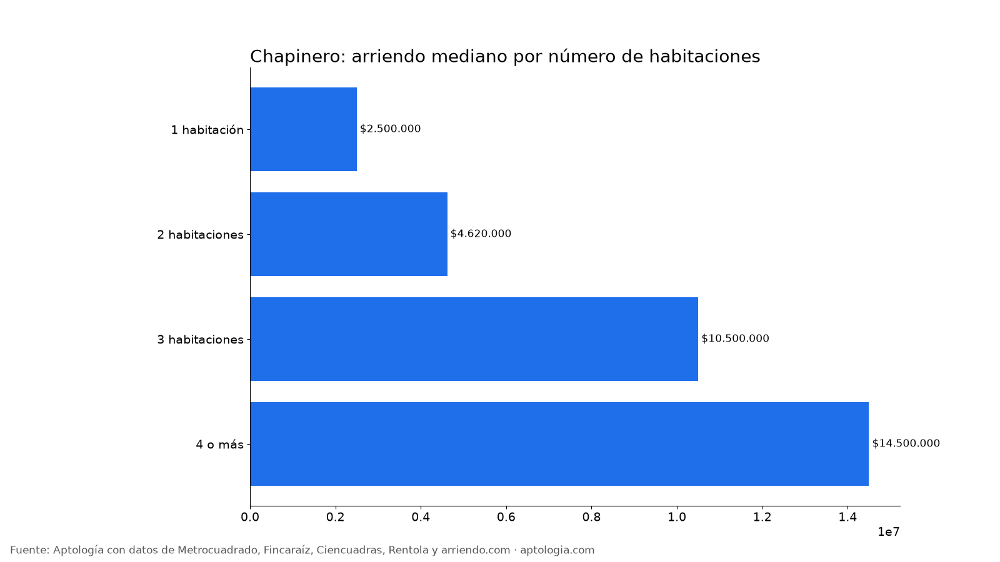
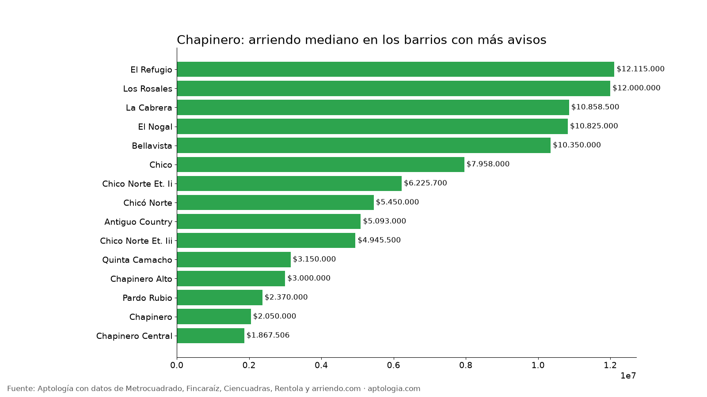

# Arriendo en Chapinero, Bogotá: precios por habitaciones, estrato y barrio (octubre 2026)

**El arriendo mediano de un apartamento o apartaestudio en Chapinero (Bogotá) es de $3.500.000 al mes, unos $63.326 por m².** Un 2 habitaciones cuesta en la mediana $4.620.000. El barrio más barato con 5 avisos o más es [Galerias](/arriendo/bogota/galerias) ($1.425.000) y el más caro [Las Acacias](/arriendo/bogota/las-acacias) ($12.207.500).

*Resumen: analizamos 1.256 apartamentos y apartaestudios en arriendo únicos en la localidad de Chapinero.*

**Actualizado:** 13 de octubre de 2026 · **Próxima actualización:** mensual.

## Resumen

| Indicador | Valor |
|---|---|
| Canon mediano | $3.500.000 |
| Por m² (mediana) | $63.326/m² |
| Área mediana | 55 m² |
| Con parqueadero | 65,5 % |
| Administración mediana | $658.500 (15,9 % del canon) |
| Avisos únicos | 1.256 |

## Por número de habitaciones

| Habitaciones | Canon mediano | Por m² | Área mediana | Avisos |
|---|---|---|---|---|
| 1 habitación | $2.500.000 | $65.000/m² | 40 m² | 403 |
| 2 habitaciones | $4.620.000 | $59.390/m² | 77 m² | 245 |
| 3 habitaciones | $10.500.000 | $60.892/m² | 171 m² | 244 |
| 4 o más | $14.500.000 | $55.152/m² | 258 m² | 61 |

## Por estrato

| Estrato | Canon mediano | Por m² | Avisos |
|---|---|---|---|
| 1 | $16.082.500 | $76.977/m² | 6 |
| 3 | $1.800.000 | $55.000/m² | 198 |
| 4 | $2.400.000 | $56.250/m² | 431 |
| 5 | $4.141.000 | $66.000/m² | 139 |
| 6 | $8.500.000 | $71.857/m² | 479 |

## Barrios más baratos y más caros

**Más baratos:**

| Barrio | Canon mediano | Por m² | Avisos |
|---|---|---|---|
| [Galerias](/arriendo/bogota/galerias) | $1.425.000 | $49.740 | 10 |
| Chapinero Alto Emaus | $1.700.000 | $50.000 | 5 |
| Chapinero Central Chapinero | $1.800.000 | $60.818 | 6 |
| [Chapinero Zona Urbana](/arriendo/bogota/chapinero-zona-urbana) | $1.850.000 | $54.054 | 15 |
| [Chapinero Central](/arriendo/bogota/chapinero-central) | $1.867.506 | $60.000 | 103 |

**Más caros:**

| Barrio | Canon mediano | Por m² | Avisos |
|---|---|---|---|
| [Las Acacias](/arriendo/bogota/las-acacias) | $12.207.500 | $59.475 | 16 |
| [El Refugio](/arriendo/bogota/el-refugio) | $12.115.000 | $58.928 | 32 |
| [Los Rosales](/arriendo/bogota/los-rosales) | $12.000.000 | $60.000 | 59 |
| [La Cabrera](/arriendo/bogota/la-cabrera) | $10.858.500 | $76.912 | 32 |
| [El Nogal](/arriendo/bogota/el-nogal) | $10.825.000 | $70.978 | 30 |

## Apartaestudio o apartamento de 1 habitación

En Chapinero, un apartaestudio cuesta en la mediana $2.184.000 (301 avisos) y un apartamento de 1 habitación $2.500.000 (403 avisos): $316.000 de diferencia.

**Cómo usarlo para decidir:** compara tu presupuesto con la mediana de tu número de habitaciones y mira los barrios más baratos de la tabla; suma la administración (mediana $658.500) para saber el costo real mensual.

## Preguntas frecuentes

**¿Cuánto cuesta arrendar un apartamento en Chapinero?**
La mediana es $3.500.000 al mes, con 1.256 avisos únicos al 13 de octubre de 2026.

**¿Cuánto vale un apartamento de 2 habitaciones en arriendo en Chapinero?**
La mediana es $4.620.000 al mes (245 avisos).

**¿Cuál es el barrio más barato para arrendar en Chapinero?**
Entre los barrios con 5 avisos o más, Galerias, con un canon mediano de $1.425.000. El más caro es Las Acacias, con $12.207.500.

**¿Cuánto se paga de administración en Chapinero?**
La mediana es $658.500 al mes, alrededor del 15,9 % del canon.

**¿Qué porcentaje de apartamentos en arriendo en Chapinero tiene parqueadero?**
El 65,5 % de los avisos que informan el dato incluye al menos un parqueadero.

## Metodología

- **Fuente:** base de ingesta diaria de Aptología, con avisos públicos de Metrocuadrado, Fincaraíz, Ciencuadras, Rentola y arriendo.com. Corte al 13 de octubre de 2026.
- **Filtros:** apartamentos y apartaestudios en avisos vivos que pasan el control de calidad, en la localidad de Chapinero, canon entre $400.000 y $30.000.000. Se excluyen TikTok y Facebook Marketplace.
- **Duplicados:** se deja un aviso por grupo de duplicados (el mismo inmueble en varios portales).
- **Barrios:** solo barrios con 5 avisos o más. Parqueadero y administración, sobre los avisos que informan el dato.
- **Limitaciones:** son precios pedidos, no cerrados. Los barrios y localidades vienen tal como los escribe cada portal.
- **Datos abiertos:** [datos.csv](datos.csv), licencia CC BY 4.0.

## Cómo citar

Pinzón Pineda, D. M. (2026). *Arriendo en Chapinero, Bogotá: precios por habitaciones, estrato y barrio (octubre 2026)*. Aptología. https://www.aptologia.com/estudios/arriendo-en-chapinero-bogota-2026. Datos: datos.csv, licencia CC BY 4.0.
