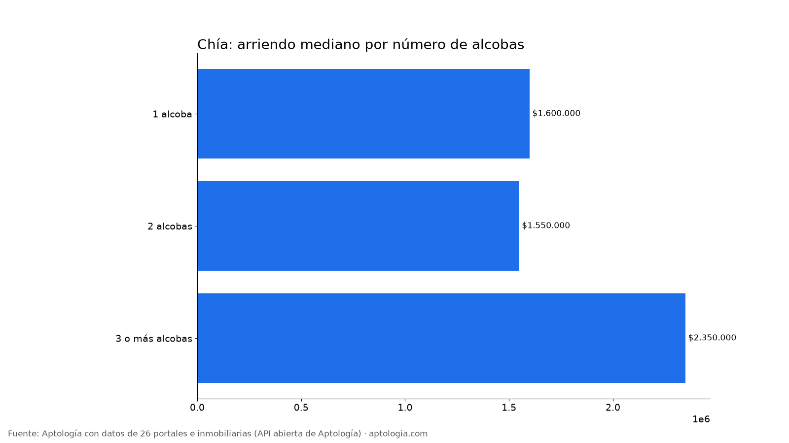
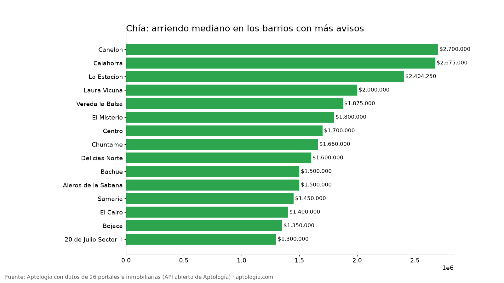

# Arriendo en Chía por barrio: precios por alcobas, barrios más baratos y más caros (octubre 2026)

**El arriendo mediano de un apartamento en Chía es de $1.700.000 al mes; un apartamento de 2 alcobas pide en la mediana $1.550.000.** Entre los barrios con 30 avisos o más, el más barato es 20 de Julio Sector II ($1.300.000) y el más caro Calahorra ($2.675.000): 2,1 veces más.

*Resumen: analizamos 1.033 avisos de apartamentos en arriendo en 28 barrios depurados de Chía.*

**Actualizado:** 18 de octubre de 2026 (datos del 5 de octubre de 2026) · **Próxima actualización:** mensual.

## Resumen

| Indicador | Valor |
|---|---|
| Arriendo mediano (toda la ciudad) | $1.700.000 |
| Mediana 1 alcoba | $1.600.000 |
| Mediana 2 alcobas | $1.550.000 |
| Mediana 3 o más alcobas | $2.350.000 |
| Avisos con parqueadero (barrios depurados) | 67,7 % |
| Barrios con 15 avisos o más | 28 |
| Avisos en barrios depurados | 1.033 |
| Rentabilidad bruta mediana por barrio (arriendo anual / precio de venta) | 6,4 % |

## Por número de alcobas

| Alcobas | Arriendo mediano | Avisos |
|---|---|---|
| 1 alcoba | $1.600.000 | 646 |
| 2 alcobas | $1.550.000 | 1.238 |
| 3 o más alcobas | $2.350.000 | 854 |

De 1 a 2 alcobas, la mediana baja $50.000 (3,1 %); de 2 a 3 o más alcobas, sube $800.000 (51,6 %). Que un apartamento de 1 alcoba pida más que uno de 2 puede deberse a que la oferta de 1 alcoba se concentra en barrios más caros o incluye más amoblados.

## Barrios más baratos y más caros

**Más baratos (30 avisos o más):**

| Barrio | Arriendo mediano | P25 – P75 | 2 alcobas | Avisos |
|---|---|---|---|---|
| 20 de Julio Sector II | $1.300.000 | $1.200.000 – $1.375.000 | $1.300.000 | 35 |
| Bojaca | $1.350.000 | $1.108.000 – $1.675.000 | $1.179.000 | 43 |
| El Cairo | $1.400.000 | $1.245.566 – $1.600.000 | $1.400.000 | 88 |
| Samaria | $1.450.000 | $1.320.000 – $1.700.000 | $1.450.000 | 33 |
| Bachue | $1.500.000 | $1.456.875 – $1.600.000 | $1.500.000 | 30 |
| Aleros de la Sabana | $1.500.000 | $1.397.500 – $2.435.950 | $1.400.000 | 32 |
| Delicias Norte | $1.600.000 | $1.400.500 – $1.999.500 | $1.550.000 | 91 |

**Más caros:**

| Barrio | Arriendo mediano | P25 – P75 | 2 alcobas | Avisos |
|---|---|---|---|---|
| Calahorra | $2.675.000 | $1.937.500 – $2.900.000 | $2.750.000 | 52 |
| La Estacion | $2.404.250 | $1.587.500 – $2.853.500 | $1.750.000 | 44 |
| Laura Vicuna | $2.000.000 | $1.500.000 – $2.900.000 | $2.200.000 | 31 |
| Vereda la Balsa | $1.875.000 | $1.600.000 – $2.600.000 | $1.600.000 | 86 |
| El Misterio | $1.800.000 | $1.607.500 – $1.990.000 | $1.800.000 | 38 |
| Centro | $1.700.000 | $1.303.000 – $1.957.500 | $1.500.000 | 84 |
| Chuntame | $1.660.000 | $1.460.000 – $1.900.000 | $1.600.000 | 57 |

## Todos los barrios con 15 avisos o más

| Barrio | Avisos | Arriendo mediano | 1 alcoba | 2 alcobas | 3+ alcobas | Con parqueadero |
|---|---|---|---|---|---|---|
| Delicias Norte | 91 | $1.600.000 | $1.600.000 | $1.550.000 | $2.625.000 | 63,7 % |
| El Cairo | 88 | $1.400.000 | $1.478.500 | $1.400.000 | $1.725.000 | 58,0 % |
| Vereda la Balsa | 86 | $1.875.000 | $2.500.000 | $1.600.000 | $1.909.600 | 64,0 % |
| Centro | 84 | $1.700.000 | $1.300.000 | $1.500.000 | $1.915.000 | 73,8 % |
| Chuntame | 57 | $1.660.000 | — | $1.600.000 | $1.900.000 | 82,5 % |
| Calahorra | 52 | $2.675.000 | $1.650.000 | $2.750.000 | $3.200.000 | 92,3 % |
| La Estacion | 44 | $2.404.250 | — | $1.750.000 | $2.600.000 | 79,5 % |
| Bojaca | 43 | $1.350.000 | — | $1.179.000 | $1.650.000 | 44,2 % |
| El Misterio | 38 | $1.800.000 | — | $1.800.000 | $2.027.000 | 89,5 % |
| 20 de Julio Sector II | 35 | $1.300.000 | — | $1.300.000 | $1.200.000 | 51,4 % |
| Samaria | 33 | $1.450.000 | — | $1.450.000 | $1.450.000 | 39,4 % |
| Aleros de la Sabana | 32 | $1.500.000 | $1.500.000 | $1.400.000 | $2.414.600 | 31,2 % |
| Laura Vicuna | 31 | $2.000.000 | $1.950.000 | $2.200.000 | — | 77,4 % |
| Bachue | 30 | $1.500.000 | — | $1.500.000 | — | 30,0 % |
| Canelon | 29 | $2.700.000 | — | — | $3.000.000 | 89,7 % |
| Santa Lucia | 28 | $1.525.000 | — | $1.400.000 | $2.400.000 | 75,0 % |
| 20 de Julio | 27 | $2.250.000 | — | $1.828.200 | $2.750.000 | 70,4 % |
| Hacienda Fontanar | 26 | $2.325.000 | $1.614.500 | $2.325.000 | — | 84,6 % |
| Modigliani | 21 | $3.000.000 | — | $2.650.000 | $3.650.000 | 100,0 % |
| Centro Historico | 21 | $1.350.000 | — | $1.375.000 | — | 71,4 % |
| La Estrella | 19 | $1.850.000 | — | — | $3.000.000 | 84,2 % |
| Delicias | 18 | $1.300.000 | — | $1.300.000 | — | 38,9 % |
| Avenida Pradilla | 18 | $1.600.000 | $1.650.000 | — | — | 22,2 % |
| Santa Ana de Chía | 18 | $11.500.000 | — | — | $12.000.000 | 94,4 % |
| El Rocio | 17 | $1.972.000 | — | — | $1.972.000 | 82,4 % |
| Santa Cruz | 16 | $1.750.000 | — | — | $1.800.000 | 87,5 % |
| Guaymaral | 16 | $2.100.000 | — | — | — | 87,5 % |
| Br San Francisco | 15 | $1.350.000 | — | $1.350.000 | — | 40,0 % |

**Cómo usarlo para decidir:** compara tu presupuesto con la mediana de tu número de alcobas y mira la franja P25 – P75 del barrio: un aviso por debajo del P25 es barato para ese barrio, uno por encima del P75 es caro. Suma la administración, que no está incluida. Precios al día por barrio en [aptologia.com/precios-de-arriendo/chia](https://www.aptologia.com/precios-de-arriendo/chia).

## Preguntas frecuentes

**¿Cuánto cuesta arrendar un apartamento en Chía?**
La mediana del arriendo pedido es $1.700.000 al mes, sin administración, con datos del 5 de octubre de 2026.

**¿Cuánto vale un apartamento de 2 alcobas en arriendo en Chía?**
La mediana es $1.550.000 al mes (1.238 avisos).

**¿Cuál es el barrio más barato para arrendar en Chía?**
Entre los barrios con 30 avisos o más, 20 de Julio Sector II, con una mediana de $1.300.000. El más caro es Calahorra, con $2.675.000.

**¿Cuántos apartamentos en arriendo en Chía tienen parqueadero?**
El 67,7 % de los avisos de los barrios depurados incluye parqueadero.

**¿Cuánto renta comprar un apartamento para arrendar en Chía?**
La rentabilidad bruta mediana entre 12 barrios comparables es 6,4 % anual (12 meses de arriendo pedido sobre el precio de venta pedido), antes de administración, predial, vacancia e impuestos.

## Metodología

- **Fuente:** API abierta de Aptología ([aptologia.com/datos-abiertos](https://www.aptologia.com/datos-abiertos)), que cada noche revisa los avisos vivos de 26 portales e inmobiliarias. Foto de los datos: 5 de octubre de 2026.
- **Qué se mide:** precio pedido de apartamentos (no casas ni habitaciones), sin administración. Son precios publicados, no cerrados.
- **Barrios:** etiquetas depuradas. Se excluyen nombres de localidad o comuna, textos de aviso, zonas genéricas, barrios de otro municipio y variantes del mismo nombre, para no contar dos veces el mismo barrio.
- **Ranking de barrios:** barrios con 30 avisos o más; la tabla completa incluye los de 15 o más. Medianas por alcobas de un barrio solo con 5 avisos o más. **Rentabilidad bruta:** 12 × mediana del arriendo ÷ mediana del precio de venta pedido, en barrios con 30 avisos o más de cada uno.
- **Limitaciones:** un mismo apartamento puede estar publicado en más de un portal, por lo que los conteos de avisos pueden incluir repetidos. Los barrios vienen tal como los escribe cada portal, después de la depuración.
- **Datos abiertos:** [datos.csv](datos.csv), licencia CC BY 4.0.

## Cómo citar

Pinzón Pineda, D. M. (2026). *Arriendo en Chía por barrio: precios por alcobas, barrios más baratos y más caros (octubre 2026)*. Aptología. https://www.aptologia.com/estudios/arriendo-en-chia-por-barrio-2026. Datos: datos.csv, licencia CC BY 4.0.
