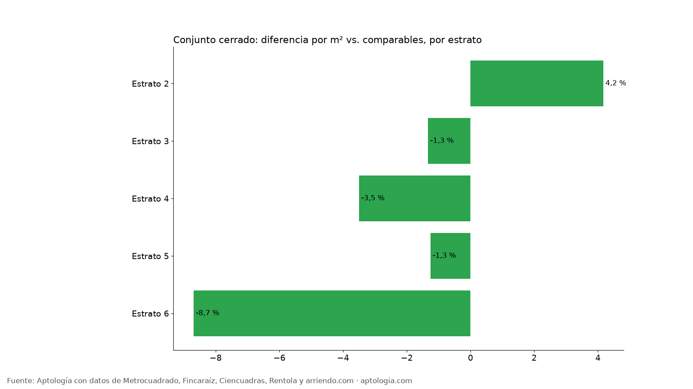
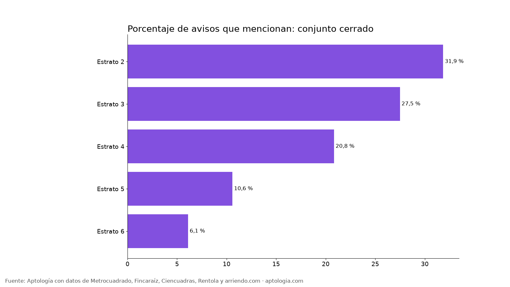

# Arriendo en conjunto cerrado en Bogotá: cuánto cuesta frente a un edificio o casa suelta (2026)

**En Bogotá, un apartamento en arriendo en conjunto cerrado o residencial cuesta 1,3 % menos por metro cuadrado que uno comparable del mismo estrato y número de habitaciones.** Así se anuncian 2.277 de 18.920 avisos (12,0 %); el canon mediano es $1.900.000 con el atributo y $2.596.703 sin él.

*Resumen: comparamos 18.920 apartamentos en arriendo únicos en Bogotá con descripción, con y sin mención de conjunto cerrado.*

**Actualizado:** 13 de octubre de 2026 · **Próxima actualización:** mensual.

## Conjunto cerrado por estrato

| Estrato | Avisos | Lo mencionan | % de avisos | Canon mediano con | Canon mediano sin | Diferencia por m² (comparable) |
|---|---|---|---|---|---|---|
| Estrato 2 | 452 | 144 | 31,9 % | $1.150.000 | $1.200.000 | 4,2 % |
| Estrato 3 | 3.048 | 838 | 27,5 % | $1.500.500 | $1.600.000 | -1,3 % |
| Estrato 4 | 3.402 | 709 | 20,8 % | $2.215.000 | $2.500.000 | -3,5 % |
| Estrato 5 | 1.927 | 204 | 10,6 % | $5.250.000 | $4.200.000 | -1,3 % |
| Estrato 6 | 5.724 | 350 | 6,1 % | $11.000.000 | $8.700.000 | -8,7 % |

**Cómo usarlo para decidir:** vivir en conjunto no sube el canon por m² frente a un edificio comparable, pero suele traer una administración más alta por las zonas comunes y la vigilancia. Compara siempre el total mensual (canon + administración).

## Preguntas frecuentes

**¿Cuánto cambia el arriendo de un apartamento en conjunto cerrado o residencial en Bogotá?**
-1,3 % por m² frente a apartamentos comparables del mismo estrato y habitaciones, corte al 13 de octubre de 2026.

**¿Cuántos apartamentos en arriendo mencionan conjunto cerrado?**
2.277 de 18.920 avisos con descripción (12,0 %).

## Metodología

- **Fuente:** base de ingesta diaria de Aptología, con avisos públicos de Metrocuadrado, Fincaraíz, Ciencuadras, Rentola y arriendo.com. Corte al 13 de octubre de 2026.
- **Filtros:** avisos vivos que pasan el control de calidad, en Bogotá, canon entre $400.000 y $30.000.000. Se excluyen TikTok y Facebook Marketplace.
- **Duplicados:** se deja un aviso por grupo de duplicados (el mismo inmueble en varios portales).
- **Prima emparejada:** se compara el precio por m² de avisos con y sin el atributo dentro de la misma celda de estrato × habitaciones (mínimo 8 avisos por lado) y se reporta la mediana ponderada de las diferencias. Así la prima no se confunde con estrato o tamaño. El atributo se detecta en el texto del aviso, por lo que solo cuentan avisos con descripción.
- **Limitaciones:** son precios pedidos, no cerrados. Los barrios y localidades vienen tal como los escribe cada portal.
- **Datos abiertos:** [datos.csv](data/arriendo_en_conjunto_cerrado_bogota_datos.csv), licencia CC BY 4.0.

## Cómo citar

Pinzón Pineda, D. M. (2026). *Arriendo en conjunto cerrado en Bogotá: cuánto cuesta frente a un edificio o casa suelta (2026)*. Aptología. https://www.aptologia.com/estudios/arriendo-en-conjunto-cerrado-bogota. Datos: datos.csv, licencia CC BY 4.0.
