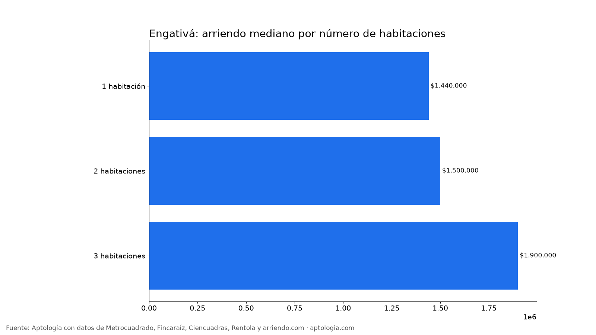
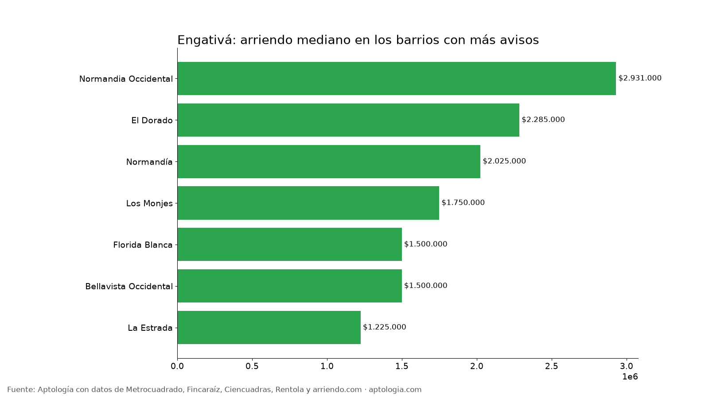

# Arriendo en Engativá, Bogotá: precios por habitaciones, estrato y barrio (octubre 2026)

**El arriendo mediano de un apartamento o apartaestudio en Engativá (Bogotá) es de $1.600.900 al mes, unos $36.000 por m².** Un 2 habitaciones cuesta en la mediana $1.500.000. El barrio más barato con 5 avisos o más es [La Estrada](/arriendo/bogota/la-estrada) ($1.225.000) y el más caro [Normandia Occidental](/arriendo/bogota/normandia-occidental) ($2.931.000).

*Resumen: analizamos 157 apartamentos y apartaestudios en arriendo únicos en la localidad de Engativá.*

**Actualizado:** 13 de octubre de 2026 · **Próxima actualización:** mensual.

## Resumen

| Indicador | Valor |
|---|---|
| Canon mediano | $1.600.900 |
| Por m² (mediana) | $36.000/m² |
| Área mediana | 45 m² |
| Con parqueadero | 18,5 % |
| Administración mediana | $216.925 (11,3 % del canon) |
| Avisos únicos | 157 |

## Por número de habitaciones

| Habitaciones | Canon mediano | Por m² | Área mediana | Avisos |
|---|---|---|---|---|
| 1 habitación | $1.440.000 | $58.333/m² | 30 m² | 15 |
| 2 habitaciones | $1.500.000 | $29.091/m² | 50 m² | 37 |
| 3 habitaciones | $1.900.000 | $32.609/m² | 64 m² | 43 |

## Por estrato

| Estrato | Canon mediano | Por m² | Avisos |
|---|---|---|---|
| 2 | $1.385.000 | $25.000/m² | 15 |
| 3 | $1.533.500 | $34.844/m² | 106 |
| 4 | $2.000.000 | $48.889/m² | 33 |

## Barrios más baratos y más caros

**Más baratos:**

| Barrio | Canon mediano | Por m² | Avisos |
|---|---|---|---|
| [La Estrada](/arriendo/bogota/la-estrada) | $1.225.000 | $26.333 | 6 |
| [Bellavista Occidental](/arriendo/bogota/bellavista-occidental) | $1.500.000 | $32.432 | 7 |
| Florida Blanca | $1.500.000 | $41.667 | 8 |
| [Los Monjes](/arriendo/bogota/los-monjes) | $1.750.000 | $59.907 | 15 |
| [Normandía](/arriendo/bogota/normandia) | $2.025.000 | $39.386 | 8 |

**Más caros:**

| Barrio | Canon mediano | Por m² | Avisos |
|---|---|---|---|
| [Normandia Occidental](/arriendo/bogota/normandia-occidental) | $2.931.000 | $58.224 | 6 |
| [El Dorado](/arriendo/bogota/el-dorado) | $2.285.000 | $36.538 | 7 |
| [Normandía](/arriendo/bogota/normandia) | $2.025.000 | $39.386 | 8 |
| [Los Monjes](/arriendo/bogota/los-monjes) | $1.750.000 | $59.907 | 15 |
| Florida Blanca | $1.500.000 | $41.667 | 8 |

## Apartaestudio o apartamento de 1 habitación

En Engativá, un apartaestudio cuesta en la mediana $1.550.000 (59 avisos) y un apartamento de 1 habitación $1.440.000 (15 avisos): $110.000 de diferencia.

**Cómo usarlo para decidir:** compara tu presupuesto con la mediana de tu número de habitaciones y mira los barrios más baratos de la tabla; suma la administración (mediana $216.925) para saber el costo real mensual.

## Preguntas frecuentes

**¿Cuánto cuesta arrendar un apartamento en Engativá?**
La mediana es $1.600.900 al mes, con 157 avisos únicos al 13 de octubre de 2026.

**¿Cuánto vale un apartamento de 2 habitaciones en arriendo en Engativá?**
La mediana es $1.500.000 al mes (37 avisos).

**¿Cuál es el barrio más barato para arrendar en Engativá?**
Entre los barrios con 5 avisos o más, La Estrada, con un canon mediano de $1.225.000. El más caro es Normandia Occidental, con $2.931.000.

**¿Cuánto se paga de administración en Engativá?**
La mediana es $216.925 al mes, alrededor del 11,3 % del canon.

**¿Qué porcentaje de apartamentos en arriendo en Engativá tiene parqueadero?**
El 18,5 % de los avisos que informan el dato incluye al menos un parqueadero.

## Metodología

- **Fuente:** base de ingesta diaria de Aptología, con avisos públicos de Metrocuadrado, Fincaraíz, Ciencuadras, Rentola y arriendo.com. Corte al 13 de octubre de 2026.
- **Filtros:** apartamentos y apartaestudios en avisos vivos que pasan el control de calidad, en la localidad de Engativá, canon entre $400.000 y $30.000.000. Se excluyen TikTok y Facebook Marketplace.
- **Duplicados:** se deja un aviso por grupo de duplicados (el mismo inmueble en varios portales).
- **Barrios:** solo barrios con 5 avisos o más. Parqueadero y administración, sobre los avisos que informan el dato.
- **Limitaciones:** son precios pedidos, no cerrados. Los barrios y localidades vienen tal como los escribe cada portal.
- **Datos abiertos:** [datos.csv](datos.csv), licencia CC BY 4.0.

## Cómo citar

Pinzón Pineda, D. M. (2026). *Arriendo en Engativá, Bogotá: precios por habitaciones, estrato y barrio (octubre 2026)*. Aptología. https://www.aptologia.com/estudios/arriendo-en-engativa-bogota-2026. Datos: datos.csv, licencia CC BY 4.0.
