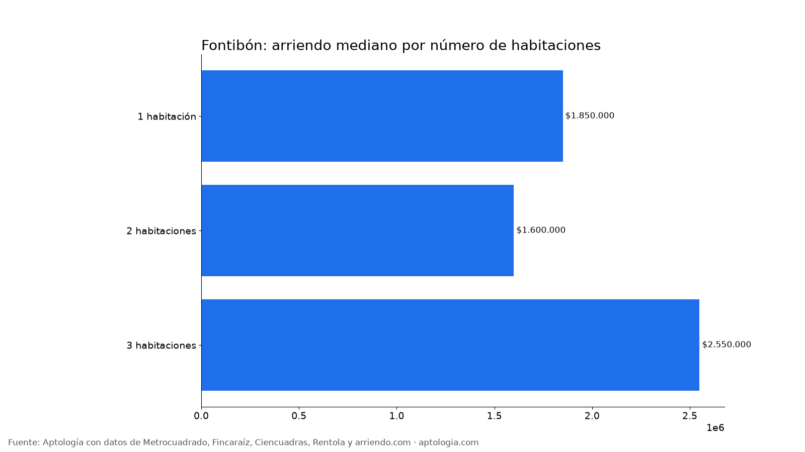
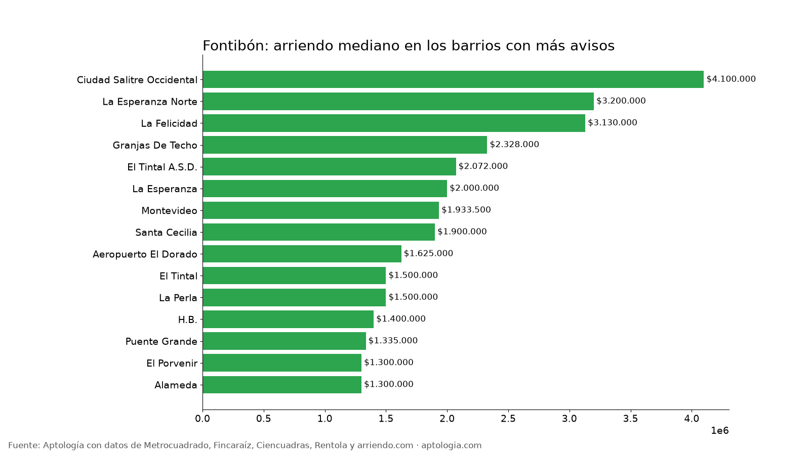

# Arriendo en Fontibón, Bogotá: precios por habitaciones, estrato y barrio (octubre 2026)

**El arriendo mediano de un apartamento o apartaestudio en Fontibón (Bogotá) es de $1.780.000 al mes, unos $43.662 por m².** Un 2 habitaciones cuesta en la mediana $1.600.000. El barrio más barato con 5 avisos o más es [Morabia](/arriendo/bogota/morabia) ($1.200.000) y el más caro [Ciudad Salitre Occidental](/arriendo/bogota/ciudad-salitre-occidental) ($4.100.000).

*Resumen: analizamos 326 apartamentos y apartaestudios en arriendo únicos en la localidad de Fontibón.*

**Actualizado:** 13 de octubre de 2026 · **Próxima actualización:** mensual.

## Resumen

| Indicador | Valor |
|---|---|
| Canon mediano | $1.780.000 |
| Por m² (mediana) | $43.662/m² |
| Área mediana | 42 m² |
| Con parqueadero | 23,6 % |
| Administración mediana | $217.500 (11,5 % del canon) |
| Avisos únicos | 326 |

## Por número de habitaciones

| Habitaciones | Canon mediano | Por m² | Área mediana | Avisos |
|---|---|---|---|---|
| 1 habitación | $1.850.000 | $62.069/m² | 30 m² | 43 |
| 2 habitaciones | $1.600.000 | $37.500/m² | 45 m² | 141 |
| 3 habitaciones | $2.550.000 | $38.750/m² | 65 m² | 75 |

## Por estrato

| Estrato | Canon mediano | Por m² | Avisos |
|---|---|---|---|
| 2 | $1.400.450 | $33.712/m² | 20 |
| 3 | $1.550.000 | $36.905/m² | 160 |
| 4 | $2.300.000 | $53.895/m² | 132 |
| 5 | $5.000.000 | $66.667/m² | 13 |

## Barrios más baratos y más caros

**Más baratos:**

| Barrio | Canon mediano | Por m² | Avisos |
|---|---|---|---|
| [Morabia](/arriendo/bogota/morabia) | $1.200.000 | $26.190 | 5 |
| [Alameda](/arriendo/bogota/alameda) | $1.300.000 | $27.206 | 8 |
| [El Porvenir](/arriendo/bogota/el-porvenir) | $1.300.000 | $26.000 | 9 |
| [Puente Grande](/arriendo/bogota/puente-grande) | $1.335.000 | $29.686 | 10 |
| [H.B.](/arriendo/bogota/h-b) | $1.400.000 | $32.971 | 20 |

**Más caros:**

| Barrio | Canon mediano | Por m² | Avisos |
|---|---|---|---|
| [Ciudad Salitre Occidental](/arriendo/bogota/ciudad-salitre-occidental) | $4.100.000 | $55.263 | 11 |
| [La Esperanza Norte](/arriendo/bogota/la-esperanza-norte) | $3.200.000 | $83.750 | 9 |
| [La Felicidad](/arriendo/bogota/la-felicidad) | $3.130.000 | $48.529 | 15 |
| [Carlos Lleras Restrepo Manzana D](/arriendo/bogota/carlos-lleras-restrepo-manzana-d) | $2.500.000 | $58.333 | 5 |
| [Granjas De Techo](/arriendo/bogota/granjas-de-techo) | $2.328.000 | $56.417 | 12 |

## Apartaestudio o apartamento de 1 habitación

En Fontibón, un apartaestudio cuesta en la mediana $1.799.000 (63 avisos) y un apartamento de 1 habitación $1.850.000 (43 avisos): $51.000 de diferencia.

**Cómo usarlo para decidir:** compara tu presupuesto con la mediana de tu número de habitaciones y mira los barrios más baratos de la tabla; suma la administración (mediana $217.500) para saber el costo real mensual.

## Preguntas frecuentes

**¿Cuánto cuesta arrendar un apartamento en Fontibón?**
La mediana es $1.780.000 al mes, con 326 avisos únicos al 13 de octubre de 2026.

**¿Cuánto vale un apartamento de 2 habitaciones en arriendo en Fontibón?**
La mediana es $1.600.000 al mes (141 avisos).

**¿Cuál es el barrio más barato para arrendar en Fontibón?**
Entre los barrios con 5 avisos o más, Morabia, con un canon mediano de $1.200.000. El más caro es Ciudad Salitre Occidental, con $4.100.000.

**¿Cuánto se paga de administración en Fontibón?**
La mediana es $217.500 al mes, alrededor del 11,5 % del canon.

**¿Qué porcentaje de apartamentos en arriendo en Fontibón tiene parqueadero?**
El 23,6 % de los avisos que informan el dato incluye al menos un parqueadero.

## Metodología

- **Fuente:** base de ingesta diaria de Aptología, con avisos públicos de Metrocuadrado, Fincaraíz, Ciencuadras, Rentola y arriendo.com. Corte al 13 de octubre de 2026.
- **Filtros:** apartamentos y apartaestudios en avisos vivos que pasan el control de calidad, en la localidad de Fontibón, canon entre $400.000 y $30.000.000. Se excluyen TikTok y Facebook Marketplace.
- **Duplicados:** se deja un aviso por grupo de duplicados (el mismo inmueble en varios portales).
- **Barrios:** solo barrios con 5 avisos o más. Parqueadero y administración, sobre los avisos que informan el dato.
- **Limitaciones:** son precios pedidos, no cerrados. Los barrios y localidades vienen tal como los escribe cada portal.
- **Datos abiertos:** [datos.csv](datos.csv), licencia CC BY 4.0.

## Cómo citar

Pinzón Pineda, D. M. (2026). *Arriendo en Fontibón, Bogotá: precios por habitaciones, estrato y barrio (octubre 2026)*. Aptología. https://www.aptologia.com/estudios/arriendo-en-fontibon-bogota-2026. Datos: datos.csv, licencia CC BY 4.0.
