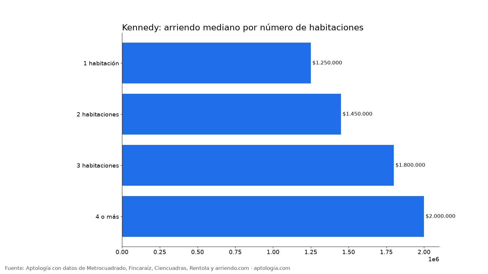
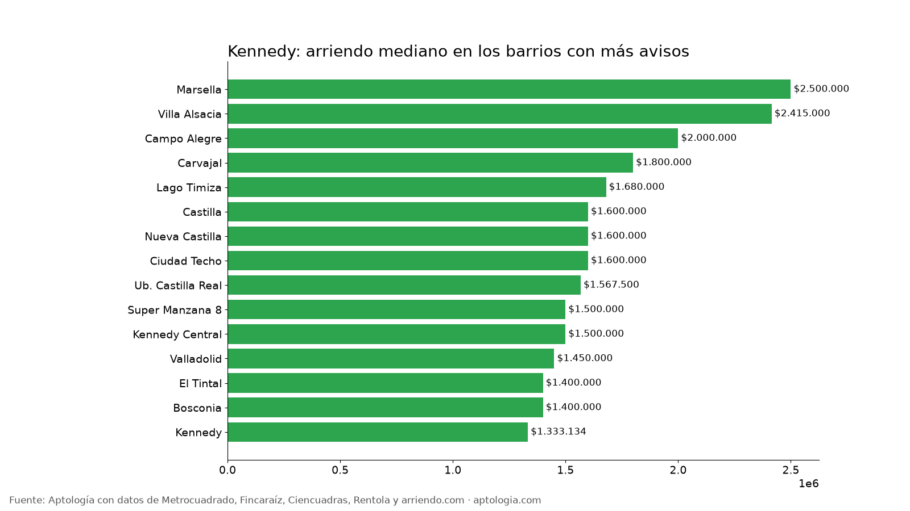

# Arriendo en Kennedy, Bogotá: precios por habitaciones, estrato y barrio (octubre 2026)

**El arriendo mediano de un apartamento o apartaestudio en Kennedy (Bogotá) es de $1.500.000 al mes, unos $31.579 por m².** Un 2 habitaciones cuesta en la mediana $1.450.000. El barrio más barato con 5 avisos o más es Ub. Castilla ($1.230.000) y el más caro [La Igualdad](/arriendo/bogota/la-igualdad) ($2.800.000).

*Resumen: analizamos 299 apartamentos y apartaestudios en arriendo únicos en la localidad de Kennedy.*

**Actualizado:** 13 de octubre de 2026 · **Próxima actualización:** mensual.

## Resumen

| Indicador | Valor |
|---|---|
| Canon mediano | $1.500.000 |
| Por m² (mediana) | $31.579/m² |
| Área mediana | 50 m² |
| Con parqueadero | 25,8 % |
| Administración mediana | $179.600 (11,3 % del canon) |
| Avisos únicos | 299 |

## Por número de habitaciones

| Habitaciones | Canon mediano | Por m² | Área mediana | Avisos |
|---|---|---|---|---|
| 1 habitación | $1.250.000 | $43.333/m² | 34 m² | 14 |
| 2 habitaciones | $1.450.000 | $32.979/m² | 44 m² | 167 |
| 3 habitaciones | $1.800.000 | $29.000/m² | 60 m² | 99 |
| 4 o más | $2.000.000 | $24.444/m² | 93 m² | 9 |

## Por estrato

| Estrato | Canon mediano | Por m² | Avisos |
|---|---|---|---|
| 2 | $1.200.000 | $22.581/m² | 33 |
| 3 | $1.500.000 | $31.731/m² | 235 |
| 4 | $2.500.000 | $42.685/m² | 28 |

## Barrios más baratos y más caros

**Más baratos:**

| Barrio | Canon mediano | Por m² | Avisos |
|---|---|---|---|
| Ub. Castilla | $1.230.000 | $30.750 | 5 |
| [Kennedy](/arriendo/bogota/kennedy) | $1.333.134 | $26.045 | 8 |
| [Bosconia](/arriendo/bogota/bosconia) | $1.400.000 | $32.500 | 9 |
| [El Tintal](/arriendo/bogota/el-tintal) | $1.400.000 | $33.333 | 13 |
| [Floralia I Sector](/arriendo/bogota/floralia-i-sector) | $1.400.000 | $22.000 | 5 |

**Más caros:**

| Barrio | Canon mediano | Por m² | Avisos |
|---|---|---|---|
| [La Igualdad](/arriendo/bogota/la-igualdad) | $2.800.000 | $39.739 | 5 |
| [Marsella](/arriendo/bogota/marsella) | $2.500.000 | $34.149 | 6 |
| [Villa Alsacia](/arriendo/bogota/villa-alsacia) | $2.415.000 | $42.754 | 6 |
| [Campo Alegre](/arriendo/bogota/campo-alegre) | $2.000.000 | $30.159 | 9 |
| [Carvajal](/arriendo/bogota/carvajal) | $1.800.000 | $30.000 | 10 |

## Apartaestudio o apartamento de 1 habitación

En Kennedy, un apartaestudio cuesta en la mediana $1.190.000 (10 avisos) y un apartamento de 1 habitación $1.250.000 (14 avisos): $60.000 de diferencia.

**Cómo usarlo para decidir:** compara tu presupuesto con la mediana de tu número de habitaciones y mira los barrios más baratos de la tabla; suma la administración (mediana $179.600) para saber el costo real mensual.

## Preguntas frecuentes

**¿Cuánto cuesta arrendar un apartamento en Kennedy?**
La mediana es $1.500.000 al mes, con 299 avisos únicos al 13 de octubre de 2026.

**¿Cuánto vale un apartamento de 2 habitaciones en arriendo en Kennedy?**
La mediana es $1.450.000 al mes (167 avisos).

**¿Cuál es el barrio más barato para arrendar en Kennedy?**
Entre los barrios con 5 avisos o más, Ub. Castilla, con un canon mediano de $1.230.000. El más caro es La Igualdad, con $2.800.000.

**¿Cuánto se paga de administración en Kennedy?**
La mediana es $179.600 al mes, alrededor del 11,3 % del canon.

**¿Qué porcentaje de apartamentos en arriendo en Kennedy tiene parqueadero?**
El 25,8 % de los avisos que informan el dato incluye al menos un parqueadero.

## Metodología

- **Fuente:** base de ingesta diaria de Aptología, con avisos públicos de Metrocuadrado, Fincaraíz, Ciencuadras, Rentola y arriendo.com. Corte al 13 de octubre de 2026.
- **Filtros:** apartamentos y apartaestudios en avisos vivos que pasan el control de calidad, en la localidad de Kennedy, canon entre $400.000 y $30.000.000. Se excluyen TikTok y Facebook Marketplace.
- **Duplicados:** se deja un aviso por grupo de duplicados (el mismo inmueble en varios portales).
- **Barrios:** solo barrios con 5 avisos o más. Parqueadero y administración, sobre los avisos que informan el dato.
- **Limitaciones:** son precios pedidos, no cerrados. Los barrios y localidades vienen tal como los escribe cada portal.
- **Datos abiertos:** [datos.csv](datos.csv), licencia CC BY 4.0.

## Cómo citar

Pinzón Pineda, D. M. (2026). *Arriendo en Kennedy, Bogotá: precios por habitaciones, estrato y barrio (octubre 2026)*. Aptología. https://www.aptologia.com/estudios/arriendo-en-kennedy-bogota-2026. Datos: datos.csv, licencia CC BY 4.0.
