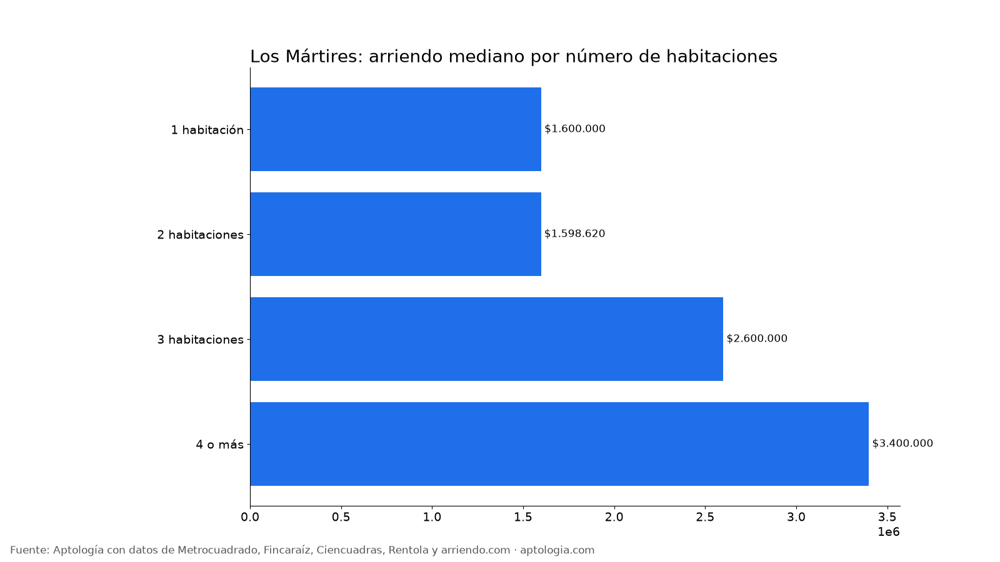
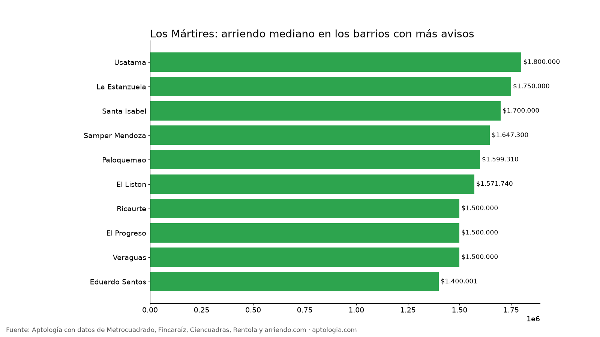

# Arriendo en Los Mártires, Bogotá: precios por habitaciones, estrato y barrio (octubre 2026)

**El arriendo mediano de un apartamento o apartaestudio en Los Mártires (Bogotá) es de $1.600.000 al mes, unos $43.734 por m².** Un 2 habitaciones cuesta en la mediana $1.598.620. El barrio más barato con 5 avisos o más es [Eduardo Santos](/arriendo/bogota/eduardo-santos) ($1.400.001) y el más caro [Usatama](/arriendo/bogota/usatama) ($1.800.000).

*Resumen: analizamos 142 apartamentos y apartaestudios en arriendo únicos en la localidad de Los Mártires.*

**Actualizado:** 13 de octubre de 2026 · **Próxima actualización:** mensual.

## Resumen

| Indicador | Valor |
|---|---|
| Canon mediano | $1.600.000 |
| Por m² (mediana) | $43.734/m² |
| Área mediana | 38 m² |
| Con parqueadero | 12,0 % |
| Administración mediana | $170.000 (10,0 % del canon) |
| Avisos únicos | 142 |

## Por número de habitaciones

| Habitaciones | Canon mediano | Por m² | Área mediana | Avisos |
|---|---|---|---|---|
| 1 habitación | $1.600.000 | $45.833/m² | 36 m² | 25 |
| 2 habitaciones | $1.598.620 | $43.939/m² | 39 m² | 73 |
| 3 habitaciones | $2.600.000 | $38.333/m² | 62 m² | 11 |
| 4 o más | $3.400.000 | $25.440/m² | 218 m² | 6 |

## Por estrato

| Estrato | Canon mediano | Por m² | Avisos |
|---|---|---|---|
| 3 | $1.568.245 | $43.310/m² | 122 |
| 4 | $1.950.000 | $47.692/m² | 13 |

## Barrios más baratos y más caros

**Más baratos:**

| Barrio | Canon mediano | Por m² | Avisos |
|---|---|---|---|
| [Eduardo Santos](/arriendo/bogota/eduardo-santos) | $1.400.001 | $37.778 | 9 |
| El Progreso | $1.500.000 | $41.667 | 8 |
| [Ricaurte](/arriendo/bogota/ricaurte) | $1.500.000 | $41.667 | 15 |
| [Veraguas](/arriendo/bogota/veraguas) | $1.500.000 | $31.981 | 7 |
| [El Liston](/arriendo/bogota/el-liston) | $1.571.740 | $50.000 | 16 |

**Más caros:**

| Barrio | Canon mediano | Por m² | Avisos |
|---|---|---|---|
| [Usatama](/arriendo/bogota/usatama) | $1.800.000 | $57.692 | 17 |
| [La Estanzuela](/arriendo/bogota/la-estanzuela) | $1.750.000 | $70.833 | 5 |
| [Santa Isabel](/arriendo/bogota/santa-isabel) | $1.700.000 | $35.417 | 11 |
| [Samper Mendoza](/arriendo/bogota/samper-mendoza) | $1.647.300 | $56.667 | 9 |
| [Paloquemao](/arriendo/bogota/paloquemao) | $1.599.310 | $52.391 | 16 |

## Apartaestudio o apartamento de 1 habitación

En Los Mártires, un apartaestudio cuesta en la mediana $1.500.000 (27 avisos) y un apartamento de 1 habitación $1.600.000 (25 avisos): $100.000 de diferencia.

**Cómo usarlo para decidir:** compara tu presupuesto con la mediana de tu número de habitaciones y mira los barrios más baratos de la tabla; suma la administración (mediana $170.000) para saber el costo real mensual.

## Preguntas frecuentes

**¿Cuánto cuesta arrendar un apartamento en Los Mártires?**
La mediana es $1.600.000 al mes, con 142 avisos únicos al 13 de octubre de 2026.

**¿Cuánto vale un apartamento de 2 habitaciones en arriendo en Los Mártires?**
La mediana es $1.598.620 al mes (73 avisos).

**¿Cuál es el barrio más barato para arrendar en Los Mártires?**
Entre los barrios con 5 avisos o más, Eduardo Santos, con un canon mediano de $1.400.001. El más caro es Usatama, con $1.800.000.

**¿Cuánto se paga de administración en Los Mártires?**
La mediana es $170.000 al mes, alrededor del 10,0 % del canon.

**¿Qué porcentaje de apartamentos en arriendo en Los Mártires tiene parqueadero?**
El 12,0 % de los avisos que informan el dato incluye al menos un parqueadero.

## Metodología

- **Fuente:** base de ingesta diaria de Aptología, con avisos públicos de Metrocuadrado, Fincaraíz, Ciencuadras, Rentola y arriendo.com. Corte al 13 de octubre de 2026.
- **Filtros:** apartamentos y apartaestudios en avisos vivos que pasan el control de calidad, en la localidad de Los Mártires, canon entre $400.000 y $30.000.000. Se excluyen TikTok y Facebook Marketplace.
- **Duplicados:** se deja un aviso por grupo de duplicados (el mismo inmueble en varios portales).
- **Barrios:** solo barrios con 5 avisos o más. Parqueadero y administración, sobre los avisos que informan el dato.
- **Limitaciones:** son precios pedidos, no cerrados. Los barrios y localidades vienen tal como los escribe cada portal.
- **Datos abiertos:** [datos.csv](datos.csv), licencia CC BY 4.0.

## Cómo citar

Pinzón Pineda, D. M. (2026). *Arriendo en Los Mártires, Bogotá: precios por habitaciones, estrato y barrio (octubre 2026)*. Aptología. https://www.aptologia.com/estudios/arriendo-en-los-martires-bogota-2026. Datos: datos.csv, licencia CC BY 4.0.
