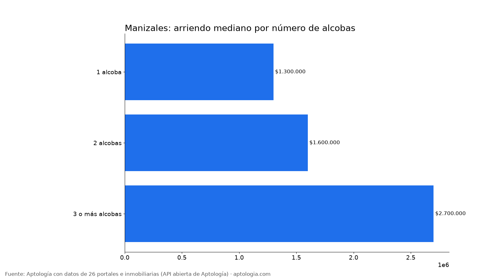
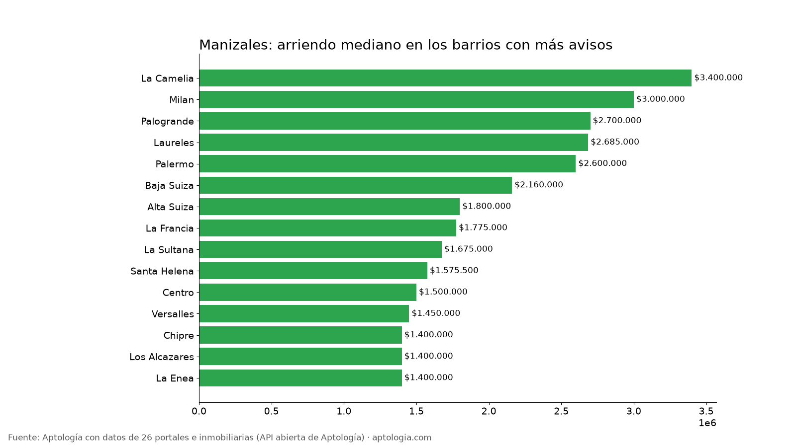

# Arriendo en Manizales por barrio: precios por alcobas, barrios más baratos y más caros (octubre 2026)

**El arriendo mediano de un apartamento en Manizales es de $1.800.000 al mes; un apartamento de 2 alcobas pide en la mediana $1.600.000.** Entre los barrios con 30 avisos o más, el más barato es Chipre ($1.400.000) y el más caro La Camelia ($3.400.000): 2,4 veces más.

*Resumen: analizamos 907 avisos de apartamentos en arriendo en 24 barrios depurados de Manizales.*

**Actualizado:** 18 de octubre de 2026 (datos del 5 de octubre de 2026) · **Próxima actualización:** mensual.

## Resumen

| Indicador | Valor |
|---|---|
| Arriendo mediano (toda la ciudad) | $1.800.000 |
| Mediana 1 alcoba | $1.300.000 |
| Mediana 2 alcobas | $1.600.000 |
| Mediana 3 o más alcobas | $2.700.000 |
| Avisos con parqueadero (barrios depurados) | 43,1 % |
| Barrios con 15 avisos o más | 24 |
| Avisos en barrios depurados | 907 |

## Por número de alcobas

| Alcobas | Arriendo mediano | Avisos |
|---|---|---|
| 1 alcoba | $1.300.000 | 282 |
| 2 alcobas | $1.600.000 | 542 |
| 3 o más alcobas | $2.700.000 | 486 |

De 1 a 2 alcobas, la mediana sube $300.000 (23,1 %); de 2 a 3 o más alcobas, sube $1.100.000 (68,8 %).

## Barrios más baratos y más caros

**Más baratos (30 avisos o más):**

| Barrio | Arriendo mediano | P25 – P75 | 2 alcobas | Avisos |
|---|---|---|---|---|
| Chipre | $1.400.000 | $1.100.000 – $2.808.490 | $1.275.000 | 44 |
| Los Alcazares | $1.400.000 | $1.300.000 – $1.637.500 | $1.400.000 | 34 |
| La Enea | $1.400.000 | $1.000.000 – $2.187.500 | $1.500.000 | 31 |
| Versalles | $1.450.000 | $1.030.000 – $3.250.000 | $3.000.000 | 35 |
| Centro | $1.500.000 | $800.000 – $2.700.000 | $1.600.000 | 113 |
| Santa Helena | $1.575.500 | $1.205.000 – $2.000.000 | $1.500.000 | 32 |
| La Sultana | $1.675.000 | $1.400.000 – $2.000.000 | $1.700.000 | 50 |

**Más caros:**

| Barrio | Arriendo mediano | P25 – P75 | 2 alcobas | Avisos |
|---|---|---|---|---|
| La Camelia | $3.400.000 | $2.200.000 – $5.000.000 | $1.800.000 | 31 |
| Milan | $3.000.000 | $2.000.000 – $3.800.000 | $2.100.000 | 78 |
| Palogrande | $2.700.000 | $2.000.000 – $3.200.000 | $2.700.000 | 33 |
| Laureles | $2.685.000 | $1.800.000 – $3.468.768 | $2.000.000 | 42 |
| Palermo | $2.600.000 | $1.700.000 – $3.900.000 | $2.750.000 | 116 |
| Baja Suiza | $2.160.000 | $2.000.000 – $2.400.000 | $2.400.000 | 33 |
| Alta Suiza | $1.800.000 | $1.300.000 – $2.600.000 | $2.100.000 | 37 |

## Todos los barrios con 15 avisos o más

| Barrio | Avisos | Arriendo mediano | 1 alcoba | 2 alcobas | 3+ alcobas | Con parqueadero |
|---|---|---|---|---|---|---|
| Palermo | 116 | $2.600.000 | $1.600.000 | $2.750.000 | $3.900.000 | 60,3 % |
| Centro | 113 | $1.500.000 | — | $1.600.000 | $1.675.000 | 23,0 % |
| Milan | 78 | $3.000.000 | — | $2.100.000 | $3.600.000 | 51,3 % |
| La Sultana | 50 | $1.675.000 | — | $1.700.000 | $1.900.000 | 22,0 % |
| Chipre | 44 | $1.400.000 | — | $1.275.000 | $2.300.000 | 34,1 % |
| Laureles | 42 | $2.685.000 | — | $2.000.000 | $4.120.000 | 73,8 % |
| Alta Suiza | 37 | $1.800.000 | — | $2.100.000 | $2.000.000 | 48,6 % |
| Versalles | 35 | $1.450.000 | $965.000 | $3.000.000 | — | 22,9 % |
| Los Alcazares | 34 | $1.400.000 | — | $1.400.000 | — | 50,0 % |
| Palogrande | 33 | $2.700.000 | — | $2.700.000 | — | 42,4 % |
| Baja Suiza | 33 | $2.160.000 | — | $2.400.000 | $2.200.000 | 90,9 % |
| Santa Helena | 32 | $1.575.500 | $1.800.000 | $1.500.000 | $1.700.000 | 56,2 % |
| La Camelia | 31 | $3.400.000 | — | $1.800.000 | $5.000.000 | 64,5 % |
| La Enea | 31 | $1.400.000 | $900.000 | $1.500.000 | — | 19,4 % |
| La Francia | 30 | $1.775.000 | — | — | $2.000.000 | 43,3 % |
| Belen | 24 | $2.500.000 | — | — | $2.700.000 | 25,0 % |
| El Bosque | 23 | $1.300.000 | — | $1.300.000 | — | 39,1 % |
| San Jorge | 23 | $1.150.000 | $1.000.000 | — | — | 17,4 % |
| Avenida Santander | 20 | $2.550.000 | — | — | — | 35,0 % |
| Cervantes | 16 | $950.000 | — | — | — | 18,8 % |
| San Antonio | 16 | $1.875.000 | — | — | $2.000.000 | 18,8 % |
| Los Rosales | 16 | $1.475.000 | — | — | — | 56,2 % |
| La Estrella | 15 | $1.400.000 | $1.400.000 | — | — | 46,7 % |
| Guayacanes | 15 | $1.900.000 | $1.200.000 | — | — | 40,0 % |

**Cómo usarlo para decidir:** compara tu presupuesto con la mediana de tu número de alcobas y mira la franja P25 – P75 del barrio: un aviso por debajo del P25 es barato para ese barrio, uno por encima del P75 es caro. Suma la administración, que no está incluida. Precios al día por barrio en [aptologia.com/precios-de-arriendo/manizales](https://www.aptologia.com/precios-de-arriendo/manizales).

## Preguntas frecuentes

**¿Cuánto cuesta arrendar un apartamento en Manizales?**
La mediana del arriendo pedido es $1.800.000 al mes, sin administración, con datos del 5 de octubre de 2026.

**¿Cuánto vale un apartamento de 2 alcobas en arriendo en Manizales?**
La mediana es $1.600.000 al mes (542 avisos).

**¿Cuál es el barrio más barato para arrendar en Manizales?**
Entre los barrios con 30 avisos o más, Chipre, con una mediana de $1.400.000. El más caro es La Camelia, con $3.400.000.

**¿Cuántos apartamentos en arriendo en Manizales tienen parqueadero?**
El 43,1 % de los avisos de los barrios depurados incluye parqueadero.

## Metodología

- **Fuente:** API abierta de Aptología ([aptologia.com/datos-abiertos](https://www.aptologia.com/datos-abiertos)), que cada noche revisa los avisos vivos de 26 portales e inmobiliarias. Foto de los datos: 5 de octubre de 2026.
- **Qué se mide:** precio pedido de apartamentos (no casas ni habitaciones), sin administración. Son precios publicados, no cerrados.
- **Barrios:** etiquetas depuradas. Se excluyen nombres de localidad o comuna, textos de aviso, zonas genéricas, barrios de otro municipio y variantes del mismo nombre, para no contar dos veces el mismo barrio.
- **Ranking de barrios:** barrios con 30 avisos o más; la tabla completa incluye los de 15 o más. Medianas por alcobas de un barrio solo con 5 avisos o más.
- **Limitaciones:** un mismo apartamento puede estar publicado en más de un portal, por lo que los conteos de avisos pueden incluir repetidos. Los barrios vienen tal como los escribe cada portal, después de la depuración.
- **Datos abiertos:** [datos.csv](datos.csv), licencia CC BY 4.0.

## Cómo citar

Pinzón Pineda, D. M. (2026). *Arriendo en Manizales por barrio: precios por alcobas, barrios más baratos y más caros (octubre 2026)*. Aptología. https://www.aptologia.com/estudios/arriendo-en-manizales-por-barrio-2026. Datos: datos.csv, licencia CC BY 4.0.
