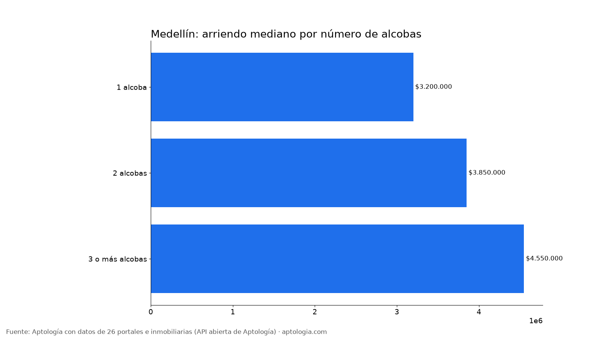
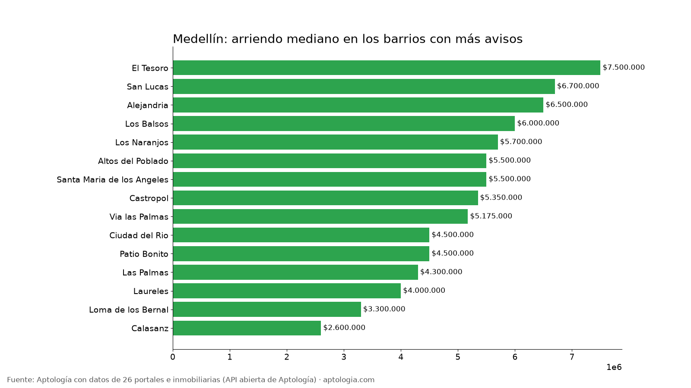

# Arriendo en Medellín por barrio: precios por alcobas, barrios más baratos y más caros (octubre 2026)

**El arriendo mediano de un apartamento en Medellín es de $4.100.000 al mes; un apartamento de 2 alcobas pide en la mediana $3.850.000.** Entre los barrios con 30 avisos o más, el más barato es Florencia ($1.100.000) y el más caro La Calera ($12.000.000): 10,9 veces más.

*Resumen: analizamos 90.019 avisos de apartamentos en arriendo en 435 barrios depurados de Medellín.*

**Actualizado:** 18 de octubre de 2026 (datos del 5 de octubre de 2026) · **Próxima actualización:** mensual.

## Resumen

| Indicador | Valor |
|---|---|
| Arriendo mediano (toda la ciudad) | $4.100.000 |
| Mediana 1 alcoba | $3.200.000 |
| Mediana 2 alcobas | $3.850.000 |
| Mediana 3 o más alcobas | $4.550.000 |
| Avisos con parqueadero (barrios depurados) | 74,0 % |
| Barrios con 15 avisos o más | 435 |
| Avisos en barrios depurados | 90.019 |
| Rentabilidad bruta mediana por barrio (arriendo anual / precio de venta) | 6,5 % |

## Por número de alcobas

| Alcobas | Arriendo mediano | Avisos |
|---|---|---|
| 1 alcoba | $3.200.000 | 17.384 |
| 2 alcobas | $3.850.000 | 41.235 |
| 3 o más alcobas | $4.550.000 | 73.077 |

De 1 a 2 alcobas, la mediana sube $650.000 (20,3 %); de 2 a 3 o más alcobas, sube $700.000 (18,2 %).

## Barrios más baratos y más caros

**Más baratos (30 avisos o más):**

| Barrio | Arriendo mediano | P25 – P75 | 2 alcobas | Avisos |
|---|---|---|---|---|
| Florencia | $1.100.000 | $1.000.000 – $1.775.000 | $1.900.000 | 34 |
| Las Mercedes | $1.290.000 | $1.290.000 – $2.500.000 | $2.200.000 | 82 |
| Caicedo | $1.290.000 | $1.100.000 – $1.700.000 | $1.200.000 | 39 |
| Belen las Mercedes | $1.290.000 | $1.290.000 – $2.300.000 | $2.500.000 | 144 |
| Enciso | $1.300.000 | $915.000 – $3.350.000 | $1.350.000 | 68 |
| Pedregal | $1.300.000 | $1.200.000 – $1.400.000 | $1.400.000 | 34 |
| Campo Valdes | $1.340.000 | $1.100.000 – $1.580.000 | $1.400.000 | 91 |
| San Antonio de Prado | $1.400.000 | $1.300.000 – $1.600.000 | $1.400.000 | 514 |
| El Salvador | $1.500.000 | $1.100.000 – $1.800.000 | $1.600.000 | 177 |
| Loreto | $1.500.000 | $1.400.000 – $1.800.000 | $1.500.000 | 100 |

**Más caros:**

| Barrio | Arriendo mediano | P25 – P75 | 2 alcobas | Avisos |
|---|---|---|---|---|
| La Calera | $12.000.000 | $7.800.000 – $14.500.000 | $7.000.000 | 396 |
| Poblado San Lucas | $10.250.000 | $6.400.000 – $14.500.000 | — | 46 |
| La Florida el Poblado | $8.500.000 | $6.925.000 – $9.000.000 | — | 36 |
| Urbanizacion Arcoiris | $8.000.000 | $6.150.000 – $10.500.000 | $9.650.000 | 35 |
| La Tomatera | $8.000.000 | $5.950.000 – $11.800.000 | $5.800.000 | 166 |
| La Concha | $7.500.000 | $6.000.000 – $9.000.000 | $10.850.000 | 101 |
| El Tesoro | $7.500.000 | $5.250.000 – $11.400.000 | $6.600.000 | 2.680 |
| Las Santas | $7.500.000 | $6.250.000 – $8.500.000 | $7.500.000 | 30 |
| El Campestre | $7.000.000 | $5.500.000 – $10.200.000 | $5.950.000 | 598 |
| Provenza | $7.000.000 | $4.812.500 – $10.000.000 | $7.100.000 | 534 |

## Todos los barrios con 15 avisos o más

| Barrio | Avisos | Arriendo mediano | 1 alcoba | 2 alcobas | 3+ alcobas | Con parqueadero |
|---|---|---|---|---|---|---|
| Laureles | 6.722 | $4.000.000 | $2.596.000 | $3.400.000 | $4.600.000 | 68,0 % |
| Castropol | 2.788 | $5.350.000 | $4.100.000 | $4.550.000 | $5.600.000 | 83,3 % |
| El Tesoro | 2.680 | $7.500.000 | $4.000.000 | $6.600.000 | $8.900.000 | 87,1 % |
| Santa Maria de los Angeles | 2.321 | $5.500.000 | $3.800.000 | $4.700.000 | $6.100.000 | 85,7 % |
| Calasanz | 2.281 | $2.600.000 | $2.200.000 | $2.400.000 | $3.000.000 | 53,8 % |
| Ciudad del Rio | 2.008 | $4.500.000 | $3.700.000 | $4.500.000 | $4.600.000 | 79,1 % |
| Los Balsos | 2.002 | $6.000.000 | $4.400.000 | $5.800.000 | $7.500.000 | 78,5 % |
| Las Palmas | 1.941 | $4.300.000 | $4.200.000 | $4.350.000 | $4.500.000 | 82,3 % |
| Altos del Poblado | 1.825 | $5.500.000 | $4.000.000 | $5.000.000 | $6.150.000 | 85,3 % |
| San Lucas | 1.617 | $6.700.000 | $5.850.000 | $7.500.000 | $7.200.000 | 81,1 % |
| Loma de los Bernal | 1.314 | $3.300.000 | $2.500.000 | $3.100.000 | $3.300.000 | 84,0 % |
| Via las Palmas | 1.310 | $5.175.000 | $3.900.000 | $5.000.000 | $5.500.000 | 97,6 % |
| Patio Bonito | 1.079 | $4.500.000 | $3.800.000 | $4.000.000 | $5.500.000 | 84,5 % |
| Los Naranjos | 1.055 | $5.700.000 | $4.400.000 | $5.200.000 | $7.000.000 | 91,6 % |
| Alejandria | 1.036 | $6.500.000 | $4.650.000 | $6.000.000 | $7.500.000 | 93,9 % |
| Cumbres | 967 | $4.500.000 | $3.930.000 | $4.300.000 | $4.600.000 | 97,1 % |
| La Florida | 948 | $5.600.000 | $4.300.000 | $4.500.000 | $6.200.000 | 90,3 % |
| San Diego | 881 | $3.600.000 | $3.700.000 | $3.200.000 | $3.900.000 | 75,0 % |
| Simesa | 856 | $4.400.000 | $3.600.000 | $4.500.000 | $4.650.000 | 97,7 % |
| Loma del Indio | 850 | $3.800.000 | $3.300.000 | $3.700.000 | $3.800.000 | 80,4 % |
| La Castellana | 846 | $3.600.000 | $2.300.000 | $2.800.000 | $4.000.000 | 60,4 % |
| Camino Verde | 786 | $3.650.000 | $3.600.000 | $3.500.000 | $3.800.000 | 93,6 % |
| Conquistadores | 773 | $3.800.000 | $2.300.000 | $3.200.000 | $4.400.000 | 57,4 % |
| Loma del Esmeraldal | 765 | $4.500.000 | $3.850.000 | $4.300.000 | $5.000.000 | 98,2 % |
| Loma de las Brujas | 749 | $5.000.000 | $3.600.000 | $4.300.000 | $6.400.000 | 95,5 % |
| La Linde | 722 | $6.500.000 | $4.000.000 | $6.100.000 | $7.800.000 | 97,4 % |
| Loma del Escobero | 685 | $4.500.000 | $3.600.000 | $4.300.000 | $5.000.000 | 95,2 % |
| Lalinde | 676 | $6.150.000 | $4.000.000 | $6.150.000 | $7.675.000 | 81,4 % |
| Las Vegas | 672 | $4.000.000 | $2.800.000 | $3.600.000 | $4.500.000 | 88,7 % |
| Los Colores | 649 | $3.400.000 | $2.600.000 | $3.400.000 | $3.500.000 | 70,4 % |
| San Joaquin | 640 | $2.700.000 | $2.000.000 | $2.700.000 | $3.300.000 | 41,2 % |
| Simon Bolivar | 634 | $3.100.000 | $1.700.000 | $2.600.000 | $3.500.000 | 53,0 % |
| Boston | 619 | $1.850.000 | $1.500.000 | $1.850.000 | $2.500.000 | 12,4 % |
| Rodeo Alto | 607 | $2.400.000 | — | $2.200.000 | $2.500.000 | 65,4 % |
| El Campestre | 598 | $7.000.000 | $5.200.000 | $5.950.000 | $8.000.000 | 94,8 % |
| Aves Maria | 590 | $3.400.000 | $2.300.000 | $3.300.000 | $3.500.000 | 92,2 % |
| San German | 546 | $3.300.000 | $2.625.000 | $3.000.000 | $3.400.000 | 77,5 % |
| Estadio | 545 | $2.900.000 | $2.350.000 | $2.700.000 | $4.200.000 | 37,4 % |
| La Aldea | 537 | $2.600.000 | — | $2.500.000 | $2.800.000 | 90,5 % |
| Loma de los Gonzalez | 536 | $5.200.000 | $4.500.000 | $5.000.000 | $6.600.000 | 87,1 % |
| Provenza | 534 | $7.000.000 | $4.500.000 | $7.100.000 | $7.200.000 | 89,0 % |
| San Antonio de Prado | 514 | $1.400.000 | $1.000.000 | $1.400.000 | $1.600.000 | 28,8 % |
| Florida Nueva | 469 | $3.200.000 | $1.850.000 | $3.000.000 | $4.150.000 | 49,7 % |
| San Jose | 468 | $3.050.000 | $1.350.000 | $2.750.000 | $3.300.000 | 83,3 % |
| Centro | 451 | $2.300.000 | $1.535.000 | $2.300.000 | $2.800.000 | 24,6 % |
| Zuniga | 442 | $5.000.000 | $3.600.000 | $4.700.000 | $5.000.000 | 93,9 % |
| La Doctora | 435 | $3.000.000 | — | $3.000.000 | $2.975.000 | 90,8 % |
| Loma los Gonzalez | 435 | $5.000.000 | $4.500.000 | $4.950.000 | $6.400.000 | 92,0 % |
| Suramerica | 423 | $2.900.000 | $2.700.000 | $2.800.000 | $3.000.000 | 93,6 % |
| Loma Benedictinos | 421 | $5.000.000 | $4.700.000 | $4.650.000 | $5.500.000 | 98,3 % |
| Santa Monica | 419 | $2.300.000 | $1.700.000 | $2.240.000 | $2.700.000 | 25,1 % |
| Loma de los Parra | 415 | $6.900.000 | $9.000.000 | $7.200.000 | $6.850.000 | 72,3 % |
| Pan de Azucar | 412 | $3.000.000 | $2.200.000 | $2.900.000 | $3.250.000 | 92,0 % |
| La Frontera | 399 | $4.800.000 | $3.300.000 | $3.900.000 | $5.500.000 | 83,0 % |
| Los Balsos No 1 | 397 | $5.500.000 | $4.200.000 | $5.400.000 | $7.050.000 | 99,2 % |
| Villa Carlota | 397 | $4.500.000 | $3.650.000 | $4.300.000 | $4.800.000 | 90,9 % |
| La Calera | 396 | $12.000.000 | — | $7.000.000 | $13.500.000 | 87,9 % |
| Las Lomitas | 387 | $3.200.000 | $2.500.000 | $2.700.000 | $3.400.000 | 91,7 % |
| Loma del Chocho | 385 | $4.650.000 | $4.600.000 | $4.500.000 | $5.200.000 | 97,4 % |
| Astorga | 374 | $6.500.000 | $5.300.000 | $4.250.000 | $8.000.000 | 90,4 % |
| Prados de Sabaneta | 373 | $3.000.000 | $2.500.000 | $2.825.000 | $3.200.000 | 84,2 % |
| La Aguacatala | 370 | $4.475.000 | $3.550.000 | $4.425.000 | $5.500.000 | 84,9 % |
| El Esmeraldal | 360 | $4.300.000 | $3.600.000 | $4.150.000 | $4.650.000 | 94,2 % |
| Milla de Oro | 345 | $6.800.000 | $4.500.000 | $5.800.000 | $8.000.000 | 83,2 % |
| Las Lomas | 334 | $5.550.000 | $4.100.000 | $5.500.000 | $6.000.000 | 66,5 % |
| Barrio Cristobal | 332 | $1.900.000 | $1.800.000 | $1.900.000 | $2.400.000 | 41,9 % |
| La Abadia | 328 | $4.300.000 | — | $4.000.000 | $4.650.000 | 95,4 % |
| Vizcaya | 322 | $6.300.000 | $4.450.000 | $5.100.000 | $6.700.000 | 94,7 % |
| Los Parra | 319 | $6.800.000 | $4.500.000 | $7.650.000 | $6.800.000 | 85,3 % |
| Jardines | 318 | $4.225.000 | — | $3.800.000 | $4.500.000 | 94,0 % |
| Fatima | 311 | $2.700.000 | $2.500.000 | $2.600.000 | $3.000.000 | 60,8 % |
| Los Balsos No 2 | 310 | $6.000.000 | $4.500.000 | $5.500.000 | $6.650.000 | 99,7 % |
| El Dorado | 307 | $1.700.000 | $1.700.000 | $2.200.000 | $3.000.000 | 22,5 % |
| Escobero | 302 | $4.500.000 | $3.850.000 | $4.250.000 | $5.175.000 | 96,4 % |
| Vegas de San Jose | 301 | $3.100.000 | — | $2.900.000 | $3.200.000 | 96,0 % |
| La Palma | 298 | $3.000.000 | $1.830.000 | $2.900.000 | $3.500.000 | 43,6 % |
| Monteazul | 295 | $3.000.000 | $2.300.000 | $2.825.000 | $3.300.000 | 92,2 % |
| La Inmaculada | 292 | $4.325.000 | — | $4.000.000 | $4.500.000 | 88,4 % |
| Otraparte | 292 | $4.300.000 | $3.100.000 | $3.850.000 | $4.500.000 | 96,6 % |
| Rosales | 276 | $2.900.000 | $1.800.000 | $2.840.000 | $3.500.000 | 38,4 % |
| La Floresta | 275 | $2.650.000 | $1.875.000 | $2.210.000 | $3.000.000 | 22,9 % |
| Vegas de la Doctora | 272 | $3.500.000 | $2.550.000 | $3.375.000 | $3.600.000 | 98,9 % |
| Santa Ana | 271 | $2.200.000 | $1.725.000 | $2.250.000 | $2.300.000 | 56,8 % |
| Santa Fe | 270 | $3.200.000 | $3.000.000 | $3.400.000 | $3.650.000 | 69,3 % |
| Lorena | 263 | $3.300.000 | $2.200.000 | $2.600.000 | $4.625.000 | 53,6 % |
| Prado | 262 | $1.800.000 | $1.350.000 | $1.600.000 | $2.200.000 | 12,2 % |
| Oviedo | 259 | $5.000.000 | $3.675.000 | $4.650.000 | $6.500.000 | 88,8 % |
| Velodromo | 254 | $3.200.000 | $2.200.000 | $3.100.000 | $4.000.000 | 34,3 % |
| Cola del Zorro | 251 | $7.000.000 | $5.200.000 | $7.000.000 | $9.000.000 | 92,4 % |
| Bosques de Zuniga | 250 | $5.000.000 | — | $4.750.000 | $5.000.000 | 98,0 % |
| Belen la Palma | 250 | $3.100.000 | $1.900.000 | $2.900.000 | $3.650.000 | 48,0 % |
| Maria Auxiliadora | 249 | $1.900.000 | — | $1.900.000 | $1.900.000 | 30,1 % |
| La Cuenca | 247 | $3.000.000 | — | $3.100.000 | $3.000.000 | 93,5 % |
| Las Antillas | 247 | $3.400.000 | — | $3.000.000 | $3.500.000 | 95,1 % |
| Loma del Barro | 236 | $3.000.000 | — | $3.150.000 | $3.000.000 | 85,2 % |
| Calle Larga | 235 | $2.650.000 | $2.300.000 | $2.600.000 | $2.800.000 | 60,0 % |
| La Milagrosa | 231 | $1.500.000 | $1.200.000 | $1.400.000 | $2.000.000 | 8,2 % |
| Ditaires | 229 | $2.700.000 | — | $2.500.000 | $2.700.000 | 77,7 % |
| Loma de San Julian | 226 | $3.800.000 | $2.950.000 | $3.200.000 | $3.900.000 | 79,6 % |
| Calasanz Parte Alta | 223 | $2.450.000 | — | $2.200.000 | $3.200.000 | 61,0 % |
| La Pradera | 221 | $4.500.000 | $3.575.000 | $4.200.000 | $5.150.000 | 90,0 % |
| Pilarica | 221 | $2.500.000 | $2.200.000 | $2.020.000 | $3.000.000 | 42,5 % |
| El Trianon | 219 | $3.200.000 | $2.700.000 | $3.425.000 | $3.200.000 | 80,8 % |
| Pajarito | 213 | $1.800.000 | $1.500.000 | $1.600.000 | $1.800.000 | 34,7 % |
| Mesa | 213 | $4.050.000 | $1.550.000 | $4.125.000 | $4.200.000 | 77,5 % |
| El Chingui | 213 | $3.500.000 | — | $3.300.000 | $3.600.000 | 96,2 % |
| Manila | 212 | $3.900.000 | $3.000.000 | $4.000.000 | $3.900.000 | 69,3 % |
| Santa Teresita | 202 | $3.500.000 | $2.450.000 | $3.000.000 | $3.500.000 | 65,8 % |
| Tres Esquinas | 202 | $3.000.000 | $2.500.000 | $2.850.000 | $3.200.000 | 93,6 % |
| Asomadera No 2 | 201 | $4.200.000 | $3.300.000 | $3.950.000 | $4.500.000 | 95,0 % |
| El Diamante No 2 | 199 | $5.000.000 | $3.900.000 | $4.525.000 | $5.500.000 | 99,5 % |
| Transversal Inferior | 189 | $6.300.000 | $4.000.000 | $4.600.000 | $6.950.000 | 98,4 % |
| Loma del Campestre | 183 | $6.700.000 | $4.700.000 | $6.500.000 | $7.000.000 | 79,8 % |
| Alcala | 179 | $2.800.000 | $1.700.000 | $2.950.000 | $3.050.000 | 36,3 % |
| El Portal | 179 | $4.000.000 | — | $3.625.000 | $4.300.000 | 90,5 % |
| El Rincon | 177 | $2.500.000 | $1.400.000 | $2.200.000 | $2.650.000 | 36,2 % |
| Transversal Superior | 177 | $7.000.000 | $4.000.000 | $6.650.000 | $8.900.000 | 94,4 % |
| El Salvador | 177 | $1.500.000 | $1.100.000 | $1.600.000 | $2.000.000 | 5,6 % |
| Canaveralejo | 172 | $3.050.000 | — | $2.450.000 | $3.300.000 | 79,1 % |
| El Castillo | 171 | $5.650.000 | $4.200.000 | $5.400.000 | $6.000.000 | 88,9 % |
| Mayorca | 167 | $3.100.000 | $1.800.000 | $3.200.000 | $3.100.000 | 78,4 % |
| La Tomatera | 166 | $8.000.000 | $5.450.000 | $5.800.000 | $10.000.000 | 91,6 % |
| La Mota | 165 | $3.000.000 | $1.900.000 | $2.800.000 | $3.200.000 | 75,8 % |
| Suramericana | 164 | $3.500.000 | $1.990.000 | $3.245.000 | $4.175.000 | 50,0 % |
| San Bernardo | 159 | $2.570.000 | $1.200.000 | $2.341.000 | $3.000.000 | 25,2 % |
| Candelaria Centro | 153 | $4.600.000 | $3.360.000 | $4.350.000 | $5.200.000 | 69,9 % |
| Las Casitas | 147 | $3.500.000 | $3.100.000 | $3.500.000 | $3.250.000 | 95,9 % |
| Bolivariana | 146 | $3.300.000 | $2.200.000 | $3.250.000 | $4.500.000 | 54,1 % |
| La Ferreria | 144 | $2.450.000 | — | $2.350.000 | $2.500.000 | 89,6 % |
| Belen las Mercedes | 144 | $1.290.000 | $1.290.000 | $2.500.000 | $3.225.000 | 18,8 % |
| Entre Amigos | 143 | $2.700.000 | $1.850.000 | $2.725.000 | $2.900.000 | 63,6 % |
| Toledo | 142 | $2.800.000 | — | $2.700.000 | $3.100.000 | 91,5 % |
| Los Alcazares | 135 | $3.200.000 | $1.500.000 | $3.000.000 | $3.200.000 | 83,7 % |
| Las Lomas No 2 | 135 | $6.800.000 | $4.575.000 | $5.500.000 | $7.100.000 | 98,5 % |
| Las Brujas | 134 | $5.800.000 | — | $4.400.000 | $6.500.000 | 94,8 % |
| Almeria | 133 | $3.200.000 | — | $1.950.000 | $3.500.000 | 43,6 % |
| Las Lomas No 1 | 133 | $5.800.000 | $4.000.000 | $5.700.000 | $6.800.000 | 97,7 % |
| La Ferreira | 132 | $2.500.000 | — | $2.500.000 | $2.500.000 | 91,7 % |
| La Mina | 132 | $2.900.000 | — | $3.000.000 | $2.400.000 | 69,7 % |
| Belen San Bernardo | 131 | $2.200.000 | $1.400.000 | $2.000.000 | $2.850.000 | 16,8 % |
| El Salado | 130 | $3.500.000 | $1.200.000 | $3.300.000 | $3.650.000 | 72,3 % |
| Alto de Misael | 130 | $4.350.000 | — | $3.900.000 | $4.650.000 | 93,8 % |
| Loma del Atravesado | 129 | $4.200.000 | $3.850.000 | $4.050.000 | $4.900.000 | 97,7 % |
| Cristo Rey | 129 | $2.000.000 | $1.700.000 | $2.300.000 | $2.600.000 | 17,1 % |
| Belen Rosales | 128 | $3.500.000 | $1.900.000 | $2.800.000 | $3.700.000 | 46,9 % |
| Andalucia | 127 | $1.900.000 | $1.350.000 | $1.800.000 | $2.100.000 | 52,0 % |
| San Rafael | 127 | $3.150.000 | $2.000.000 | $3.200.000 | $3.200.000 | 77,2 % |
| Belen Loma de los Bernal | 126 | $3.200.000 | — | $3.100.000 | $3.600.000 | 78,6 % |
| Las Acacias | 126 | $3.500.000 | $2.200.000 | $3.100.000 | $4.575.000 | 77,8 % |
| El Carmelo | 123 | $3.200.000 | — | $3.125.000 | $3.200.000 | 82,1 % |
| Los Alpes | 122 | $2.500.000 | $1.450.000 | $2.275.000 | $2.900.000 | 30,3 % |
| Belen los Alpes | 122 | $2.450.000 | $1.800.000 | $2.500.000 | $2.900.000 | 28,7 % |
| Zona Centro | 113 | $3.650.000 | $2.340.000 | $3.475.000 | $3.800.000 | 63,7 % |
| Belen las Playas | 110 | $2.400.000 | $1.575.000 | $2.140.000 | $2.500.000 | 6,4 % |
| El Nogal los Almendros | 108 | $2.875.000 | $2.590.000 | $2.800.000 | $3.900.000 | 56,5 % |
| La Barquerena | 106 | $3.600.000 | — | $3.150.000 | $3.850.000 | 96,2 % |
| Alto de las Palmas | 104 | $5.900.000 | $5.450.000 | $5.800.000 | $9.500.000 | 76,9 % |
| Santa Lucia | 103 | $2.200.000 | $1.800.000 | $2.100.000 | $2.500.000 | 6,8 % |
| Cabanas | 103 | $2.100.000 | $1.650.000 | $1.800.000 | $2.300.000 | 42,7 % |
| Niquia | 102 | $2.050.000 | — | $2.200.000 | $2.100.000 | 61,8 % |
| La Paz | 102 | $3.250.000 | — | $3.200.000 | $3.250.000 | 80,4 % |
| Uribe Angel | 101 | $3.700.000 | — | $3.500.000 | $3.800.000 | 81,2 % |
| Prado Centro | 101 | $2.000.000 | $1.300.000 | $1.725.000 | $2.200.000 | 13,9 % |
| La Concha | 101 | $7.500.000 | $4.200.000 | $10.850.000 | $6.900.000 | 92,1 % |
| Loreto | 100 | $1.500.000 | $1.000.000 | $1.500.000 | $1.800.000 | 12,0 % |
| Bucaros | 99 | $1.950.000 | — | $1.800.000 | $2.150.000 | 55,6 % |
| Pontevedra | 99 | $4.500.000 | — | $4.500.000 | $4.600.000 | 91,9 % |
| Belen Fatima | 94 | $3.150.000 | $3.500.000 | $2.600.000 | $3.250.000 | 42,6 % |
| Holanda | 94 | $2.900.000 | — | $2.850.000 | $3.100.000 | 69,1 % |
| Loma San Jose | 93 | $3.100.000 | — | $2.700.000 | $3.200.000 | 93,5 % |
| Asomadera No 1 | 93 | $3.950.000 | $3.775.000 | $3.775.000 | $4.100.000 | 90,3 % |
| Bombona | 92 | $2.175.000 | $1.750.000 | $2.300.000 | $3.000.000 | 12,0 % |
| Campo Valdes | 91 | $1.340.000 | $1.125.000 | $1.400.000 | $1.800.000 | 6,6 % |
| Belen Aliadas | 90 | $2.600.000 | $1.630.000 | $2.600.000 | $3.000.000 | 31,1 % |
| Ub Cortijo de San Jose | 89 | $3.200.000 | — | $3.000.000 | $3.300.000 | 96,6 % |
| La Tablaza | 89 | $1.700.000 | — | $1.700.000 | $1.700.000 | 51,7 % |
| La Gloria | 89 | $2.300.000 | $1.800.000 | $2.500.000 | $2.800.000 | 21,3 % |
| Zona Industrial No 1 | 89 | $3.000.000 | — | $2.400.000 | $3.050.000 | 94,4 % |
| San Gabriel | 89 | $1.700.000 | — | $1.800.000 | $1.700.000 | 20,2 % |
| La Gabriela | 87 | $2.000.000 | — | $1.600.000 | $2.000.000 | 57,5 % |
| Caqueta | 87 | $2.600.000 | — | $2.500.000 | $2.700.000 | 92,0 % |
| Primavera | 86 | $3.600.000 | $1.850.000 | $3.250.000 | $4.200.000 | 83,7 % |
| Santa Rosa de Lima | 86 | $2.400.000 | — | $2.400.000 | $2.700.000 | 66,3 % |
| Belen la Gloria | 86 | $2.300.000 | $1.700.000 | $2.325.000 | $2.800.000 | 4,7 % |
| Belen Parque | 85 | $2.400.000 | $1.940.000 | $2.240.000 | $3.000.000 | 29,4 % |
| Betania | 84 | $3.650.000 | — | $2.850.000 | $3.800.000 | 77,4 % |
| Los Gonzalez | 84 | $5.500.000 | $4.700.000 | $5.400.000 | $6.600.000 | 92,9 % |
| Aldea Verde | 83 | $3.000.000 | — | $3.000.000 | $3.000.000 | 97,6 % |
| El Chagualo | 83 | $1.700.000 | — | $1.700.000 | $2.100.000 | 4,8 % |
| Urbanizacion Villa Paula | 82 | $5.425.000 | $3.750.000 | $4.650.000 | $6.000.000 | 100,0 % |
| Las Mercedes | 82 | $1.290.000 | $1.290.000 | $2.200.000 | $3.000.000 | 22,0 % |
| El Diamante | 80 | $3.200.000 | $1.250.000 | $4.550.000 | $4.700.000 | 53,8 % |
| Calle Nueva | 79 | $4.000.000 | $4.000.000 | $4.100.000 | $4.000.000 | 91,1 % |
| El Trapiche | 78 | $1.800.000 | — | $2.100.000 | $1.800.000 | 65,4 % |
| Los Angeles | 78 | $1.900.000 | $1.600.000 | $1.850.000 | $2.100.000 | 34,6 % |
| Ancon Sur | 78 | $2.902.550 | — | $1.900.000 | $3.000.000 | 75,6 % |
| Los Almendros | 78 | $3.350.000 | — | $3.100.000 | $3.400.000 | 94,9 % |
| El Chocho | 77 | $4.800.000 | — | $4.500.000 | $5.350.000 | 98,7 % |
| La Visitacion | 77 | $5.500.000 | $4.500.000 | $5.000.000 | $6.400.000 | 76,6 % |
| San Remo | 77 | $3.200.000 | — | $2.800.000 | $3.300.000 | 92,2 % |
| Villagrande | 75 | $4.400.000 | — | $4.100.000 | $4.600.000 | 85,3 % |
| Viviendas del Sur | 75 | $2.300.000 | — | $2.000.000 | $2.500.000 | 56,0 % |
| Las Playas | 75 | $2.250.000 | $1.300.000 | $2.200.000 | $2.450.000 | 8,0 % |
| Colon | 72 | $1.850.000 | $1.850.000 | $1.750.000 | $2.900.000 | 13,9 % |
| Sabaneta Real | 71 | $3.000.000 | $1.800.000 | $2.800.000 | $3.100.000 | 83,1 % |
| El Robledo | 70 | $1.550.000 | — | $1.425.000 | $1.700.000 | 37,1 % |
| Loma San Julian | 69 | $3.900.000 | — | $5.100.000 | $3.800.000 | 78,3 % |
| Enciso | 68 | $1.300.000 | $900.000 | $1.350.000 | $2.250.000 | 16,2 % |
| Granada | 66 | $2.050.000 | $1.600.000 | $2.300.000 | $3.000.000 | 15,2 % |
| El Rodeo | 66 | $2.500.000 | — | $2.200.000 | $2.550.000 | 71,2 % |
| San Marcos | 66 | $3.950.000 | — | $3.600.000 | $4.300.000 | 59,1 % |
| Santa Maria | 65 | $2.200.000 | — | $2.100.000 | $2.500.000 | 32,3 % |
| Senorial | 65 | $3.500.000 | — | $3.200.000 | $3.800.000 | 86,2 % |
| Santa Catalina | 64 | $2.975.000 | — | $2.700.000 | $3.073.950 | 84,4 % |
| El Danubio | 63 | $2.200.000 | $1.600.000 | $2.100.000 | $2.675.000 | 19,0 % |
| Miravalle | 63 | $3.260.000 | $2.600.000 | $4.300.000 | $3.260.000 | 52,4 % |
| Ceramica | 62 | $2.300.000 | — | $1.825.000 | $2.500.000 | 40,3 % |
| Alto de las Flores | 62 | $2.700.000 | — | $2.950.000 | $2.650.000 | 56,5 % |
| Loma de los Benedictinos | 61 | $5.100.000 | — | $5.000.000 | $6.500.000 | 98,4 % |
| Shellmar | 61 | $3.500.000 | $3.000.000 | $3.700.000 | $3.850.000 | 91,8 % |
| Perpetuo Socorro | 61 | $3.800.000 | $3.000.000 | $3.250.000 | $4.100.000 | 90,2 % |
| Las Cometas | 59 | $3.250.000 | — | $2.450.000 | $3.300.000 | 83,1 % |
| Restrepo Naranjo | 59 | $3.100.000 | — | $2.400.000 | $3.100.000 | 84,7 % |
| Bombona No 1 | 58 | $1.925.000 | $1.750.000 | $2.000.000 | — | 5,2 % |
| El Nogal | 58 | $3.900.000 | — | — | $4.150.000 | 56,9 % |
| Altos del Poblado Cola del Zorro | 58 | $5.500.000 | — | $6.000.000 | $9.000.000 | 43,1 % |
| Navarra | 57 | $1.800.000 | — | $1.675.000 | $2.200.000 | 52,6 % |
| Belen Malibu | 57 | $3.250.000 | — | $2.550.000 | $4.200.000 | 50,9 % |
| San Jose Obrero | 57 | $2.800.000 | — | $2.200.000 | $3.100.000 | 82,5 % |
| Urbanizacion Villa Linda | 56 | $5.450.000 | — | $4.400.000 | $5.550.000 | 96,4 % |
| San Julian | 56 | $4.000.000 | — | — | $3.750.000 | 67,9 % |
| Campo Amor | 54 | $2.125.000 | $1.700.000 | $1.900.000 | $3.200.000 | 16,7 % |
| Corazon de Jesus | 54 | $3.800.000 | $3.000.000 | $3.750.000 | $4.325.000 | 51,9 % |
| Villanueva | 53 | $3.500.000 | — | $2.975.000 | $3.875.000 | 69,8 % |
| Bosques de San Pablo | 53 | $2.750.000 | $1.600.000 | $3.000.000 | $3.000.000 | 37,7 % |
| La Hondonada | 52 | $2.400.000 | — | $2.500.000 | $2.400.000 | 65,4 % |
| Poblado Altos del Poblado | 51 | $4.700.000 | — | $4.950.000 | $6.500.000 | 80,4 % |
| La Visitacion los Gonzalez | 50 | $5.700.000 | — | $5.125.000 | $7.000.000 | 58,0 % |
| La Magnolia | 50 | $3.000.000 | $1.700.000 | $2.900.000 | $3.200.000 | 26,0 % |
| Urbanizacion Serramonte | 50 | $1.800.000 | — | $1.700.000 | $1.800.000 | 26,0 % |
| Belen Rincon | 50 | $1.775.000 | $1.060.000 | $1.750.000 | $2.000.000 | 32,0 % |
| Ciudad Niquia | 49 | $1.800.000 | $1.700.000 | $1.575.000 | $1.900.000 | 46,9 % |
| Los Pinos | 49 | $2.500.000 | $2.500.000 | $2.725.000 | $2.500.000 | 30,6 % |
| Carlos E Restrepo | 48 | $3.500.000 | — | — | $3.500.000 | 62,5 % |
| Robledo Pajarito | 48 | $1.825.000 | — | — | $1.850.000 | 33,3 % |
| San Cristobal | 48 | $1.675.000 | $1.300.000 | $1.525.000 | $3.650.000 | 22,9 % |
| La Inferior | 48 | $5.800.000 | — | $6.500.000 | $5.500.000 | 89,6 % |
| Poblado los Balsos | 46 | $6.300.000 | — | — | $8.000.000 | 41,3 % |
| Poblado San Lucas | 46 | $10.250.000 | $5.700.000 | — | $12.000.000 | 76,1 % |
| Loma de San Jose | 46 | $2.800.000 | — | $2.300.000 | $3.200.000 | 91,3 % |
| Vallano | 45 | $2.950.000 | $1.200.000 | $3.300.000 | $3.650.000 | 60,0 % |
| Manrique Central | 45 | $1.500.000 | — | $1.300.000 | $2.100.000 | 4,4 % |
| Diego Echavarria | 44 | $3.000.000 | $2.575.000 | $2.250.000 | $3.200.000 | 43,2 % |
| Las Brisas | 44 | $2.300.000 | — | $2.250.000 | $2.500.000 | 70,5 % |
| La Orquidea | 44 | $4.500.000 | — | $4.600.000 | $4.150.000 | 95,5 % |
| Alto las Flores | 44 | $2.650.000 | — | $2.600.000 | $2.950.000 | 68,2 % |
| Transversal Intermedia | 44 | $6.250.000 | — | $6.000.000 | $7.000.000 | 93,2 % |
| Barrio Colombia | 43 | $4.300.000 | $1.800.000 | $4.800.000 | — | 58,1 % |
| La Nubia | 43 | $2.700.000 | — | $2.900.000 | $2.700.000 | 20,9 % |
| Trinidad | 43 | $1.500.000 | — | $1.500.000 | $2.100.000 | 14,0 % |
| Portal Norte | 42 | $4.350.000 | — | — | $4.850.000 | 92,9 % |
| Santa Elena | 42 | $2.775.000 | $1.850.000 | $2.250.000 | $5.500.000 | 73,8 % |
| La Colina | 41 | $2.250.000 | — | $1.900.000 | $2.250.000 | 56,1 % |
| Virgen del Carmen | 41 | $2.700.000 | — | $3.500.000 | $2.700.000 | 82,9 % |
| Belen Alameda | 40 | $3.520.000 | — | — | $3.600.000 | 65,0 % |
| Los Balsos No | 40 | $6.750.000 | — | — | $7.550.000 | 40,0 % |
| El Campestre la Frontera | 40 | $5.500.000 | — | — | $7.125.000 | 50,0 % |
| Las Orquideas | 40 | $3.875.000 | — | $4.700.000 | $3.550.000 | 85,0 % |
| Poblado Ciudad del Rio | 39 | $4.500.000 | — | $4.500.000 | $4.500.000 | 82,1 % |
| Caicedo | 39 | $1.290.000 | — | $1.200.000 | — | 7,7 % |
| Villas del Carmen | 39 | $2.700.000 | — | $2.200.000 | $2.800.000 | 71,8 % |
| Av las Palmas | 39 | $4.200.000 | — | $4.250.000 | $4.200.000 | 2,6 % |
| San Joaquin Laureles | 39 | $2.800.000 | — | — | $3.350.000 | 15,4 % |
| Bellavista | 38 | $1.800.000 | — | $2.000.000 | $1.700.000 | 42,1 % |
| La Inmaculada 1 | 38 | $1.700.000 | — | $1.700.000 | — | 28,9 % |
| Poblado del Sur | 37 | $2.500.000 | — | $2.700.000 | $2.500.000 | 94,6 % |
| Sector Belvedere | 37 | $1.900.000 | — | $1.700.000 | $2.000.000 | 51,4 % |
| La Sebastiana | 37 | $2.500.000 | — | $2.500.000 | $3.650.000 | 56,8 % |
| Urbanizacion Palmar de Serramonte | 36 | $1.775.000 | — | $1.700.000 | $1.800.000 | 11,1 % |
| La Florida el Poblado | 36 | $8.500.000 | — | — | $9.000.000 | 44,4 % |
| Villa del Parque | 36 | $2.300.000 | — | $2.025.000 | $2.400.000 | 69,4 % |
| Loma el Encierro | 36 | $4.800.000 | — | $4.750.000 | $4.800.000 | 100,0 % |
| Sevilla | 36 | $1.600.000 | — | $1.600.000 | — | 13,9 % |
| Altavista | 35 | $2.350.000 | $1.000.000 | $1.950.000 | $2.975.000 | 60,0 % |
| Urbanizacion Arcoiris | 35 | $8.000.000 | $6.400.000 | $9.650.000 | $7.950.000 | 94,3 % |
| El Carmelo II | 35 | $3.100.000 | — | $2.900.000 | $3.500.000 | 88,6 % |
| Lopez de Mesa | 34 | $1.750.000 | $1.225.000 | $1.450.000 | $2.500.000 | 8,8 % |
| Santa Maria 1 el Guayabo | 34 | $2.200.000 | — | $2.070.000 | $2.300.000 | 14,7 % |
| Florencia | 34 | $1.100.000 | $1.000.000 | $1.900.000 | — | 0,0 % |
| Quebrada Grande | 34 | $2.600.000 | — | $2.400.000 | $2.800.000 | 82,4 % |
| Pedregal | 34 | $1.300.000 | $1.300.000 | $1.400.000 | — | 20,6 % |
| Las Flores | 34 | $3.050.000 | — | — | $2.850.000 | 67,6 % |
| Madera | 34 | $2.175.000 | — | — | $2.125.000 | 70,6 % |
| El Porvenir | 33 | $2.600.000 | — | — | $2.800.000 | 81,8 % |
| Belen la Nubia | 33 | $2.600.000 | — | $2.560.000 | $2.600.000 | 3,0 % |
| San Isidro | 33 | $2.400.000 | — | $1.825.000 | $2.400.000 | 6,1 % |
| Parque Residencial la Sabana | 33 | $3.200.000 | $2.950.000 | $3.440.000 | — | 100,0 % |
| Manrique Central 1 | 32 | $1.600.000 | — | $1.600.000 | $1.800.000 | 0,0 % |
| San Agustin Suramerica | 32 | $3.000.000 | — | $2.650.000 | $3.200.000 | 84,4 % |
| El Poblado Castropol | 32 | $5.600.000 | — | $3.500.000 | $6.250.000 | 84,4 % |
| Escobar | 32 | $3.050.000 | — | $2.800.000 | $3.100.000 | 93,8 % |
| Las Santas | 30 | $7.500.000 | — | $7.500.000 | $8.500.000 | 86,7 % |
| Amazonia | 30 | $2.300.000 | — | $2.200.000 | $2.450.000 | 70,0 % |
| Belen Granada | 30 | $2.050.000 | — | $2.075.000 | $4.200.000 | 13,3 % |
| San Pablo | 29 | $2.500.000 | — | — | $2.600.000 | 20,7 % |
| Envigado Zuniga | 29 | $4.650.000 | — | — | $4.900.000 | 93,1 % |
| Calle del Banco | 29 | $2.000.000 | $1.650.000 | $2.050.000 | — | 24,1 % |
| San Miguel | 29 | $1.980.000 | $1.250.000 | $1.850.000 | $2.500.000 | 31,0 % |
| Parque Principal | 29 | $3.000.000 | — | $2.750.000 | $3.400.000 | 58,6 % |
| Altos de Niquia | 29 | $1.800.000 | — | $2.000.000 | $1.800.000 | 27,6 % |
| Dona Maria | 28 | $4.600.000 | — | $3.700.000 | $6.200.000 | 100,0 % |
| Belencito | 28 | $1.500.000 | $1.280.000 | — | — | 25,0 % |
| Sucre | 28 | $1.500.000 | $1.100.000 | $1.750.000 | $2.500.000 | 10,7 % |
| Los Balsos II | 28 | $6.300.000 | — | — | — | 42,9 % |
| Caminos de la Romeria | 28 | $3.400.000 | — | — | $3.600.000 | 100,0 % |
| Loma de la Doctora | 28 | $3.050.000 | — | $3.200.000 | $2.950.000 | 92,9 % |
| Antonio Narino | 28 | $1.425.000 | — | — | — | 10,7 % |
| Cucaracho | 28 | $1.475.000 | — | $1.500.000 | $1.300.000 | 3,6 % |
| La Cabana | 27 | $2.280.000 | — | — | $2.300.000 | 51,9 % |
| Santa Maria Et III | 27 | $2.200.000 | — | $2.100.000 | $2.700.000 | 0,0 % |
| Obrero | 27 | $2.900.000 | — | — | $3.400.000 | 14,8 % |
| Alto de Palmas | 27 | $4.000.000 | $5.300.000 | — | — | 70,4 % |
| Parque Tulio Ospina | 26 | $2.500.000 | — | — | $2.500.000 | 100,0 % |
| La Asomadera | 26 | $4.200.000 | — | — | — | 73,1 % |
| Belen Miravalle | 26 | $2.590.000 | $2.680.000 | — | $2.800.000 | 7,7 % |
| Nazareth | 26 | $1.800.000 | — | — | $1.825.000 | 23,1 % |
| Villa Ventura | 26 | $2.300.000 | — | $2.200.000 | $2.300.000 | 69,2 % |
| Fuente Clara | 25 | $2.000.000 | — | $2.000.000 | $2.100.000 | 52,0 % |
| Cabanitas | 25 | $1.850.000 | $1.400.000 | — | $2.450.000 | 36,0 % |
| Naranjitos | 25 | $3.500.000 | — | $3.500.000 | $5.500.000 | 60,0 % |
| Zona Rural | 25 | $2.300.000 | — | — | $2.350.000 | 64,0 % |
| Urbanizacion Palmacia | 25 | $2.300.000 | — | — | $2.400.000 | 100,0 % |
| Alameda | 25 | $3.520.000 | — | — | $3.760.000 | 52,0 % |
| Aliadas del Sur | 25 | $2.800.000 | — | — | $2.800.000 | 40,0 % |
| Belen Altavista | 25 | $2.300.000 | — | — | $2.750.000 | 32,0 % |
| Lagos de la Doctora | 25 | $3.150.000 | — | — | $3.200.000 | 92,0 % |
| San Antonio del Prado | 24 | $1.450.000 | — | $1.400.000 | $1.350.000 | 12,5 % |
| San Jose de Manzanillo | 24 | $2.300.000 | — | — | $2.275.000 | 79,2 % |
| Loma Linda | 24 | $4.100.000 | — | $4.350.000 | $4.000.000 | 95,8 % |
| El Poblado el Tesoro | 24 | $6.000.000 | — | — | $6.150.000 | 87,5 % |
| Colina Campestre | 23 | $5.000.000 | — | — | $5.200.000 | 100,0 % |
| Pueblo Viejo | 23 | $1.800.000 | — | $1.800.000 | — | 8,7 % |
| Malibu | 23 | $3.200.000 | — | — | $3.300.000 | 56,5 % |
| Poblado las Palmas | 23 | $6.500.000 | — | — | $6.950.000 | 69,6 % |
| Cuarta Brigada | 23 | $4.000.000 | — | $4.250.000 | $4.500.000 | 87,0 % |
| Loma del Escobero Envigado | 23 | $4.500.000 | — | $4.400.000 | $5.125.000 | 95,7 % |
| Loma el Atravesado | 23 | $4.600.000 | — | $4.125.000 | $6.425.000 | 95,7 % |
| San Javier No 2 | 23 | $1.550.000 | — | — | — | 4,3 % |
| La Ospina | 23 | $2.800.000 | — | $2.725.000 | $2.850.000 | 95,7 % |
| Cordoba | 23 | $1.930.000 | — | $1.600.000 | $2.800.000 | 39,1 % |
| Manrique Oriental | 23 | $1.600.000 | — | $1.600.000 | — | 0,0 % |
| San Sebastian | 23 | $4.450.000 | — | — | $5.000.000 | 91,3 % |
| San Fernando | 22 | $2.750.000 | — | — | $3.100.000 | 45,5 % |
| Mt Villa Grande | 22 | $4.975.000 | — | — | $5.000.000 | 86,4 % |
| Las Violetas | 22 | $1.575.000 | $1.200.000 | — | — | 13,6 % |
| Robledo Pilarica | 22 | $2.200.000 | — | — | $3.175.000 | 31,8 % |
| Ciudadela del Norte | 22 | $2.150.000 | — | — | $2.150.000 | 86,4 % |
| Panamericano | 22 | $2.323.000 | — | $2.200.000 | $2.450.000 | 81,8 % |
| Belén las Violetas | 22 | $1.700.000 | — | — | $1.800.000 | 0,0 % |
| Urbanizacion Villa Jardin I Etapa | 22 | $4.350.000 | — | $3.800.000 | $5.000.000 | 100,0 % |
| San Javier 1 | 22 | $1.275.000 | $1.140.000 | — | — | 9,1 % |
| Manchester | 22 | $2.650.000 | — | — | $3.000.000 | 54,5 % |
| La Aldea la Estrella | 21 | $2.600.000 | — | $2.400.000 | $2.800.000 | 90,5 % |
| El Guayabo | 21 | $2.300.000 | — | $2.300.000 | $2.400.000 | 76,2 % |
| Guaduales de la Abadia | 21 | $4.200.000 | — | $4.200.000 | — | 95,2 % |
| Intercontinental | 21 | $4.600.000 | — | — | $4.850.000 | 100,0 % |
| Loma de Escobero | 21 | $4.300.000 | — | $4.250.000 | $5.100.000 | 100,0 % |
| Naranjal | 21 | $2.800.000 | — | $2.900.000 | — | 66,7 % |
| Parque | 21 | $2.700.000 | — | — | $2.800.000 | 28,6 % |
| Perez | 21 | $1.800.000 | — | — | $1.850.000 | 23,8 % |
| Santa Maria I | 21 | $2.250.000 | — | — | $2.400.000 | 33,3 % |
| El Rosario | 20 | $1.997.910 | — | $1.550.000 | $2.500.000 | 30,0 % |
| El Mirador | 20 | $1.675.000 | — | $1.650.000 | $1.700.000 | 35,0 % |
| Camparola | 20 | $2.600.000 | — | — | $2.700.000 | 55,0 % |
| Itag I | 20 | $1.945.000 | — | $2.400.000 | $2.095.000 | 35,0 % |
| La Estacion | 20 | $2.250.000 | — | $1.650.000 | — | 20,0 % |
| El Diamante II | 20 | $5.125.000 | — | — | $5.300.000 | 70,0 % |
| Campo Alegre | 20 | $2.500.000 | — | — | $2.600.000 | 30,0 % |
| La Pola | 20 | $1.465.000 | — | — | $1.500.000 | 20,0 % |
| Laureles 1er Parque | 20 | $4.500.000 | — | — | $4.500.000 | 50,0 % |
| Calazans | 20 | $2.800.000 | — | $2.300.000 | $3.550.000 | 50,0 % |
| Barichara | 19 | $1.300.000 | — | $1.300.000 | — | 26,3 % |
| Urbanizacion Palma 30 | 19 | $3.350.000 | — | — | $3.600.000 | 68,4 % |
| Gerona | 19 | $1.900.000 | — | — | — | 15,8 % |
| Puertas del Sol | 19 | $1.700.000 | — | — | $1.700.000 | 57,9 % |
| Asturias | 18 | $1.850.000 | — | — | — | 0,0 % |
| San Francisco | 18 | $2.250.000 | — | — | $2.200.000 | 22,2 % |
| Belen la Mota | 18 | $2.625.000 | — | — | $3.000.000 | 77,8 % |
| Poblado Milla de Oro | 18 | $6.500.000 | — | — | $6.700.000 | 100,0 % |
| Pantanillo | 18 | $5.650.000 | — | $8.150.000 | — | 100,0 % |
| Palenque | 18 | $1.550.000 | — | $1.500.000 | — | 16,7 % |
| Nuevo | 18 | $1.925.000 | — | — | $2.000.000 | 61,1 % |
| Los Horizontes | 18 | $3.025.000 | — | — | $3.200.000 | 94,4 % |
| Blanquizal | 18 | $2.925.000 | — | $2.700.000 | — | 72,2 % |
| Urbanizacion el Futuro | 18 | $4.150.000 | — | $4.000.000 | — | 100,0 % |
| Casa Jardin | 18 | $2.650.000 | — | $2.600.000 | — | 94,4 % |
| Cataluna | 18 | $1.525.000 | — | $1.525.000 | — | 33,3 % |
| Coltejer | 18 | $3.250.000 | — | — | $3.200.000 | 100,0 % |
| Comuna 7 Robledo | 18 | $1.400.000 | — | $1.450.000 | — | 0,0 % |
| Zuniga Otra Parte | 18 | $3.900.000 | — | — | — | 22,2 % |
| La Frontera Campestre | 18 | $3.500.000 | — | — | — | 44,4 % |
| La Esmeralda | 18 | $3.150.000 | — | — | $3.100.000 | 55,6 % |
| Villa Santa Teresa | 18 | $4.375.000 | — | — | $4.650.000 | 94,4 % |
| El Poblado Loma del Indio | 18 | $3.350.000 | — | $3.200.000 | — | 94,4 % |
| Granizal | 18 | $4.100.000 | — | — | $4.400.000 | 72,2 % |
| El Pedrero | 18 | $1.700.000 | — | $1.700.000 | $1.725.000 | 22,2 % |
| Las Margaritas | 17 | $2.300.000 | — | $3.000.000 | — | 29,4 % |
| El Dorado Envigado | 17 | $1.700.000 | $1.700.000 | — | — | 0,0 % |
| Altos de Maria Auxiliadora | 17 | $1.850.000 | — | — | $1.820.000 | 17,6 % |
| Belen Rodeo Alto | 17 | $2.600.000 | — | — | — | 47,1 % |
| La Campina | 17 | $1.600.000 | — | — | $1.625.000 | 0,0 % |
| Aliada | 17 | $2.800.000 | — | — | $2.800.000 | 58,8 % |
| La Cabanita | 17 | $2.150.000 | — | — | $2.175.000 | 47,1 % |
| Belalcazar | 17 | $1.200.000 | — | — | — | 11,8 % |
| Laureles Nogal | 17 | $3.500.000 | — | — | $4.300.000 | 64,7 % |
| Laureles 2do Parque | 17 | $4.300.000 | — | — | — | 64,7 % |
| La Aurora | 16 | $1.200.000 | — | — | $1.250.000 | 6,2 % |
| Los Bernal | 16 | $4.000.000 | — | — | — | 100,0 % |
| Ferreni | 16 | $3.450.000 | — | — | $3.800.000 | 68,8 % |
| El Poblado Medellin | 16 | $6.100.000 | — | — | $7.400.000 | 62,5 % |
| Campo Valdes 1 | 16 | $1.550.000 | — | $1.500.000 | — | 25,0 % |
| Miraflores | 16 | $1.275.000 | — | — | — | 12,5 % |
| Zona Comercial Puerta del Norte 1 y 2 | 16 | $2.500.000 | — | — | $2.500.000 | 87,5 % |
| Urbanizacion Bucaros 1 | 16 | $1.925.000 | — | — | $1.925.000 | 87,5 % |
| Ecoparque Cerro el Volador | 16 | $3.125.000 | — | $3.300.000 | — | 62,5 % |
| Claraval | 15 | $5.500.000 | — | — | — | 100,0 % |
| Poblado la Calera | 15 | $14.500.000 | — | — | $14.500.000 | 40,0 % |
| Urbanizacion Nuevo Horizonte | 15 | $3.800.000 | — | — | $4.000.000 | 100,0 % |
| Buenos Aires Medellin | 15 | $1.550.000 | — | $1.550.000 | — | 26,7 % |
| Girardot | 15 | $1.350.000 | — | — | — | 13,3 % |
| Cerro Nutibara | 15 | $3.200.000 | $2.800.000 | — | — | 46,7 % |
| Vegas del Poblado | 15 | $3.600.000 | — | — | $3.750.000 | 73,3 % |
| Comuneros 1 la Frontera  | 15 | $4.000.000 | — | — | — | 80,0 % |
| Urbanizacion Barcelona | 15 | $3.550.000 | — | — | $3.925.000 | 53,3 % |
| Artex | 15 | $2.450.000 | — | $2.400.000 | — | 80,0 % |

**Cómo usarlo para decidir:** compara tu presupuesto con la mediana de tu número de alcobas y mira la franja P25 – P75 del barrio: un aviso por debajo del P25 es barato para ese barrio, uno por encima del P75 es caro. Suma la administración, que no está incluida. Precios al día por barrio en [aptologia.com/precios-de-arriendo/medellin](https://www.aptologia.com/precios-de-arriendo/medellin).

## Preguntas frecuentes

**¿Cuánto cuesta arrendar un apartamento en Medellín?**
La mediana del arriendo pedido es $4.100.000 al mes, sin administración, con datos del 5 de octubre de 2026.

**¿Cuánto vale un apartamento de 2 alcobas en arriendo en Medellín?**
La mediana es $3.850.000 al mes (41.235 avisos).

**¿Cuál es el barrio más barato para arrendar en Medellín?**
Entre los barrios con 30 avisos o más, Florencia, con una mediana de $1.100.000. El más caro es La Calera, con $12.000.000.

**¿Cuántos apartamentos en arriendo en Medellín tienen parqueadero?**
El 74,0 % de los avisos de los barrios depurados incluye parqueadero.

**¿Cuánto renta comprar un apartamento para arrendar en Medellín?**
La rentabilidad bruta mediana entre 229 barrios comparables es 6,5 % anual (12 meses de arriendo pedido sobre el precio de venta pedido), antes de administración, predial, vacancia e impuestos.

## Metodología

- **Fuente:** API abierta de Aptología ([aptologia.com/datos-abiertos](https://www.aptologia.com/datos-abiertos)), que cada noche revisa los avisos vivos de 26 portales e inmobiliarias. Foto de los datos: 5 de octubre de 2026.
- **Qué se mide:** precio pedido de apartamentos (no casas ni habitaciones), sin administración. Son precios publicados, no cerrados.
- **Barrios:** etiquetas depuradas. Se excluyen nombres de localidad o comuna, textos de aviso, zonas genéricas, barrios de otro municipio y variantes del mismo nombre, para no contar dos veces el mismo barrio.
- **Ranking de barrios:** barrios con 30 avisos o más; la tabla completa incluye los de 15 o más. Medianas por alcobas de un barrio solo con 5 avisos o más. **Rentabilidad bruta:** 12 × mediana del arriendo ÷ mediana del precio de venta pedido, en barrios con 30 avisos o más de cada uno.
- **Limitaciones:** un mismo apartamento puede estar publicado en más de un portal, por lo que los conteos de avisos pueden incluir repetidos. Los barrios vienen tal como los escribe cada portal, después de la depuración.
- **Datos abiertos:** [datos.csv](datos.csv), licencia CC BY 4.0.

## Cómo citar

Pinzón Pineda, D. M. (2026). *Arriendo en Medellín por barrio: precios por alcobas, barrios más baratos y más caros (octubre 2026)*. Aptología. https://www.aptologia.com/estudios/arriendo-en-medellin-por-barrio-2026. Datos: datos.csv, licencia CC BY 4.0.
