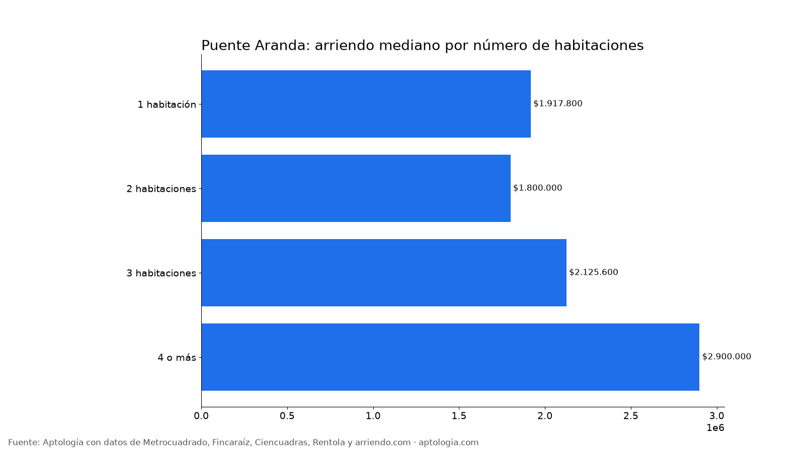
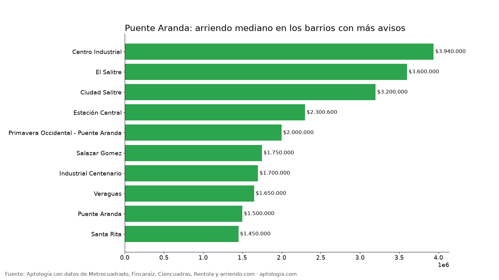

# Arriendo en Puente Aranda, Bogotá: precios por habitaciones, estrato y barrio (octubre 2026)

**El arriendo mediano de un apartamento o apartaestudio en Puente Aranda (Bogotá) es de $1.900.000 al mes, unos $42.472 por m².** Un 2 habitaciones cuesta en la mediana $1.800.000. El barrio más barato con 5 avisos o más es [Santa Rita](/arriendo/bogota/santa-rita) ($1.450.000) y el más caro [Centro Industrial](/arriendo/bogota/centro-industrial) ($3.940.000).

*Resumen: analizamos 228 apartamentos y apartaestudios en arriendo únicos en la localidad de Puente Aranda.*

**Actualizado:** 13 de octubre de 2026 · **Próxima actualización:** mensual.

## Resumen

| Indicador | Valor |
|---|---|
| Canon mediano | $1.900.000 |
| Por m² (mediana) | $42.472/m² |
| Área mediana | 48 m² |
| Con parqueadero | 21,9 % |
| Administración mediana | $217.800 (11,4 % del canon) |
| Avisos únicos | 228 |

## Por número de habitaciones

| Habitaciones | Canon mediano | Por m² | Área mediana | Avisos |
|---|---|---|---|---|
| 1 habitación | $1.917.800 | $57.692/m² | 35 m² | 33 |
| 2 habitaciones | $1.800.000 | $38.158/m² | 50 m² | 111 |
| 3 habitaciones | $2.125.600 | $28.040/m² | 77 m² | 44 |
| 4 o más | $2.900.000 | $31.875/m² | 89 m² | 6 |

## Por estrato

| Estrato | Canon mediano | Por m² | Avisos |
|---|---|---|---|
| 3 | $1.650.000 | $35.714/m² | 147 |
| 4 | $3.200.000 | $71.111/m² | 69 |
| 5 | $3.277.000 | $45.455/m² | 7 |

## Barrios más baratos y más caros

**Más baratos:**

| Barrio | Canon mediano | Por m² | Avisos |
|---|---|---|---|
| [Santa Rita](/arriendo/bogota/santa-rita) | $1.450.000 | $29.167 | 6 |
| [Puente Aranda](/arriendo/bogota/puente-aranda) | $1.500.000 | $41.000 | 5 |
| [Veraguas](/arriendo/bogota/veraguas) | $1.650.000 | $43.421 | 5 |
| [Industrial Centenario](/arriendo/bogota/industrial-centenario) | $1.700.000 | $50.000 | 21 |
| [Salazar Gomez](/arriendo/bogota/salazar-gomez) | $1.750.000 | $43.618 | 12 |

**Más caros:**

| Barrio | Canon mediano | Por m² | Avisos |
|---|---|---|---|
| [Centro Industrial](/arriendo/bogota/centro-industrial) | $3.940.000 | $93.198 | 6 |
| [El Salitre](/arriendo/bogota/el-salitre) | $3.600.000 | $60.000 | 5 |
| [Ciudad Salitre](/arriendo/bogota/ciudad-salitre) | $3.200.000 | $73.333 | 41 |
| Estación Central | $2.300.600 | $65.731 | 5 |
| [Primavera Occidental - Puente Aranda](/arriendo/bogota/primavera-occidental-puente-aranda) | $2.000.000 | $28.571 | 7 |

## Apartaestudio o apartamento de 1 habitación

En Puente Aranda, un apartaestudio cuesta en la mediana $2.208.000 (32 avisos) y un apartamento de 1 habitación $1.917.800 (33 avisos): $290.200 de diferencia.

**Cómo usarlo para decidir:** compara tu presupuesto con la mediana de tu número de habitaciones y mira los barrios más baratos de la tabla; suma la administración (mediana $217.800) para saber el costo real mensual.

## Preguntas frecuentes

**¿Cuánto cuesta arrendar un apartamento en Puente Aranda?**
La mediana es $1.900.000 al mes, con 228 avisos únicos al 13 de octubre de 2026.

**¿Cuánto vale un apartamento de 2 habitaciones en arriendo en Puente Aranda?**
La mediana es $1.800.000 al mes (111 avisos).

**¿Cuál es el barrio más barato para arrendar en Puente Aranda?**
Entre los barrios con 5 avisos o más, Santa Rita, con un canon mediano de $1.450.000. El más caro es Centro Industrial, con $3.940.000.

**¿Cuánto se paga de administración en Puente Aranda?**
La mediana es $217.800 al mes, alrededor del 11,4 % del canon.

**¿Qué porcentaje de apartamentos en arriendo en Puente Aranda tiene parqueadero?**
El 21,9 % de los avisos que informan el dato incluye al menos un parqueadero.

## Metodología

- **Fuente:** base de ingesta diaria de Aptología, con avisos públicos de Metrocuadrado, Fincaraíz, Ciencuadras, Rentola y arriendo.com. Corte al 13 de octubre de 2026.
- **Filtros:** apartamentos y apartaestudios en avisos vivos que pasan el control de calidad, en la localidad de Puente Aranda, canon entre $400.000 y $30.000.000. Se excluyen TikTok y Facebook Marketplace.
- **Duplicados:** se deja un aviso por grupo de duplicados (el mismo inmueble en varios portales).
- **Barrios:** solo barrios con 5 avisos o más. Parqueadero y administración, sobre los avisos que informan el dato.
- **Limitaciones:** son precios pedidos, no cerrados. Los barrios y localidades vienen tal como los escribe cada portal.
- **Datos abiertos:** [datos.csv](datos.csv), licencia CC BY 4.0.

## Cómo citar

Pinzón Pineda, D. M. (2026). *Arriendo en Puente Aranda, Bogotá: precios por habitaciones, estrato y barrio (octubre 2026)*. Aptología. https://www.aptologia.com/estudios/arriendo-en-puente-aranda-bogota-2026. Datos: datos.csv, licencia CC BY 4.0.
