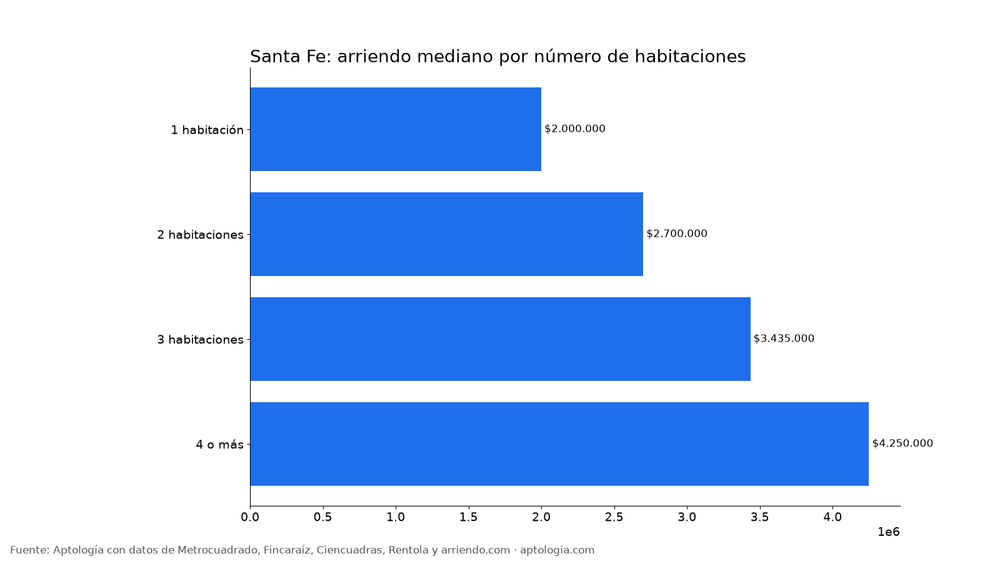
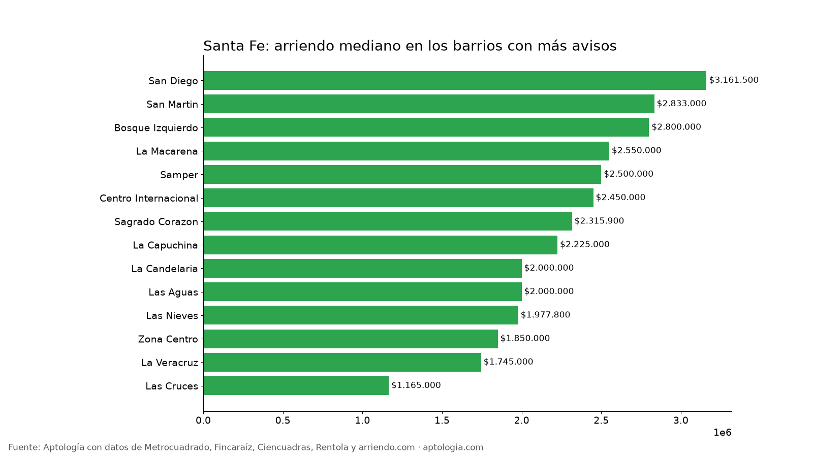

# Arriendo en Santa Fe, Bogotá: precios por habitaciones, estrato y barrio (octubre 2026)

**El arriendo mediano de un apartamento o apartaestudio en Santa Fe (Bogotá) es de $2.100.000 al mes, unos $60.000 por m².** Un 2 habitaciones cuesta en la mediana $2.700.000. El barrio más barato con 5 avisos o más es [Las Cruces](/arriendo/bogota/las-cruces) ($1.165.000) y el más caro [San Diego](/arriendo/bogota/san-diego) ($3.161.500).

*Resumen: analizamos 389 apartamentos y apartaestudios en arriendo únicos en la localidad de Santa Fe.*

**Actualizado:** 13 de octubre de 2026 · **Próxima actualización:** mensual.

## Resumen

| Indicador | Valor |
|---|---|
| Canon mediano | $2.100.000 |
| Por m² (mediana) | $60.000/m² |
| Área mediana | 36 m² |
| Con parqueadero | 27,8 % |
| Administración mediana | $278.900 (13,7 % del canon) |
| Avisos únicos | 389 |

## Por número de habitaciones

| Habitaciones | Canon mediano | Por m² | Área mediana | Avisos |
|---|---|---|---|---|
| 1 habitación | $2.000.000 | $64.583/m² | 33 m² | 196 |
| 2 habitaciones | $2.700.000 | $47.619/m² | 56 m² | 75 |
| 3 habitaciones | $3.435.000 | $40.922/m² | 94 m² | 26 |
| 4 o más | $4.250.000 | $34.706/m² | 130 m² | 5 |

## Por estrato

| Estrato | Canon mediano | Por m² | Avisos |
|---|---|---|---|
| 2 | $1.550.000 | $37.037/m² | 15 |
| 3 | $1.800.000 | $58.136/m² | 201 |
| 4 | $2.600.000 | $63.333/m² | 161 |
| 5 | $5.250.000 | $54.186/m² | 6 |

## Barrios más baratos y más caros

**Más baratos:**

| Barrio | Canon mediano | Por m² | Avisos |
|---|---|---|---|
| [Las Cruces](/arriendo/bogota/las-cruces) | $1.165.000 | $33.180 | 7 |
| [La Veracruz](/arriendo/bogota/la-veracruz) | $1.745.000 | $71.962 | 51 |
| [Zona Centro](/arriendo/bogota/zona-centro) | $1.850.000 | $39.015 | 8 |
| [Las Nieves](/arriendo/bogota/las-nieves) | $1.977.800 | $61.024 | 81 |
| [La Candelaria](/arriendo/bogota/la-candelaria) | $2.000.000 | $52.589 | 10 |

**Más caros:**

| Barrio | Canon mediano | Por m² | Avisos |
|---|---|---|---|
| [San Diego](/arriendo/bogota/san-diego) | $3.161.500 | $55.768 | 8 |
| [San Martin](/arriendo/bogota/san-martin) | $2.833.000 | $64.583 | 33 |
| [Bosque Izquierdo](/arriendo/bogota/bosque-izquierdo) | $2.800.000 | $40.936 | 13 |
| [La Macarena](/arriendo/bogota/la-macarena) | $2.550.000 | $57.143 | 25 |
| [Samper](/arriendo/bogota/samper) | $2.500.000 | $64.401 | 45 |

## Apartaestudio o apartamento de 1 habitación

En Santa Fe, un apartaestudio cuesta en la mediana $1.889.267 (84 avisos) y un apartamento de 1 habitación $2.000.000 (196 avisos): $110.733 de diferencia.

**Cómo usarlo para decidir:** compara tu presupuesto con la mediana de tu número de habitaciones y mira los barrios más baratos de la tabla; suma la administración (mediana $278.900) para saber el costo real mensual.

## Preguntas frecuentes

**¿Cuánto cuesta arrendar un apartamento en Santa Fe?**
La mediana es $2.100.000 al mes, con 389 avisos únicos al 13 de octubre de 2026.

**¿Cuánto vale un apartamento de 2 habitaciones en arriendo en Santa Fe?**
La mediana es $2.700.000 al mes (75 avisos).

**¿Cuál es el barrio más barato para arrendar en Santa Fe?**
Entre los barrios con 5 avisos o más, Las Cruces, con un canon mediano de $1.165.000. El más caro es San Diego, con $3.161.500.

**¿Cuánto se paga de administración en Santa Fe?**
La mediana es $278.900 al mes, alrededor del 13,7 % del canon.

**¿Qué porcentaje de apartamentos en arriendo en Santa Fe tiene parqueadero?**
El 27,8 % de los avisos que informan el dato incluye al menos un parqueadero.

## Metodología

- **Fuente:** base de ingesta diaria de Aptología, con avisos públicos de Metrocuadrado, Fincaraíz, Ciencuadras, Rentola y arriendo.com. Corte al 13 de octubre de 2026.
- **Filtros:** apartamentos y apartaestudios en avisos vivos que pasan el control de calidad, en la localidad de Santa Fe, canon entre $400.000 y $30.000.000. Se excluyen TikTok y Facebook Marketplace.
- **Duplicados:** se deja un aviso por grupo de duplicados (el mismo inmueble en varios portales).
- **Barrios:** solo barrios con 5 avisos o más. Parqueadero y administración, sobre los avisos que informan el dato.
- **Limitaciones:** son precios pedidos, no cerrados. Los barrios y localidades vienen tal como los escribe cada portal.
- **Datos abiertos:** [datos.csv](datos.csv), licencia CC BY 4.0.

## Cómo citar

Pinzón Pineda, D. M. (2026). *Arriendo en Santa Fe, Bogotá: precios por habitaciones, estrato y barrio (octubre 2026)*. Aptología. https://www.aptologia.com/estudios/arriendo-en-santa-fe-bogota-2026. Datos: datos.csv, licencia CC BY 4.0.
