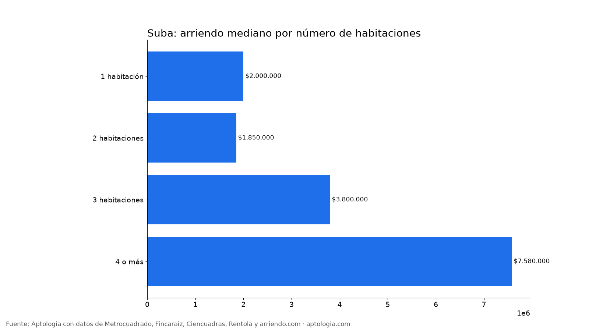
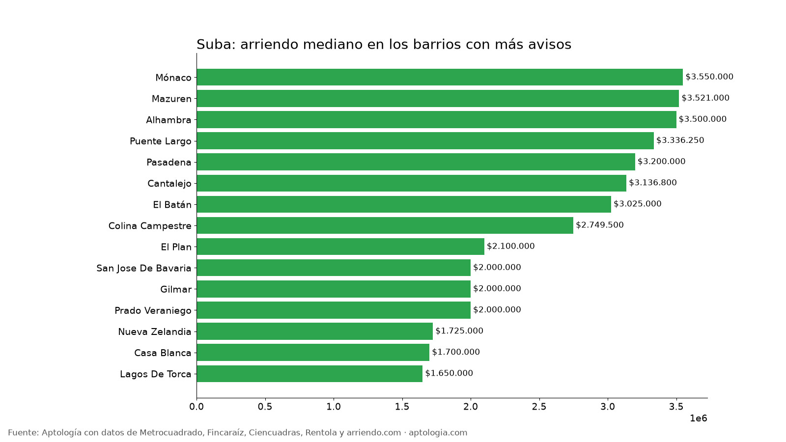

# Arriendo en Suba, Bogotá: precios por habitaciones, estrato y barrio (octubre 2026)

**El arriendo mediano de un apartamento o apartaestudio en Suba (Bogotá) es de $2.307.000 al mes, unos $44.235 por m².** Un 2 habitaciones cuesta en la mediana $1.850.000. El barrio más barato con 5 avisos o más es [Rincón De Santa Ines](/arriendo/bogota/rincon-de-santa-ines) ($1.300.000) y el más caro [Suba Naranjos](/arriendo/bogota/suba-naranjos) ($11.100.000).

*Resumen: analizamos 917 apartamentos y apartaestudios en arriendo únicos en la localidad de Suba.*

**Actualizado:** 13 de octubre de 2026 · **Próxima actualización:** mensual.

## Resumen

| Indicador | Valor |
|---|---|
| Canon mediano | $2.307.000 |
| Por m² (mediana) | $44.235/m² |
| Área mediana | 54 m² |
| Con parqueadero | 54,1 % |
| Administración mediana | $390.000 (13,7 % del canon) |
| Avisos únicos | 917 |

## Por número de habitaciones

| Habitaciones | Canon mediano | Por m² | Área mediana | Avisos |
|---|---|---|---|---|
| 1 habitación | $2.000.000 | $54.545/m² | 37 m² | 147 |
| 2 habitaciones | $1.850.000 | $41.784/m² | 45 m² | 361 |
| 3 habitaciones | $3.800.000 | $41.379/m² | 90 m² | 303 |
| 4 o más | $7.580.000 | $38.835/m² | 185 m² | 41 |

## Por estrato

| Estrato | Canon mediano | Por m² | Avisos |
|---|---|---|---|
| 2 | $1.300.000 | $27.857/m² | 28 |
| 3 | $1.650.000 | $37.083/m² | 245 |
| 4 | $2.250.000 | $47.436/m² | 353 |
| 5 | $3.800.000 | $48.173/m² | 232 |
| 6 | $9.047.540 | $44.917/m² | 54 |

## Barrios más baratos y más caros

**Más baratos:**

| Barrio | Canon mediano | Por m² | Avisos |
|---|---|---|---|
| [Rincón De Santa Ines](/arriendo/bogota/rincon-de-santa-ines) | $1.300.000 | $30.000 | 5 |
| [Tuna Baja](/arriendo/bogota/tuna-baja) | $1.500.000 | $39.583 | 5 |
| [Conejera](/arriendo/bogota/conejera) | $1.550.000 | $35.227 | 5 |
| [Suba](/arriendo/bogota/suba) | $1.600.000 | $41.026 | 11 |
| [Guaymaral](/arriendo/bogota/guaymaral) | $1.639.430 | $37.500 | 11 |

**Más caros:**

| Barrio | Canon mediano | Por m² | Avisos |
|---|---|---|---|
| [Suba Naranjos](/arriendo/bogota/suba-naranjos) | $11.100.000 | $42.852 | 6 |
| [Los Naranjos](/arriendo/bogota/los-naranjos) | $9.000.000 | $26.672 | 5 |
| [Ilarco](/arriendo/bogota/ilarco) | $8.080.000 | $44.975 | 5 |
| [Niza Suba](/arriendo/bogota/niza-suba) | $6.125.000 | $45.742 | 8 |
| [Casa Blanca Suba](/arriendo/bogota/casa-blanca-suba) | $4.935.000 | $45.734 | 6 |

## Apartaestudio o apartamento de 1 habitación

En Suba, un apartaestudio cuesta en la mediana $1.850.000 (65 avisos) y un apartamento de 1 habitación $2.000.000 (147 avisos): $150.000 de diferencia.

**Cómo usarlo para decidir:** compara tu presupuesto con la mediana de tu número de habitaciones y mira los barrios más baratos de la tabla; suma la administración (mediana $390.000) para saber el costo real mensual.

## Preguntas frecuentes

**¿Cuánto cuesta arrendar un apartamento en Suba?**
La mediana es $2.307.000 al mes, con 917 avisos únicos al 13 de octubre de 2026.

**¿Cuánto vale un apartamento de 2 habitaciones en arriendo en Suba?**
La mediana es $1.850.000 al mes (361 avisos).

**¿Cuál es el barrio más barato para arrendar en Suba?**
Entre los barrios con 5 avisos o más, Rincón De Santa Ines, con un canon mediano de $1.300.000. El más caro es Suba Naranjos, con $11.100.000.

**¿Cuánto se paga de administración en Suba?**
La mediana es $390.000 al mes, alrededor del 13,7 % del canon.

**¿Qué porcentaje de apartamentos en arriendo en Suba tiene parqueadero?**
El 54,1 % de los avisos que informan el dato incluye al menos un parqueadero.

## Metodología

- **Fuente:** base de ingesta diaria de Aptología, con avisos públicos de Metrocuadrado, Fincaraíz, Ciencuadras, Rentola y arriendo.com. Corte al 13 de octubre de 2026.
- **Filtros:** apartamentos y apartaestudios en avisos vivos que pasan el control de calidad, en la localidad de Suba, canon entre $400.000 y $30.000.000. Se excluyen TikTok y Facebook Marketplace.
- **Duplicados:** se deja un aviso por grupo de duplicados (el mismo inmueble en varios portales).
- **Barrios:** solo barrios con 5 avisos o más. Parqueadero y administración, sobre los avisos que informan el dato.
- **Limitaciones:** son precios pedidos, no cerrados. Los barrios y localidades vienen tal como los escribe cada portal.
- **Datos abiertos:** [datos.csv](datos.csv), licencia CC BY 4.0.

## Cómo citar

Pinzón Pineda, D. M. (2026). *Arriendo en Suba, Bogotá: precios por habitaciones, estrato y barrio (octubre 2026)*. Aptología. https://www.aptologia.com/estudios/arriendo-en-suba-bogota-2026. Datos: datos.csv, licencia CC BY 4.0.
