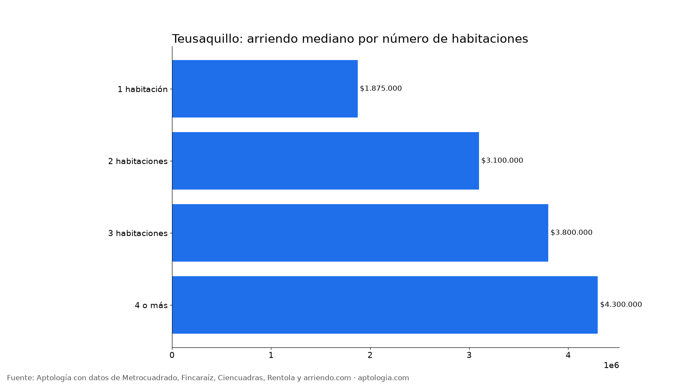
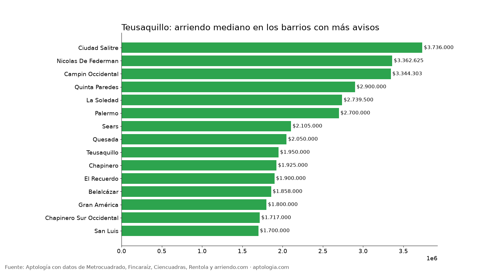

# Arriendo en Teusaquillo, Bogotá: precios por habitaciones, estrato y barrio (octubre 2026)

**El arriendo mediano de un apartamento o apartaestudio en Teusaquillo (Bogotá) es de $2.393.900 al mes, unos $54.286 por m².** Un 2 habitaciones cuesta en la mediana $3.100.000. El barrio más barato con 5 avisos o más es [Santa Teresita](/arriendo/bogota/santa-teresita) ($1.675.000) y el más caro [Ciudad Salitre](/arriendo/bogota/ciudad-salitre) ($3.736.000).

*Resumen: analizamos 415 apartamentos y apartaestudios en arriendo únicos en la localidad de Teusaquillo.*

**Actualizado:** 13 de octubre de 2026 · **Próxima actualización:** mensual.

## Resumen

| Indicador | Valor |
|---|---|
| Canon mediano | $2.393.900 |
| Por m² (mediana) | $54.286/m² |
| Área mediana | 40 m² |
| Con parqueadero | 43,9 % |
| Administración mediana | $354.600 (15,0 % del canon) |
| Avisos únicos | 415 |

## Por número de habitaciones

| Habitaciones | Canon mediano | Por m² | Área mediana | Avisos |
|---|---|---|---|---|
| 1 habitación | $1.875.000 | $61.558/m² | 30 m² | 138 |
| 2 habitaciones | $3.100.000 | $47.826/m² | 64 m² | 71 |
| 3 habitaciones | $3.800.000 | $45.652/m² | 89 m² | 79 |
| 4 o más | $4.300.000 | $32.530/m² | 130 m² | 17 |

## Por estrato

| Estrato | Canon mediano | Por m² | Avisos |
|---|---|---|---|
| 3 | $1.775.000 | $55.933/m² | 82 |
| 4 | $2.616.500 | $54.441/m² | 300 |
| 5 | $4.942.000 | $47.847/m² | 24 |

## Barrios más baratos y más caros

**Más baratos:**

| Barrio | Canon mediano | Por m² | Avisos |
|---|---|---|---|
| [Santa Teresita](/arriendo/bogota/santa-teresita) | $1.675.000 | $61.175 | 6 |
| [Alfonso López](/arriendo/bogota/alfonso-lopez) | $1.700.000 | $52.438 | 8 |
| [San Luis](/arriendo/bogota/san-luis) | $1.700.000 | $54.545 | 11 |
| Chapinero Sur Occidental | $1.717.000 | $62.615 | 20 |
| Paramericano | $1.750.000 | $46.154 | 5 |

**Más caros:**

| Barrio | Canon mediano | Por m² | Avisos |
|---|---|---|---|
| [Ciudad Salitre](/arriendo/bogota/ciudad-salitre) | $3.736.000 | $55.000 | 19 |
| [Ciudad Salitre Sur-Oriental](/arriendo/bogota/ciudad-salitre-sur-oriental) | $3.550.000 | $52.500 | 9 |
| [Nicolas De Federman](/arriendo/bogota/nicolas-de-federman) | $3.362.625 | $41.645 | 30 |
| [Campin Occidental](/arriendo/bogota/campin-occidental) | $3.344.303 | $52.584 | 9 |
| [Armenia](/arriendo/bogota/armenia) | $3.275.000 | $67.315 | 8 |

## Apartaestudio o apartamento de 1 habitación

En Teusaquillo, un apartaestudio cuesta en la mediana $1.800.000 (108 avisos) y un apartamento de 1 habitación $1.875.000 (138 avisos): $75.000 de diferencia.

**Cómo usarlo para decidir:** compara tu presupuesto con la mediana de tu número de habitaciones y mira los barrios más baratos de la tabla; suma la administración (mediana $354.600) para saber el costo real mensual.

## Preguntas frecuentes

**¿Cuánto cuesta arrendar un apartamento en Teusaquillo?**
La mediana es $2.393.900 al mes, con 415 avisos únicos al 13 de octubre de 2026.

**¿Cuánto vale un apartamento de 2 habitaciones en arriendo en Teusaquillo?**
La mediana es $3.100.000 al mes (71 avisos).

**¿Cuál es el barrio más barato para arrendar en Teusaquillo?**
Entre los barrios con 5 avisos o más, Santa Teresita, con un canon mediano de $1.675.000. El más caro es Ciudad Salitre, con $3.736.000.

**¿Cuánto se paga de administración en Teusaquillo?**
La mediana es $354.600 al mes, alrededor del 15,0 % del canon.

**¿Qué porcentaje de apartamentos en arriendo en Teusaquillo tiene parqueadero?**
El 43,9 % de los avisos que informan el dato incluye al menos un parqueadero.

## Metodología

- **Fuente:** base de ingesta diaria de Aptología, con avisos públicos de Metrocuadrado, Fincaraíz, Ciencuadras, Rentola y arriendo.com. Corte al 13 de octubre de 2026.
- **Filtros:** apartamentos y apartaestudios en avisos vivos que pasan el control de calidad, en la localidad de Teusaquillo, canon entre $400.000 y $30.000.000. Se excluyen TikTok y Facebook Marketplace.
- **Duplicados:** se deja un aviso por grupo de duplicados (el mismo inmueble en varios portales).
- **Barrios:** solo barrios con 5 avisos o más. Parqueadero y administración, sobre los avisos que informan el dato.
- **Limitaciones:** son precios pedidos, no cerrados. Los barrios y localidades vienen tal como los escribe cada portal.
- **Datos abiertos:** [datos.csv](datos.csv), licencia CC BY 4.0.

## Cómo citar

Pinzón Pineda, D. M. (2026). *Arriendo en Teusaquillo, Bogotá: precios por habitaciones, estrato y barrio (octubre 2026)*. Aptología. https://www.aptologia.com/estudios/arriendo-en-teusaquillo-bogota-2026. Datos: datos.csv, licencia CC BY 4.0.
