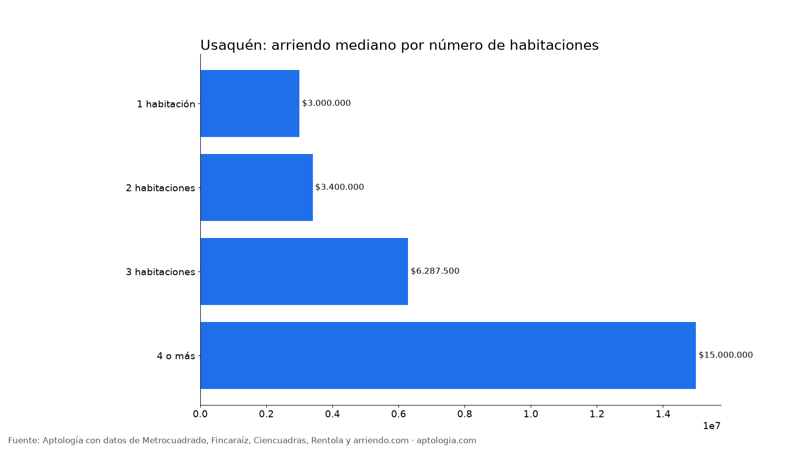
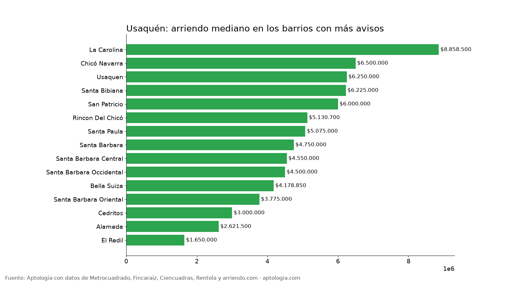

# Arriendo en Usaquén, Bogotá: precios por habitaciones, estrato y barrio (octubre 2026)

**El arriendo mediano de un apartamento o apartaestudio en Usaquén (Bogotá) es de $3.800.000 al mes, unos $51.163 por m².** Un 2 habitaciones cuesta en la mediana $3.400.000. El barrio más barato con 5 avisos o más es [Hacienda La Estancia Navarra](/arriendo/bogota/hacienda-la-estancia-navarra) ($1.550.000) y el más caro [Cerros De Santa Barbara](/arriendo/bogota/cerros-de-santa-barbara) ($21.718.000).

*Resumen: analizamos 1.903 apartamentos y apartaestudios en arriendo únicos en la localidad de Usaquén.*

**Actualizado:** 13 de octubre de 2026 · **Próxima actualización:** mensual.

## Resumen

| Indicador | Valor |
|---|---|
| Canon mediano | $3.800.000 |
| Por m² (mediana) | $51.163/m² |
| Área mediana | 72 m² |
| Con parqueadero | 80,3 % |
| Administración mediana | $700.000 (16,1 % del canon) |
| Avisos únicos | 1.903 |

## Por número de habitaciones

| Habitaciones | Canon mediano | Por m² | Área mediana | Avisos |
|---|---|---|---|---|
| 1 habitación | $3.000.000 | $61.905/m² | 45 m² | 422 |
| 2 habitaciones | $3.400.000 | $48.000/m² | 68 m² | 585 |
| 3 habitaciones | $6.287.500 | $46.853/m² | 127 m² | 600 |
| 4 o más | $15.000.000 | $46.353/m² | 318 m² | 151 |

## Por estrato

| Estrato | Canon mediano | Por m² | Avisos |
|---|---|---|---|
| 2 | $1.600.000 | $43.929/m² | 13 |
| 3 | $1.700.000 | $39.310/m² | 172 |
| 4 | $2.600.001 | $45.679/m² | 531 |
| 5 | $4.000.000 | $56.126/m² | 458 |
| 6 | $6.500.000 | $56.642/m² | 716 |

## Barrios más baratos y más caros

**Más baratos:**

| Barrio | Canon mediano | Por m² | Avisos |
|---|---|---|---|
| [Hacienda La Estancia Navarra](/arriendo/bogota/hacienda-la-estancia-navarra) | $1.550.000 | $42.857 | 5 |
| [San Cristobal Norte](/arriendo/bogota/san-cristobal-norte) | $1.575.000 | $31.989 | 8 |
| [Bosque De Pinos](/arriendo/bogota/bosque-de-pinos) | $1.600.000 | $53.333 | 5 |
| [Lagos De Torca](/arriendo/bogota/lagos-de-torca) | $1.600.000 | $36.745 | 18 |
| [El Vervenal](/arriendo/bogota/el-vervenal) | $1.601.800 | $41.547 | 12 |

**Más caros:**

| Barrio | Canon mediano | Por m² | Avisos |
|---|---|---|---|
| [Cerros De Santa Barbara](/arriendo/bogota/cerros-de-santa-barbara) | $21.718.000 | $58.667 | 9 |
| [Ciudadela Real](/arriendo/bogota/ciudadela-real) | $18.000.000 | $56.782 | 5 |
| [Santa Barbara Alta](/arriendo/bogota/santa-barbara-alta) | $15.900.000 | $59.350 | 20 |
| [Santa Ana Oriental](/arriendo/bogota/santa-ana-oriental) | $15.500.000 | $61.952 | 21 |
| [Bosques Del Marques](/arriendo/bogota/bosques-del-marques) | $15.000.000 | $56.604 | 13 |

## Apartaestudio o apartamento de 1 habitación

En Usaquén, un apartaestudio cuesta en la mediana $2.400.000 (141 avisos) y un apartamento de 1 habitación $3.000.000 (422 avisos): $600.000 de diferencia.

**Cómo usarlo para decidir:** compara tu presupuesto con la mediana de tu número de habitaciones y mira los barrios más baratos de la tabla; suma la administración (mediana $700.000) para saber el costo real mensual.

## Preguntas frecuentes

**¿Cuánto cuesta arrendar un apartamento en Usaquén?**
La mediana es $3.800.000 al mes, con 1.903 avisos únicos al 13 de octubre de 2026.

**¿Cuánto vale un apartamento de 2 habitaciones en arriendo en Usaquén?**
La mediana es $3.400.000 al mes (585 avisos).

**¿Cuál es el barrio más barato para arrendar en Usaquén?**
Entre los barrios con 5 avisos o más, Hacienda La Estancia Navarra, con un canon mediano de $1.550.000. El más caro es Cerros De Santa Barbara, con $21.718.000.

**¿Cuánto se paga de administración en Usaquén?**
La mediana es $700.000 al mes, alrededor del 16,1 % del canon.

**¿Qué porcentaje de apartamentos en arriendo en Usaquén tiene parqueadero?**
El 80,3 % de los avisos que informan el dato incluye al menos un parqueadero.

## Metodología

- **Fuente:** base de ingesta diaria de Aptología, con avisos públicos de Metrocuadrado, Fincaraíz, Ciencuadras, Rentola y arriendo.com. Corte al 13 de octubre de 2026.
- **Filtros:** apartamentos y apartaestudios en avisos vivos que pasan el control de calidad, en la localidad de Usaquén, canon entre $400.000 y $30.000.000. Se excluyen TikTok y Facebook Marketplace.
- **Duplicados:** se deja un aviso por grupo de duplicados (el mismo inmueble en varios portales).
- **Barrios:** solo barrios con 5 avisos o más. Parqueadero y administración, sobre los avisos que informan el dato.
- **Limitaciones:** son precios pedidos, no cerrados. Los barrios y localidades vienen tal como los escribe cada portal.
- **Datos abiertos:** [datos.csv](datos.csv), licencia CC BY 4.0.

## Cómo citar

Pinzón Pineda, D. M. (2026). *Arriendo en Usaquén, Bogotá: precios por habitaciones, estrato y barrio (octubre 2026)*. Aptología. https://www.aptologia.com/estudios/arriendo-en-usaquen-bogota-2026. Datos: datos.csv, licencia CC BY 4.0.
