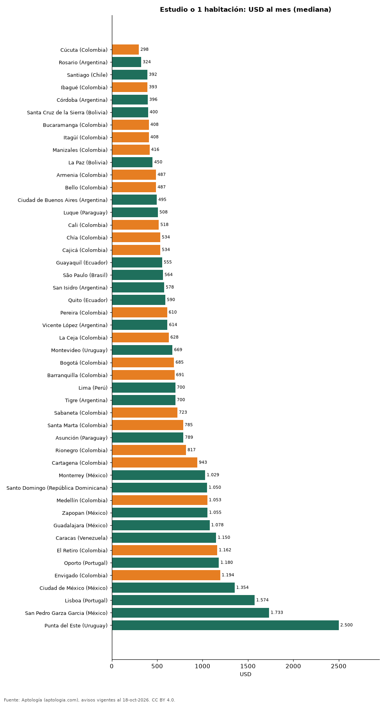

# Cuánto cuesta arrendar un estudio o apartamento de 1 habitación en 47 ciudades de Latinoamérica y Portugal (octubre 2026)

**Arrendar un estudio o apartamento de 1 habitación es más barato en Cúcuta (Colombia), con una mediana de USD 298 al mes, y más caro en Punta del Este (Uruguay), con USD 2.500.** En Bogotá la mediana es USD 685 al mes.

*Resumen: comparamos 37.088 estudios y apartamentos de 1 habitación en arriendo en 47 ciudades.*

**Actualizado:** 18 de octubre de 2026 (datos del 18 de octubre de 2026) · **Próxima actualización:** mensual.

## Resumen

| Indicador | Valor |
|---|---|
| Más barata | Cúcuta: USD 298 |
| Más cara | Punta del Este: USD 2.500 |
| Bogotá | USD 685 |

## Ciudades de menor a mayor

| País | Ciudad | USD al mes | Avisos |
|---|---|---|---|
| Colombia | Cúcuta | 298 | 47 |
| Argentina | Rosario | 324 | 79 |
| Chile | Santiago | 392 | 3.039 |
| Colombia | Ibagué | 393 | 36 |
| Argentina | Córdoba | 396 | 122 |
| Bolivia | Santa Cruz de la Sierra | 400 | 646 |
| Colombia | Bucaramanga | 408 | 88 |
| Colombia | Itagüí | 408 | 49 |
| Colombia | Manizales | 416 | 140 |
| Bolivia | La Paz | 450 | 70 |
| Colombia | Armenia | 487 | 132 |
| Colombia | Bello | 487 | 74 |
| Argentina | Ciudad de Buenos Aires | 495 | 2.823 |
| Paraguay | Luque | 508 | 39 |
| Colombia | Cali | 518 | 658 |
| Colombia | Chía | 534 | 200 |
| Colombia | Cajicá | 534 | 46 |
| Ecuador | Guayaquil | 555 | 242 |
| Brasil | São Paulo | 564 | 5.173 |
| Argentina | San Isidro | 578 | 51 |
| Ecuador | Quito | 590 | 308 |
| Colombia | Pereira | 610 | 305 |
| Argentina | Vicente López | 614 | 74 |
| Colombia | La Ceja | 628 | 47 |
| Uruguay | Montevideo | 669 | 2.595 |
| Colombia | Bogotá | 685 | 6.406 |
| Colombia | Barranquilla | 691 | 763 |
| Perú | Lima | 700 | 835 |
| Argentina | Tigre | 700 | 69 |
| Colombia | Sabaneta | 723 | 243 |
| Colombia | Santa Marta | 785 | 266 |
| Paraguay | Asunción | 789 | 1.894 |
| Colombia | Rionegro | 817 | 382 |
| Colombia | Cartagena | 943 | 361 |
| México | Monterrey | 1.029 | 522 |
| República Dominicana | Santo Domingo | 1.050 | 1.203 |
| Colombia | Medellín | 1.053 | 3.904 |
| México | Zapopan | 1.055 | 144 |
| México | Guadalajara | 1.078 | 311 |
| Venezuela | Caracas | 1.150 | 73 |
| Colombia | El Retiro | 1.162 | 155 |
| Portugal | Oporto | 1.180 | 39 |
| Colombia | Envigado | 1.194 | 444 |
| México | Ciudad de México | 1.354 | 1.177 |
| Portugal | Lisboa | 1.574 | 126 |
| México | San Pedro Garza Garcia | 1.733 | 200 |
| Uruguay | Punta del Este | 2.500 | 488 |

Canon mensual convertido a dólares.

## Preguntas frecuentes

**¿Dónde es más barato arrendar un estudio en Latinoamérica?**
En Cúcuta (Colombia): USD 298 al mes en la mediana.

## Metodología

- **Fuente:** exportes nocturnos de la base de datos de Aptología (aptologia.com) del 18 de octubre de 2026: avisos vigentes de vivienda en portales inmobiliarios de 13 países, recogidos por Aptología y vistos en línea entre el 11 y el 18 de octubre de 2026. Corte: 18 de octubre de 2026.
- **Depuración:** se eliminan duplicados exactos (misma ciudad, zona, tipo, precio, moneda, área, habitaciones y baños) y los precios fuera del percentil 1–99 de cada país, operación, moneda y tipo; el precio por m² usa solo avisos con área declarada entre 12 y 2.000 m² y también se recorta al P1–P99.
- **Qué se mide:** precios pedidos (publicados), no precios de cierre. En arriendo, el canon mensual sin administración, gastos comunes ni condominio.
- **Muestra mínima:** cada cifra publicada se apoya en al menos 30 avisos; las celdas con menos se omiten.
- **Monedas:** nunca se mezclan avisos de monedas distintas sin convertirlos. Conversión a dólares con la tasa de mercado de ExchangeRate-API (open.er-api.com, actualización del 18 Oct 2026): 1 USD = 3.182,80 COP, 1 USD = 18,47 M.N, 1 USD = 5,09 BRL, 1 USD = 3,44 PEN, 1 USD = 982,44 CLP, 1 USD = 1.514,57 ARS, 1 USD = 40,20 UYU, 1 USD = 5.705,37 PYG, 1 USD = 61,27 DOP, 1 USD = 0,89 EUR, 1 USD = 11,72 BOB; la UF chilena a 41.178,64 CLP (mindicador,cl. 18-oct-2026). Los avisos publicados en dólares se usan tal cual.
- **Limitaciones:** la cobertura depende de los portales que recorre Aptología en cada país y es mayor en las ciudades grandes y en los segmentos medio-alto y alto; el área es la que declara el aviso, sin verificar; los nombres de zona vienen de los portales.
- **Privacidad:** solo se publican agregados; no se publica ningún dato personal, enlace a avisos ni nombre de anunciante.
- **Datos abiertos:** [datos.csv](datos.csv), licencia CC BY 4.0.

## Cómo citar

Pinzón Pineda, D. M. (2026). *Cuánto cuesta arrendar un estudio o apartamento de 1 habitación en 47 ciudades de Latinoamérica y Portugal (octubre 2026)*. Aptología (aptologia.com). https://github.com/elbroker/aptologia-datos/tree/main/estudios/arriendo-estudio-1-habitacion-ciudades-latinoamerica-2026. Datos: datos.csv, licencia CC BY 4.0.
