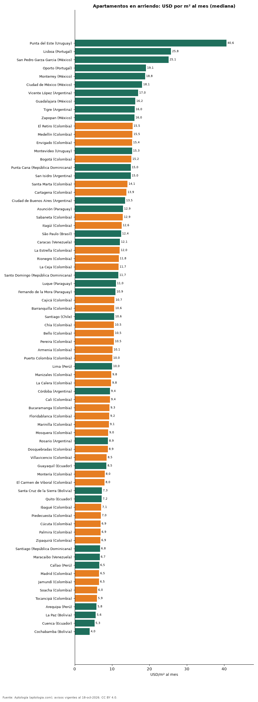

# Arriendo por metro cuadrado en 72 ciudades de Latinoamérica y Portugal (octubre 2026)

**El arriendo por metro cuadrado más alto de la muestra está en Punta del Este (Uruguay): USD 40,6 por m² al mes; el más bajo, en Cochabamba (Bolivia), con USD 4,0.** En Bogotá el canon mediano equivale a USD 15,2 por m² al mes (puesto 15 de 72).

*Resumen: comparamos 118.072 apartamentos en arriendo con área declarada en 72 ciudades.*

**Actualizado:** 18 de octubre de 2026 (datos del 18 de octubre de 2026) · **Próxima actualización:** mensual.

## Resumen

| Indicador | Valor |
|---|---|
| Arriendo por m² más alto | Punta del Este: USD 40,6 |
| Más bajo | Cochabamba: USD 4,0 |
| Bogotá | USD 15,2 (puesto 15) |
| Ciudades | 72 |

## Ranking de ciudades (30 avisos o más)

| País | Ciudad | USD/m² al mes | Avisos con área |
|---|---|---|---|
| Uruguay | Punta del Este | 40,6 | 1.964 |
| Portugal | Lisboa | 25,8 | 491 |
| México | San Pedro Garza Garcia | 25,1 | 595 |
| Portugal | Oporto | 19,1 | 78 |
| México | Monterrey | 18,8 | 1.645 |
| México | Ciudad de México | 18,1 | 4.782 |
| Argentina | Vicente López | 17,0 | 168 |
| México | Guadalajara | 16,2 | 838 |
| Argentina | Tigre | 16,0 | 151 |
| México | Zapopan | 16,0 | 823 |
| Colombia | El Retiro | 15,5 | 541 |
| Colombia | Medellín | 15,5 | 20.068 |
| Colombia | Envigado | 15,4 | 7.303 |
| Uruguay | Montevideo | 15,3 | 3.702 |
| Colombia | Bogotá | 15,2 | 12.954 |
| República Dominicana | Punta Cana | 15,0 | 93 |
| Argentina | San Isidro | 15,0 | 148 |
| Colombia | Santa Marta | 14,1 | 674 |
| Colombia | Cartagena | 13,9 | 2.008 |
| Argentina | Ciudad de Buenos Aires | 13,5 | 4.316 |
| Paraguay | Asunción | 12,9 | 3.560 |
| Colombia | Sabaneta | 12,9 | 3.868 |
| Colombia | Itagüí | 12,6 | 908 |
| Brasil | São Paulo | 12,4 | 10.656 |
| Venezuela | Caracas | 12,1 | 326 |
| Colombia | La Estrella | 12,0 | 489 |
| Colombia | Rionegro | 11,8 | 3.179 |
| Colombia | La Ceja | 11,7 | 354 |
| República Dominicana | Santo Domingo | 11,7 | 3.410 |
| Paraguay | Luque | 11,0 | 47 |
| Paraguay | Fernando de la Mora | 10,9 | 37 |
| Colombia | Cajicá | 10,7 | 385 |
| Colombia | Barranquilla | 10,6 | 3.694 |
| Chile | Santiago | 10,6 | 7.098 |
| Colombia | Chía | 10,5 | 489 |
| Colombia | Bello | 10,5 | 1.082 |
| Colombia | Pereira | 10,5 | 1.530 |
| Colombia | Armenia | 10,1 | 337 |
| Colombia | Puerto Colombia | 10,0 | 90 |
| Perú | Lima | 10,0 | 4.134 |
| Colombia | Manizales | 9,8 | 282 |
| Colombia | La Calera | 9,8 | 51 |
| Argentina | Córdoba | 9,4 | 216 |
| Colombia | Cali | 9,4 | 1.499 |
| Colombia | Bucaramanga | 9,3 | 416 |
| Colombia | Floridablanca | 9,2 | 357 |
| Colombia | Marinilla | 9,1 | 107 |
| Colombia | Mosquera | 9,0 | 167 |
| Argentina | Rosario | 8,9 | 129 |
| Colombia | Dosquebradas | 8,9 | 70 |
| Colombia | Villavicencio | 8,5 | 74 |
| Ecuador | Guayaquil | 8,5 | 1.231 |
| Colombia | Montería | 8,0 | 44 |
| Colombia | El Carmen de Viboral | 8,0 | 102 |
| Bolivia | Santa Cruz de la Sierra | 7,3 | 947 |
| Ecuador | Quito | 7,2 | 1.167 |
| Colombia | Ibagué | 7,1 | 249 |
| Colombia | Piedecuesta | 7,0 | 57 |
| Colombia | Cúcuta | 6,9 | 298 |
| Colombia | Palmira | 6,9 | 42 |
| Colombia | Zipaquirá | 6,9 | 168 |
| República Dominicana | Santiago | 6,8 | 116 |
| Venezuela | Maracaibo | 6,7 | 38 |
| Perú | Callao | 6,5 | 31 |
| Colombia | Madrid | 6,5 | 259 |
| Colombia | Jamundí | 6,5 | 107 |
| Colombia | Soacha | 6,0 | 128 |
| Colombia | Tocancipá | 5,9 | 94 |
| Perú | Arequipa | 5,8 | 46 |
| Bolivia | La Paz | 5,6 | 298 |
| Ecuador | Cuenca | 5,3 | 176 |
| Bolivia | Cochabamba | 4,0 | 91 |

## Preguntas frecuentes

**¿Dónde es más caro arrendar por metro cuadrado en Latinoamérica?**
En Punta del Este (Uruguay), con una mediana de USD 40,6 por m² al mes.

**¿Cuánto cuesta el arriendo por m² en Bogotá en dólares?**
USD 15,2 por m² al mes en la mediana (48.246 pesos).

**¿Dónde es más barato arrendar por m²?**
En Cochabamba (Bolivia), con USD 4,0 por m² al mes.

## Metodología

- **Fuente:** exportes nocturnos de la base de datos de Aptología (aptologia.com) del 18 de octubre de 2026: avisos vigentes de vivienda en portales inmobiliarios de 13 países, recogidos por Aptología y vistos en línea entre el 11 y el 18 de octubre de 2026. Corte: 18 de octubre de 2026.
- **Depuración:** se eliminan duplicados exactos (misma ciudad, zona, tipo, precio, moneda, área, habitaciones y baños) y los precios fuera del percentil 1–99 de cada país, operación, moneda y tipo; el precio por m² usa solo avisos con área declarada entre 12 y 2.000 m² y también se recorta al P1–P99.
- **Qué se mide:** precios pedidos (publicados), no precios de cierre. En arriendo, el canon mensual sin administración, gastos comunes ni condominio.
- **Muestra mínima:** cada cifra publicada se apoya en al menos 30 avisos; las celdas con menos se omiten.
- **Monedas:** nunca se mezclan avisos de monedas distintas sin convertirlos. Conversión a dólares con la tasa de mercado de ExchangeRate-API (open.er-api.com, actualización del 18 Oct 2026): 1 USD = 3.182,80 COP, 1 USD = 18,47 M.N, 1 USD = 5,09 BRL, 1 USD = 3,44 PEN, 1 USD = 982,44 CLP, 1 USD = 1.514,57 ARS, 1 USD = 40,20 UYU, 1 USD = 5.705,37 PYG, 1 USD = 61,27 DOP, 1 USD = 0,89 EUR, 1 USD = 11,72 BOB; la UF chilena a 41.178,64 CLP (mindicador,cl. 18-oct-2026). Los avisos publicados en dólares se usan tal cual.
- **Limitaciones:** la cobertura depende de los portales que recorre Aptología en cada país y es mayor en las ciudades grandes y en los segmentos medio-alto y alto; el área es la que declara el aviso, sin verificar; los nombres de zona vienen de los portales.
- **Privacidad:** solo se publican agregados; no se publica ningún dato personal, enlace a avisos ni nombre de anunciante.
- **Datos abiertos:** [datos.csv](datos.csv), licencia CC BY 4.0.

## Cómo citar

Pinzón Pineda, D. M. (2026). *Arriendo por metro cuadrado en 72 ciudades de Latinoamérica y Portugal (octubre 2026)*. Aptología (aptologia.com). https://github.com/elbroker/aptologia-datos/tree/main/estudios/arriendo-m2-ciudades-latinoamerica-2026. Datos: datos.csv, licencia CC BY 4.0.
