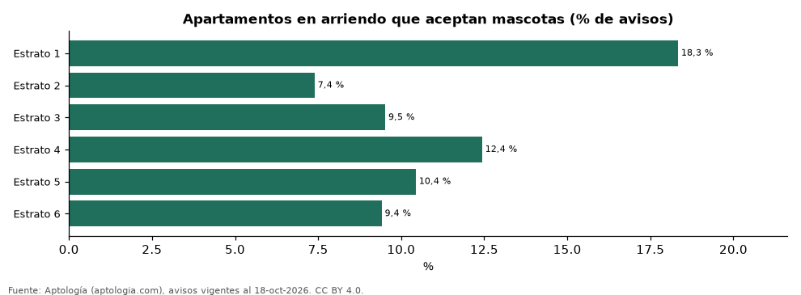
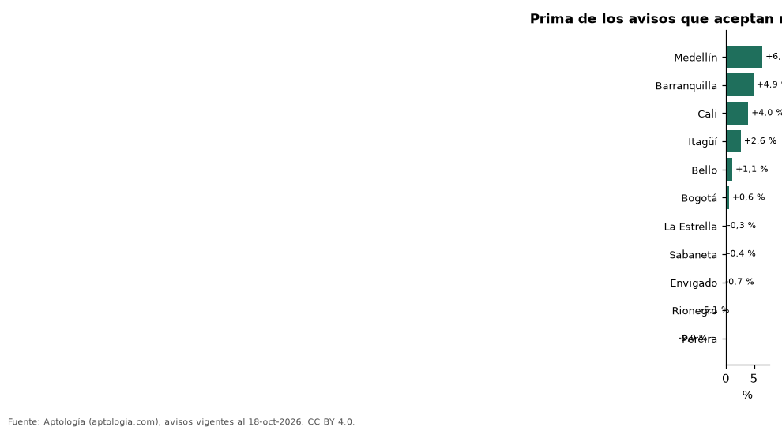

# ¿Cuesta más un arriendo que acepta mascotas? Prima por estrato y por ciudad en Colombia (octubre 2026)

**Un apartamento que acepta mascotas se arrienda en Colombia +0,9 % frente a uno comparable que no las acepta (misma ciudad, estrato y habitaciones).** La parte de la oferta que admite mascotas va de 7,4 % en el estrato 2 a 18,3 % en el estrato 1. Por ciudad, la prima va de -9,0 % en Pereira a +6,5 % en Medellín.

*Resumen: comparamos 5.444 apartamentos en arriendo que aceptan mascotas con 45.523 que no, en 56 celdas de ciudad, estrato y habitaciones.*

**Actualizado:** 18 de octubre de 2026 (datos del 18 de octubre de 2026) · **Próxima actualización:** mensual.

## Resumen

| Indicador | Valor |
|---|---|
| Prima nacional (emparejada) | +0,9 % |
| Estrato con más oferta pet friendly | 1: 18,3 % |
| Estrato con menos | 2: 7,4 % |

## Por estrato

| Estrato | Prima por aceptar mascotas | Avisos que aceptan | Oferta que acepta mascotas |
|---|---|---|---|
| 3 | +0,1 % | 488 | 9,5 % |
| 4 | -0,4 % | 1.811 | 12,4 % |
| 5 | +0,8 % | 1.529 | 10,4 % |
| 6 | +2,8 % | 1.616 | 9,4 % |

Comparación emparejada: dentro de cada celda de ciudad × estrato × número de habitaciones con 30 avisos o más de cada lado se calcula la razón entre medianas; la prima es el promedio de esas razones ponderado por los avisos con la característica.

## Por ciudad

| Ciudad | Prima | Avisos que aceptan | Celdas |
|---|---|---|---|
| Medellín | +6,5 % | 1.165 | 9 |
| Barranquilla | +4,9 % | 310 | 7 |
| Cali | +4,0 % | 123 | 3 |
| Itagüí | +2,6 % | 140 | 3 |
| Bello | +1,1 % | 124 | 2 |
| Bogotá | +0,6 % | 1.512 | 12 |
| La Estrella | -0,3 % | 123 | 3 |
| Sabaneta | -0,4 % | 447 | 3 |
| Envigado | -0,7 % | 728 | 4 |
| Rionegro | -5,1 % | 396 | 4 |
| Pereira | -9,0 % | 272 | 4 |

Solo ciudades con al menos una celda válida.

## Preguntas frecuentes

**¿Es más caro arrendar con mascotas en Colombia?**
Los avisos que aceptan mascotas piden en promedio +0,9 % frente a apartamentos comparables que no las aceptan.

**¿En qué estrato es más fácil arrendar con mascota?**
En el estrato 1, donde el 18,3 % de los avisos las acepta.

## Metodología

- **Fuente:** exportes nocturnos de la base de datos de Aptología (aptologia.com) del 18 de octubre de 2026: avisos vigentes de vivienda en portales inmobiliarios de 13 países, recogidos por Aptología y vistos en línea entre el 11 y el 18 de octubre de 2026. Corte: 18 de octubre de 2026.
- **Depuración:** se eliminan duplicados exactos (misma ciudad, zona, tipo, precio, moneda, área, habitaciones y baños) y los precios fuera del percentil 1–99 de cada país, operación, moneda y tipo; el precio por m² usa solo avisos con área declarada entre 12 y 2.000 m² y también se recorta al P1–P99.
- **Qué se mide:** precios pedidos (publicados), no precios de cierre. En arriendo, el canon mensual sin administración, gastos comunes ni condominio.
- **Muestra mínima:** cada cifra publicada se apoya en al menos 30 avisos; las celdas con menos se omiten.
- **Colombia:** Precios en pesos colombianos, sin conversión de moneda.
- **Limitaciones:** la cobertura depende de los portales que recorre Aptología en cada país y es mayor en las ciudades grandes y en los segmentos medio-alto y alto; el área es la que declara el aviso, sin verificar; los nombres de zona vienen de los portales.
- **Privacidad:** solo se publican agregados; no se publica ningún dato personal, enlace a avisos ni nombre de anunciante.
- **Datos abiertos:** [datos.csv](datos.csv), licencia CC BY 4.0.

## Cómo citar

Pinzón Pineda, D. M. (2026). *¿Cuesta más un arriendo que acepta mascotas? Prima por estrato y por ciudad en Colombia (octubre 2026)*. Aptología (aptologia.com). https://github.com/elbroker/aptologia-datos/tree/main/estudios/arriendo-pet-friendly-prima-por-estrato-y-ciudad-colombia-2026. Datos: datos.csv, licencia CC BY 4.0.
