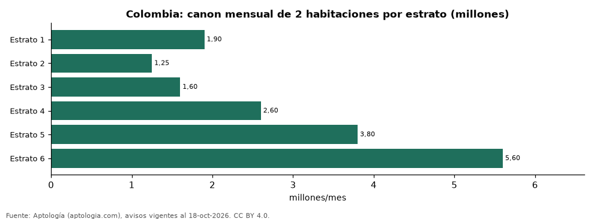

# Cuánto cuesta arrendar un apartamento de 2 habitaciones según el estrato en las ciudades de Colombia (octubre 2026)

**Arrendar un apartamento de 2 habitaciones en estrato 6 cuesta en Colombia 5.600.000 pesos al mes en la mediana, 3,5 veces lo que se pide en estrato 3 (1.600.000 pesos).** En estrato 4 la mediana es 2.600.000 pesos y en estrato 5, 3.800.000 pesos.

*Resumen: analizamos 23.496 apartamentos de 2 habitaciones en arriendo con estrato declarado.*

**Actualizado:** 18 de octubre de 2026 (datos del 18 de octubre de 2026) · **Próxima actualización:** mensual.

## Resumen

| Indicador | Valor |
|---|---|
| Estrato 1 | 1.900.000 pesos |
| Estrato 2 | 1.250.000 pesos |
| Estrato 3 | 1.600.000 pesos |
| Estrato 4 | 2.600.000 pesos |
| Estrato 5 | 3.800.000 pesos |
| Estrato 6 | 5.600.000 pesos |

## Canon mensual por ciudad y estrato (2 habitaciones)

| Ciudad | Estrato 2 | Estrato 3 | Estrato 4 | Estrato 5 | Estrato 6 |
|---|---|---|---|---|---|
| Bogotá | 1.156.454 pesos | 1.500.000 pesos | 2.600.000 pesos | 4.200.000 pesos | 7.000.000 pesos |
| Medellín | 1.400.000 pesos | 1.800.000 pesos | 2.700.000 pesos | 4.000.000 pesos | 5.880.764 pesos |
| Cali | — | 1.100.000 pesos | 1.535.000 pesos | 3.000.000 pesos | 5.000.000 pesos |
| Barranquilla | — | 1.500.000 pesos | 2.100.000 pesos | 3.000.000 pesos | 3.600.000 pesos |
| Cartagena | — | 2.000.000 pesos | 2.750.000 pesos | 3.700.000 pesos | 5.000.000 pesos |
| Envigado | — | 2.600.000 pesos | 3.600.000 pesos | 4.350.000 pesos | 4.800.000 pesos |
| Pereira | — | — | 1.700.000 pesos | 2.200.000 pesos | 2.900.000 pesos |
| Sabaneta | 2.100.000 pesos | 2.200.000 pesos | 3.000.000 pesos | 3.400.000 pesos | — |
| Rionegro | — | 1.600.000 pesos | 1.850.000 pesos | 2.875.000 pesos | 6.200.000 pesos |
| Bucaramanga | — | — | 2.100.000 pesos | — | — |

Medianas; — indica menos de 30 avisos.

## Preguntas frecuentes

**¿Cuánto cuesta arrendar en estrato 3 en Colombia?**
1.600.000 pesos al mes en la mediana por un apartamento de 2 habitaciones.

**¿Cuánto cuesta arrendar en estrato 6?**
5.600.000 pesos al mes en la mediana.

## Metodología

- **Fuente:** exportes nocturnos de la base de datos de Aptología (aptologia.com) del 18 de octubre de 2026: avisos vigentes de vivienda en portales inmobiliarios de 13 países, recogidos por Aptología y vistos en línea entre el 11 y el 18 de octubre de 2026. Corte: 18 de octubre de 2026.
- **Depuración:** se eliminan duplicados exactos (misma ciudad, zona, tipo, precio, moneda, área, habitaciones y baños) y los precios fuera del percentil 1–99 de cada país, operación, moneda y tipo; el precio por m² usa solo avisos con área declarada entre 12 y 2.000 m² y también se recorta al P1–P99.
- **Qué se mide:** precios pedidos (publicados), no precios de cierre. En arriendo, el canon mensual sin administración, gastos comunes ni condominio.
- **Muestra mínima:** cada cifra publicada se apoya en al menos 30 avisos; las celdas con menos se omiten.
- **Colombia:** Precios en pesos colombianos, sin conversión de moneda.
- **Limitaciones:** la cobertura depende de los portales que recorre Aptología en cada país y es mayor en las ciudades grandes y en los segmentos medio-alto y alto; el área es la que declara el aviso, sin verificar; los nombres de zona vienen de los portales.
- **Privacidad:** solo se publican agregados; no se publica ningún dato personal, enlace a avisos ni nombre de anunciante.
- **Datos abiertos:** [datos.csv](datos.csv), licencia CC BY 4.0.

## Cómo citar

Pinzón Pineda, D. M. (2026). *Cuánto cuesta arrendar un apartamento de 2 habitaciones según el estrato en las ciudades de Colombia (octubre 2026)*. Aptología (aptologia.com). https://github.com/elbroker/aptologia-datos/tree/main/estudios/arriendo-por-estrato-y-ciudad-colombia-2026. Datos: datos.csv, licencia CC BY 4.0.
