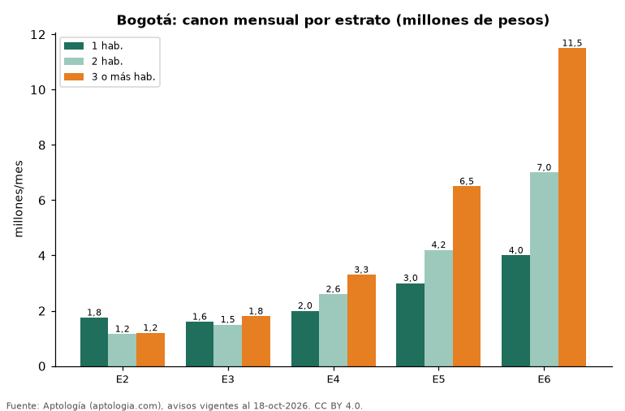

# Arriendo en Bogotá por estrato y número de habitaciones: cuánto cuesta cada combinación (octubre 2026)

**En Bogotá, arrendar un apartamento de 2 habitaciones cuesta en la mediana 1.156.454 pesos al mes en estrato 2 y 7.000.000 pesos en estrato 6, 6,1 veces más.** Por metro cuadrado, el canon va de 25.000 pesos a 59.259 pesos al mes según el estrato.

*Resumen: analizamos 13.081 apartamentos en arriendo en Bogotá con estrato y habitaciones declarados.*

**Actualizado:** 18 de octubre de 2026 (datos del 18 de octubre de 2026) · **Próxima actualización:** mensual.

## Resumen

| Indicador | Valor |
|---|---|
| 2 hab., estrato 2 | 1.156.454 pesos |
| 2 hab., estrato 6 | 7.000.000 pesos |
| Diferencia | 6,1 veces |
| Avisos | 13.081 |

## Canon mensual por estrato y habitaciones

| Estrato | 1 hab. (mediana) | 2 hab. (mediana) | 3 o más hab. (mediana) | Canon por m² | Avisos |
|---|---|---|---|---|---|
| 2 | 1.750.000 pesos | 1.156.454 pesos | 1.200.000 pesos | 25.000 pesos | 415 |
| 3 | 1.600.000 pesos | 1.500.000 pesos | 1.800.000 pesos | 34.286 pesos | 2.954 |
| 4 | 2.000.000 pesos | 2.600.000 pesos | 3.300.000 pesos | 46.250 pesos | 3.159 |
| 5 | 3.000.000 pesos | 4.200.000 pesos | 6.500.000 pesos | 53.090 pesos | 1.818 |
| 6 | 4.000.000 pesos | 7.000.000 pesos | 11.500.000 pesos | 59.259 pesos | 4.679 |

Medianas del canon pedido, sin administración; — indica menos de 30 avisos en la celda.

## Preguntas frecuentes

**¿Cuánto cuesta arrendar un apartamento de 2 habitaciones en Bogotá?**
Entre 1.156.454 pesos (estrato 2) y 7.000.000 pesos (estrato 6) al mes en la mediana, según avisos de octubre de 2026.

**¿Cuánto cuesta arrendar en estrato 3 en Bogotá?**
Un apartamento de 2 habitaciones en estrato 3 se pide en 1.500.000 pesos al mes.

## Metodología

- **Fuente:** exportes nocturnos de la base de datos de Aptología (aptologia.com) del 18 de octubre de 2026: avisos vigentes de vivienda en portales inmobiliarios de 13 países, recogidos por Aptología y vistos en línea entre el 11 y el 18 de octubre de 2026. Corte: 18 de octubre de 2026.
- **Depuración:** se eliminan duplicados exactos (misma ciudad, zona, tipo, precio, moneda, área, habitaciones y baños) y los precios fuera del percentil 1–99 de cada país, operación, moneda y tipo; el precio por m² usa solo avisos con área declarada entre 12 y 2.000 m² y también se recorta al P1–P99.
- **Qué se mide:** precios pedidos (publicados), no precios de cierre. En arriendo, el canon mensual sin administración, gastos comunes ni condominio.
- **Muestra mínima:** cada cifra publicada se apoya en al menos 30 avisos; las celdas con menos se omiten.
- **Colombia:** Precios en pesos colombianos, sin conversión de moneda.
- **Limitaciones:** la cobertura depende de los portales que recorre Aptología en cada país y es mayor en las ciudades grandes y en los segmentos medio-alto y alto; el área es la que declara el aviso, sin verificar; los nombres de zona vienen de los portales.
- **Privacidad:** solo se publican agregados; no se publica ningún dato personal, enlace a avisos ni nombre de anunciante.
- **Datos abiertos:** [datos.csv](datos.csv), licencia CC BY 4.0.

## Cómo citar

Pinzón Pineda, D. M. (2026). *Arriendo en Bogotá por estrato y número de habitaciones: cuánto cuesta cada combinación (octubre 2026)*. Aptología (aptologia.com). https://github.com/elbroker/aptologia-datos/tree/main/estudios/arriendo-por-estrato-y-habitaciones-bogota-2026. Datos: datos.csv, licencia CC BY 4.0.
