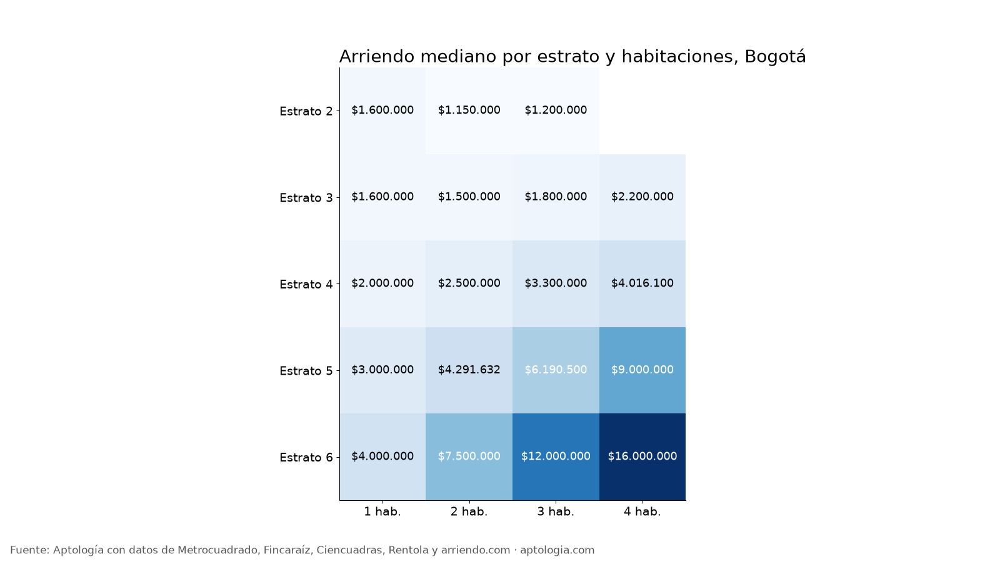

# Cuánto cuesta arrendar en Bogotá según estrato y número de habitaciones: tabla completa (2026)

**En Bogotá, un apartamento de 2 habitaciones cuesta en la mediana $1.500.000 en estrato 3, $2.500.000 en estrato 4 y $7.500.000 en estrato 6.** Pasar de 2 a 3 habitaciones en estrato 4 sube el canon de $2.500.000 a $3.300.000.

*Resumen: cruzamos estrato y habitaciones en 16.213 apartamentos en arriendo únicos en Bogotá.*

**Actualizado:** 13 de octubre de 2026 · **Próxima actualización:** mensual.

## Tabla completa

| Estrato | Habitaciones | Canon mediano | Rango típico (p25–p75) | Área mediana | Avisos |
|---|---|---|---|---|---|
| 2 | 1 | $1.600.000 | $900.000 – $2.200.000 | 36 m² | 61 |
| 2 | 2 | $1.150.000 | $950.000 – $1.400.000 | 45 m² | 334 |
| 2 | 3 | $1.200.000 | $950.000 – $1.400.000 | 50 m² | 148 |
| 3 | 1 | $1.600.000 | $1.400.000 – $1.950.000 | 31 m² | 1.088 |
| 3 | 2 | $1.500.000 | $1.350.000 – $1.791.250 | 45 m² | 1.814 |
| 3 | 3 | $1.800.000 | $1.406.000 – $2.300.000 | 62 m² | 709 |
| 3 | 4 | $2.200.000 | $1.900.000 – $3.050.000 | 90 m² | 43 |
| 4 | 1 | $2.000.000 | $1.700.000 – $2.550.000 | 36 m² | 1.531 |
| 4 | 2 | $2.500.000 | $1.900.000 – $3.300.000 | 56 m² | 1.270 |
| 4 | 3 | $3.300.000 | $2.600.000 – $4.030.000 | 80 m² | 1.033 |
| 4 | 4 | $4.016.100 | $3.500.000 – $5.000.000 | 116 m² | 78 |
| 5 | 1 | $3.000.000 | $2.500.000 – $3.707.500 | 48 m² | 683 |
| 5 | 2 | $4.291.632 | $3.287.500 – $5.711.250 | 78 m² | 632 |
| 5 | 3 | $6.190.500 | $4.368.275 – $9.000.000 | 125 m² | 702 |
| 5 | 4 | $9.000.000 | $5.700.000 – $13.900.000 | 200 m² | 123 |
| 6 | 1 | $4.000.000 | $3.200.000 – $5.500.000 | 56 m² | 1.178 |
| 6 | 2 | $7.500.000 | $5.300.000 – $9.900.000 | 101 m² | 1.558 |
| 6 | 3 | $12.000.000 | $8.500.000 – $16.500.000 | 200 m² | 2.613 |
| 6 | 4 | $16.000.000 | $11.997.500 – $21.554.000 | 317 m² | 611 |

**Cómo usarlo para decidir:** ubica tu presupuesto en la tabla. Si cae por debajo del p25 de la celda que buscas, baja un estrato o una habitación; si cae en el rango típico, tienes la mitad del mercado disponible.

## Preguntas frecuentes

**¿Cuánto cuesta un apartamento de 2 habitaciones en estrato 3 en Bogotá?**
La mediana es $1.500.000 al mes, corte al 13 de octubre de 2026.

**¿Cuánto cuesta un apartamento de 3 habitaciones en estrato 4?**
La mediana es $3.300.000 al mes.

**¿Cuánto cuesta un apartamento de 1 habitación en estrato 6?**
La mediana es $4.000.000 al mes.

## Metodología

- **Fuente:** base de ingesta diaria de Aptología, con avisos públicos de Metrocuadrado, Fincaraíz, Ciencuadras, Rentola y arriendo.com. Corte al 13 de octubre de 2026.
- **Filtros:** avisos vivos que pasan el control de calidad, en Bogotá, canon entre $400.000 y $30.000.000. Se excluyen TikTok y Facebook Marketplace.
- **Duplicados:** se deja un aviso por grupo de duplicados (el mismo inmueble en varios portales).
- **Celdas:** estrato 2 a 6 × 1 a 4 habitaciones, solo celdas con 15 avisos o más.
- **Limitaciones:** son precios pedidos, no cerrados. Los barrios y localidades vienen tal como los escribe cada portal.
- **Datos abiertos:** [datos.csv](datos.csv), licencia CC BY 4.0.

## Cómo citar

Pinzón Pineda, D. M. (2026). *Cuánto cuesta arrendar en Bogotá según estrato y número de habitaciones: tabla completa (2026)*. Aptología. https://www.aptologia.com/estudios/arriendo-por-estrato-y-habitaciones-bogota. Datos: datos.csv, licencia CC BY 4.0.
