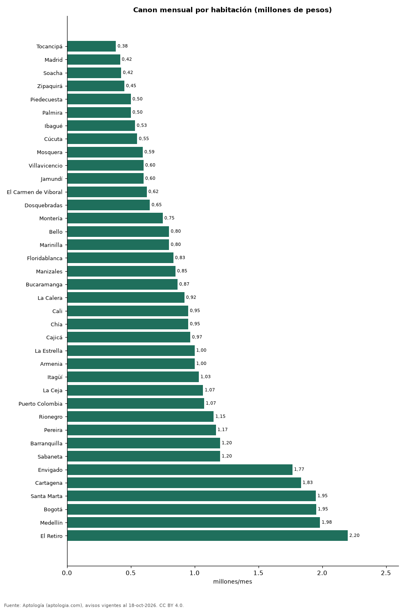

# Cuánto cuesta cada habitación: arriendo por alcoba en las ciudades de Colombia (octubre 2026)

**Cada habitación de un apartamento en arriendo cuesta en la mediana 383.333 pesos al mes en Tocancipá y 2.200.000 pesos en El Retiro.** En Bogotá son 1.953.167 pesos por habitación. En el país, la habitación sale más cara en los de 1 alcoba (2.850.000 pesos) que en los de 3 o más (1.333.333 pesos).

*Resumen: dividimos el canon de 65.742 apartamentos en arriendo por su número de habitaciones.*

**Actualizado:** 18 de octubre de 2026 (datos del 18 de octubre de 2026) · **Próxima actualización:** mensual.

## Resumen

| Indicador | Valor |
|---|---|
| Más barata | Tocancipá: 383.333 pesos |
| Más cara | El Retiro: 2.200.000 pesos |
| Bogotá | 1.953.167 pesos |
| 3 o más habitaciones (Colombia) | 1.333.333 pesos |

## Ciudades

| Ciudad | Canon por habitación (mediana) | Avisos |
|---|---|---|
| Tocancipá | 383.333 pesos | 99 |
| Madrid | 416.167 pesos | 274 |
| Soacha | 425.000 pesos | 145 |
| Zipaquirá | 450.000 pesos | 176 |
| Piedecuesta | 500.000 pesos | 66 |
| Palmira | 500.000 pesos | 48 |
| Ibagué | 533.333 pesos | 264 |
| Cúcuta | 550.000 pesos | 396 |
| Mosquera | 593.333 pesos | 167 |
| Villavicencio | 600.000 pesos | 77 |
| Jamundí | 600.000 pesos | 118 |
| El Carmen de Viboral | 625.000 pesos | 105 |
| Dosquebradas | 650.000 pesos | 68 |
| Montería | 750.000 pesos | 58 |
| Bello | 800.000 pesos | 1.089 |
| Marinilla | 800.000 pesos | 109 |
| Floridablanca | 833.333 pesos | 367 |
| Manizales | 850.000 pesos | 288 |
| Bucaramanga | 866.667 pesos | 436 |
| La Calera | 920.000 pesos | 51 |
| Cali | 950.000 pesos | 1.610 |
| Chía | 950.000 pesos | 492 |
| Cajicá | 966.667 pesos | 386 |
| La Estrella | 1.000.000 pesos | 486 |
| Armenia | 1.000.000 pesos | 339 |
| Itagüí | 1.033.333 pesos | 907 |
| La Ceja | 1.066.667 pesos | 353 |
| Puerto Colombia | 1.075.000 pesos | 91 |
| Rionegro | 1.150.000 pesos | 3.191 |
| Pereira | 1.166.667 pesos | 1.558 |
| Barranquilla | 1.200.000 pesos | 3.817 |
| Sabaneta | 1.200.000 pesos | 3.884 |
| Envigado | 1.766.667 pesos | 7.339 |
| Cartagena | 1.833.333 pesos | 2.031 |
| Santa Marta | 1.950.000 pesos | 679 |
| Bogotá | 1.953.167 pesos | 13.240 |
| Medellín | 1.983.333 pesos | 20.377 |
| El Retiro | 2.200.000 pesos | 542 |

Mediana del canon ÷ número de habitaciones de cada aviso.

## Preguntas frecuentes

**¿Cuánto cuesta una habitación de un apartamento en Bogotá?**
1.953.167 pesos al mes en la mediana (canon ÷ habitaciones).

**¿Sale más barato por habitación un apartamento grande?**
Sí: 1.333.333 pesos por habitación en los de 3 o más, frente a 2.850.000 pesos en los de 1.

## Metodología

- **Fuente:** exportes nocturnos de la base de datos de Aptología (aptologia.com) del 18 de octubre de 2026: avisos vigentes de vivienda en portales inmobiliarios de 13 países, recogidos por Aptología y vistos en línea entre el 11 y el 18 de octubre de 2026. Corte: 18 de octubre de 2026.
- **Depuración:** se eliminan duplicados exactos (misma ciudad, zona, tipo, precio, moneda, área, habitaciones y baños) y los precios fuera del percentil 1–99 de cada país, operación, moneda y tipo; el precio por m² usa solo avisos con área declarada entre 12 y 2.000 m² y también se recorta al P1–P99.
- **Qué se mide:** precios pedidos (publicados), no precios de cierre. En arriendo, el canon mensual sin administración, gastos comunes ni condominio.
- **Muestra mínima:** cada cifra publicada se apoya en al menos 30 avisos; las celdas con menos se omiten.
- **Colombia:** Precios en pesos colombianos, sin conversión de moneda.
- **Limitaciones:** la cobertura depende de los portales que recorre Aptología en cada país y es mayor en las ciudades grandes y en los segmentos medio-alto y alto; el área es la que declara el aviso, sin verificar; los nombres de zona vienen de los portales.
- **Privacidad:** solo se publican agregados; no se publica ningún dato personal, enlace a avisos ni nombre de anunciante.
- **Datos abiertos:** [datos.csv](datos.csv), licencia CC BY 4.0.

## Cómo citar

Pinzón Pineda, D. M. (2026). *Cuánto cuesta cada habitación: arriendo por alcoba en las ciudades de Colombia (octubre 2026)*. Aptología (aptologia.com). https://github.com/elbroker/aptologia-datos/tree/main/estudios/arriendo-por-habitacion-ciudades-colombia-2026. Datos: datos.csv, licencia CC BY 4.0.
