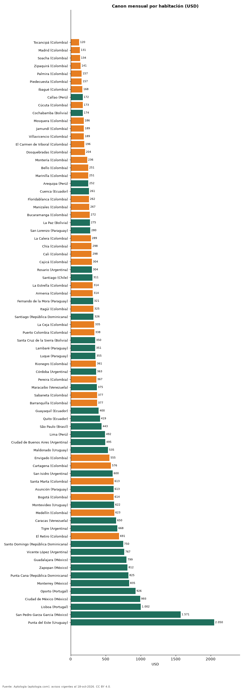

# Cuánto cuesta cada habitación: arriendo por alcoba en dólares en 75 ciudades de Latinoamérica y Portugal (octubre 2026)

**Cada habitación de un apartamento en arriendo cuesta en la mediana USD 120 al mes en Tocancipá (Colombia), la ciudad más barata, y USD 2.050 en Punta del Este (Uruguay), la más cara.** En Bogotá son USD 614 por habitación.

*Resumen: dividimos el canon en dólares de 123.392 apartamentos en arriendo por su número de habitaciones.*

**Actualizado:** 18 de octubre de 2026 (datos del 18 de octubre de 2026) · **Próxima actualización:** mensual.

## Resumen

| Indicador | Valor |
|---|---|
| Más barata | Tocancipá: USD 120 |
| Más cara | Punta del Este: USD 2.050 |
| Bogotá | USD 614 |

## Ciudades de menor a mayor

| País | Ciudad | USD por habitación al mes | Avisos |
|---|---|---|---|
| Colombia | Tocancipá | 120 | 99 |
| Colombia | Madrid | 131 | 274 |
| Colombia | Soacha | 134 | 145 |
| Colombia | Zipaquirá | 141 | 176 |
| Colombia | Palmira | 157 | 48 |
| Colombia | Piedecuesta | 157 | 66 |
| Colombia | Ibagué | 168 | 264 |
| Perú | Callao | 172 | 32 |
| Colombia | Cúcuta | 173 | 396 |
| Bolivia | Cochabamba | 174 | 96 |
| Colombia | Mosquera | 186 | 167 |
| Colombia | Jamundí | 189 | 118 |
| Colombia | Villavicencio | 189 | 77 |
| Colombia | El Carmen de Viboral | 196 | 105 |
| Colombia | Dosquebradas | 204 | 68 |
| Colombia | Montería | 236 | 58 |
| Colombia | Bello | 251 | 1.089 |
| Colombia | Marinilla | 251 | 109 |
| Perú | Arequipa | 252 | 46 |
| Ecuador | Cuenca | 261 | 210 |
| Colombia | Floridablanca | 262 | 367 |
| Colombia | Manizales | 267 | 288 |
| Colombia | Bucaramanga | 272 | 436 |
| Bolivia | La Paz | 275 | 308 |
| Paraguay | San Lorenzo | 280 | 36 |
| Colombia | La Calera | 289 | 51 |
| Colombia | Chía | 298 | 492 |
| Colombia | Cali | 298 | 1.610 |
| Colombia | Cajicá | 304 | 386 |
| Argentina | Rosario | 304 | 143 |
| Chile | Santiago | 311 | 8.583 |
| Colombia | La Estrella | 314 | 486 |
| Colombia | Armenia | 314 | 339 |
| Paraguay | Fernando de la Mora | 321 | 71 |
| Colombia | Itagüí | 325 | 907 |
| República Dominicana | Santiago | 326 | 137 |
| Colombia | La Ceja | 335 | 353 |
| Colombia | Puerto Colombia | 338 | 91 |
| Bolivia | Santa Cruz de la Sierra | 350 | 1.059 |
| Paraguay | Lambaré | 351 | 41 |
| Paraguay | Luque | 355 | 94 |
| Colombia | Rionegro | 361 | 3.191 |
| Argentina | Córdoba | 363 | 244 |
| Colombia | Pereira | 367 | 1.558 |
| Venezuela | Maracaibo | 375 | 41 |
| Colombia | Sabaneta | 377 | 3.884 |
| Colombia | Barranquilla | 377 | 3.817 |
| Ecuador | Guayaquil | 400 | 1.321 |
| Ecuador | Quito | 419 | 1.262 |
| Brasil | São Paulo | 443 | 10.876 |
| Perú | Lima | 492 | 4.177 |
| Argentina | Ciudad de Buenos Aires | 495 | 3.830 |
| Uruguay | Maldonado | 535 | 38 |
| Colombia | Envigado | 555 | 7.339 |
| Colombia | Cartagena | 576 | 2.031 |
| Argentina | San Isidro | 600 | 140 |
| Colombia | Santa Marta | 613 | 679 |
| Paraguay | Asunción | 613 | 4.256 |
| Colombia | Bogotá | 614 | 13.240 |
| Uruguay | Montevideo | 622 | 3.877 |
| Colombia | Medellín | 623 | 20.377 |
| Venezuela | Caracas | 650 | 329 |
| Argentina | Tigre | 668 | 140 |
| Colombia | El Retiro | 691 | 542 |
| República Dominicana | Santo Domingo | 750 | 3.936 |
| Argentina | Vicente López | 767 | 157 |
| México | Guadalajara | 799 | 828 |
| México | Zapopan | 812 | 841 |
| República Dominicana | Punta Cana | 825 | 112 |
| México | Monterrey | 835 | 1.780 |
| Portugal | Oporto | 926 | 82 |
| México | Ciudad de México | 993 | 4.850 |
| Portugal | Lisboa | 1.002 | 500 |
| México | San Pedro Garza Garcia | 1.571 | 650 |
| Uruguay | Punta del Este | 2.050 | 2.513 |

Mediana de canon ÷ habitaciones de cada aviso, convertida a dólares.

## Preguntas frecuentes

**¿Cuánto cuesta una habitación en Latinoamérica?**
Entre USD 120 (Tocancipá) y USD 2.050 (Punta del Este) al mes, como fracción del canon de un apartamento.

## Metodología

- **Fuente:** exportes nocturnos de la base de datos de Aptología (aptologia.com) del 18 de octubre de 2026: avisos vigentes de vivienda en portales inmobiliarios de 13 países, recogidos por Aptología y vistos en línea entre el 11 y el 18 de octubre de 2026. Corte: 18 de octubre de 2026.
- **Depuración:** se eliminan duplicados exactos (misma ciudad, zona, tipo, precio, moneda, área, habitaciones y baños) y los precios fuera del percentil 1–99 de cada país, operación, moneda y tipo; el precio por m² usa solo avisos con área declarada entre 12 y 2.000 m² y también se recorta al P1–P99.
- **Qué se mide:** precios pedidos (publicados), no precios de cierre. En arriendo, el canon mensual sin administración, gastos comunes ni condominio.
- **Muestra mínima:** cada cifra publicada se apoya en al menos 30 avisos; las celdas con menos se omiten.
- **Monedas:** nunca se mezclan avisos de monedas distintas sin convertirlos. Conversión a dólares con la tasa de mercado de ExchangeRate-API (open.er-api.com, actualización del 18 Oct 2026): 1 USD = 3.182,80 COP, 1 USD = 18,47 M.N, 1 USD = 5,09 BRL, 1 USD = 3,44 PEN, 1 USD = 982,44 CLP, 1 USD = 1.514,57 ARS, 1 USD = 40,20 UYU, 1 USD = 5.705,37 PYG, 1 USD = 61,27 DOP, 1 USD = 0,89 EUR, 1 USD = 11,72 BOB; la UF chilena a 41.178,64 CLP (mindicador,cl. 18-oct-2026). Los avisos publicados en dólares se usan tal cual.
- **Limitaciones:** la cobertura depende de los portales que recorre Aptología en cada país y es mayor en las ciudades grandes y en los segmentos medio-alto y alto; el área es la que declara el aviso, sin verificar; los nombres de zona vienen de los portales.
- **Privacidad:** solo se publican agregados; no se publica ningún dato personal, enlace a avisos ni nombre de anunciante.
- **Datos abiertos:** [datos.csv](datos.csv), licencia CC BY 4.0.

## Cómo citar

Pinzón Pineda, D. M. (2026). *Cuánto cuesta cada habitación: arriendo por alcoba en dólares en 75 ciudades de Latinoamérica y Portugal (octubre 2026)*. Aptología (aptologia.com). https://github.com/elbroker/aptologia-datos/tree/main/estudios/arriendo-por-habitacion-ciudades-latinoamerica-2026. Datos: datos.csv, licencia CC BY 4.0.
