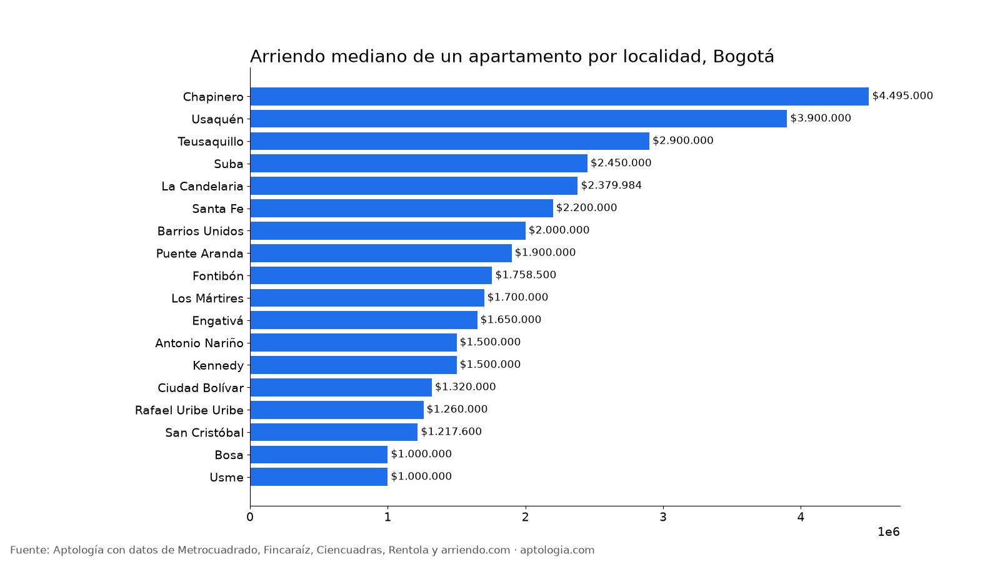
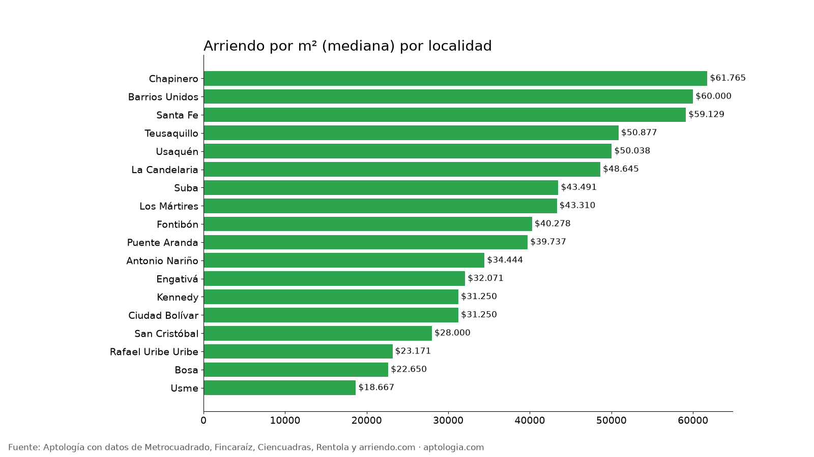

# Arriendo en Bogotá por localidad: precio mediano, por m² y de 2 habitaciones (octubre 2026)

**El arriendo mediano de un apartamento en Bogotá va de $1.000.000 en Usme a $4.495.000 en Chapinero: 4,5 veces más.** Un 2 habitaciones cuesta en la mediana $1.443.500 en Kennedy, $1.850.000 en Suba y $4.610.000 en Chapinero.

*Resumen: comparamos 5.808 apartamentos en arriendo únicos con localidad identificada, en 18 localidades de Bogotá.*

**Actualizado:** 13 de octubre de 2026 · **Próxima actualización:** mensual.

## Arriendo por localidad

| Localidad | Canon mediano | 2 habitaciones | Por m² | Área mediana | Avisos |
|---|---|---|---|---|---|
| Chapinero | $4.495.000 | $4.610.000 | $61.765/m² | 70 m² | 952 |
| Usaquén | $3.900.000 | $3.389.250 | $50.038/m² | 76 m² | 1.757 |
| Teusaquillo | $2.900.000 | $3.100.000 | $50.877/m² | 55 m² | 307 |
| Suba | $2.450.000 | $1.850.000 | $43.491/m² | 57 m² | 846 |
| La Candelaria | $2.379.984 | $2.250.000 | $48.645/m² | 39 m² | 40 |
| Santa Fe | $2.200.000 | $2.700.000 | $59.129/m² | 39 m² | 305 |
| Barrios Unidos | $2.000.000 | $2.375.000 | $60.000/m² | 39 m² | 303 |
| Puente Aranda | $1.900.000 | $1.800.000 | $39.737/m² | 51 m² | 196 |
| Fontibón | $1.758.500 | $1.600.000 | $40.278/m² | 45 m² | 262 |
| Los Mártires | $1.700.000 | $1.598.620 | $43.310/m² | 39 m² | 115 |
| Engativá | $1.650.000 | $1.500.000 | $32.071/m² | 54 m² | 96 |
| Antonio Nariño | $1.500.000 | $1.490.000 | $34.444/m² | 50 m² | 57 |
| Kennedy | $1.500.000 | $1.443.500 | $31.250/m² | 50 m² | 287 |
| Ciudad Bolívar | $1.320.000 | $1.300.000 | $31.250/m² | 42 m² | 60 |
| Rafael Uribe Uribe | $1.260.000 | $1.110.000 | $23.171/m² | 54 m² | 53 |
| San Cristóbal | $1.217.600 | $1.217.600 | $28.000/m² | 45 m² | 35 |
| Bosa | $1.000.000 | $1.000.000 | $22.650/m² | 46 m² | 82 |
| Usme | $1.000.000 | $1.000.000 | $18.667/m² | 47 m² | 55 |

**Cómo usarlo para decidir:** compara por m² y no solo por canon. Las localidades del norte tienen apartamentos más grandes; el m² muestra cuánto pagas realmente por espacio.

## Preguntas frecuentes

**¿Cuál es la localidad más cara para arrendar en Bogotá?**
Chapinero, con un canon mediano de $4.495.000 al mes (952 avisos, corte al 13 de octubre de 2026).

**¿Cuál es la localidad más barata para arrendar en Bogotá?**
Entre las localidades con al menos 20 avisos, Usme, con $1.000.000 al mes.

**¿Cuánto cuesta arrendar un apartamento en Suba?**
La mediana es $2.450.000 al mes.

## Metodología

- **Fuente:** base de ingesta diaria de Aptología, con avisos públicos de Metrocuadrado, Fincaraíz, Ciencuadras, Rentola y arriendo.com. Corte al 13 de octubre de 2026.
- **Filtros:** avisos vivos que pasan el control de calidad, en Bogotá, canon entre $400.000 y $30.000.000. Se excluyen TikTok y Facebook Marketplace.
- **Duplicados:** se deja un aviso por grupo de duplicados (el mismo inmueble en varios portales).
- **Localidad:** se normalizan los nombres a las 20 localidades oficiales; se descartan zonas genéricas ("Norte", "Occidental"). Solo localidades con 20 avisos o más.
- **Limitaciones:** son precios pedidos, no cerrados. Los barrios y localidades vienen tal como los escribe cada portal.
- **Datos abiertos:** [datos.csv](datos.csv), licencia CC BY 4.0.

## Cómo citar

Pinzón Pineda, D. M. (2026). *Arriendo en Bogotá por localidad: precio mediano, por m² y de 2 habitaciones (octubre 2026)*. Aptología. https://www.aptologia.com/estudios/arriendo-por-localidad-bogota. Datos: datos.csv, licencia CC BY 4.0.
