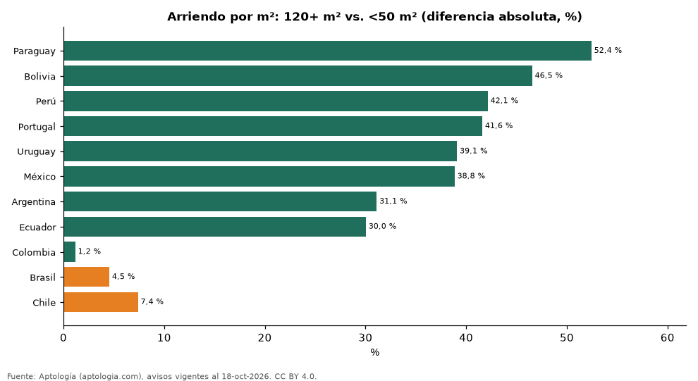

# ¿Se paga más arriendo por metro cuadrado en un apartamento pequeño? Canon por m² según el tamaño en 11 países (octubre 2026)

**En Paraguay el arriendo por m² de un apartamento de 120 m² o más es 52,4 % menor que el de uno de menos de 50 m², la mayor diferencia de 11 países; en Colombia, -1,2 %.** En 9 de 11 países el inquilino de un apartamento pequeño paga más por cada metro cuadrado.

*Resumen: comparamos el canon por m² de 107.528 apartamentos en arriendo en cinco tramos de área, dentro de cada país y en su moneda.*

**Actualizado:** 18 de octubre de 2026 (datos del 18 de octubre de 2026) · **Próxima actualización:** mensual.

## Resumen

| Indicador | Valor |
|---|---|
| Paraguay | -52,4 % |
| Bolivia | -46,5 % |
| Perú | -42,1 % |
| Portugal | -41,6 % |
| Uruguay | -39,1 % |
| México | -38,8 % |
| Argentina | -31,1 % |
| Ecuador | -30,0 % |
| Colombia | -1,2 % |
| Brasil | +4,5 % |
| Chile | +7,4 % |

## Arriendo por m² frente al tramo de menos de 50 m²

| País | 50 a 69 m² vs. <50 m² | 70 a 89 m² vs. <50 m² | 90 a 119 m² vs. <50 m² | 120 m² o más vs. <50 m² |
|---|---|---|---|---|
| Paraguay | -18,9 % | -22,3 % | -30,6 % | -52,4 % |
| Bolivia | -19,8 % | -24,5 % | -35,7 % | -46,5 % |
| Perú | -25,1 % | -39,1 % | -42,2 % | -42,1 % |
| Portugal | -22,8 % | -36,0 % | -35,4 % | -41,6 % |
| Uruguay | -17,0 % | -26,0 % | -32,5 % | -39,1 % |
| México | -25,0 % | -31,4 % | -34,7 % | -38,8 % |
| Argentina | -7,7 % | -12,1 % | -18,6 % | -31,1 % |
| Ecuador | -7,9 % | -6,1 % | -12,2 % | -30,0 % |
| Colombia | -14,5 % | -3,2 % | -0,9 % | -1,2 % |
| Brasil | -15,5 % | +0,3 % | +7,6 % | +4,5 % |
| Chile | -14,3 % | -10,5 % | +16,6 % | +7,4 % |

Diferencia porcentual de la mediana del canon por m² de cada tramo frente al de menos de 50 m², en la moneda mayoritaria del país (sin convertir).

## Preguntas frecuentes

**¿Es más caro el arriendo por m² de un apartamento pequeño?**
Sí en 9 de 11 países: el m² de los apartamentos grandes se arrienda más barato.

**¿Y en Colombia?**
Un apartamento de 120 m² o más se arrienda -1,2 % por m² frente a uno de menos de 50 m².

## Metodología

- **Fuente:** exportes nocturnos de la base de datos de Aptología (aptologia.com) del 18 de octubre de 2026: avisos vigentes de vivienda en portales inmobiliarios de 13 países, recogidos por Aptología y vistos en línea entre el 11 y el 18 de octubre de 2026. Corte: 18 de octubre de 2026.
- **Depuración:** se eliminan duplicados exactos (misma ciudad, zona, tipo, precio, moneda, área, habitaciones y baños) y los precios fuera del percentil 1–99 de cada país, operación, moneda y tipo; el precio por m² usa solo avisos con área declarada entre 12 y 2.000 m² y también se recorta al P1–P99.
- **Qué se mide:** precios pedidos (publicados), no precios de cierre. En arriendo, el canon mensual sin administración, gastos comunes ni condominio.
- **Muestra mínima:** cada cifra publicada se apoya en al menos 30 avisos; las celdas con menos se omiten.
- **Monedas:** cada país se analiza en su moneda mayoritaria de arriendo; la comparación es en porcentaje dentro de cada país, sin convertir ni mezclar monedas.
- **Limitaciones:** la cobertura depende de los portales que recorre Aptología en cada país y es mayor en las ciudades grandes y en los segmentos medio-alto y alto; el área es la que declara el aviso, sin verificar; los nombres de zona vienen de los portales.
- **Privacidad:** solo se publican agregados; no se publica ningún dato personal, enlace a avisos ni nombre de anunciante.
- **Datos abiertos:** [datos.csv](datos.csv), licencia CC BY 4.0.

## Cómo citar

Pinzón Pineda, D. M. (2026). *¿Se paga más arriendo por metro cuadrado en un apartamento pequeño? Canon por m² según el tamaño en 11 países (octubre 2026)*. Aptología (aptologia.com). https://github.com/elbroker/aptologia-datos/tree/main/estudios/arriendo-por-m2-segun-tamano-del-apartamento-latinoamerica-2026. Datos: datos.csv, licencia CC BY 4.0.
